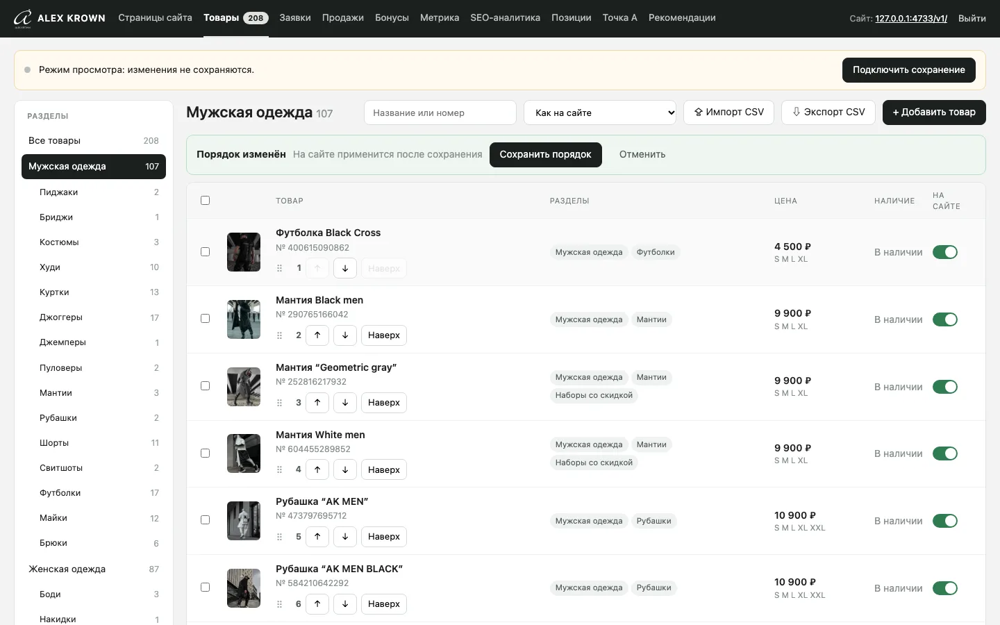
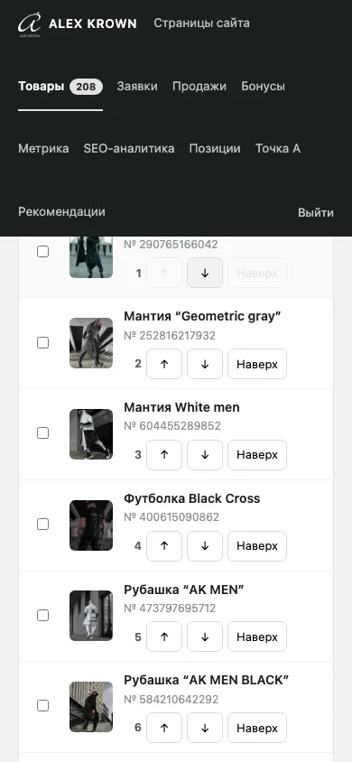

# ALEX KROWN: порядок товаров в админке готов, но на стенде я сломал сайт и восстановил его с потерями

Перетаскивание и кнопки ↑ ↓ «Наверх» работают в админке на Pages. На crown.deford.ru функцию выложить нельзя, и при попытке я затёр сайт стенда. Он восстановлен, но двух картинок и одной правки нет.

## Что сделано: порядок товаров в разделе

- Открываешь раздел, например «Мужская одежда», при сортировке «Как на сайте».
- На компьютере – тянешь строку мышью. На телефоне – кнопки ↑ ↓ «Наверх».
- Появляется зелёная полоса «Порядок изменён» с кнопкой «Сохранить порядок». Одно нажатие – один коммит, сайт обновляется за 1–2 минуты.
- «Отменить» возвращает как было. Если уйти в другой раздел, не сохранив, админка переспросит.
- Проверено в браузере на 1440 и 390 px: наверх, вниз, перетаскивание, отмена; редактор товара от кнопок не открывается, горизонтальной прокрутки нет.

Где смотреть: https://tema-mail.github.io/alex-krown/v1/admin/products/ (вход тот же, сохранение – кнопка «Подключить сохранение»).

## Что сломал на crown.deford.ru и как вернул

- С 17.11 сайт на стенде кто-то правит руками прямо на сервере: адреса без /v1/, свои правки, свои бэкапы. В репозитории этого нет.
- Я выложил туда сборку из репозитория с удалением лишнего – она затёрла их сайт. Разделы, админка и кабинет отдавали 404 примерно 15 минут.
- Восстановил из их же бэкапов на сервере (состояние 18.11 10:00) плюс картинки из сборки. 505 страниц отвечают, все файлы на месте, кроме двух.
- Потеряно: правка «плавающий виджет» от 18.11, картинки карты на «Контактах» и стельки в таблице размеров, любые ручные правки после 18.11 10:00.
- Чтобы не повторилось: выкладка deploy.sh теперь сама останавливается, если на стенде корневая раскладка.

## Решение 19.11: стенд правим руками, git – копия

- Копия стенда как есть – в приватном репо tema-mail/alex-krown-stend (3058 файлов). Свежий снимок – `./snimok.sh`, он только читает сервер.
- В публичный репо сайта копию не клал: стенд за паролем, там он стал бы открытым.
- Регламент совместной работы над проектами – в инбоксе Евы, пока не общее правило.

## Где кнопки ↑ ↓ «Наверх»

- Сейчас – только в админке на Pages: https://tema-mail.github.io/alex-krown/v1/admin/products/
- Товары → «Все товары» (порядок общего каталога /catalog/) или любой раздел → сортировка «Как на сайте» → кнопки под названием каждого товара.
- С 19.11 17:10 порядок задаётся и во «Все товары»: проверено на 208 товарах, компьютер и телефон.
- На crown.deford.ru их нет: там админка стенда, которую правят руками. Её кнопка сохранения пишет в репо, а стенд из репо не собирается – порядок на стенде не поменялся бы.

## Почему на стенде не всё вернулось

- Восстановил всё, что было на сервере: 505 страниц, все файлы, кроме двух картинок. Повторная проверка 19.11 17:00 в браузере – в консоли только нет карты на «Контактах» (и 401 кабинета без входа – так и должно быть).
- Новее 18.11 10:00 на сервере нет ни одной копии: искал по всему серверу. Плавающий виджет, карта на «Контактах» и стелька в таблице размеров есть только у того, кто их делал.

## Нужно от тебя

- Кто правит стенд руками – скорее всего сотрудник с доступом до 17.12. Попроси его вернуть плавающий виджет и две картинки и сказать, откуда он собирает сайт.
- Решить, кто ведёт стенд: репозиторий или ручные правки. Пока не решено, порядок товаров на crown.deford.ru не выложить – админка сохраняет в репозиторий, а стенд из него не собирается.
- Для автообновления стенда после «Сохранить» нужен ключ GitHub с правом только копировать файлы в папку сайта. Скажи «да» – поставлю, когда стенд снова будет из репозитория.

## Что раскрыть

- Как устроено сохранение порядка (что именно меняется в sections.json).
- Список всех восстановленных и потерянных файлов стенда.
- Как сделать автовыкладку на стенд после сохранения в админке.
