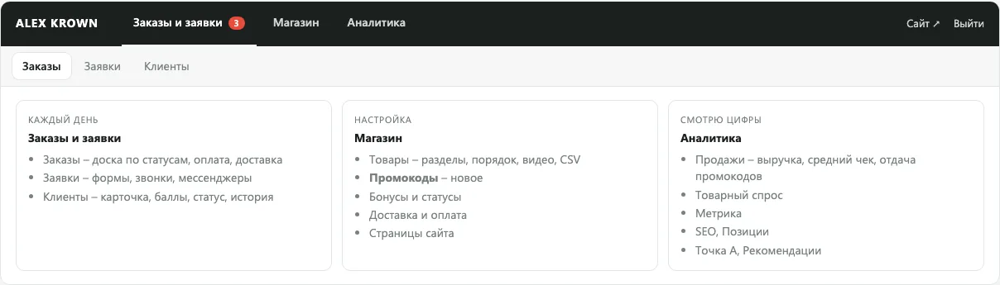
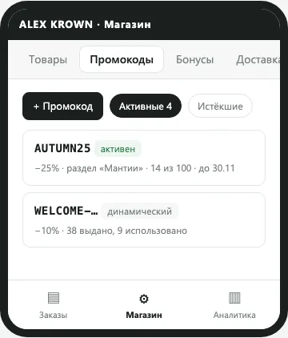
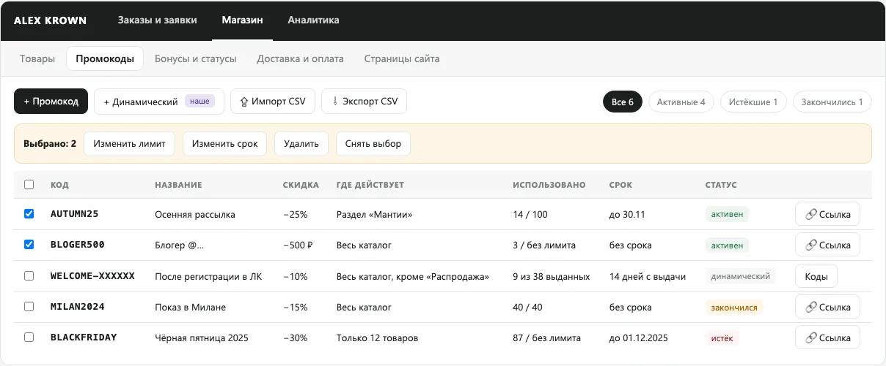
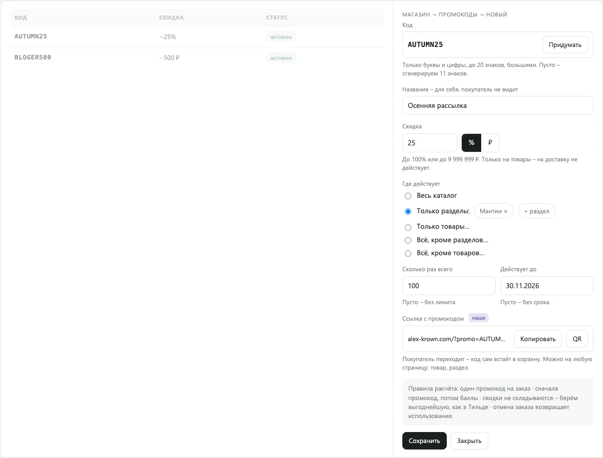
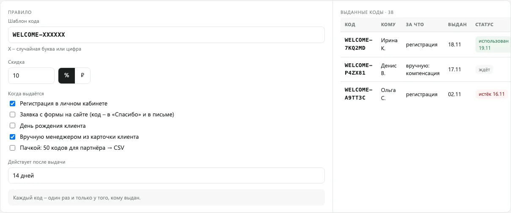
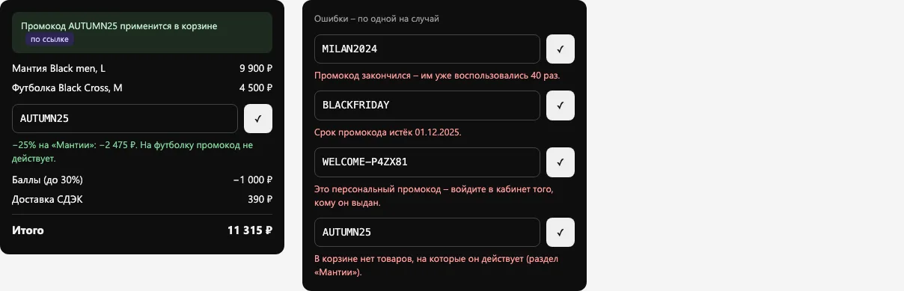

# Промокоды как в Тильде и три вкладки вместо десяти – макеты для решения

Предлагаю: сверху админки три вкладки – «Заказы и заявки», «Магазин», «Аналитика»; промокоды – раздел в «Магазине», с полями Тильды плюс ссылка и динамические коды. Ничего не собрано – это эскизы.

Живой макет целиком (открывается и на телефоне): [maket.html](maket.html)

## 1. Вкладки: делим по смыслу, а не по истории

- Сейчас в одной строке десять пунктов вперемешку: работа, настройки и цифры.
- **Заказы и заявки** – что делаешь каждый день: заказы, заявки, клиенты.
- **Магазин** – что настраиваешь: товары, промокоды, бонусы и статусы, доставка и оплата, страницы сайта.
- **Аналитика** – что смотришь: продажи, товарный спрос, Метрика, SEO, позиции, Точка А, рекомендации.
- На телефоне три вкладки внизу (таб-бар), разделы – полоской сверху.

## 2. Промокоды: всё, что есть в Тильде

- Код – буквы и цифры до 20 знаков; пусто – придумаем сами.
- Скидка процентом (до 100%) или рублями; только на товары, не на доставку.
- Где действует: весь каталог, только разделы, только товары, всё кроме разделов, всё кроме товаров.
- Лимит использований всего и срок действия; пусто – без ограничений.
- Список со статусами «активен / закончился / истёк», массовая правка лимита и срока галочками, импорт и экспорт CSV.
- Источник – описание магазина Тильды через её подключение, 19.11.2026. У ALEX KROWN в Тильде сейчас промокодов нет.

## 3. Наше сверху: ссылка и динамические коды

- В справке Тильды ни промокода по ссылке, ни динамических кодов я не нашёл – добавляю по твоим словам, на макете помечено «наше».
- **Ссылка:** у каждого промокода кнопка «Ссылка» и QR – покупатель переходит, код сам встаёт в корзину.
- **Динамический:** правило «шаблон + скидка + срок», каждому свой одноразовый код. Выдаётся за регистрацию в кабинете, заявку с формы, день рождения, вручную менеджером или пачкой для партнёра.
- В движке магазинов (shop-modules) это уже заложено: публичный, одноразовый и персональный код, выдача клиенту с причиной.

## 4. Что видит покупатель

- Пришёл по ссылке – полоса «промокод применится в корзине».
- Скидка расписана: на какие товары подействовал, на какие нет.
- Сначала промокод, потом баллы; один промокод на заказ; ошибки прямым текстом – закончился, истёк, персональный, не на эти товары.

## Нужно от тебя

- Три вкладки и их названия – так или поправить.
- Динамический промокод: за что выдаём из пяти вариантов.
- Где делаем первым: ALEX KROWN или сразу в общем движке магазинов, чтобы получили все.

## Что раскрыть

- Как промокод складывается с баллами и бонусной программой.
- Что попадает в «Аналитика → Продажи»: отдача каждого промокода.
- Как это лечь в эталон кабинетов для всех магазинов.
