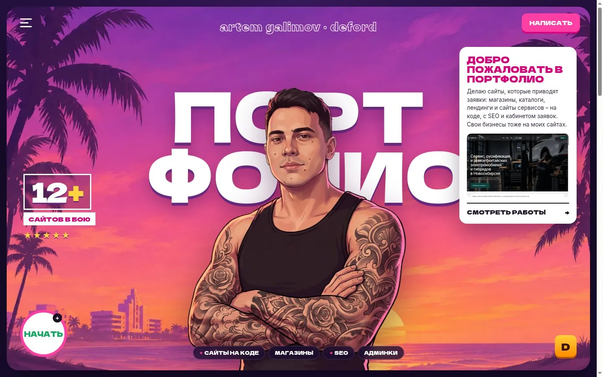
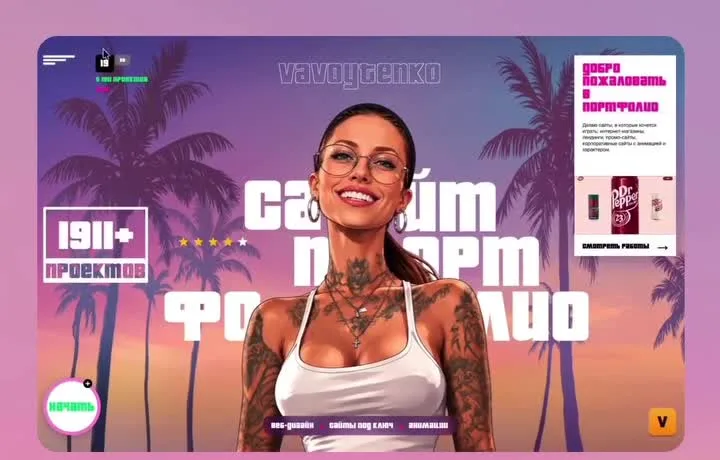
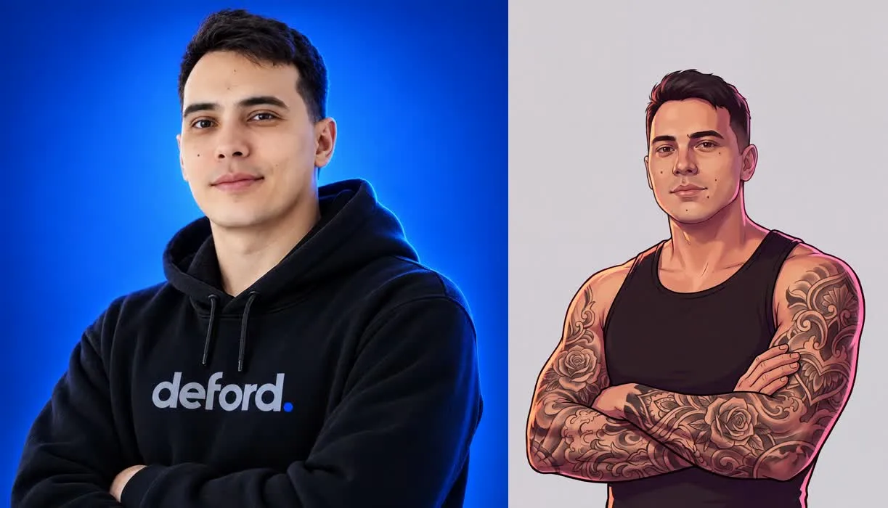
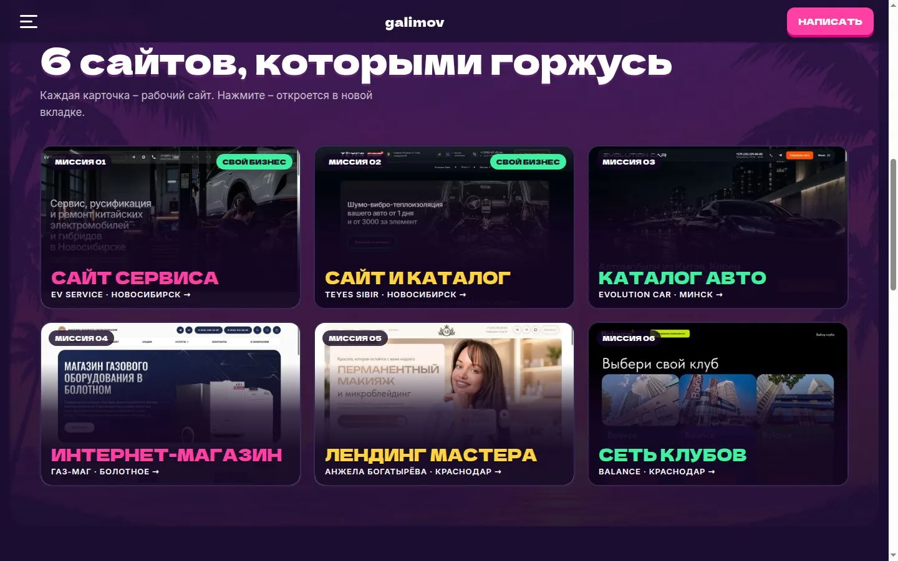
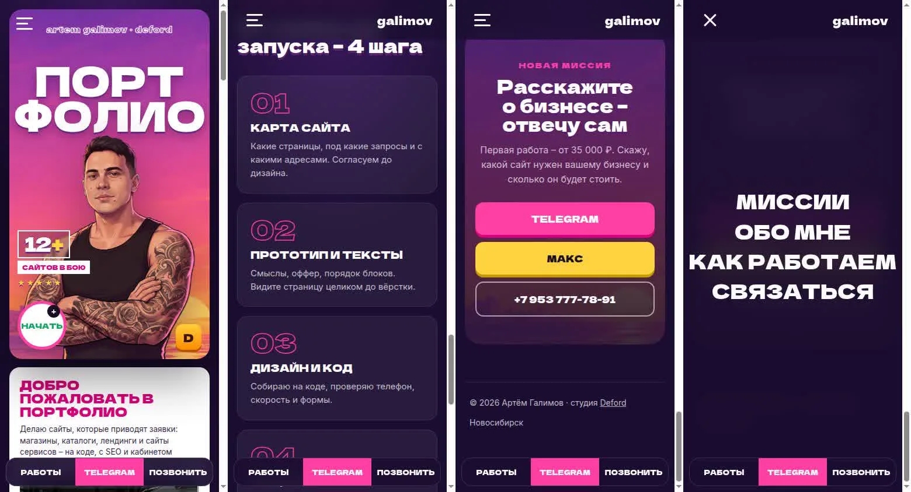

# Твой сайт-портфолио в стиле рилса готов: tema-mail.github.io/artem-portfolio

Сделан по рилсу vavoytenko: заставка с именем, закат с пальмами, рисованный ты в майке с татуировками, работы – «миссии». Сейчас это стенд: в поиск закрыт, ждёт твоего «да».

**Открыть:** [tema-mail.github.io/artem-portfolio](https://tema-mail.github.io/artem-portfolio/)

## Сделано как в рилсе, но с тобой и нашими работами

| В рилсе | У нас |
|---|---|
| Заставка «vavoytenko» на чёрном | «ARTEM GALIMOV» – один раз на устройство, дальше сразу сайт |
| Рисованная девушка в майке с тату | Ты: майка, плечи, бицепс, рукава татуировок |
| Счётчик «1911+ проектов» и звёзды | «12+ сайтов в бою» – столько наших сайтов сейчас живые |
| Карточка «Добро пожаловать» | То же + что делаем и что свои бизнесы на наших сайтах |
| «Миссии» – работы | 6 работ, как ты сказал: EV Service, TEYES Sibir, Evolution Car, Газ-маг, Анжела Богатырёва, Balance |

Ниже первого экрана: работы, «обо мне», 4 шага работы, контакты (Telegram, Макс, телефон, вход от 35 000 ₽). На телефоне – нижняя панель «Работы / Telegram / Позвонить».

## Портрет: лицо твоё, стиль – рисованный

Нарисован Segmind по фото в худи deford. Пробовал 5 вызовов: два мультяшных варианта, живописный, подмена лица (испортила – выкинул) и подгонка черт под исходник. Взял последний.

Траты: Segmind **$0,76 ≈ 62 ₽** (баланс $5,77 → $5,01) – на 12 ₽ выше сметы, фактическая цена у Segmind выше каталожной. Фон с пальмами – Codex, бесплатно. Время – около 40 минут.

## Проверено на живом адресе

- Компьютер 1440 и телефон 390: всё влезает, горизонтальной прокрутки нет.
- Заставка: первый заход – показалась, второй – нет (гейт заставок: «ок»).
- Ссылки: Telegram t.me/Artem1Galimov, Макс, тел. +7 953 777-78-91 – верные, WhatsApp нет.
- Картинки WebP, отдаются как image/webp; все 6 сайтов из «миссий» открываются (код 200).

## Нужно от тебя

1. «Да» на вид и портрет – или что поправить (стиль, поза, другое фото).
2. Эти 6 работ оставляем или меняем? Запасные скрины есть: Автобалл, StarLine, Техникс, KitAccess, Milovini, Розалия.
3. Куда сажать: поддомен deford.ru (например galimov.deford.ru) или свой домен. После этого сниму запрет поиска.

## Что раскрыть

- Как сделан портрет и промты – в репо tema-mail/artem-portfolio, папка assets/raw/portrait.
- Карта сайта: одна страница с разделами «Миссии», «Обо мне», «Как работаем», «Связаться».
