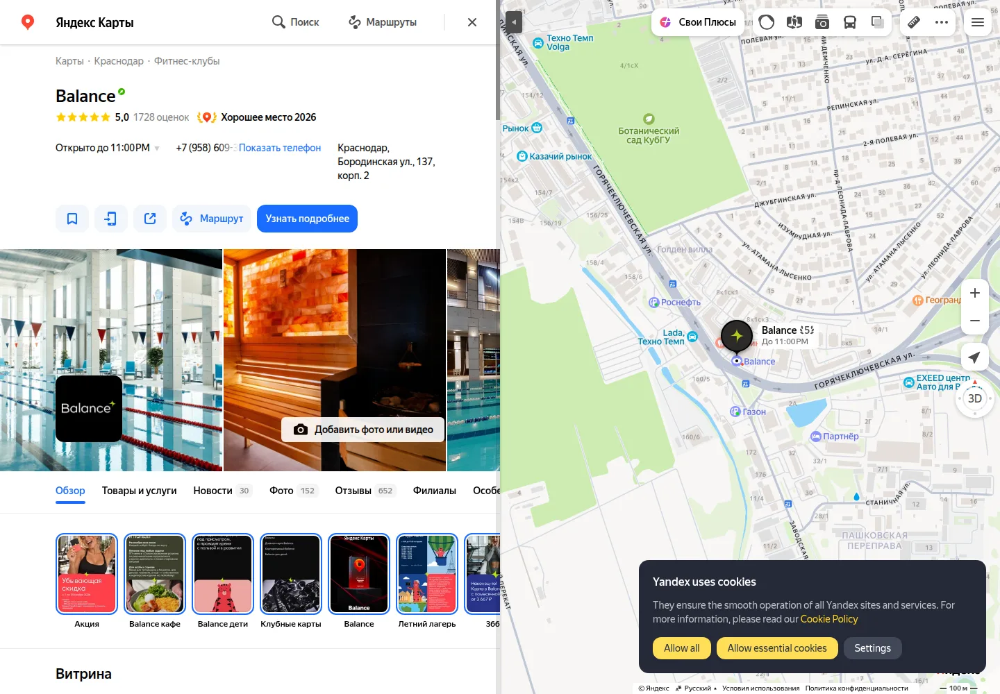
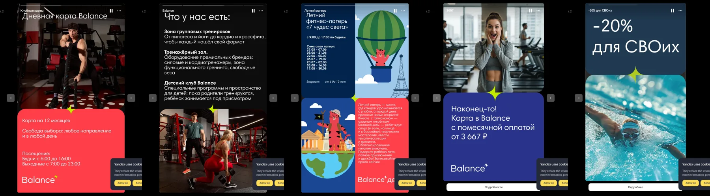
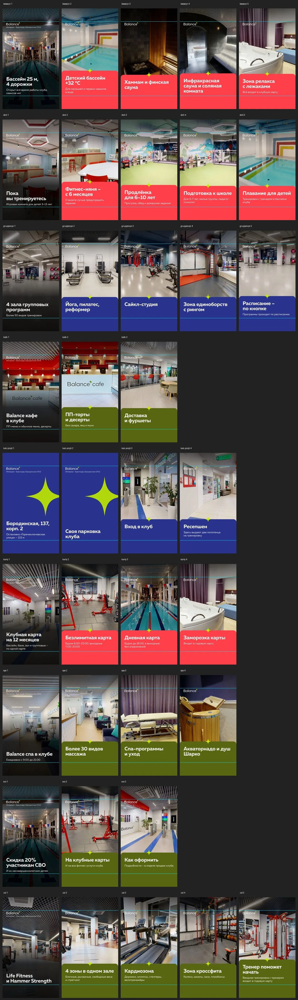
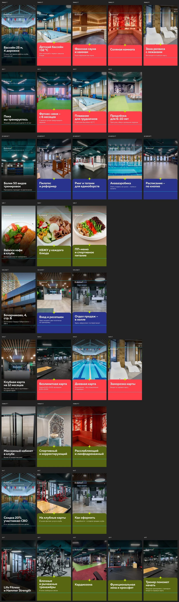
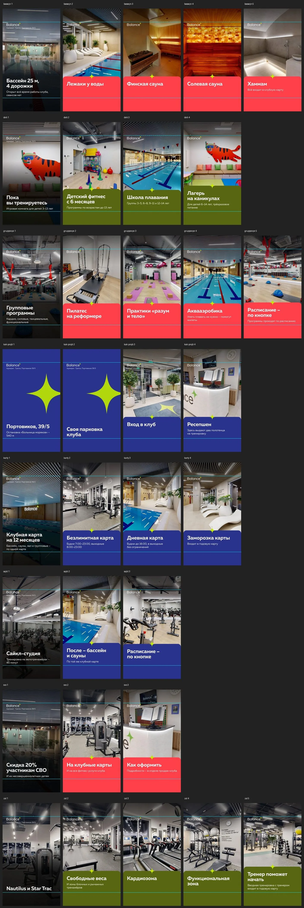
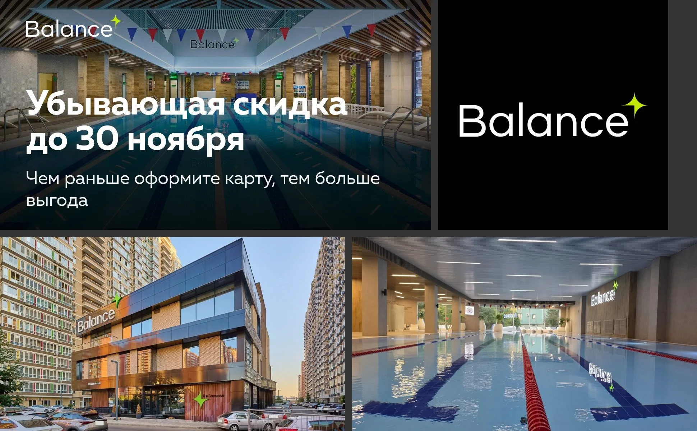

# Баланс: Яндекс Карты – ТЗ на три клуба и 106 слайдов сторис готовы

Карточки у клубов сильные: у всех 5,0 и «Хорошее место 2026». Слабые места – старый прайс, устаревшие сторис и нет сторис «Как пройти». ТЗ, все сторис, фото, акция, логотип и обложки готовы. Всё нарисовано бесплатно, из живых фото клуба и кадров 3D-туров. Под это заведены агент и два скилла, они работают на любого клиента.

## Что увидел клиент на картах (снято 18.11 без входа в кабинет)

- **Империал:** 1728 оценок, 652 отзыва, 152 фото. **Абрикосово:** 962 оценки, 438 отзывов, 193 фото. **Адмирал:** 203 оценки, 102 отзыва, 100 фото.
- **Сторис** – 9–10 у каждого клуба, но часть мусорная. «Летний лагерь» висит в ноябре, со сменами мая–августа. Сторис «3667» – цифра вместо названия и стоковое фото. «Balance» и «Что у нас есть» – стена мелкого текста. Сторис «Как пройти» нет ни у одного клуба.
- **Прайс** у всех трёх помечен Яндексом «Давно не обновлялось». У Абрикосово «Грудничковое плавание – 1 ₽», у Адмирала в прайсе всего 2 позиции.
- **Прочее.** У Адмирала одна наша новость 16.11 висит дважды – это известный дубль Cycle. В особенностях Адмирала стоит «Доступ по согласованию». В отзывах минусы – парковка и раздевалки.

## ТЗ: что поменять, по выгоде

1. Обновить прайс всех трёх клубов: убрать «1 ₽», дописать недостающие карты и услуги. Это бесплатно и влияет на позицию.
2. Телефоны в карточках (958 …) не совпадают с сайтом – выяснить, подменные ли это номера, и подписать «Ресепшен» и «Отдел продаж».
3. Поправить особенности: у Адмирала убрать «Доступ по согласованию» и добавить цену абонемента.
4. Сайт в контактах – страница своего клуба, а не главная.
5. Подключить «Записаться онлайн» через CRM клуба. Это бесплатно, сейчас запись не стоит ни у одного клуба.
6. Акцию сети привязать ко всем трём клубам – сейчас её видно только у Адмирала.
7. Удалить дубль новости Адмирала от 16.11.
8. Отметить входы и написать комментарий к адресу.
9. Поставить первыми 5 фото по ТЗ, а Империалу добавить категорию «Доступность».
10. Сторис: снять 5–6 старых у каждого клуба и поставить новые – они ниже.

Полное ТЗ (сеть + каждый клуб, чек-лист 45 пунктов × 3, 2ГИС и Google): [TZ-yandex-karty-balance.md](https://github.com/tema-mail/balance-stati/blob/main/geo/tz/TZ-yandex-karty-balance.md)

## Сторис: 26 историй, 106 слайдов, фирменный стиль

Шрифт Muller, цвета и звезда – как в сторис клуба сейчас, но по одной мысли на слайд и крупным шрифтом. «Как пройти» стоит первой. На каждой истории кнопка со ссылкой на страницу клуба с utm. Код проверил, что текст не заходит под полоски и кнопку Яндекса, а каждый лист я просмотрел глазами.

**Империал** – 9 историй, 38 слайдов. Своих фото у клуба почти нет, поэтому всё взято из 3D-тура:

**Абрикосово** – 9 историй, 35 слайдов:

**Адмирал** – 8 историй, 33 слайда:

Скачать: [сторис Империала](storis-imperial.zip) · [Абрикосово](storis-abricosovo.zip) · [Адмирала](storis-admiral.zip). Порядок, названия и ссылки кнопок для кабинета: [Империал](vylozhit-imperial.md) · [Абрикосово](vylozhit-abricosovo.md) · [Адмирал](vylozhit-admiral.md).

## Остальной визуал

- **Акция «Убывающая скидка до 30 ноября»** – одна картинка на все три клуба. Проценты на неё не ставил: они падают каждые 5 дней.
- **Логотип 720×720 и обложки 1920×1080** – для 2ГИС и Google.
- **Фото карточки, первые 5 по каждому клубу.** На фасаде Абрикосово 9 номеров машин закрыты строго по рамке.

Скачать: [фото карточек](foto-kartochki.zip) · [акция, логотип, обложки](akciya-logo-oblozhki.zip)

## Как сделано

- **Агент `geo-oformitel`** и скиллы `geo-karty` (аудит и ТЗ) и `geo-vizual` (визуал): работают на любого клиента – TEYES, цветы и т. д.
- **Чем рисовал.** Всё рисовал на нашем сервере claude-vps, бесплатно, без ChatGPT. Карточки смотрел нашим браузером, мак не трогал.
- **3D-туры.** Это туры подрядчика «Эффект присутствия». Из них снято 128 кадров интерьера, вертикальные – сразу 9:16. Людей в кадрах нет.

## Нужно от тебя

- **Тариф сети в Яндекс Бизнесе.** Сторис по правилам Яндекса есть только в платном «Расширенном». У Баланса они уже стоят – значит, тариф или реклама подключены. Кто ведёт кабинет?
- **Ответы клуба:**
  - актуальные цены карт и цены Адмирала;
  - подменные ли номера 958;
  - действует ли оплата «от 3 667 ₽» в месяц;
  - какая CRM для онлайн-записи;
  - есть ли своя парковка у Абрикосово.
- **Фото фасада и парковки** Империала и Адмирала. Без них два первых слайда «Как пройти» у этих клубов идут без фото, в цвете бренда.
- **Выкладка.** «Да» на выкладку сторис в кабинет – или отдать файлы администратору клуба.

## Что раскрыть

- Почему цены на картинках не ставим, а в прайс карточки ставим.
- Что даёт платный тариф Яндекса и стоит ли он сети.
- 2ГИС и Google: снаружи их пока не смотрели.
