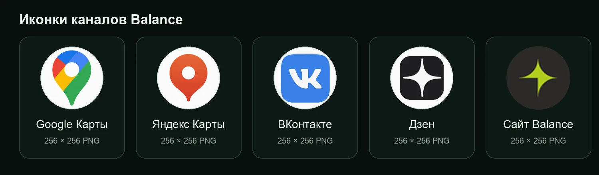
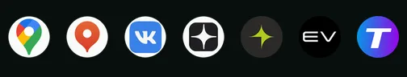
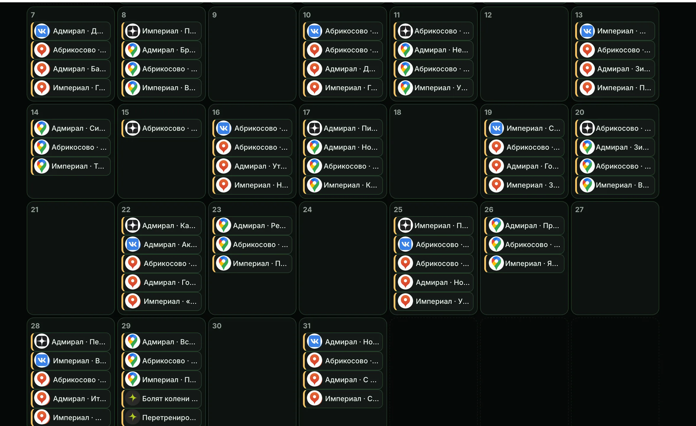
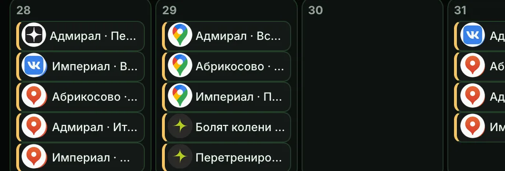
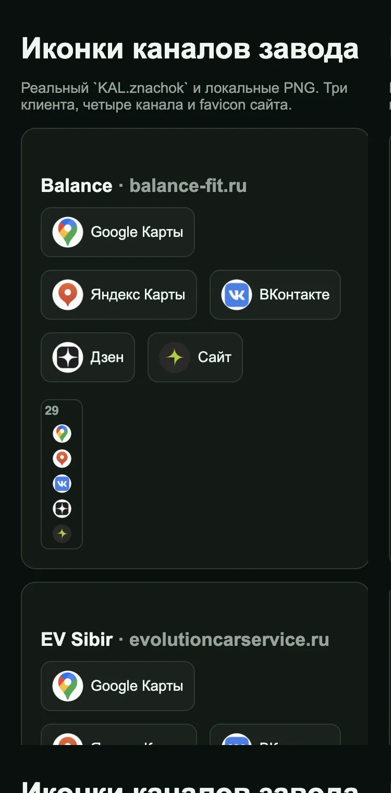

# Иконки каналов: код готов, боевой выпуск остановлен

**Главный вывод:** согласованные иконки реализованы для всех проектов и проверены, но на боевой завод не установлены. `deploy-check` вернул `NO-GO` из-за старых production-уязвимостей Starlette уровня High.

**Что нужно от тебя:** отдельное разрешение обновить FastAPI/Starlette и провести полный цикл проверок зависимостей. Без него я не меняю рабочий стек и не обхожу запрет выпуска.

## 1. Что согласовано и реализовано

Общие каналы получили единые PNG 256×256:

- Google Карты;
- Яндекс Карты, включая внутренний канал `yandex_biznes`;
- ВКонтакте;
- Дзен.

Канал «Сайт» получает favicon текущего проекта, а не один значок Balance для всех:

| Проект | Домен | Значок сайта |
|---|---|---|
| Balance | `balance-fit.ru` | Лаймовая звезда из favicon сайта |
| EV Sibir | `evolutioncarservice.ru` | EV из favicon сайта |
| TEYES Sibir | `teyes-sibir.ru` | T из favicon сайта |

[Скачать комплект из семи PNG](ikonki-balance.zip)

## 2. Как это выглядит в календаре

Согласованный макет содержит 70 замен. Сетка, названия клубов, обрезанные заголовки, жёлтые полосы и расписание не менялись.

После согласования макет перенесён в общий рендер `KAL.znachok`, поэтому одно изменение работает для владельца, клиентских кабинетов, сводки, фильтров и календаря.

## 3. Что заложено для будущих площадок

В `web/kanaly.js` записан простой контракт:

1. Для новой площадки добавляется локальный PNG 256×256 в `web/icons` и поле `ikonka` в реестре канала.
2. Для нового клиента добавляется favicon в `SAYT_IKONKI` по домену.
3. Если файл ещё не добавлен, остаётся понятная буква, а не чужой логотип или сломанная ссылка.

Внешние URL при рендере не используются. Изображения имеют фиксированные размеры, пустой `alt` рядом с доступным названием канала и ленивую загрузку. Отдельное мобильное правило убирает лишние боковые поля.

## 4. Проверки кода

| Проверка | Результат |
|---|---|
| RED | Старый код упал по отсутствию `saytDomen` и PNG |
| GREEN | 2 focused-теста прошли |
| Полный suite | 885 тестов прошли |
| JavaScript | `node --check` обоих изменённых файлов прошёл |
| Независимое ревью | FAIL на мобильном padding → исправление → PASS |
| Секреты | `gitleaks` коммита `61ec06c`: утечек нет |
| Браузер | Локальный рендер Balance, EV и TEYES на 1280 и 375 px проверен |
| Коммиты | `61ec06c` – код и иконки, `9727f1d` – состояние проекта |

Проверены раздельные favicon трёх клиентов, буквенный fallback неизвестного канала и домена, семь локальных PNG 256×256 и отсутствие внешних зависимостей.

## 5. Почему на боевом заводе иконок ещё нет

Среда: production. Проверенная версия: `61ec06c`. Вердикт: **NO-GO**.

| Пункт deploy-check | Статус | Доказательство |
|---|---|---|
| 1. Тесты | PASS | 885 тестов |
| 2. Git | PASS | Только собственные точные коммиты |
| 3. Схема БД | N/A | Модели и схема не менялись |
| 4. Секреты | PASS | `gitleaks` чисто |
| 5. Отладочные артефакты | PASS | В изменённых production JS нет console.log, debugger, TODO |
| 6. Переменные окружения | N/A | Новых переменных нет |
| 7. Авторизация | N/A | API не менялся; публичные только статические PNG |
| 8. Зависимости | FAIL | Starlette 0.41.3: High DoS |
| 9. Сборка | PASS | Статический frontend без bundle, Node-проверки прошли |
| 10. Миграции | N/A | Данных и миграций нет; резервная копия в штатном скрипте предусмотрена |

Блокеры подтверждены через OSV 28.11.2026:

- `CVE-2025-62727` – O(n²) DoS через объединение Range-заголовков, доступность High;
- `CVE-2026-54283` – игнорирование лимитов `request.form()` для `application/x-www-form-urlencoded`, доступность High.

Это старый техдолг, а не изменение из задачи иконок. Обновлять зависимости в том же коммите не стал: это отдельный риск для всего завода.

## 6. Что осталось для боевого результата

1. Отдельно обновить FastAPI/Starlette до безопасных совместимых версий.
2. Прогнать полный suite, проверки API, статики, авторизации и боевого UI.
3. Повторить `deploy-check` до `GO`.
4. Выполнить `scripts/vylozhit.sh` с резервной копией базы.
5. Сравнить живой календарь Balance, EV и TEYES на десктопе и телефоне с этим макетом.
6. Обновить публичную схему механик завода после выпуска.

Сейчас push и `vylozhit.sh` не выполнялись. Боевая база, сервисы и текущий завод не затронуты.

## Источники

- Согласование Артёма и присланные логотипы, 28.11.2026.
- [Google Maps icon (2020), Wikimedia Commons](https://commons.wikimedia.org/wiki/File:Google_Maps_icon_(2020).svg) – высокодетализированная версия знака.
- Favicon [Balance](https://balance-fit.ru/), [EV Sibir](https://evolutioncarservice.ru/) и [TEYES Sibir](https://teyes-sibir.ru/), получены 28.11.2026.
- OSV: [CVE-2025-62727](https://api.osv.dev/v1/vulns/CVE-2025-62727) и [CVE-2026-54283](https://api.osv.dev/v1/vulns/CVE-2026-54283), прочитано 28.11.2026.
- Тесты, независимый change-reviewer и локальная браузерная проверка, 28.11.2026.

## Что раскрыть

- Сам код иконок готов и не требует доработки по текущему ревью.
- Для выпуска нужен отдельный шаг обновления зависимостей, а не повторная попытка выкладки.
