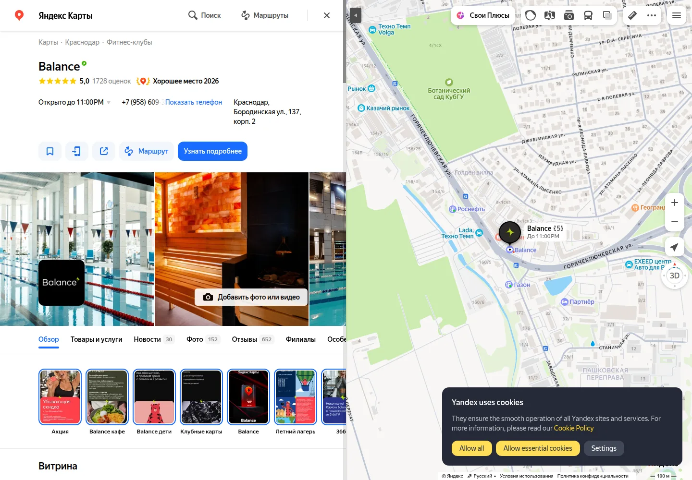

# Баланс на Яндекс Картах: оценки сильные, содержание отстаёт – 10 правок кроме историй, 7 из них бесплатные

Яндекс и пользователи ставят всем трём клубам высший уровень: у всех 5,0, «Хорошее место 2026», знак владельца. На ответы на отзывы клуб отвечает почти всегда. Отстаёт содержание карточки: прайс старый и почти без цен, нет онлайн-записи, у Империала сайт ведёт на главную, фото не обновлялись с марта, у Адмирала встал поток отзывов. Снято 18–19.11 снаружи, как видит клиент, без входа в кабинет.

## Как Яндекс сам оценивает карточку

**Официально Яндекс называет 5 вещей**, от которых зависит место в поиске по картам:
1. **Качество профиля** – заполнены все поля, разнообразные фото и видео. Дословно: «сначала будут добавлены компании с заполненным профилем и разнообразными фотографиями и видеороликами».
2. **Соответствие запросу** – рубрики, особенности, прайс. Ищут и по услугам из прайса, а не только по рубрике.
3. **Расстояние** до человека.
4. **Рейтинг.**
5. **Бюджет рекламы.** Если две карточки заполнены одинаково, выше та, где больше бюджет.

**Знаки, которые выдаёт сам Яндекс:**
- **«Информация подтверждена владельцем».** Нужны график, сайт, телефон, фото и прайс хотя бы с одной ценой. Данные надо подтверждать раз в 90 дней кнопкой «Данные актуальны». Зелёный знак означает, что у сети подключена реклама Яндекса.
- **«Хорошее место».** Даётся при рейтинге от 4,5, знаке владельца и подходящей рубрике. Итоги 2027 года – 1 февраля. Пять лет подряд – «Особенно хорошее место».

**Что на позицию не влияет, по словам самого Яндекса:** публикации (новости) и события. Они работают на то, чтобы человек выбрал клуб, когда уже открыл карточку.

**Мнение практиков, Яндекс его не подтверждал:**
- влияют звонки, маршруты и переходы на сайт из карточки;
- влияют свежесть отзывов и скорость ответов.

## Как карточку оценивают пользователи

- **Рейтинг 1–5 – не среднее арифметическое.** Яндекс пересчитывает его каждый день. Вес оценки зависит от автора: у нового аккаунта он меньше, у «Надёжного автора» больше. Учитываются число отзывов и их достоверность. Накрученные отзывы не публикуются.
- **Плашки тем в отзывах.** Яндекс сам разбирает отзывы по темам и показывает долю хороших: «Персонал 81%», «Парковка – отрицательный». Их видно до текста отзывов – это первое, что читает человек.
- **«Коротко о месте».** Нейросеть Яндекса сама собирает сторис из отзывов и фото, написать их самому нельзя. Поэтому то, что пишут в отзывах, превращается в рекламу или антирекламу клуба.
- **Подборки и загруженность по часам.** Подборки Яндекс собирает сам: «Фитнес-клубы с наградой Хорошее место», «Хамамы в Краснодаре». Империал входит в 10 подборок, Адмирал – в 2.

## Как Баланс выглядит в этих оценках

| | Империал | Абрикосово | Адмирал |
|---|---|---|---|
| Рейтинг | 5,0 | 5,0 | 5,0 |
| Оценок / отзывов | 1728 / 652 | 962 / 438 | 203 / 102 |
| Хорошее место 2026 | да | да | да |
| Знак владельца | зелёный, с рекламой | зелёный, с рекламой | зелёный, с рекламой |
| Ответы на 15 последних отзывов | 15 из 15 | 14 из 15 (1★ от 17.11 без ответа) | 15 из 15 |
| Последний отзыв | 9 ноября | 17 ноября | **28 сентября** |
| Темы в минусе | парковка, раздевалки (37%) | парковка, очереди, детские занятия 49%, групповые 54% | – |
| Подборок Яндекса | 10 | 10 | 2 |

**Что в низких оценках последних месяцев.** Жалоб на залы нет – люди пишут про продажи и условия:
- акция «3+2» – обещали 5 месяцев, дали 3 (Адмирал, 13.09);
- при записи на персональную по боксу не сказали про ограничение абонемента (Абрикосово, 17.11);
- менеджер звонил, хотя просили не звонить (Империал, 30.10);
- маникюр в спа (Империал, 06.11).

Это работа клуба, а не карточки. Но в карточке это лечится честными условиями в прайсе и в описании клубных карт.

## Что поменять кроме историй – по выгоде

| № | Что | Империал | Абрикосово | Адмирал | Платно? |
|---|---|---|---|---|---|
| 1 | **Прайс:** Яндекс пометил «Давно не обновлялось». Нужны точные цены без «от» – без цены позиция не публикуется | 6 позиций, детский фитнес лежит в разделе «Занятия по плаванию» | «Грудничковое плавание – 1 ₽» | всего 2 позиции | бесплатно |
| 2 | **Онлайн-запись** через CRM клуба (YCLIENTS, Altegio, SQNS и др.) | нет | нет | нет | бесплатно |
| 3 | **Сайт в контактах** | ведёт на главную → поставить `/imperial` | страница клуба, верно | страница клуба, но `http` → `https` | бесплатно |
| 4 | **Свежие фото, 10–15 на клуб**: кадры 3D-туров уже есть, 128 штук | нет категории «Доступность» | последнее фото 20.03 | последнее фото 10.03 | бесплатно |
| 5 | **Праздничный график** на 31.12–8.01 заранее, отдельно от общего | нет | нет | нет | бесплатно |
| 6 | **Особенности** | добавить «Массаж», «Предварительная запись» | проверить парковку | убрать «Доступ по согласованию», добавить цену абонемента | бесплатно |
| 7 | **Поток отзывов**: QR и пирамидки на ресепшен из «Промоматериалов» кабинета, напоминание через 1–3 дня после визита. Платить и давать скидку за отзыв нельзя | – | ответить на 1★ от 17.11 | отзывов нет 7 недель | бесплатно |
| 8 | **Телефоны:** в карточках 958…, на сайте 207-27-…, 205-… Подменные ли? Подписать «Ресепшен» и «Отдел продаж» | да | да | да | бесплатно |
| 9 | **Акция сети** «Убывающая скидка» – привязать ко всем трём клубам | нет | нет | есть | входит в рекламу |
| 10 | **Дубль новости 16.11** – удалить | – | – | да | – |

Уже в порядке, менять не надо:
- рубрики у всех – «Фитнес-клуб», «Спортивный, тренажёрный зал», «Бассейн»;
- входы отмечены;
- график основной заполнен;
- единое название «Balance» – как требует Яндекс для сети;
- категории фото у Абрикосово и Адмирала полные.

## Как оформлять правильно – 12 главных правил

1. Название – как на вывеске, у всех клубов сети одинаковое. Без «лучший», без ключевых слов: за это снимают.
2. Рубрик до трёх, первая – основная. Остальные – только если услугу продают как отдельную.
3. Адрес с ориентирами, точка входа на карте, комментарий «как пройти».
4. Основной график и отдельно праздничные дни.
5. Сайт – страница своего филиала, телефоны подписаны.
6. Прайс по разделам: зал, бассейн, групповые, спа, детям, персональные, карты. У каждой позиции точная цена, единица и описание (первые 250 знаков видны сразу).
7. Особенности – все, что правда есть. По ним работают фильтры поиска: «бассейн», «женский зал», «доступно на коляске».
8. Фото – от 15 на клуб, по категориям: Снаружи, Вход, Внутри, Услуги, Доступность. Первым – фасад с вывеской. Без надписей, без чужих лиц и номеров машин. Обновлять раз в квартал.
9. Видео – хотя бы одно: проход от входа до зала.
10. Онлайн-запись через партнёра – бесплатно для фитнеса.
11. Отзывы – отвечать на каждый, на негатив по существу. Просить отзывы честно: QR на ресепшене, напоминание после визита.
12. Раз в 90 дней нажимать «Данные актуальны», иначе знак владельца пропадает.

Платное (тариф «Расширенный» или реклама) – это истории, публикации, порядок фото, фото в прайсе, своя кнопка со ссылкой. У Баланса реклама уже подключена (зелёный знак), поэтому истории и витрина у сети есть.

**Полный свод:**
- [правила Яндекса, 2ГИС и Google с источниками](https://github.com/tema-mail/balance-stati/blob/main/docs/geo-karty-pravila.md) – чек-лист из 45 пунктов;
- [ТЗ на три клуба](https://github.com/tema-mail/balance-stati/blob/main/geo/tz/TZ-yandex-karty-balance.md).

## Нужно от тебя

- **Отдать клубу пункты 1–8:** их меняет тот, у кого кабинет Яндекс Бизнеса. Нужны цены для прайса, CRM для записи и ответ про номера 958.
- **«Да» на загрузку свежих фото из 3D-туров** – или отдать файлы клубу.

## Что раскрыть

- Почему сайт Империала на главной – потеря переходов по клубу.
- Сколько стоит реклама сети в Яндексе и что она даёт.
- 2ГИС и Google: снаружи ещё не смотрели.
