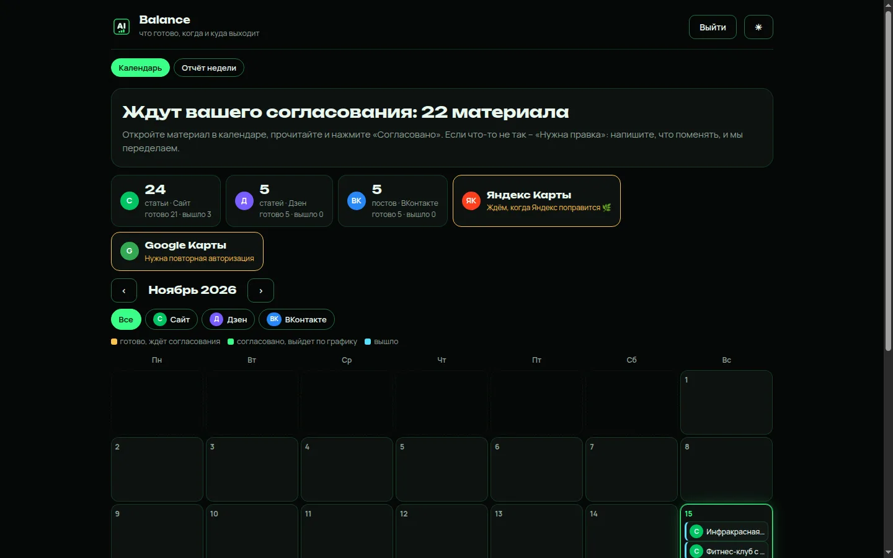

# Баланс: Яндекс и Google Карты теперь видны в кабинете со статусом

Клиент открывает кабинет /balance и рядом с Сайтом, Дзеном и ВК видит две карточки: Яндекс Карты – «Ждём, когда Яндекс поправится 🌿», Google Карты – «Нужна повторная авторизация».

## Что сделано

- В заводе календарь показывает площадки, куда сейчас не выкладываем, карточкой с причиной. Видно и клиенту, и тебе в пульте.
- Статусы берутся из настройки сайта. Поменять текст или убрать карточку можно без правки кода.
- Баланс: старую пометку «Яндекс Карты не работают» заменили двумя статусами по твоим словам.

## Что проверено

- Тесты завода: 500 прошли, в том числе новый тест: статусы видят клиент и владелец, после снятия карточка пропадает.
- Выкладка на сервер: копия базы снята, сервисы работают, окно 200, API без входа 401.
- Живой кабинет: вошёл под клиентом Баланса, обе карточки на экране (снимок выше). Эти же строки попадут в «Куда идём» отчёта недели в понедельник.

## Нужно от тебя

- Google Карты: пройти повторную авторизацию. Скажешь «готово» – уберу карточку.
- Яндекс Карты: как Яндекс поправится – скажи, сниму статус и вернём публикации.

## Что раскрыть

- Подорожника в эмодзи нет, поставил листик 🌿. Нужен другой значок – скажи.
