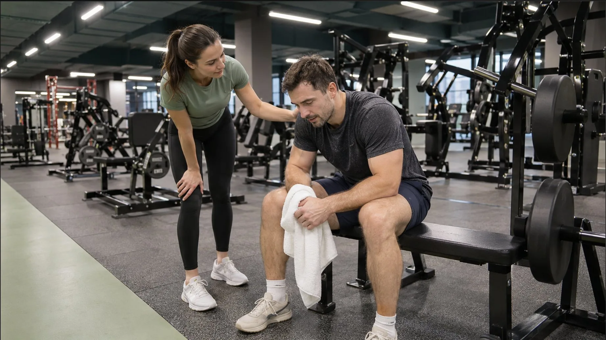

# Balance: обе статьи на 30.12 и 31.12 готовы

**Главный вывод:** две новые продающие статьи написаны, иллюстрированы и поставлены в Тильду и AI Завод. Публичные превью работают, расписание подтверждено, обе ссылки отправлены через Еву в Telegram.

**Что важно:** статьи не опубликованы раньше срока. Выход запланирован на 30.12 в Абрикосово и 31.12 в Империале. Боевые адреса начнут работать после публикации существующим контуром `publish_due.py`.

## 1. Готовые материалы и доказательства

| Материал | Статус | Доказательство |
|---|---|---|
| «Перетренированность: 8 признаков и план восстановления» | Готово на 30.12.2026, 14:40 | [Публичное превью](https://tema-mail.github.io/balance-stati/peretrenirovannost-krasnodar.html), Tilda UID `e6xcxvn9a1` |
| «Болят колени после тренировки: 7 причин и когда нужен разбор техники» | Готово на 31.12.2026, 16:40 | [Публичное превью](https://tema-mail.github.io/balance-stati/bolyat-koleni-posle-trenirovki-krasnodar.html), Tilda UID `lb80jlble1` |
| Изображения | 8 новых сцен с людьми | По 4 отдельных изображения на статью, созданы через ChatGPT |
| AI Завод | Обе записи и даты созданы | Статьи `stati_chernoviki.id=26` и `25`, календарь `plan_vyhoda.id=166` и `165` |
| Telegram | Обе ссылки отправлены | Ева, подтверждение API: `ok=true`, `message_id=481` |

Проверка `feeds_get_post` для второй статьи подтвердила адрес `peretrenirovannost-krasnodar`, SEO-поля и пустые `published` и `active`. Первая статья ранее проверена так же. Обе ждут своей даты, а не висят неопубликованными из-за сбоя.

## 2. Как выбирал темы и почему они продают

Сначала были выбраны «Шапочка для бассейна» и «Солевая сауна». Ты остановил работу: это повтор старых сюжетов и готовых изображений. Темы заменены на две новые клиентские ситуации из плана Codex, а визуал создан заново с людьми.

| Дата | Тема Codex | Спрос | За что человек придёт в клуб |
|---|---|---|---|
| 30.12 | Перетренированность | 39 – край, 5 122 – Россия, Wordstat 17.11.2026 | Разбор текущей нагрузки, спокойный план возврата и вводная тренировка |
| 31.12 | Болят колени после тренировки | 28 – край, 1 479 – Россия, Wordstat 10.11.2026 | Разбор техники, замена упражнений и персональная программа |

Обе статьи построены по одной продающей цепочке:

1. Сначала дают безопасное действие, а не рекламу.
2. Объясняют, почему универсального ответа нет.
3. Показывают, что именно тренер сделает на встрече.
4. Предлагают записаться на конкретную работу, а не просто «посетить клуб».

### Перетренированность: продажа программы восстановления

Статья разбирает 8 признаков: падение результата, сон, усталость, раздражительность, боль, повторные повреждения, изменение аппетита или пульса, концентрацию. Читатель получает дневник нагрузки и пример мягкой недели.

Продукт появляется как следующий шаг: тренер смотрит дневник, проверяет несколько движений без работы на пределе и собирает новую программу. Вводная тренировка входит в годовую карту, поэтому читатель понимает, что получит при покупке. Статья не обещает лечение и отправляет к врачу при стойком или резком ухудшении.

### Колени: продажа разбора техники

Статья разбирает 7 исправимых причин: скачок нагрузки, разминку, линию стопы и колена, вес и глубину, вариант упражнения, повторы и восстановление. Тревожные симптомы отправляют к врачу, а не к продаже.

Остальная работа продаёт конкретную услугу: тренер смотрит движение со стороны, уменьшает вес и диапазон, подбирает жимовую альтернативу и правила остановки. Читатель идёт не «лечить колено», а разбирать движение и программу.

## 3. Как работал с ключами, SEO, AEO и GEO

| Элемент | 30.12 | 31.12 |
|---|---|---|
| Главный запрос | перетренированность | болят колени после тренировки |
| Title | Перетренированность: как восстановиться \| Balance Абрикосово | Болят колени после тренировки: что делать \| Balance Империал |
| Description | 8 признаков, снижение нагрузки и возврат, вводная тренировка | Проверка, остановка и замена упражнений с тренером |
| Объём | 1 190 слов | 1 302 слова |
| Первый ответ | Снизить нагрузку и разобрать причины | Прекратить упражнение и оценить тревожные признаки |
| FAQ | 6 вопросов | 6 вопросов |
| Внутренние ссылки | Клуб, бассейн, сауны | Клуб, начало тренировок, бассейн |
| Целевое действие | Вводная персональная тренировка | Разбор техники и персональная программа |

Ключи стоят в title, H1, первом абзаце и смысловых H2. Нет набивания синонимами, скрытых блоков или обещания FAQ-расширенной выдачи. Ответы самостоятельны и пригодны для цитирования ИИ.

Для AEO первый абзац сразу отвечает на вопрос, а FAQ закрывает уточняющие сомнения. Для GEO указаны конкретный клуб, город, адрес, услуги, ограничения и следующий шаг. Медицинские утверждения ограничены: тренер разбирает нагрузку и технику, диагноз ставит врач.

Проверки после последних правок:

- `python3 build.py` – 35 файлов, 0 ошибок;
- `python3 posty/obosnovanie.py` – 136 материалов с обоснованием, 33 без, 0 ошибок;
- title до 70 знаков, description до 160, по 6 FAQ;
- контакты, клубные ограничения, ссылки и расписание проверены.

## 4. Изображения: 8 новых сцен, люди есть

Gemini и AI Studio повторно ответили региональной блокировкой. После этого ты прямо разрешил: «делай значит через гпт сейчас». Поэтому оба комплекта созданы через ChatGPT по подписке, платные API не использовались.

### Перетренированность, Абрикосово

- уставший клиент сидит после тренировки, тренер рядом обсуждает самочувствие;
- тренер и клиент смотрят дневник нагрузки на планшете;
- тренер показывает лёгкое упражнение на подвижность;
- клиент и тренер идут вдоль бассейна и обсуждают возврат к нагрузке.

### Боль в коленях, Империал

- тренер наблюдает присед клиента;
- тренер показывает линию колена и носка;
- тренер предлагает жимовую альтернативу;
- тренер и клиент обсуждают программу с планшетом.

Люди вымышленные, реальные сотрудники не копировались. Помещение и тренажёры использованы как визуальные референсы клубов, но старые фотографии в статьи не вставлялись. Каждый кадр просмотрен крупно и сохранён как JPEG 1844×1038 с комментарием происхождения.

## 5. Публикация и проверенные ссылки

| Контур | 30.12 | 31.12 |
|---|---|---|
| Текст | `stati/34-peretrenirovannost-krasnodar.md` | `stati/35-bolyat-koleni-posle-trenirovki-krasnodar.md` |
| Изображения | 4 файла `peretrenirovannost-krasnodar-*.jpg` | 4 файла `bolyat-koleni-posle-trenirovki-krasnodar-*.jpg` |
| Тильда | UID `e6xcxvn9a1`, 30.12.2026 14:40, черновик | UID `lb80jlble1`, 31.12.2026 16:40, черновик |
| AI Завод | Статья `id=26`, календарь `id=166` | Статья `id=25`, календарь `id=165` |
| Git | `d5e8e8c`, затем `900cea9` | `7e3844d` |
| Публичное превью | https://tema-mail.github.io/balance-stati/peretrenirovannost-krasnodar.html | https://tema-mail.github.io/balance-stati/bolyat-koleni-posle-trenirovki-krasnodar.html |
| Будущий адрес | https://balance-fit.ru/abricosovo/blog/peretrenirovannost-krasnodar | https://balance-fit.ru/borodinskaya/blog/bolyat-koleni-posle-trenirovki-krasnodar |

Первый deploy второй статьи столкнулся с ошибкой метаданных служебного архива GitHub Pages. Повтор того же запуска создал дубликат архива. Новый штатный deploy `46128493283` прошёл успешно, превью отвечает HTTP 200. Файлы статей и история Git ради исправления инфраструктурной ошибки не переписывались.

Визуально проверены десктоп и мобильный экран 375 px, основной текст, CTA, контакты и главное изображение. Отдельное наблюдение по общему шаблону: на узком экране длинное слово в H1 может выходить за правую границу. Общий шаблон всех статей в этой задаче не менялся.

## 6. Откуда возьмутся показы, переходы и заявки

Гарантировать их нельзя. Рабочая цепочка выглядит так:

1. **Индексация.** После публикации страница становится доступна роботам по точному URL, canonical, title и контенту. Нужно проверить фактический индекс, а не считать его автоматическим.
2. **Показы.** Запрос существует по Wordstat. Если страница попадёт в выдачу, title и description объяснят, что человек получит ответ и следующий шаг. Позиции и показы не прогнозируются числом.
3. **Переходы.** Первый абзац отвечает на вопрос и предлагает безопасное действие. Внутренние ссылки ведут на клуб и смежные материалы. Это даёт шанс на клик, а не гарантирует CTR.
4. **Заявки.** В статье конкретно написано, что тренер сделает на встрече. Человек с проблемой видит не абстрактный клуб, а способ решения и форму заявки.
5. **Измерение.** Через 7 и 28 дней сравниваем индекс, показы, клики, CTR, переходы на страницу клуба и цели Метрики. Только по фактическим данным решаем, менять ли заголовок, первый абзац или CTA.

### Почему нет UTM

Текущий `build.py` принимает ссылки только из белого списка. Поэтому UTM не добавлены и не выдумываются. Переходы измеряются по странице статьи и целевой странице клуба. Метрика `71090701` уже привязана, Search Console и Вебмастер Balance в заводе не подключены – это отдельный пробел для оценки поисковых запросов.

## 7. Отправка через Еву

После успешного HTTP 200 обеих превью Еве передано одно сообщение с двумя превью, датами и будущими адресами. Telegram Bot API вернул `ok=true`, `message_id=481`.

Отправлены именно рабочие превью, а не только будущие боевые URL, которые до 30 и 31 декабря ещё не существуют. Это позволяет открыть и проверить материалы уже сейчас.

## 8. Повторяемые уроки

- Перед выбором темы сравнивать не только запрос, но и существующие статьи и изображения. Доказательство – замена первоначальных бассейна и сауны после замечания.
- До текста фиксировать конкретную продажу: что человек получит на встрече и почему она решает его ситуацию. Обе SEO-карточки начаты с этого решения.
- Не вставлять старые изображения по умолчанию: сначала проверять, повторяет ли статья визуальный сюжет.
- Доступ генератора проверять до обещания результата. После явного разрешения второй комплект перенесён с Gemini на ChatGPT, без платных API.
- Не отправлять ссылки, пока публичное превью не отвечает 200 и не проверено в браузере.

## Источники

- `plan90/dekabr.md`, Wordstat 10.11 и 17.11.2026.
- Shire Sports Medicine, «Fatigue and overtraining syndrome», прочитано 27.11.2026.
- NHS, «Knee pain and other running injuries», прочитано 27.11.2026.
- WHO Europe, «Physical activity», прочитано 27.11.2026.
- Тильда, AI Завод, Git, GitHub Pages, Telegram Bot API и живые превью, проверка 27–28.11.2026.
