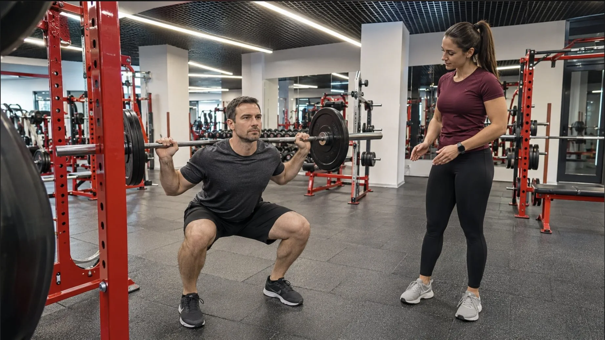
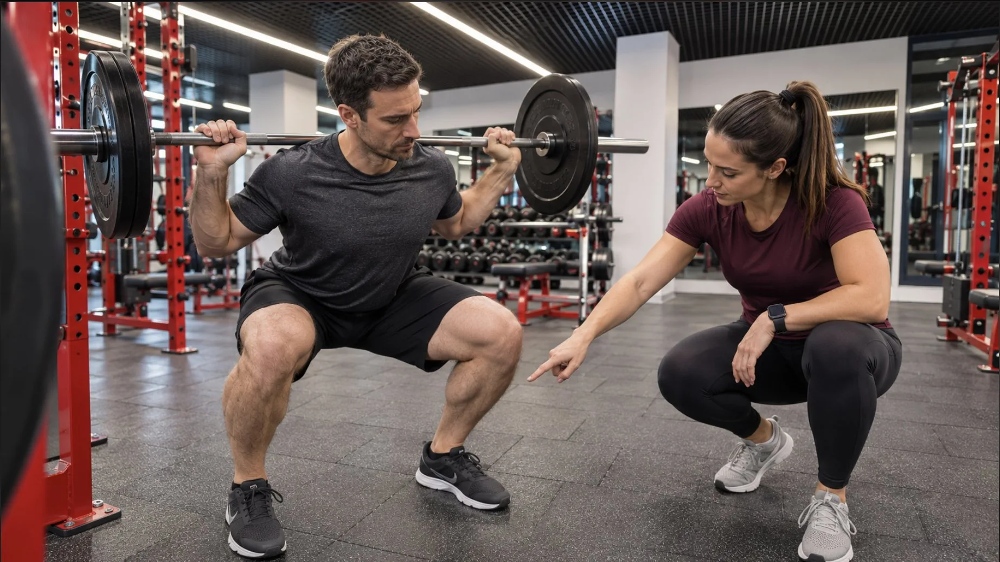

# Balance: статья на 31.12 готова, статья на 30.12 ждёт изображения Gemini

**Главный вывод:** статья о боли в коленях полностью подготовлена и поставлена на 31.12 в Тильду и AI Завод. Статья о перетренированности написана и прошла проверки, но не загружена: Gemini и AI Studio отвечают региональной блокировкой, поэтому четыре изображения не созданы.

**Что нужно для завершения:** доступ к Gemini в поддерживаемом аккаунте или твоё разрешение создать оставшиеся четыре изображения через ChatGPT. Пока второй вариант не выбран, я не подменяю Gemini и не отправляю незавершённую статью.

## 1. Что сделано

| Материал | Статус | Доказательство |
|---|---|---|
| «Болят колени после тренировки: 7 причин и когда нужен разбор техники» | Готово на 31.12.2026, 16:40 | [Публичное превью](https://tema-mail.github.io/balance-stati/bolyat-koleni-posle-trenirovki-krasnodar.html), Tilda UID `lb80jlble1` |
| «Перетренированность: 8 признаков и план восстановления» | Текст и SEO готовы, изображения не готовы | 1 190 слов, lint PASS, загрузка не выполнена |
| Обоснования для ЛК | Готово | Ключи, спрос, целевая услуга и назначение каждой статьи записаны в шапке |
| Публикация в AI Заводе | Готово для первой статьи | `stati_chernoviki.id=25`, `plan_vyhoda.id=165`, дата 2026-12-31 |
| Изображения для первой статьи | 4 новых сцены через ChatGPT | Присед, линия колена, жимовая альтернатива, консультация с планшетом |
| Изображения для второй статьи | Не созданы | Gemini: «isn’t currently supported in your country»; AI Studio перенаправляет на Available regions |

Статья на 31.12 не опубликована раньше срока: в Тильде `published` и `active` пустые, работает существующее расписание `publish_due.py`.

## 2. Как выбирал темы и почему они продают

Сначала были выбраны «Шапочка для бассейна» и «Солевая сауна». Ты справедливо остановил работу: это повтор старых сюжетов и готовых изображений. Темы заменены на две новые боли из того же плана Codex, а изображения заказаны заново с людьми.

| Дата | Тема Codex | Спрос | За что человек придёт в клуб |
|---|---|---|---|
| 30.12 | Перетренированность | 39 – край, 5 122 – Россия, Wordstat 17.11.2026 | Разбор текущей нагрузки, спокойный план возврата и вводная тренировка |
| 31.12 | Болят колени после тренировки | 28 – край, 1 479 – Россия, Wordstat 10.11.2026 | Разбор техники, замена упражнений и персональная программа |

Обе статьи идут по продающей цепочке:

1. Сначала дают безопасное действие, а не рекламу.
2. Затем объясняют, почему универсального ответа нет.
3. Показывают, что именно тренер сделает на встрече.
4. Предлагают записаться на конкретную работу, а не просто «посетить клуб».

### Перетренированность: продажа программы восстановления

Статья отвечает на 8 признаков: падение результата, сон, усталость, раздражительность, боль, повторные повреждения, изменение аппетита или пульса, концентрация. Далее даёт дневник нагрузки и пример мягкой недели.

Продукт появляется естественно: тренер смотрит дневник, проверяет несколько движений без работы на пределе и собирает новую программу. Вводная входит в годовую карту, поэтому читатель понимает, что получит при покупке.

### Колени: продажа разбора техники

Статья разбирает 7 исправимых причин: скачок нагрузки, разминка, линия стопы и колена, вес и глубина, вариант упражнения, повторы, восстановление. Тревожные симптомы отправляют к врачу, а не к продаже.

Остальная работа продаёт конкретную услугу: тренер смотрит движение со стороны, уменьшает вес и диапазон, подбирает жимовую альтернативу и правила остановки. Читатель идёт не «лечить колено», а разбирать движение и программу.

## 3. SEO, AEO и GEO

| Элемент | 30.12 | 31.12 |
|---|---|---|
| Главный запрос | перетренированность | болят колени после тренировки |
| Title | Перетренированность: как восстановиться \| Balance Абрикосово | Болят колени после тренировки: что делать \| Balance Империал |
| Description | 8 признаков, снижение нагрузки и возврат, вводная тренировка | Проверка, остановка и замена упражнений с тренером |
| Объём | 1 190 слов | 1 302 слова |
| Первый ответ | Снизить нагрузку и разобрать причины | Прекратить упражнение и оценить тревожные признаки |
| FAQ | 6 вопросов | 6 вопросов |
| Внутренние ссылки | Клуб, бассейн, сауны | Клуб, начало тренировок, бассейн |
| Разметка | Article и BreadcrumbList, если поддерживает шаблон | Article и BreadcrumbList, если поддерживает шаблон |
| Целевое действие | Вводная персональная тренировка | Разбор техники и персональная программа |

Ключи стоят в title, H1, первом абзаце и смысловых H2. Нет набивания синонимами, скрытых блоков или обещания FAQ-расширенной выдачи. Ответы самостоятельны и пригодны для цитирования ИИ.

Проверки: `python3 build.py --lint` – 35 файлов, 0 ошибок; `python3 posty/obosnovanie.py` – 136 с обоснованием, 0 ошибок. Title ≤70, description ≤160, 5–6 FAQ, контакты и ограничения клубов соблюдены.

## 4. Изображения: все новые, с людьми

Для статьи о коленях ChatGPT создал четыре отдельные сцены 16:9:

- тренер наблюдает присед клиента;
- тренер показывает линию колена и носка;
- тренер предлагает жимовую альтернативу;
- тренер и клиент обсуждают программу с планшетом.

Люди вымышленные, реальные сотрудники не копировались. Помещение и красные тренажёры взяты из фотобанка Империала, но готовые фотографии в статью не вставлялись. Каждый кадр просмотрен крупно и сохранён как JPEG 1844×1038 с комментарием происхождения.

Фактическая стоимость генерации по подписке не измерялась. Платные API не использовались.

Для статьи о перетренированности запланированы четыре новые сцены с уставшим клиентом и тренером, но они не созданы. Старые фотографии бассейна и сауны не используются как готовые иллюстрации.

## 5. Публикация и проверенные ссылки

| Контур | Результат |
|---|---|
| Текст 35 | `stati/35-bolyat-koleni-posle-trenirovki-krasnodar.md` |
| Изображения | 4 файла в `site/img/` с именем статьи |
| Тильда | UID `lb80jlble1`, дата 31.12.2026 16:40, черновик |
| AI Завод | Статья `id=25`, календарь `id=165`, канал `sayt` |
| Git | `7e3844d Добавить статью о боли в коленях на 31 декабря` |
| GitHub Pages | Deploy success, превью 200 |
| Публичное превью | https://tema-mail.github.io/balance-stati/bolyat-koleni-posle-trenirovki-krasnodar.html |
| Будущий адрес | https://balance-fit.ru/borodinskaya/blog/bolyat-koleni-posle-trenirovki-krasnodar |

Визуально проверены десктоп и мобильный 375 px, загрузка всех четырёх изображений, CTA, контакты, чтение и работа GitHub Pages.

## 6. Откуда возьмутся показы, переходы и заявки

Гарантировать их нельзя. Рабочая цепочка выглядит так:

1. **Индексация.** После публикации страница становится доступна роботам по точному URL, canonical, title и контенту. Нужно проверить фактический индекс, а не считать его автоматическим.
2. **Показы.** Запрос существует по Wordstat. Если страница попадёт в выдачу, title и description объяснят, что человек получит ответ и следующий шаг. Позиции и показы не прогнозируются числом.
3. **Переходы.** Первый абзац отвечает на вопрос и предлагает безопасное действие. Внутренние ссылки ведут на клуб и смежные материалы. Это даёт шанс на клик, а не гарантирует CTR.
4. **Заявки.** В статье конкретно написано, что тренер сделает на встрече. Человек с проблемой видит не абстрактный клуб, а способ решения и форму заявки.
5. **Измерение.** Через 7 и 28 дней сравниваем индекс, показы, клики, CTR, переходы на `/imperial` и цели Метрики. Только по фактическим данным решаем, менять ли заголовок, первый абзац или CTA.

### Почему нет UTM

Текущий `build.py` принимает ссылки только из белого списка. Поэтому UTM не добавлены и не выдумываются. Переходы измеряются по странице статьи и целевой странице клуба. Метрика `71090701` уже привязана, Search Console и Вебмастер Balance в заводе не подключены – это отдельный пробел для оценки поисковых запросов.

## 7. Что осталось и почему Telegram пока не отправлен

Для 30.12 осталось:

- создать 4 новых изображения через Gemini;
- проверить их крупно;
- загрузить статью в Тильду на 30.12;
- добавить её в календарь AI Завода;
- опубликовать превью и проверить ссылки;
- отправить обе ссылки через Еву.

Ева пока ничего не отправляет: ты просил две ссылки после завершения, а готова только одна. Не заменяю это сообщение отчётом о незавершённой работе.

## 8. Повторяемые уроки

- Перед выбором темы сравнивать не только запрос, но и существующие статьи и изображения. Доказательство – замена первоначальных бассейна и сауны после твоего замечания.
- До текста фиксировать конкретную продажу: что человек получит на встрече и почему она решает его ситуацию. Обе SEO-карточки начаты с этого решения.
- Не вставлять старые изображения по умолчанию: сначала проверять, повторяет ли статья визуальный сюжет.
- Доступ генератора проверять до обещания результата. Региональную блокировку нельзя скрывать или обходить другой моделью без твоего решения.

## Источники

- `plan90/dekabr.md`, Wordstat 10.11 и 17.11.2026.
- Shire Sports Medicine, «Fatigue and overtraining syndrome», прочитано 27.11.2026.
- NHS, «Knee pain and other running injuries», прочитано 27.11.2026.
- WHO Europe, «Physical activity», прочитано 27.11.2026.
- Тильда, AI Завод, Git, GitHub Pages и живое превью, проверка 27–28.11.2026.
