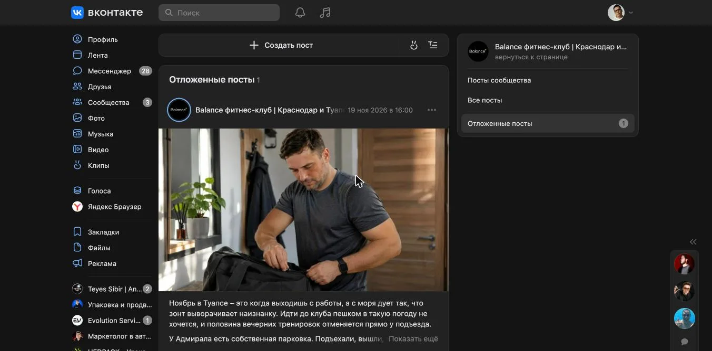

# Баланс: пробный пост ВК в отложенных

**Пробный пост ВК встал в отложенные: 19.11 в 16:00 НСК (12:00 по Москве) он выйдет в группе Баланса сам. Если скажешь «да», так же поставлю остальные 23 поста ВК.**

## Что стоит в очереди

- Группа одна на сеть: «Balance фитнес-клуб | Краснодар и Туапсе», vk.ru/balance_krd.
- Пост «Своя парковка: вечерняя тренировка в дождь и ветер» – клуб «Адмирал», Туапсе. Текст из календаря завода целиком, хэштеги на месте, одно фото.
- Выйдет 19.11 в 16:00 НСК, это 12:00 по Москве, обед в Туапсе.
- В отложенных ровно один пост, без дублей.

## Почему днём не получалось

- ВК не лежал: он переехал с vk.com на **vk.ru**. Разрешение для Claude в Chrome нужно было именно на vk.ru.
- Вкладки усыпляет расширение-усыпитель, поэтому они «пропадали».
- Порядок выкладки и эти ловушки записал в память и в состояние проекта, в следующий раз пройдёт с первого раза.

## Нужно от тебя

- **«Да» на остальные 23 поста ВК** (22.11 – 18.01, раз в 3 дня, клубы по очереди). Поставлю их в отложенные тем же способом, это около часа работы в твоём Chrome.
- Глянь пост в отложенных и скажи, если время 12:00 по Москве не подходит.

## Что раскрыть

- Список всех 24 постов ВК с датами и клубами.
- Завтра в 18:00 – тексты Баланса до конца года (чат «Balance ДЗЕН»), 19.11 – новости Яндекс Карт по филиалам.
