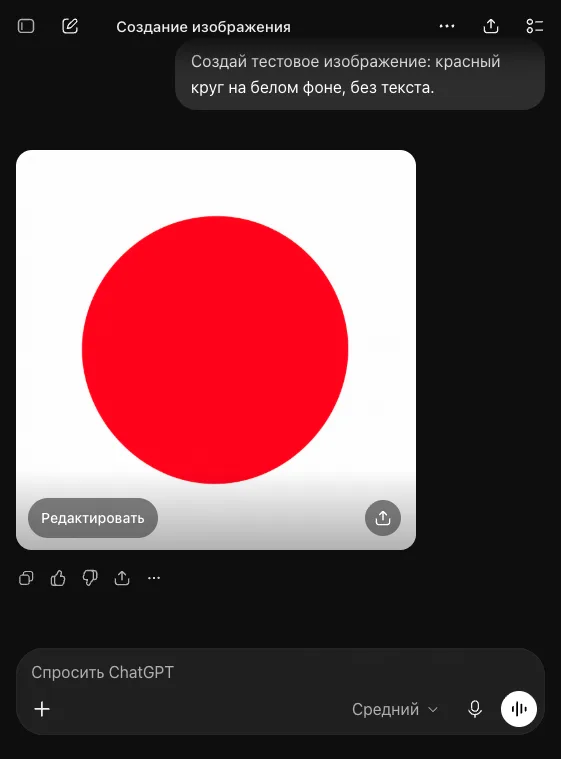
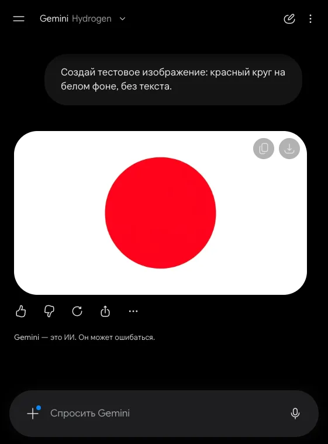

# ChatGPT и Gemini работают по подпискам

**Вывод: оба сервиса вошли в аккаунты и создали тестовые изображения через веб-интерфейсы. Платные API не использовались.**

Дата проверки: 26.11.2026. Источник: реальные запросы и визуальная проверка во встроенном браузере Kimi.

## 1. Генерация проверена на деле

Оба сервиса получили одинаковый запрос: «Создай тестовое изображение: красный круг на белом фоне, без текста». Оба вернули именно такое изображение.

### ChatGPT

### Gemini

## 2. Расходуются лимиты подписок, а не платные токены

- Работа идёт через сайты ChatGPT и Gemini, где выполнен вход.
- API OpenAI и Gemini не подключались, ключи не создавались.
- Платных запросов не было. Тесты использовали только возможности и лимиты текущих подписок.
- Подписка не означает безлимит: если сервис покажет ограничение, нужно будет подождать или выбрать другой из этих двух сервисов.

## 3. Segmind остаётся отдельным платным каналом

Segmind для обычного рисования не используем. Перед каждым платным запросом к нему я сначала назову операцию и цену, затем спрошу разрешение. Без явного «да» запрос не отправляю.

## 4. Полный переезд продолжается без дублей

Во время проверки параллельный Kimi-чат продолжил устанавливать переносимые скиллы и агенты. На момент одной из сверок 26.11.2026 было найдено 104 установленные позиции из 131 записи в общем манифесте `rem1–rem14`; число меняется по мере работы того чата.

Этот чат не устанавливает те же компоненты повторно. После завершения параллельного переноса понадобится финальная сверка файлов, сценариев и интеграций. Само число установленных файлов ещё не доказывает работоспособность каждой внешней интеграции.

## Нужно от тебя

Для картинок больше ничего настраивать не нужно. Для завершения всего переезда дай второму чату закончить перенос, затем напиши здесь: **«Перенос закончен, проверь остаток»**.

## Что раскрыть

- **Google Drive:** после входа проверить доступ к выбранной общей папке, затем отдельно настроить резервное копирование.
- **Интеграции:** проверять живыми безопасными вызовами только после подтверждения доступов; платные действия согласовывать отдельно.
- **Финальная приёмка:** сверить оставшиеся компоненты, найти конфликты имён и проверить сценарии без повторной установки готовых партий.
