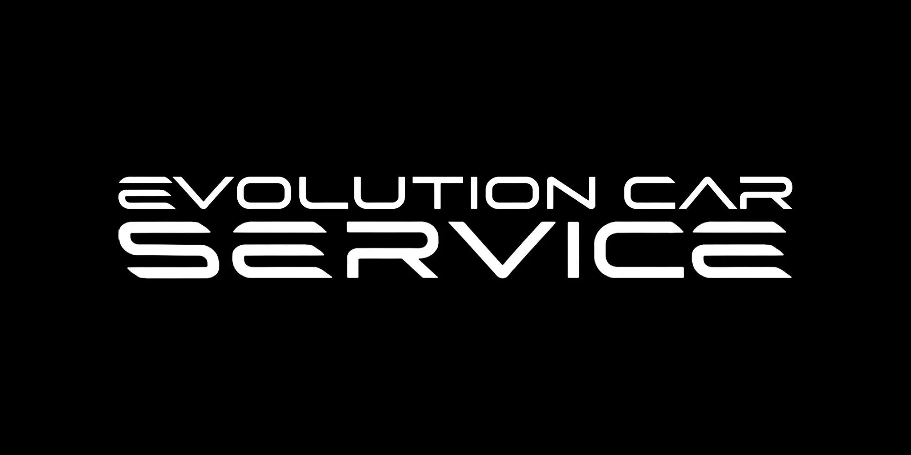

# Логотип EVOLUTION CAR SERVICE для Яндекс Карт – на новом лого, чёрный фон, белые буквы

Переделал на новом широком лого Evolution Car. Расположение – как в первом варианте: EVOLUTION CAR сверху, SERVICE под ним крупнее, на всю ширину. Есть квадрат под карточку.

## Скачать

- [Квадрат, PNG 1080×1080](fayly/logo-kvadrat.png) – этот грузить в Яндекс Бизнес как логотип.
- [Горизонтальный, PNG 2000×1000](fayly/logo-gorizont.png)
- [Белый на прозрачном, PNG](fayly/logo-belyy-prozrachnyy.png) – чтобы класть на фото и тёмные фоны.

Те же файлы на маке: Загрузки → `evolution-car-service-logo-novyy`.

## Как сделан

- Строка EVOLUTION CAR – файл нового лого с сайта Evolution Car, без перерисовки.
- SERVICE собран из букв этого же лого: E, R, V, I, C вырезаны из него. Буквы S в лого нет – собрал её из нижней части E и её же, повёрнутой на 180°, поэтому скругления и скошенные концы как у остальных букв.
- Надпись в квадрате занимает 88% ширины и помещается в круг – если Карты обрежут аватарку кругом, буквы не срежет.

## Ограничение

- Нового лого у нас есть только картинка высотой 48 px, вектора нет. Для Карт и соцсетей этого хватает, края чистые. Для печати (вывеска, баннер) нужен исходник лого в векторе от дизайнера – с ним пересоберу за пару минут.

## Нужно от тебя

- Посмотреть квадрат и загрузить в Яндекс Бизнес: Профиль → Логотип.
- Если есть векторный исходник лого Evolution Car – скинь, сделаю вектор для печати.

## Что раскрыть

- Как собрана буква S.
- Как выглядит аватарка в мелком размере на Картах.
