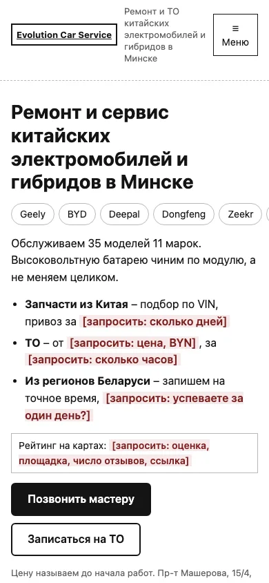
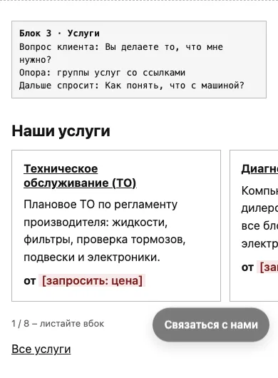
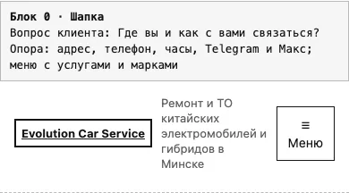

# Бриф для одного видео готов, старые замечания прототипа исправлены, дизайну переданы тексты первого экрана

## 1. Бриф: один разговор закрывает все 4 247 пустых мест на сайте

**Ссылка для клиента:** [tema-mail.github.io/razbory/evolution-minsk-brif-video-cd67a376](https://tema-mail.github.io/razbory/evolution-minsk-brif-video-cd67a376/). На странице голосом объяснено, как записывать.

- На 136 страницах прототипа 4 247 красных меток, разных – 363. Все разложены по 19 вопросам для видео и 6 файлам. Скрипт проверил: неразложенных 0.
- **Девять сцен в порядке разговора:**
  - владелец: о сервисе, гарантия, запчасти, регионы, цены, первый экран;
  - мастер: батарея в кадре, марки и модели, как проходит работа.

  Около 70–90 минут, можно в два захода.
- **Номер вопроса – вслух.** Расшифровка разложит ответы по страницам сама.
- **Больше всего мест закрывают:**
  - цены и время – 1 580;
  - отзывы и рейтинг с карт – 824;
  - часы работы и ссылки на Telegram и Макс – по 267;
  - марки и модели – 266.
- **Цены можно не говорить, а прислать прайсом.** В брифе готовые таблицы: 16 услуг и 35 моделей.
- **Файлами, не на видео:** ссылки, реквизиты, ссылка на карты с разрешением на отзывы, фото, кто согласится на видеоотзыв, выгрузка статей старого сайта.
- **Сделаем сами:** юридические тексты, оценку и отзывы с карт.
- **Приложение для мастера** – вопросы по каждой из 35 моделей из паспортов: регламент, батареи, частые поломки, вопросы владельцев.
- Технические вопросы (домен, реклама, доступы) в видео не вошли – пришлю отдельным списком.

В проекте: `docs/brif/2026-11-16-video-brif.md`. Пересчёт, сколько мест осталось: `docs/brif/metki-po-voprosam.py`.

## 2. Старые замечания прототипа исправлены – проверка проходит на всех типах страниц

| Было | Стало |
|---|---|
| Длинные блоки на телефоне в 2 экрана: марки, услуги, «Почему сюда», особенности модели, отзывы | Лента вбок: видно край следующей карточки, под лентой «1 / 8 – листайте вбок». Ставится сама на любой блок с 3 и больше однородными карточками |
| «Связаться с нами» наезжала на кнопку первого экрана | Нижняя панель и «Связаться с нами» появляются, когда первый экран ушёл вверх (правило мобилки) |
| Подпись в шапке 11,5 px | 13 px |
| Надзаголовок «Видеоотзывы клиентов» без ключа | Заголовок «Видеоотзывы клиентов о нашей работе», без надзаголовка |

**Проверка:** `proverka.mjs` – PASS на 14 типах страниц из 14 (было от 1 до 3 FAIL на каждой). Снимки 390 px смотрел глазами.

**Живой адрес:** [прототип](https://tema-mail.github.io/evolution-service-minsk-proto/) обновлён, `/design/` на месте.

## 3. Дизайн главной: вид с Фигмы, тексты первого экрана – по правилу

Твоё «да» понял так: макет из Фигмы остаётся, тексты меняем по правилу.

Чат дизайна сейчас сам переделывает первый экран: в 19:49 появилась новая картинка. Если править параллельно, мы перезапишем друг друга. Поэтому передал ему задание напрямую:

- H1 – по SEO-заданию;
- надзаголовок «EVOLUTION CAR SERVICE / МИНСК» – убрать;
- подзаголовок – одна фраза вместо перечня с длинным тире;
- главная кнопка – «Позвонить мастеру»;
- все 11 марок по спросу.

Проверка задана той же `proverka.mjs`. Он должен ответить строкой «сделано». Пока ответа нет – **не проверено**.

## Нужно от тебя

1. **Отправить бриф клиенту** и назначить видео (можно на meet.deford.ru, будет расшифровка). Запись или расшифровку – мне, разложу ответы по сайту.
2. **Глянуть первый экран дизайна**, когда чат дизайна ответит.

Затрачено на этот шаг – около 1,5 ч.

## Что раскрыть

- Какие ещё блоки стали лентой на других типах страниц.
- Как после видео ответы попадут на сайт: номер вопроса → поле данных → страницы.
