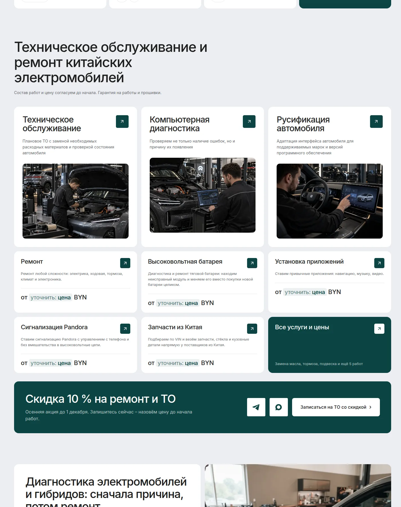
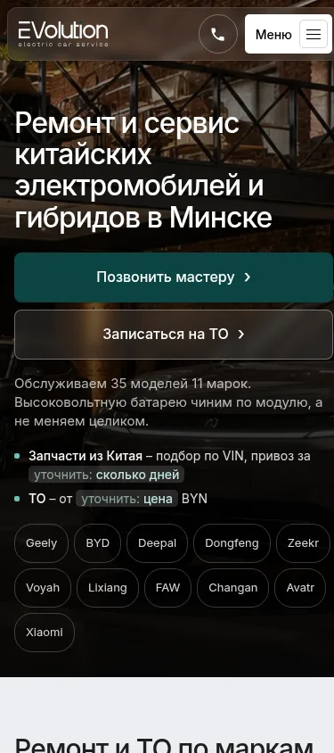

# Главная Evolution Минск переделана в стиле кадра «5» из Фигмы

**Вывод:** дизайн главной переделан под твой образец «5 (2)» – в Фигме это кадр «5» (1:1081): [tema-mail.github.io/evolution-service-minsk-proto/design/](https://tema-mail.github.io/evolution-service-minsk-proto/design/). Тексты первого экрана – по правилу первых экранов, которое ты утвердил в соседнем чате. Проверка прототипа – PASS.

Потрачено: первая версия около 25 минут, переделка около 30 минут.

## 1. Вид – кадр «5» и лендинг Lixiang из того же файла

- Кадр «5»: стеклянная шапка с кнопкой «Меню», лофт с машинами на весь первый экран, серый фон #eceef2, тёмно-зелёный #0b4442, белые карточки услуг с фото и зелёными квадратами-стрелками, зелёная плашка с Telegram и Макс.
- Блоков ниже первого экрана в кадре «5» нет. Их нарисовал в языке лендинга «Lixiang» (1:1181) из того же файла: цены «от» в карточках, зелёный блок с белыми пунктами, вопросы двумя колонками, форма на фото, контакты с картой, подвал.
- В прошлый раз ошибся с образцом: взял кадр «6» с графитом и рыжим акцентом.

## 2. Первый экран – по правилу первых экранов

- H1 поисковый: «Ремонт и сервис китайских электромобилей и гибридов в Минске».
- Одна фраза вместо перечня: «Обслуживаем 35 моделей 11 марок. Высоковольтную батарею чиним по модулю, а не меняем целиком».
- Главная кнопка – «Позвонить мастеру», вторая – «Записаться на ТО»: звонков по Метрике втрое больше, чем форм.
- Под кнопками – 11 марок по спросу, каждая ведёт на свою страницу.

## 3. Проверено на 1440 и 390 px

- Проверка прототипа `proverka.mjs` – PASS. Ошибок в консоли нет, все картинки грузятся.
- Телефон: нет прокрутки вбок, заголовок и кнопка видны сразу. Однородные карточки листаются вбок, вопросы – гармошкой, внизу таб-бар.
- Нашёл и исправил: класс поля ввода совпадал с классом появления блока, поэтому заголовки получили белые плашки.

## Нужно от тебя

1. Глазами: тот ли это стиль? Если да – какую страницу делаем следующей, хаб марки или лендинг модели?
2. Фото в дизайне – из макета, они сгенерированы. Для работ, видео и отзывов нужны живые материалы заказчика, места под них оставлены.

## Что раскрыть

- Какие блоки взяты из кадра «5», а какие – из лендинга Lixiang
- Режим каждого блока на телефоне
