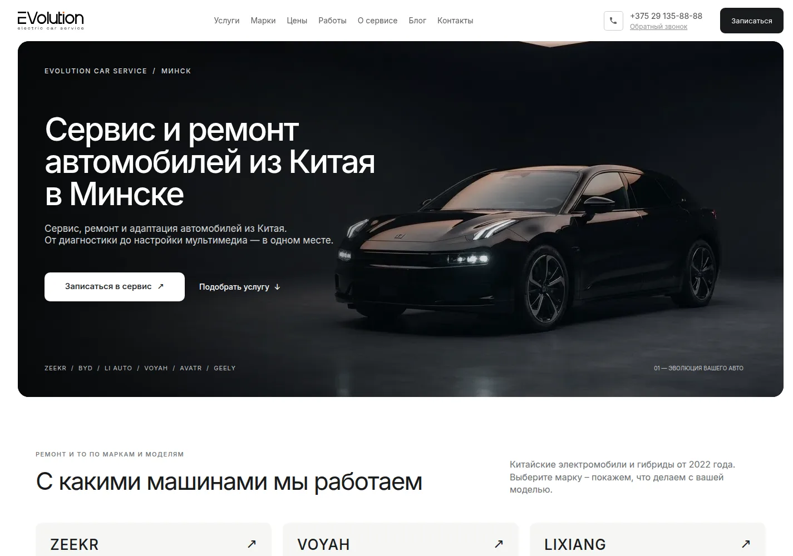
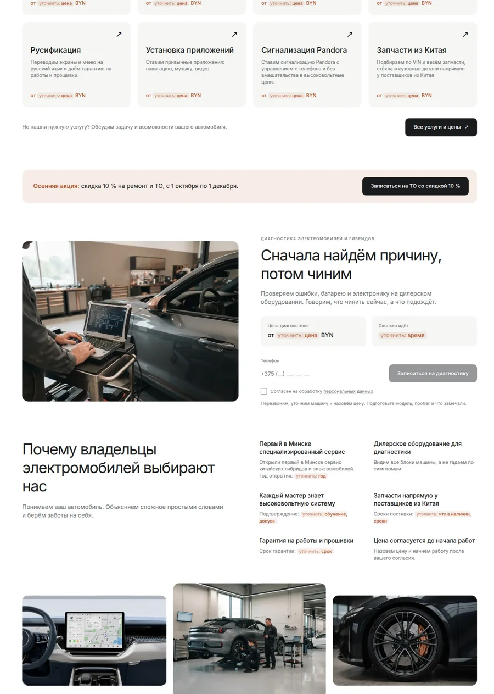

# Главная Evolution Минск сверстана в стиле Фигмы

**Вывод:** главная прототипа готова в дизайне макета: [tema-mail.github.io/evolution-service-minsk-proto/design/](https://tema-mail.github.io/evolution-service-minsk-proto/design/). Первый экран взят с Фигмы один в один, блоки и ссылки – из прототипа. Работает на компьютере и телефоне.

Потрачено: около 25 минут.

## 1. Вид и первый экран – с Фигмы

- Образец стиля – новая главная «6» (кадр 1:483, 1440 px): шрифт Inter, графит, серые карточки, акцент #ae582e. Старую главную на 1920 px с красной Теслой не брал.
- Первый экран (кадр 1:518) перенесён один в один: фото Zeekr, тексты, кнопки «Записаться в сервис» и «Подобрать услугу», строка марок. Фото и логотип скачаны из макета, картинки в WebP.
- От макета отступил в трёх местах, по твоим правилам: убрал надзаголовки «01 / ПОЧЕМУ EVOLUTION» и номера карточек, не чередовал фон блоков, в меню нет франшизы и «Заказать авто» (решение 08.11). Длинное тире из текстов макета заменил на короткое.

## 2. Содержание – блоки прототипа

- Порядок блоков – как в прототипе, всего 11: марки и модели, услуги с ценой, акция, диагностика с формой, почему мы, работы, видео, отзывы, «цена не вырастет», вопросы, запись и адрес.
- Все 58 ссылок ведут на живые страницы прототипа (марки, модели, услуги).
- Чего нет у заказчика, помечено «уточнить: …» (цены, срок гарантии, часы, ссылки Telegram и Макс). Под живые фото, видео и отзывы оставлены места с подписью, что там должно быть.

## 3. Проверено на 1440 и 390 px

- Телефон: нет прокрутки вбок, заголовок и кнопка видны без прокрутки, текст не мельче 13 px, кнопки от 44 px. Услуги, преимущества, работы и отзывы листаются вбок со счётчиком, вопросы – гармошкой.
- Таб-бар внизу появляется, когда первый экран ушёл вверх; «Записаться» открывает окно «Связаться».
- Форма: маска +375, кнопка закрыта, пока не стоит галочка, после отправки – «Заявка принята». Фото открываются окном с крестиком, Esc закрывает. Ошибок в консоли нет.

## Сбой по ходу – исправлен

Прототип одновременно правил другой чат (первые экраны по правилу 16.11). Две мои пересборки выложили его незаконченные правки на живой прототип. Через 3 минуты я их откатил, потом тот чат сам выложил готовую версию. При заведении `docs/sostoyanie.md` я затёр его строку – вернул.

Чтобы не повторилось: `scripts/vykladka-proto.sh` откажется выкладывать, если в исходниках есть незакоммиченные правки. Отказ проверен.

## Нужно от тебя

1. **H1.** Сейчас стоит текст Фигмы «Сервис и ремонт автомобилей из Китая в Минске». Он шире рамки (только электромобили и гибриды от 2022) и расходится с SEO-заданием «Ремонт и сервис китайских электромобилей и гибридов в Минске». Какой оставить?
2. **Подзаголовок первого экрана.** В разборе 16.11 ты назвал подзаголовок прототипа водой. Подзаголовок Фигмы такой же общий: «От диагностики до настройки мультимедиа – в одном месте». Переписать по новому правилу или оставить, как в макете?
3. **Что дальше:** какую страницу делаем следующей – хаб марки или лендинг модели?

## Что раскрыть

- Какие блоки прототипа и в каком виде вошли в дизайн
- Как устроена выкладка и почему дизайн живёт в /design/
- Режим каждого блока на телефоне
