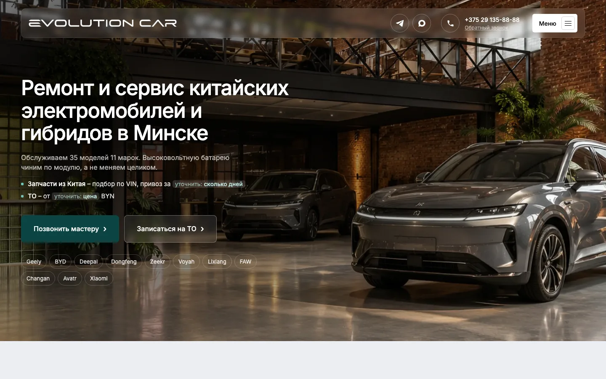
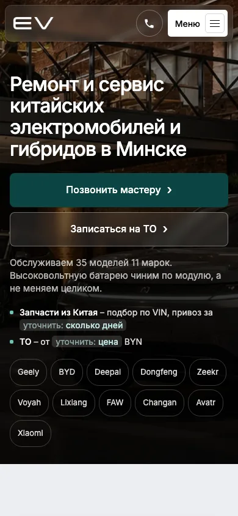
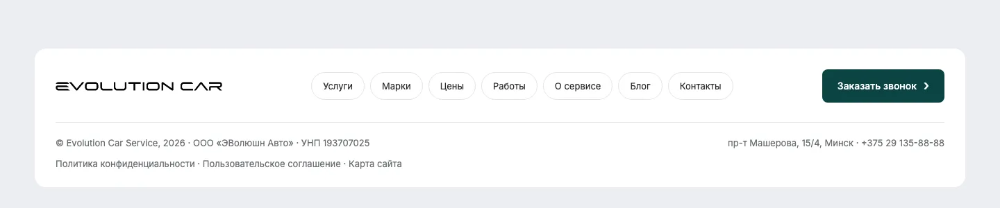
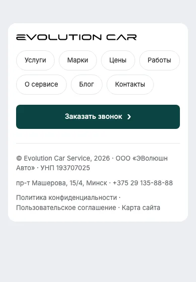

# Evolution Минск: логотип Evolution Car стоит на дизайне главной

На https://tema-mail.github.io/evolution-service-minsk-proto/design/ теперь тот же логотип, что на сайте пригона Evolution Car: в шапке и подвале. Прототип не трогал.

## Что поменялось

- Шапка на компьютере: длинное белое «EVOLUTION CAR» на стекле.
- Шапка на телефоне: знак «EV», как на сайте Evolution Car, иначе длинное слово получается мелким.
- Подвал: то же «EVOLUTION CAR», тёмное на белой карточке.
- Файлы – WebP, взяты из проекта evolution-car-by без перерисовки.

## Как проверено

- Проверка прототипа `proverka.mjs` – PASS.
- Снимки 1440 и 390 – посмотрел глазами. На компьютере подвал сначала съехал, меню ушло на вторую строку – починил, снимок выше после правки.
- Живой адрес отдаёт новую страницу, все три файла лого – 200, image/webp.
- Коммиты: ba76dd5 в проекте, fcdc899 на стенде (только папка /design/).

## Нужно от тебя

- Глянуть шапку и подвал. Если лого нужно крупнее или зелёное в подвале – скажи.
- По-прежнему ждёт выбора: следующей страницей верстать хаб марки или лендинг модели.

## Что раскрыть

- Иконку вкладки (favicon) оставил старую, «E». Могу сделать из знака «EV».
