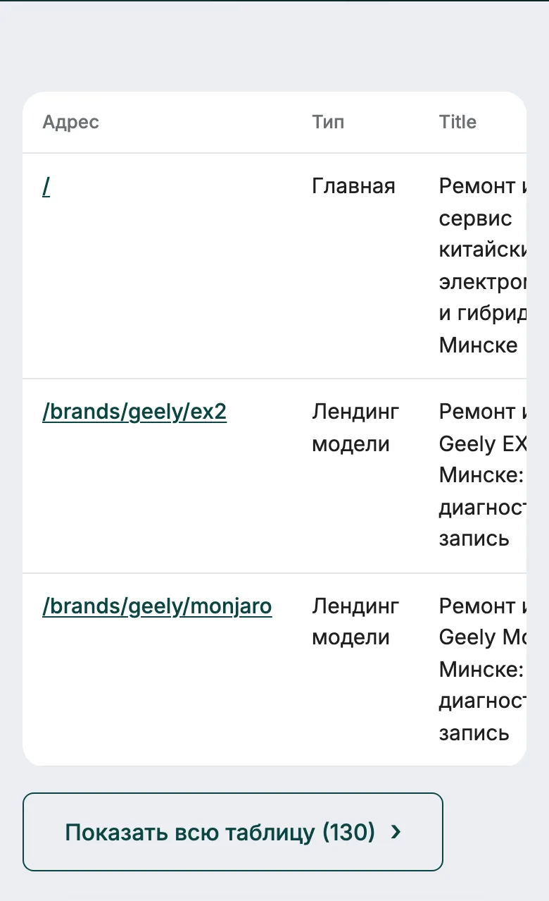
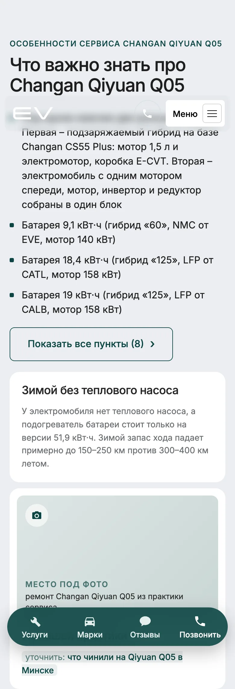
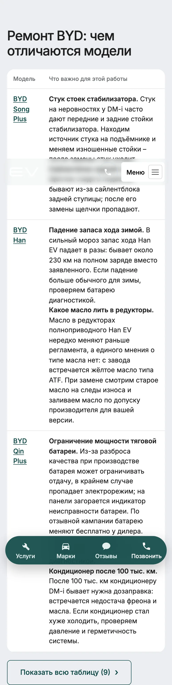

# Evolution Минск: все страницы прототипа проходят проверку телефона

**Вывод:** 9 страниц, которые падали на 390 px, починены. Теперь прототип проходит проверку на всех 134 страницах из 134. Дизайн, который пойдёт в бой, этих ошибок и не имел. От тебя ничего не нужно.

## Что было не так

- Проверка ругалась «длинный блок без режима для телефона» на карте сайта, Changan Qiyuan Q05, пяти услугах BYD (приложения, ремонт, обновление ПО, диагностика, ТО) и ремонте Lixiang. При полном прогоне нашлась девятая – русификация BYD.
- Источник был один: дизайн на телефоне уже сворачивал эти блоки (первые строки + кнопка «Показать всю таблицу»), а в чёрно-белом прототипе для дизайнера режим не был проставлен.
- Блоки: таблица «цены по моделям» и «чем отличаются модели» на страницах услуги для марки, таблица всех адресов на карте сайта (135 строк, 15 экранов), блок «Особенности модели» у Q05.

## Что сделано

- Прототип теперь сам ставит блоку режим по тому же правилу, по которому дизайн его сворачивает: таблица длиннее 6 строк (или 3 строк, если текст длинный) и список длиннее 6 пунктов – гармошка, короче – вниз.
- Карта сайта – гармошка. У Q05 две карточки, лента из двух не нужна: список фактов свёрнут, карточки идут вниз.
- Правка в одном файле, proto/sborka.mjs, коммит 7fd11bb.

## Что проверено

- Проверка страниц на всех страницах прототипа: 134 PASS из 134. Не считал galaxy-e5: это переадресация на EX5 после склейки 18.11, блоков в ней нет.
- Дизайн пересобран из коммита и проверен на всех страницах: 132 PASS из 134, не прошли «О сервисе» и «Работы» по тексту первого экрана: это скрытые заглушки, ждут истории и кейсов от клиента (решение 7В), к телефону отношения не имеют.
- Снимки 390 px четырёх блоков в дизайне просмотрены глазами.
- Выложено на стенд: [ремонт BYD](https://tema-mail.github.io/evolution-service-minsk-proto/design/services/repair/byd/), [карта сайта](https://tema-mail.github.io/evolution-service-minsk-proto/design/sitemap/), [Q05](https://tema-mail.github.io/evolution-service-minsk-proto/design/brands/changan/qiyuan-q05/).

## Нужно от тебя

Ничего.

## Заметил попутно, записал, не правил

- «Ремонт BYD: чем отличаются модели» на телефоне даже свёрнутым занимает 1,8 экрана. Колонка модели узкая, «BYD Song Plus» ломается на три строки. Лучше на телефоне ставить модель над текстом. Это правка вида таблиц дизайна, она заденет и регламент ТО.

## Что раскрыть

- По каким страницам какой режим встал.
- Почему режим ставится в прототипе, а не только в дизайне.
