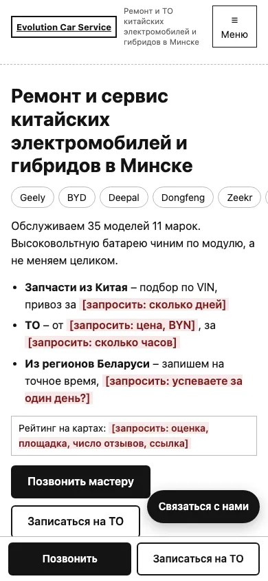
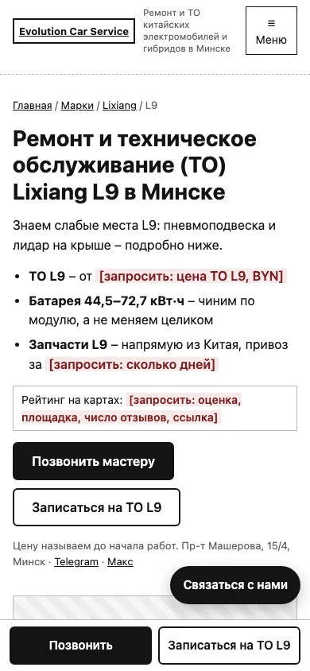
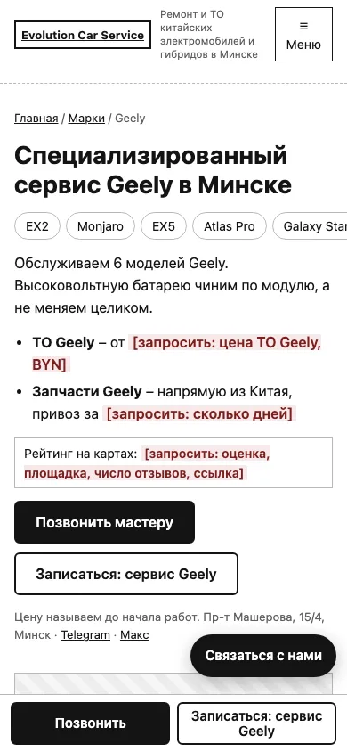
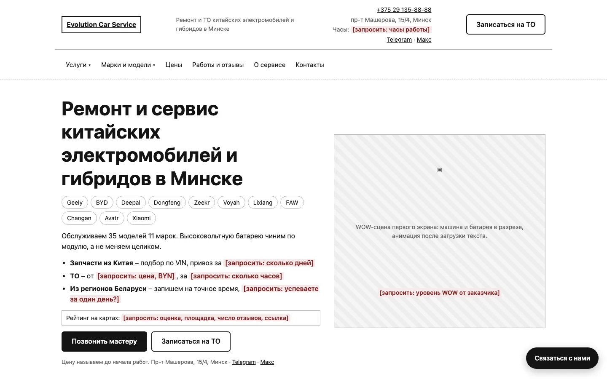

# Первые экраны Evolution Минск переделаны по новому правилу на всех 135 страницах, правило – в скиллах и в проверке кодом

Прототип: [главная](https://tema-mail.github.io/evolution-service-minsk-proto/) · [хаб Geely](https://tema-mail.github.io/evolution-service-minsk-proto/brands/geely/) · [лендинг Lixiang L9](https://tema-mail.github.io/evolution-service-minsk-proto/brands/lixiang/l9/) · [услуга «Батарея»](https://tema-mail.github.io/evolution-service-minsk-proto/services/high-voltage-battery/)

Прошлый разбор: [почему было водой и 10 правил](https://tema-mail.github.io/razbory/evolution-minsk-pervyy-ekran-a39f7ae2/)

## 1. На сайте: вода ушла, на её месте – факты из данных и с живого сайта

Новых обещаний я не придумывал. Два настоящих отличия уже были на живом сайте сервиса: «батарею чиним по модулю, а не меняем целиком» и «запчасти везём напрямую из Китая». Цифры взяты из наших данных: 35 моделей, 11 марок, ёмкость батарей и слабые места из паспортов моделей. Чего нет – стоит метка «запросить».

| Тип страницы | Было | Стало |
|---|---|---|
| Главная | перечень услуг, «цену называем до начала работ», «дилерское оборудование», «гарантия, [срок]» | 11 марок чипами по спросу, «Обслуживаем 35 моделей 11 марок. Высоковольтную батарею чиним по модулю, а не меняем целиком», буллеты: запчасти из Китая, ТО от, из регионов Беларуси |
| Хаб марки (11) | перечень услуг + те же три общие строки | модели марки чипами, «Обслуживаем 4 модели Lixiang», ТО от, запчасти марки |
| Лендинг модели (35) | техописание, «дилерское оборудование», «гарантия», «цена до начала работ» – 4 буллета | «Знаем слабые места L9: пневмоподвеска и лидар на крыше» (из паспорта), ТО от, батарея 44,5–72,7 кВт·ч, запчасти |
| Услуга (16) и услуга + марка или модель (62) | первая фраза описания + «цену называем до начала работ» | одна фраза на страх по каждой услуге + паспорт таблицей: цена, время, гарантия |
| Все страницы | главная кнопка – запись, телефон вторым | «Позвонить мастеру» главной, запись второй; в липкой панели так же |

Почему звонок главный: Метрика за год – 3 009 целевых звонков против 965 отправок формы.

«Цену называем до начала работ» осталась в одном месте – подсказкой под кнопкой, рядом с адресом, Telegram и Максом.

## 2. Правило внесено и ловится кодом – повторить ошибку не дадим

- **Правило целиком** – `~/.claude/skills/marketolog/references/pervyy-ekran.md`: зачем экран, порядок выбора текста, 10 правил, таблица по типам страниц, пример Evolution.
- **Кому разнесено**:
  - маркетолог – раздел в скилле;
  - прототипировщик `site-prototype` – строка в шаге сборки;
  - проверка лендинга `site-landing` – в пункте «Первый экран»;
  - Хормози – в строке «Текст на сайт»;
  - решения владельца `site-lead/memory/rules.md` – строка 16.11.
- **Карточка-шаблон** `par-pervyy-ekran`, по которой экран заполнялся «по форме», теперь сначала отсылает к правилу.
- **Проверка** `proverka.mjs`:
  - FAIL на гигиену в подзаголовке и буллетах;
  - FAIL на подзаголовок-перечень;
  - FAIL на 4 и больше буллетов;
  - с флагом `--boy` – FAIL на «запросить» в первом экране;
  - ИНФО – на дубль с заголовком ниже и на H1 длиннее 12 слов;
  - исключение – только по твоему слову, атрибутом `data-hero-ok`.

## 3. Что проверено

- Проверка поймала старую главную: 4 FAIL первого экрана – ровно те строки, что ты назвал лишними. Рейтинг не тронут: это доказательство.
- Новая сборка: правила первого экрана проходят на 135 из 135 страниц с H1.
- Полная проверка с Playwright на 9 страницах всех типов (390 и 1440): по первому экрану ни одного FAIL. Кнопка в первом окне на телефоне. Сначала 11 марок в два ряда сдвинули её на 20 px вниз – сделал ряд лентой вбок.
- Снимки первых экранов просмотрены глазами (выше).
- Живой адрес: главная, Geely, L9, «Батарея» отдают 200 и новый текст. `/design/` соседнего чата на месте, его не трогал.
- Коммиты: генератор `847e0b9`, выкладка `67fe113`, состояние `bd54ebb`. Чужие незакоммиченные правки в `sborka.mjs` в мой коммит не попали.
- База знаний маркетолога: 265 карточек, 0 ошибок.

## 4. Что не трогал и почему

- **Дизайн главной с Фигмы** (соседний чат, твоё решение 16.11 «первый экран – с Фигмы») расходится с правилом:
  - H1 «Сервис и ремонт автомобилей из Китая в Минске» не совпадает с SEO-заданием;
  - подзаголовок – перечень «От диагностики до настройки мультимедиа» с длинным тире;
  - надзаголовок без ключа;
  - главная кнопка – запись, а не звонок.

  Записал в состояние проекта, решать тебе.
- **Старые FAIL прототипа, не про первый экран:**
  - надзаголовок «Видеоотзывы клиентов» без ключа;
  - длинные блоки без режима для телефона (главная – 3, L9 – 2);
  - подпись в шапке мельче 13 px;
  - плавающая «Связаться с нами» на телефоне наезжает на вторую кнопку первого экрана.
- **Эталоны 08.11** в `docs/prototip` (glavnaya, l9, monjaro) не пересобирал: их заменила полная сборка, и они не опубликованы.
- **H1 страницы «Марки»** «С какими машинами мы работаем» – не запрос. Это решение SEO-задания, отдельной правкой.

Затрачено на этот шаг – около 1,5 ч.

## Нужно от тебя

1. **Дизайн главной: Фигма или правило?** Если правило – чат дизайна меняет первый экран, около 0,5 ч.
2. **Шесть ответов клиента** – без них буллеты остаются с метками:
   - срок привоза запчастей;
   - ремонт батареи по модулю (подтвердить);
   - цена ТО «от» и сколько часов;
   - срок гарантии;
   - рейтинг на картах;
   - успевают ли за день для приезжих из регионов.
3. **Старые FAIL прототипа**: чинить? Около 1 ч.

## Что раскрыть

- Подзаголовки всех 16 услуг: какая фраза откуда взята.
- Порядок марок по спросу и почему Geely первой.
- Как работает проверка первого экрана и где она может ошибиться.
