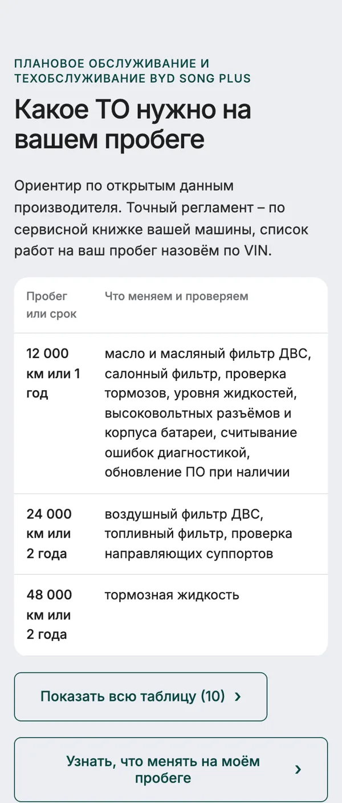

# Регламент ТО: вариант А стоит на всех моделях Evolution

Таблица «пробег – что меняем» с подписью «ориентир по открытым данным, точно – по VIN» теперь на 19 моделях. У 15 моделей без данных регламента блок скрыт – пустых таблиц с «уточнить» больше нет.

## Что изменилось

- **Подпись везде честная:** «Ориентир по открытым данным производителя. Точный регламент – по сервисной книжке вашей машины, список работ на ваш пробег назовём по VIN».
- **Zeekr 001**, где показывали вариант Б, вернулся к таблице.
- **Вопрос «Что входит в ТО?»** отвечает под оба случая: есть таблица – «ориентир в таблице выше», нет – «назовите VIN, мастер скажет список работ».

<figure style="margin:16px 0;max-width:340px"><figcaption>Так блок выглядит на телефоне</figcaption></figure>

## Как проверено

- Проверка прототипа – PASS на 6 моделях: с таблицей (Zeekr 001, Song Plus, L9) и без неё (L6, Xiaomi YU7, BYD Tang).
- Живой стенд после выкладки: на Zeekr 001 таблица есть, кнопки Б нет; на L6 блока нет, меток «интервал из регламента» нет.

## Нужно от тебя

Ничего. Осталось из аудита: у Song Plus и Qin Plus в таблице подряд два графика – гибридный и электрический. Разведу их подписью отдельным шагом.

## Что раскрыть

- Пример: https://tema-mail.github.io/evolution-service-minsk-proto/design/brands/lixiang/l9/#reglament
- Сравнение А и Б: https://tema-mail.github.io/razbory/evolution-minsk-reglament-ab-520a66e7/
