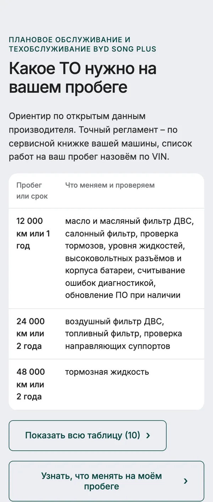
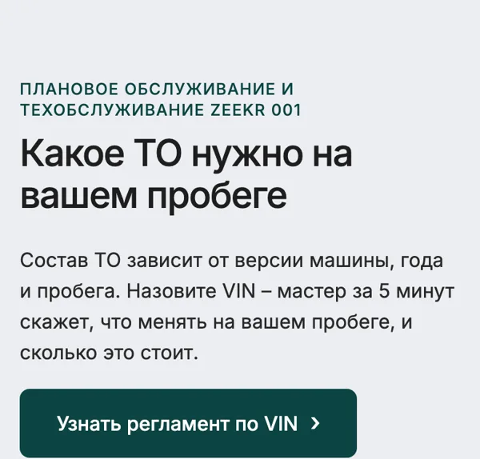
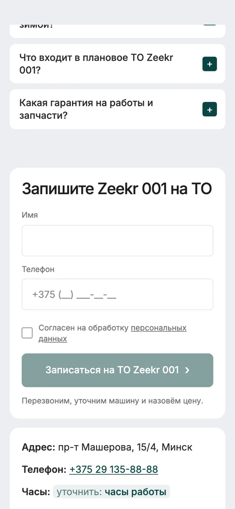
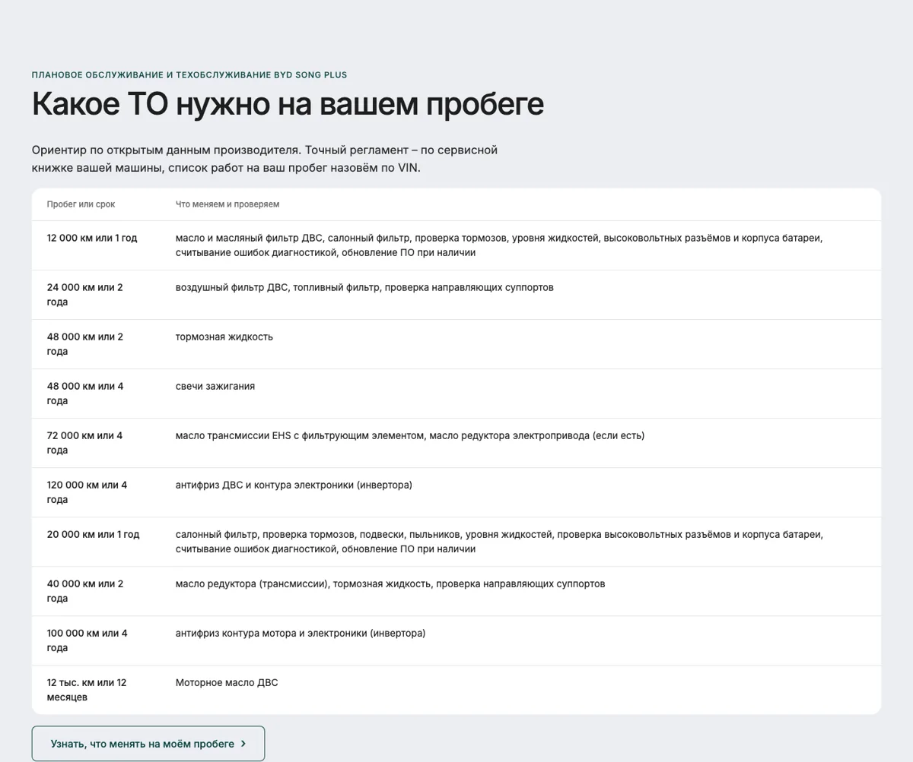
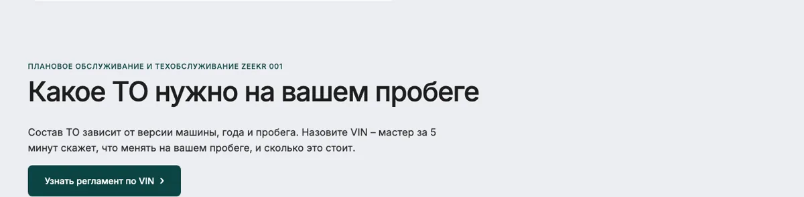

# Регламент ТО: А – клиент видит таблицу, Б – таблицы нет, только кнопка «Узнать по VIN»

Разница одна: показываем ли мы клиенту интервалы ТО его модели. В А он сам видит, что и когда менять. В Б он ничего не видит и должен оставить заявку, чтобы узнать. Мой совет – **А**.

## Так это выглядит на телефоне

<figure style="margin:0;flex:1 1 280px;max-width:360px"><figcaption><b>А</b> – подпись «ориентир по открытым данным», таблица «пробег – что меняем», кнопка «Узнать, что менять на моём пробеге»</figcaption></figure>
<figure style="margin:0;flex:1 1 280px;max-width:360px"><figcaption><b>Б</b> – таблицы нет: одна фраза и зелёная кнопка «Узнать регламент по VIN»</figcaption></figure>

## Что будет после нажатия кнопки – одинаково

В обоих вариантах кнопка ведёт к форме записи внизу страницы: имя, телефон, галочка. Мастер перезванивает.

<figure style="margin:16px 0;max-width:360px"><figcaption>Форма «Запишите Zeekr 001 на ТО» – куда приводит кнопка</figcaption></figure>

## Чем отличаются

| | **А – таблица** | **Б – кнопка по VIN** |
|---|---|---|
| Что видит клиент | Интервалы ТО своей модели: 12 000 км – масло, фильтры; 48 000 км – тормозная жидкость… | Одну фразу и кнопку |
| Поиск (Яндекс, Google, нейросети) | Есть что показать по запросу «регламент ТО Song Plus» – текст таблицы читается | Текста нет – страница слабее в поиске |
| Риск ошибки | Цифры из открытых данных, могут не совпасть с книжкой клиента – поэтому честная подпись | Ошибиться нечем |
| Заявки | Кто хочет точнее – жмёт кнопку под таблицей | Узнать можно только через заявку – заявок может быть больше, но часть людей уйдёт без ответа |
| У 15 моделей таблицы нет | Блок на этих страницах скрываем | Не важно – везде одна кнопка |
| Работа на все 34 модели | 1 ч · себестоимость 1 000 ₽ · клиенту от 3 000 ₽ | 0,5 ч · себестоимость 500 ₽ · клиенту от 1 500 ₽ |

## Почему совет – А

- Человек пришёл узнать, когда ему на ТО. В А он получает ответ сразу и видит, что сервис знает его машину.
- Таблица – это текст под запрос «регламент ТО модели». В Б этого текста нет.
- Риск ошибки закрыт подписью и кнопкой «точно – по VIN».

## На компьютере

<figure style="margin:0;flex:1 1 420px"><figcaption>А – BYD Song Plus</figcaption></figure>
<figure style="margin:0;flex:1 1 420px"><figcaption>Б – Zeekr 001</figcaption></figure>

## Нужно от тебя

Одна буква: **А** или **Б**. Раскатаю на все 34 модели.

## Что раскрыть

- Живые страницы: А – https://tema-mail.github.io/evolution-service-minsk-proto/design/brands/byd/song-plus/#reglament , Б – https://tema-mail.github.io/evolution-service-minsk-proto/design/brands/zeekr/001/#reglament
- Отчёт по всем 9 решениям: https://tema-mail.github.io/razbory/evolution-minsk-resheniya-sdelano-34772193/
