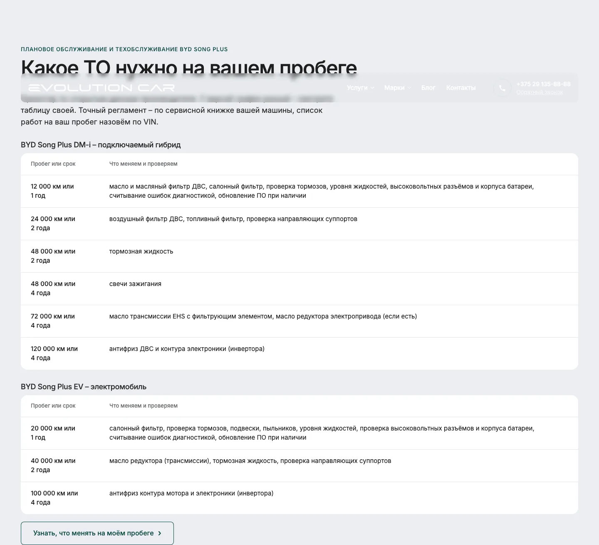
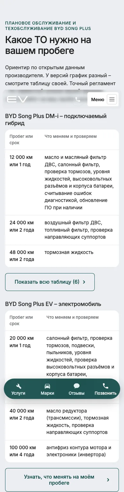
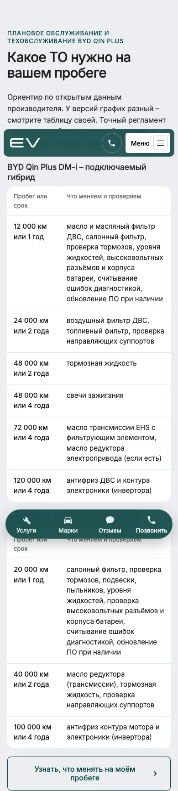

# Evolution Минск: регламент BYD Song Plus и Qin Plus разведён на гибрид и электро

**Вывод:** у двух BYD в таблице ТО больше нет каши из двух графиков. Гибрид DM-i и электромобиль EV теперь в отдельных таблицах с подписью. Уже на стенде, от тебя ничего не нужно.

## Что было не так

- В одной таблице подряд шли 9 строк: сначала график гибрида (12–120 тыс. км), потом электро (20–100 тыс. км), без подписи. Владелец EV читал про свечи и масло ДВС, которых у него нет.
- Последней строкой стояло «Моторное масло ДВС – 12 тыс. км». Это повтор первой строки.
- Это пункт А4 из аудита 18.11.

## Что сделано

- В паспортах двух моделей у каждой строки регламента теперь указана версия: «DM-i – подключаемый гибрид» или «EV – электромобиль». Версию определили по PDF-регламентам BYD, из которых взяты данные.
- Сборщик выводит отдельную таблицу на каждую версию с подзаголовком «BYD Song Plus DM-i – подключаемый гибрид». Строки внутри идут по пробегу.
- Над таблицами добавлена фраза: «У версий график разный – смотрите таблицу своей».
- Дубль про масло убран. Если в строке регламента с тем же пробегом уже есть эта работа, жидкость второй раз не выводится.
- Попутно: «1 год» и «12 000 км» больше не разрываются переносом. Это касается всех таблиц регламента.

## Что проверено

- Сверил до и после все 19 таблиц регламента. Поменялись только Song Plus и Qin Plus, у остальных 17 текст тот же.
- Проверка страниц: обе модели проходят (PASS). На телефоне блок помечен гармошкой, длинная таблица гибрида открывается кнопкой «Показать всю таблицу (6)».
- Смотрел снимки на 390 и 1440 px, горизонтальной прокрутки нет.
- Выложено на стенд: [Song Plus](https://tema-mail.github.io/evolution-service-minsk-proto/design/brands/byd/song-plus/#reglament), [Qin Plus](https://tema-mail.github.io/evolution-service-minsk-proto/design/brands/byd/qin-plus/#reglament).

## Нужно от тебя

Ничего. Попутно нашёл 8 страниц, которые на телефоне не проходят нашу проверку. У них длинный блок без режима для телефона: карта сайта, Changan Qiyuan Q05, пять услуг BYD и ремонт Lixiang. Они не проходили ещё до этой правки. Записал в «Открыто» и починю следующим шагом.

## Что раскрыть

- Как выглядит таблица у любой другой модели.
- Почему два графика не стали одной таблицей с подписями внутри: на телефоне электро-график ушёл бы под кнопку «Показать всё».
