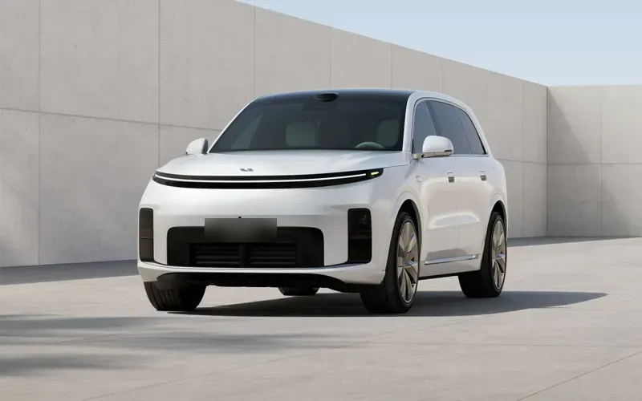

# Evolution Минск: 9 решений по аудиту – выбери буквы

Нужен твой выбор по 9 пунктам аудита, у каждого живой макет. Мой совет – **1А 2А 3А 4А 5А 6А 7В 8А 9А**: около 11 часов, себестоимость ≈11 тыс. ₽, по минимуму 3 000 ₽/ч – ≈32 тыс. ₽. Ответ буквами, например «1А 2Б 3А…».

<h2>1. Акция «−10 % до 1 декабря» – что с ней через 14 дней</h2>

Стоит на 47 страницах, взята с живого сайта заказчика. После 1 декабря станет враньём.

совет<b class="l">А</b>

Календарь: 17 ноября1 декабря2 декабря

Осенняя акция: −10 % на ремонт и ТО до 1 декабря

Плашка сама исчезает 2 декабря. Заказчика спрашиваем про зимнюю акцию.

0,3 ч · себестоимость 300 ₽ · клиенту от 900 ₽

<b class="l">Б</b>

Осенняя акция: −10 % на ремонт и ТО до 1 декабря 31 декабря

Продлить до 31 декабря. Только если заказчик скажет «да».

0,2 ч · себестоимость 200 ₽ · клиенту от 600 ₽

<b class="l">В</b>

Осенняя акция: −10 % на ремонт и ТО до 1 декабря

Снять со всех страниц сейчас.

0,2 ч · себестоимость 200 ₽ · клиенту от 600 ₽

<h2>2. «Батарею чиним по модулю» – оставлять ли</h2>

Стоит на 46 страницах. Заказчик не подтвердил. У BYD Blade и Zeekr 001 модулей нет – там это неправда.

совет<b class="l">А</b>

Li Auto L9 Чиним по модулю

BYD Han Диагностика и ремонт батареи

Zeekr 001 Диагностика и ремонт батареи

Убрать везде. Пишем «диагностика и ремонт батареи», пока заказчик не подтвердит.

0,5 ч · себестоимость 500 ₽ · клиенту от 1 500 ₽

<b class="l">Б</b>

Li Auto L9 – ремонт по модулю

BYD Han, Blade – по заключению диагностики

Zeekr 001 – по заключению диагностики

Оставить только там, где батарея собрана из модулей. Остальным – «по заключению диагностики».

1,5 ч · себестоимость 1 500 ₽ · клиенту от 4 500 ₽

<b class="l">В</b>

Li Auto L9 – чиним по модулю

BYD Han – чиним по модулю модулей нет

Zeekr 001 – чиним по модулю модулей нет

Оставить как есть и ждать заказчика. На двух марках ошибка висит.

0 ч · бесплатно, но с ошибкой на сайте

<h2>3. 70 вопросов без ответа мастера – что показывать</h2>

28 страниц, 70 вопросов в «Частых вопросах» без ответа, ещё 28 ответов – отписки. Ответы мастер может дать в одном видео по брифу.

совет<b class="l">А</b>

Сколько занимает ТО? ✓

Есть ли запчасти в наличии? ✓

Скрыто до ответа мастера: 70

Показываем только отвеченные. Остальные появятся, когда мастер ответит по видео-брифу.

0,5 ч · себестоимость 500 ₽ · клиенту от 1 500 ₽

<b class="l">Б</b>

Можно ли ездить с ошибкой батареи?

черновик – проверит мастер

Пишем ответы сами по паспортам моделей. Мастер вычитывает, без его «да» не выкладываем.

5 ч · себестоимость 5 000 ₽ · клиенту от 15 000 ₽

<b class="l">В</b>

Сколько стоит диагностика? уточнить

Работаете ли в выходные? уточнить

Даёте ли гарантию? уточнить

Оставить вопросы с пометкой «уточнить». На боевом сайте так нельзя.

0 ч · бесплатно

<h2>4. Ссылки на drive2, дилера и Википедию в тексте</h2>

300 ссылок на 71 странице. Часть ведёт к дилеру-конкуренту avtogermes. Фразу «перепрошивку делают частные мастера, есть жалобы» уберу в любом случае – она против своей услуги.

совет<b class="l">А</b>

На L9 чаще всего приезжают с (по данным drive2.ru) ошибкой подвески.

Мастер: «Начинаем с диагностики пневмоподвески, это 40 минут»

Убрать все ссылки, текст от лица мастера. Источники держим у себя в паспортах.

2 ч · себестоимость 2 000 ₽ · клиенту от 6 000 ₽

<b class="l">Б</b>

На L9 чаще всего приезжают с ошибкой подвески.

Источники: Li Auto, руководство владельца

Ссылки из текста убрать, внизу страницы блок «Источники»: только производитель.

2,5 ч · себестоимость 2 500 ₽ · клиенту от 7 500 ₽

<b class="l">В</b>

По данным drive2.ru и avtogermes.ru на L9 бывает…

→ клиент ушёл к дилеру

Оставить как есть.

0 ч · бесплатно, уводит людей с сайта

<h2>5. Geely EX5 и Galaxy E5 – одна машина, две страницы</h2>

Тексты совпадают на 99,5 %: для поиска это дубль. Спрос в Минске: «EX5» – 2 208, «Galaxy E5» – 242.

совет<b class="l">А</b>

/geely/ex5

/geely/galaxy-e5

Одна страница: Geely EX5 (Galaxy E5). Старый адрес – переадресация 301

Склеить в EX5, второе имя – в тексте и заголовке.

0,5 ч · себестоимость 500 ₽ · клиенту от 1 500 ₽

<b class="l">Б</b>

/geely/ex5

/geely/galaxy-e5

Galaxy E5 закрыта от поиска, указывает на EX5

Оставить обе, Galaxy E5 закрыть от поиска.

0,3 ч · себестоимость 300 ₽ · клиенту от 900 ₽

<b class="l">В</b>

/geely/ex5

/geely/galaxy-e5

совпадение 99,5 % – риск «малополезного»

Оставить как есть.

0 ч · бесплатно, риск для всего сайта

<h2>6. Таблицы регламента ТО</h2>

Подписаны «по регламенту производителя», а взяты с auto.ru и из книжек для других стран. У 15 моделей из 35 таблица пустая.

совет<b class="l">А</b>

Ориентир по открытым данным. Точный регламент – по сервисной книжке вашей машины.

Пустые 15 таблиц скрыты

Таблицы оставить с честной подписью, пустые скрыть.

1 ч · себестоимость 1 000 ₽ · клиенту от 3 000 ₽

<b class="l">Б</b>

Регламент вашей машины – по VIN за 5 минут
Узнать по VIN

Таблицы убрать. Вместо них кнопка «Узнать регламент по VIN» – это заявка.

0,5 ч · себестоимость 500 ₽ · клиенту от 1 500 ₽

<b class="l">В</b>

Интервал 1 уточнить

Интервал 2 уточнить

Интервал 3 уточнить

Ждать регламент от заказчика, пока «уточнить».

0 ч наших · ждём заказчика

<h2>7. Страницы-заглушки: Цены, Работы, О сервисе, Контакты</h2>

Сейчас там только первый экран и форма. Для «Контактов» данные есть: Машерова 15/4 и телефон. Прайса, работ и истории сервиса нет.

<b class="l">А</b>

УслугиМаркиЦеныРаботыО сервисеКонтакты

уточнить уточнить

Наполнить все четыре тем, что есть, пробелы – «уточнить».

2 ч · себестоимость 2 000 ₽ · клиенту от 6 000 ₽

<b class="l">Б</b>

УслугиМаркиЦеныРаботыО сервисеКонтакты

Скрыть все четыре из меню и от поиска, пока нет данных.

0,3 ч · себестоимость 300 ₽ · клиенту от 900 ₽

совет<b class="l">В</b>

УслугиМаркиЦеныРаботыО сервисеКонтакты

Минск, Машерова 15/4 Телефон · карта · как проехать

«Контакты» наполнить сейчас, три остальные скрыть до данных заказчика.

1 ч · себестоимость 1 000 ₽ · клиенту от 3 000 ₽

<h2>8. Картинка первого экрана на страницах моделей</h2>

Сейчас на всех моделях одно сгенерированное фото из макета. Рендеры есть в наших конфигураторах на 11 моделей из 35: Li Auto L6, L8, L9, Zeekr 001, 007 GT, 009, X, Xiaomi YU7, Avatr 07, Geely Galaxy E5, Starship 7. Китайские надписи и номера на рендерах закрываем.

совет<b class="l">А</b>

<b style="font-size:14px">Сервис Li Auto L9 в Минске</b>

Позвонить мастеру

Рендер своей модели на 11 страницах, на остальных – общее фото, пока нет живых.

2 ч · себестоимость 2 000 ₽ · клиенту от 6 000 ₽

<b class="l">Б</b>

<b style="font-size:14px">Сервис Li Auto L9 в Минске</b>

Позвонить мастеру

Как сейчас: одно сгенерированное фото техцентра на всех моделях.

0 ч · бесплатно

<b class="l">В</b>

<b style="font-size:14px">Сервис Li Auto L9 в Минске</b>

Позвонить мастеру

Фото L9 в нашем техцентре – от заказчика

Ждать живые фото заказчика по видео-брифу.

0 ч наших · ждём заказчика

<h2>9. Меню в шапке: как попасть на услугу и марку</h2>

Сейчас в шапке простые ссылки на разделы. Услуг 16, марок 11, моделей 35.

совет<b class="l">А</b>

Услуги ▾Марки ▾

Услуги

Марки

ТО

Li Auto

Диагностика

Zeekr

Батарея

BYD

Кондиционер

Geely

Выпадающее меню: услуги и марки в две колонки, на телефоне – списком.

3 ч · себестоимость 3 000 ₽ · клиенту от 9 000 ₽

<b class="l">Б</b>

УслугиМаркиЦены

Страница «Марки»: 11 карточек

Как сейчас: ссылка ведёт на страницу раздела, там выбор.

0 ч · бесплатно

<b class="l">В</b>

Моя машина ▾

Марка: Li Auto · Zeekr · BYD · Geely

Модель: L6 · L7 · L8 · L9

Выбор «марка → модель» прямо в шапке, сразу на страницу своей машины.

4 ч · себестоимость 4 000 ₽ · клиенту от 12 000 ₽

## Делаю сам, решения не нужно

- **Цифры, которые расходятся** (L9 – 44,5 или 42,6 кВт·ч, двигатель 112 и 115 кВт, Voyah Dream – гибрид или электро): сверяю по производителю, по году выпуска.
- **H1 не равен запросу** на 78 страницах («Тормоза в Минске»): SEO-проход по спросу, формула «услуга + марка/модель + в Минске».
- **Значки Telegram и Макс** без ссылок убираю совсем, пока заказчик не даст ссылки – как на всех наших сайтах.
- **Фраза против своей услуги** («перепрошивку делают частные мастера, есть жалобы») – убираю.
- **Досматриваю глазами** планшет на «Блоге», «Контактах», «Работах» и формы на телефоне.

## Что раскрыть

- Полный аудит, 40 косяков: https://tema-mail.github.io/razbory/evolution-minsk-audit-40d87ea3/
- Стенд дизайна: https://tema-mail.github.io/evolution-service-minsk-proto/design/
- Цена посчитана по product-lead: час 1 000 ₽ себестоимости, минимум продажи 3 000 ₽/ч. Часы – моя оценка без запаса.
