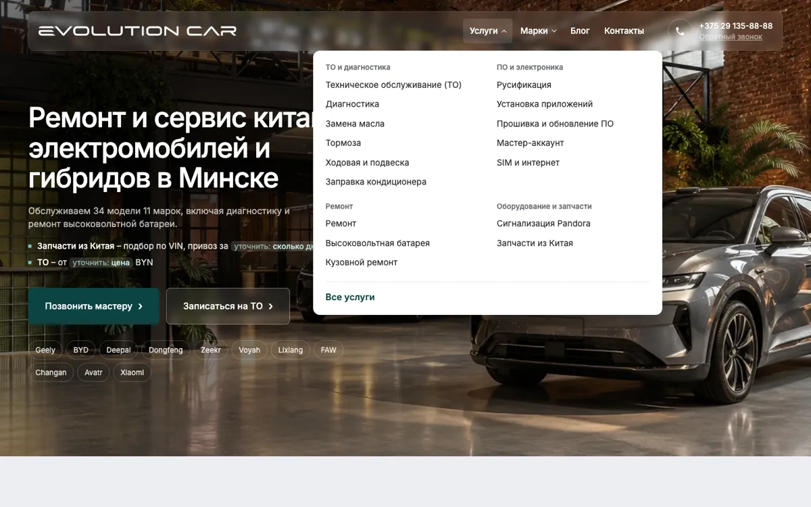
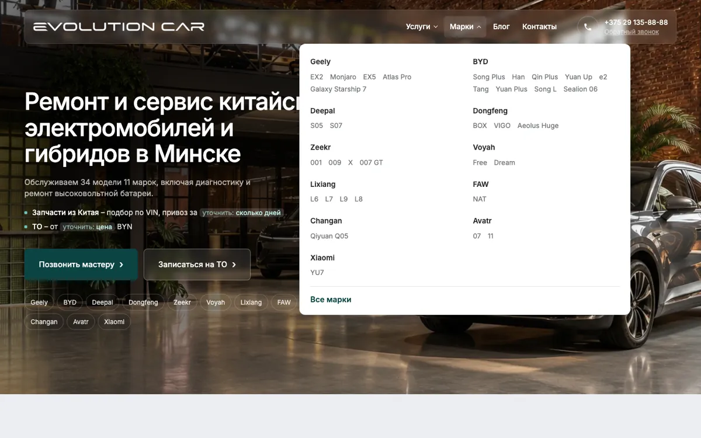
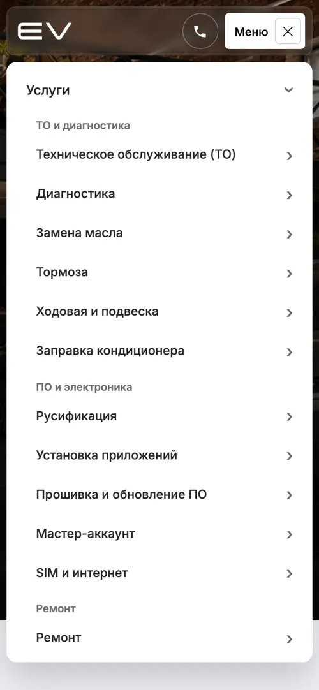
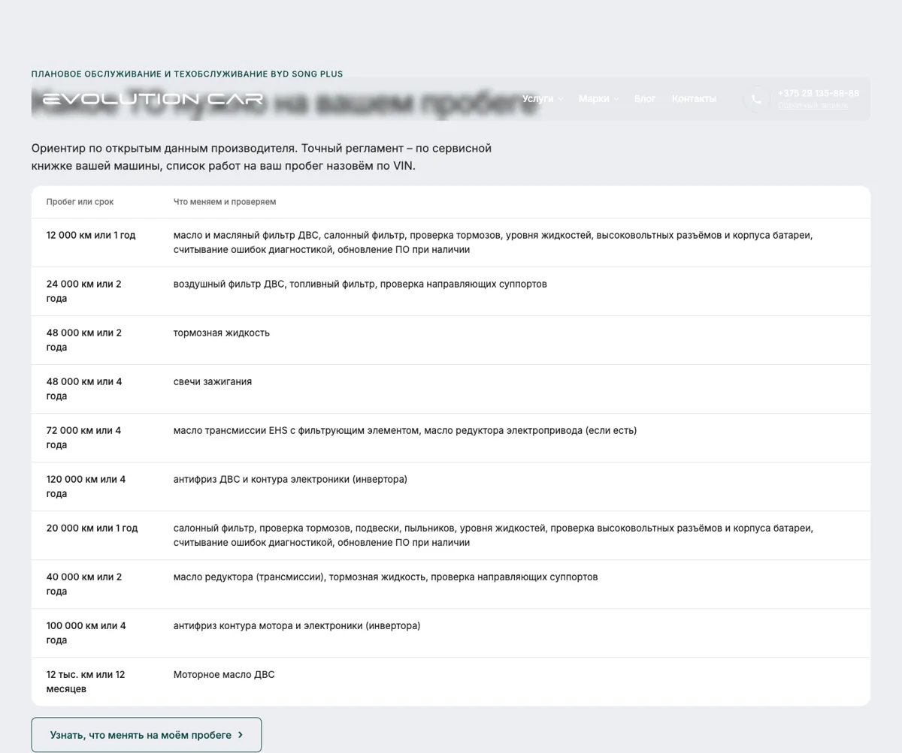
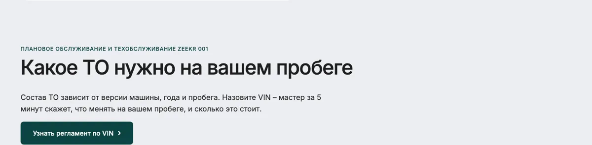

# Evolution Минск: 9 решений по аудиту внедрены и выложены на стенд

Всё по твоим буквам сделано: 1А 2А 3Б 4А 5А 7В 9А – на всём сайте, 6 – показ на двух моделях, 8Б – в техдолге. Правило «без чужих ссылок» закреплено для всех сайтов и ловится проверкой само.

Стенд: https://tema-mail.github.io/evolution-service-minsk-proto/design/

## Что исчезло: обещания без подтверждения и чужие сайты

- **1А, акция:** плашка «−10 % до 1 декабря» сама пропадёт 2 декабря – и в сборке, и на уже выложенных страницах (скрипт по дате Минска), окно акции тоже. Про зимнюю акцию – вопрос О08 в брифе.
- **2А, батарея:** «чиним по модулю» убрано отовсюду: первые экраны, хабы, услуги, паспорта. Теперь – «диагностика и ремонт, по заключению диагностики».
- **4А, источники:** чужих ссылок на сайте 0 (было 300). Тексты 29 паспортов моделей переписаны от лица сервиса: «признак → причина → что проверяем», без «владелец на drive2 пишет». На Monjaro убрана фраза «частные мастера ломают».

## Что появилось: ответы, контакты, меню, заголовки

- **3Б, ответы:** 70 вопросов без ответа и 36 отписок – теперь ответы по фактам паспортов. Выложены сразу. Где мы предположили практику сервиса (гарантия, свои запчасти, сроки привоза, страховка) – список на сверку после брифа, вопрос О09.
- **5А:** Galaxy E5 склеена с EX5. Заголовок «Ремонт и ТО Geely EX5 (Galaxy E5) в Минске», со старого адреса – переадресация, 301 записан в карту сайта.
- **7В:** «Контакты» наполнены: адрес, телефон, маршрут в Яндекс Картах, что взять с собой. «Цены», «Работы», «О сервисе» убраны из меню и подвала и закрыты от поиска до данных заказчика.
- **9А, меню:** на компьютере «Услуги ▾» и «Марки ▾» в шапке – услуги по 4 группам, марки с моделями. На телефоне – в окне «Меню» гармошками.
- **H1 под запрос:** 78 страниц услуг – «Ремонт тормозов BYD в Минске» вместо «Тормоза BYD в Минске».

<figure style="margin:0;flex:1 1 420px"><figcaption>Меню «Услуги» на компьютере</figcaption></figure>
<figure style="margin:0;flex:1 1 420px"><figcaption>Меню «Марки» с моделями</figcaption></figure>
<figure style="margin:0;flex:0 1 220px"><figcaption>Телефон</figcaption></figure>

## Что ждёт твоего выбора: регламент ТО (6)

Открой две страницы и скажи букву – раскатаю на все 34 модели:

- **А – таблица с честной подписью:** https://tema-mail.github.io/evolution-service-minsk-proto/design/brands/byd/song-plus/#reglament
- **Б – вместо таблицы кнопка «Узнать регламент по VIN»:** https://tema-mail.github.io/evolution-service-minsk-proto/design/brands/zeekr/001/#reglament

<figure style="margin:0;flex:1 1 420px"><figcaption>А – Song Plus</figcaption></figure>
<figure style="margin:0;flex:1 1 420px"><figcaption>Б – Zeekr 001</figcaption></figure>

8Б – в техдолге: первый экран моделей остаётся общим фото, пока ты не дашь способ генерировать авто.

## Как проверено

- Проверка прототипа на всех 134 страницах дизайна: 132 PASS. Не прошли «О сервисе» и «Работы» – это скрытые заглушки без текста, как и до правок. Живой стенд после выкладки проверен: «Контакты», меню, H1, переадресация EX5, регламент Б.
- По всему сайту поиском: ссылок на чужие сайты 0, «по модулю» 0, вопросов «ответ мастера» 0, длинных тире 0, «Цены/Работы/О сервисе» в меню 0.
- Глазами: меню на 1440, 1180 и 390, «Контакты» на телефоне, оба варианта регламента. На «Контактах» нашёл и убрал повтор блока адреса.
- Правило 4А: стандарт сайтов (site-lead), память, `proverka.mjs` – теперь FAIL «ссылки на чужие сайты». Проверил на подставной странице: ловит drive2, карту пропускает.

## Нужно от тебя

- Буква по регламенту: А или Б.
- Другие проекты с чужими ссылками, сам не чинил: **Evolution Car BY** – Википедия 10, дилер avtogermes 10, auto.ru 3, zr.ru 3, autonews 1; **Community Dealer** – auto.ru 94 (похоже на их объявления – это можно, проверить в их чате).
- Проект Evolution правят и другие чаты (брифолог) – коммитил только своё.

## Что раскрыть

- Списки «сверить после брифа»: в проекте `docs/audit/2026-11-18-posle-brifa-modeli.md` и `…-uslugi.md`.
- Прошлая страница решений: https://tema-mail.github.io/razbory/evolution-minsk-resheniya-023b0f35/
