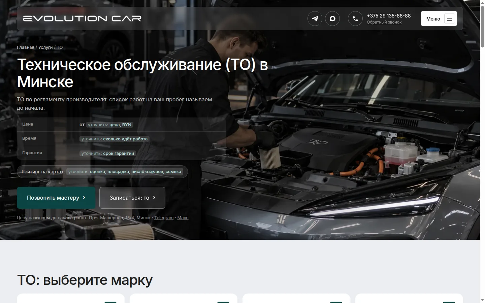
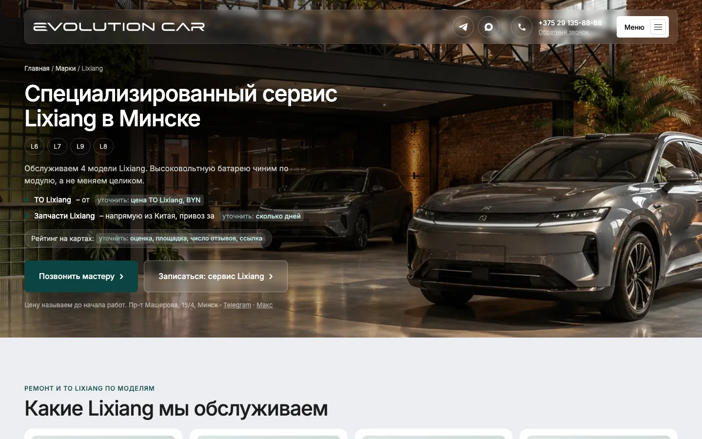
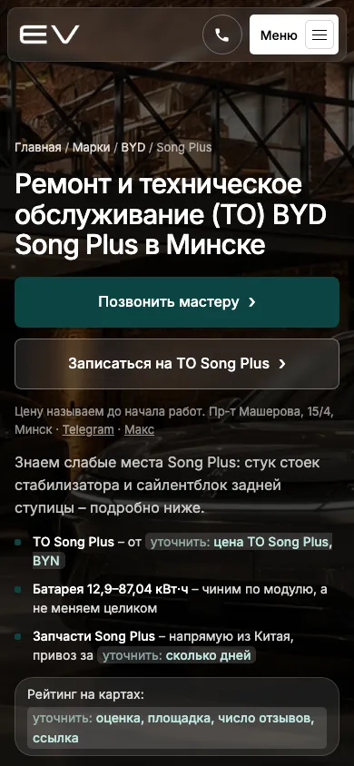

# Evolution Минск: весь сайт в дизайне главной – 135 страниц

Все страницы прототипа теперь в дизайне главной: https://tema-mail.github.io/evolution-service-minsk-proto/design/ . С главной можно ходить по услугам, маркам, моделям, ценам и контактам, и все страницы будут в том же стиле.

## Что сделано

- 134 страницы прототипа получили шапку, подвал, таб-бар, зелёный и белые карточки, как на главной. Главная осталась ручной.
- Тексты и блоки берутся из прототипа автоматически, из последнего коммита. Поправили прототип – пересборка дизайна подхватывает правку сама.
- Первый экран каждой страницы – текст на фото на весь экран. Фото взяты из макета: ТО, диагностика, русификация, лофт с машинами. Для Zeekr – свой кадр.
- «[запросить: …]» стало «уточнить: …», как на главной. Заметки дизайнеру убраны.
- Где нужно живое фото заказчика, стоит аккуратная заглушка «Место под фото» с подписью, что снять. Под видеоотзывы – тёмная плитка с кнопкой воспроизведения.
- Длинные таблицы и списки на телефоне свёрнуты: видно первые строки, остальное открывается кнопкой «Показать всю таблицу».

## Как проверено

- Проверка прототипа на всех 135 страницах: 130 PASS.
- Оставшиеся 5 – тексты самого прототипа, не вид: подзаголовок-перечень на «О сервисе» и «Работах», надзаголовки «Как проходит приложения / кузов / кондиционер» на трёх услугах. Их правит чат прототипа.
- Остатков прототипа на страницах нет, битых внутренних ссылок нет.
- Живой стенд: все 135 адресов отвечают 200, снимки 1440 и 390 через браузер на сервере.
- Коммиты: ffa74b8 и 34f3f3b в проекте, стенд – 13e0c87 и c9d2cab, только папка /design/.

## Нужно от тебя

- Пройтись по сайту с главной и сказать, что не так по виду.
- Решить, ставить ли рендеры моделей с конфигураторов на первые экраны моделей, вместо общего фото.
- От заказчика по-прежнему нужны живые фото, видео и отзывы – места под них размечены.

## Что раскрыть

- Тексты прототипа заметил по ходу: кнопка «Записаться: то BYD» с маленькой «то», перечни в первых экранах «О сервисе» и «Работ». Передать в чат прототипа.
- Меню в шапке пока короткое, 7 разделов. Можно сделать выпадающее с услугами и марками, как в прототипе.
