# Карточка Zeekr 8X на телефоне: правки и три варианта ритма

**Вывод: все твои правки на карточке. Видео горизонтальное и занимает четверть экрана. Сравнение с 9X и L9 на телефоне убрано. В расчёте нет повтора машины, а в форме выбор «расчёт, лизинг, кредит». В тест-драйве только 8X, конфигуратор видно по снимку. Карточка стала 15,5 экрана вместо 17,8. Против «сплошного текста» я сделал три варианта ритма прямо на карточке: зебра, главы и цифры-удары. Открой каждый на телефоне и выбери. Рекомендую «Главы»: страница делится на 4 части, и между ними есть пауза.**

15.11.2026 · [карточка как сейчас](https://tema-mail.github.io/razbory/evolutioncar-zeekr-8x-d2effe31/prototip/)

## 1. Что исправил по твоим скринам

**Видео в обзоре.** Было 356×688 px – выше экрана и уходило вниз. Ролик горизонтальный, но в разметке стояла высота 688, и браузер растягивал его по ней. Стало 16:9, 356×200 px – четверть экрана.

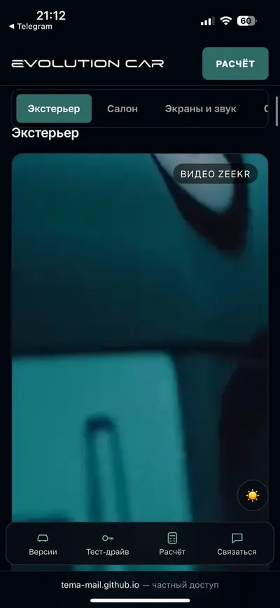
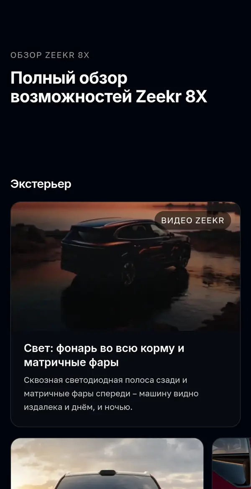

**«Чем 8X отличается от 9X и L9»** на телефоне больше не показывается, на десктопе таблица осталась.

**«Рассчитаем точную стоимость».** Картинки машины больше нет: она уже была в первом экране и в конфигураторе. Вместо неё одна строка: какая версия и цвет выбраны. Вместо «Расчёт под ключ / Тест-драйв / Лизинг» теперь «Расчёт под ключ / Лизинг / Кредит». Кнопка тест-драйва ведёт в ту же форму, но выбор цели там скрыт – остаётся «Уточнить наличие и тест-драйв».

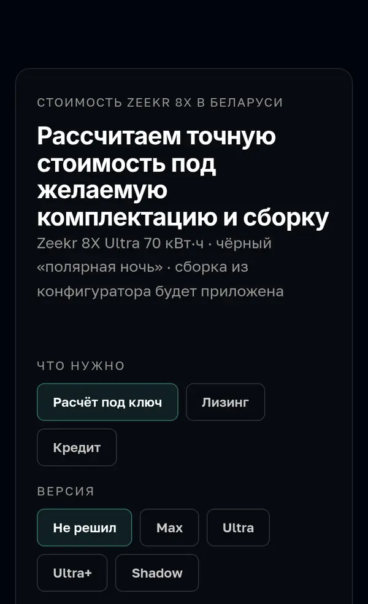

**Тест-драйв** – только Zeekr 8X, вкладок 9X и «Оба подряд» нет. **Конфигуратор** – на карточке снимок самого конфигуратора с версиями и цветами и метка «нажмите, чтобы открыть». По нажатию он открывается на весь экран, проверил.

## 2. Три варианта против сплошного текста

Сейчас все блоки на одном тёмном фоне, с одинаковым надзаголовком, заголовком и абзацем. Глазу не за что зацепиться, и страница читается как один длинный текст.

| Вариант | Что меняется | Длина | Открыть на телефоне |
|---|---|---|---|
| **A. Зебра** | Блоки чередуют фон: тёмный и чуть светлее. Цена под ключ и свой сервис – на светлом фоне, как отдельные листы | 16,3 экрана | [?ritm=a](https://tema-mail.github.io/razbory/evolutioncar-zeekr-8x-d2effe31/prototip/?ritm=a) |
| **B. Главы** | Страница делится на 4 главы: Машина, Цена и оплата, Заказ и гарантии, После покупки. Перед каждой – кадр на всю ширину с номером и названием | 17,9 экрана | [?ritm=b](https://tema-mail.github.io/razbory/evolutioncar-zeekr-8x-d2effe31/prototip/?ritm=b) |
| **C. Цифры-удары** | Между текстовыми блоками – полосы на зелёном фоне с одной крупной цифрой: 660 кВт, до 1416 км, от 356 800 ¥, Машерова 15/4 | 17,2 экрана | [?ritm=c](https://tema-mail.github.io/razbory/evolutioncar-zeekr-8x-d2effe31/prototip/?ritm=c) |

Можно сочетать: например, B + светлая цена из A.

### Вся страница сверху вниз: как сейчас, A, B, C
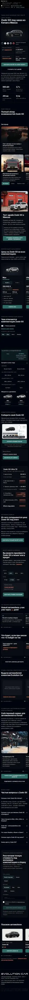 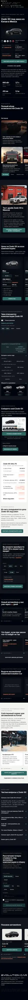  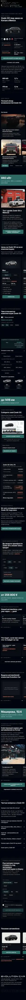

### Переход «конфигуратор → цена»
**Как сейчас** 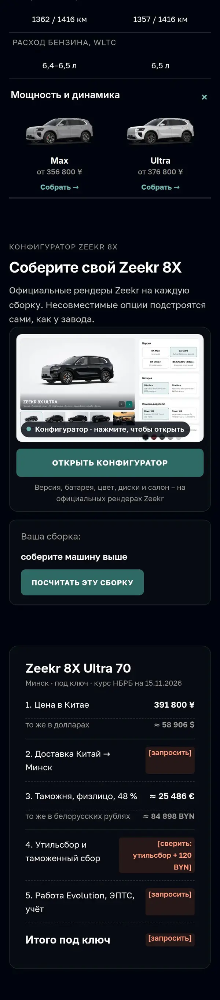
**A. Зебра** 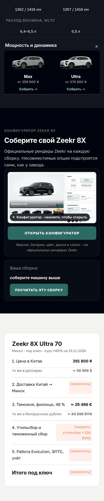
**B. Главы** 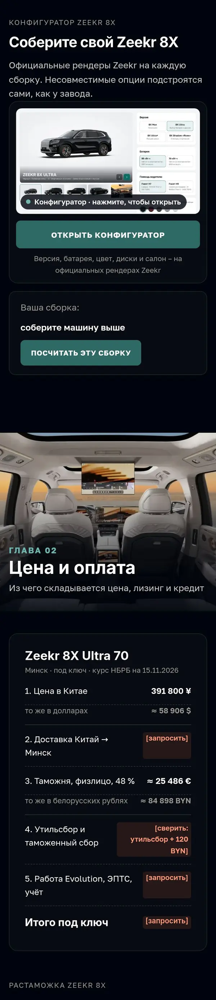
**C. Цифры-удары** 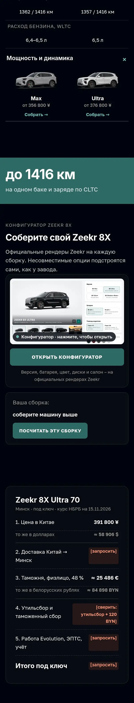

### Переход «выдачи → свой сервис»
**Как сейчас** 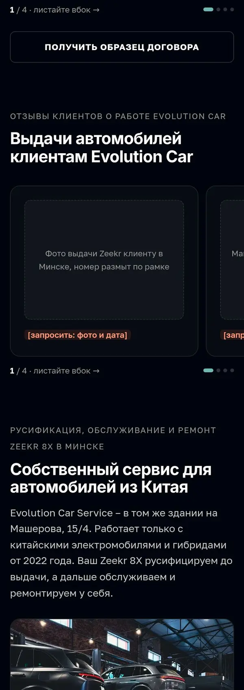
**A. Зебра** 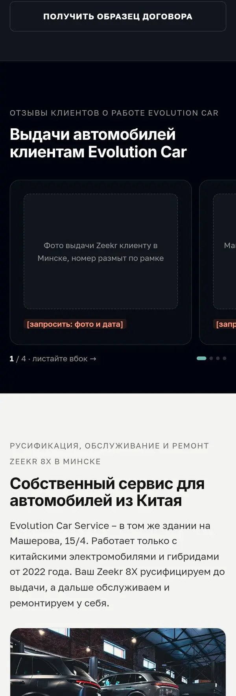
**B. Главы** 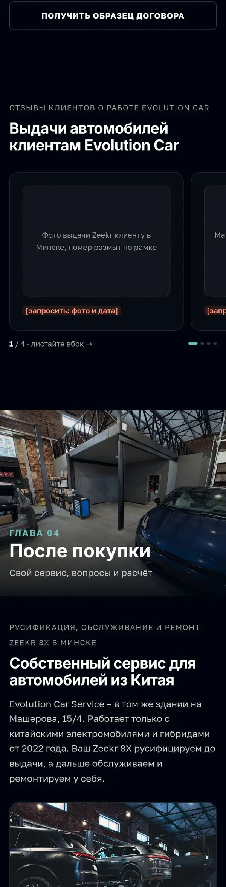
**C. Цифры-удары** 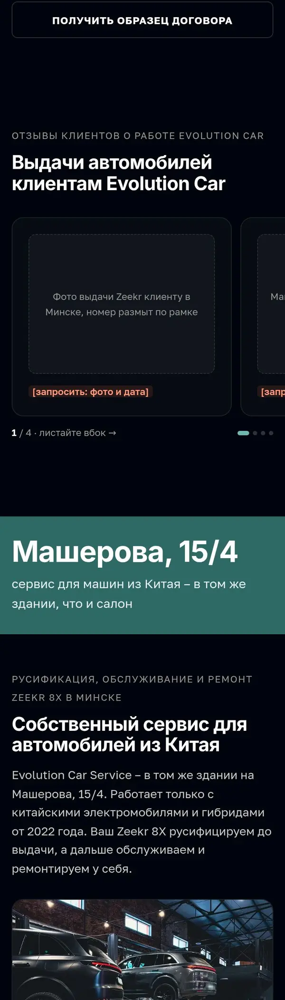

**Почему рекомендую B.** Глава отвечает на вопрос «где я и что дальше», а кадр даёт глазу отдохнуть между блоками текста. Кадры глав взяты только из тех фото, которых больше нет на странице. Минус варианта: +2,4 экрана длины. A короче всех, но разницу фона на тёмной теме видно слабо. C ярче всех, но четыре зелёные полосы спорят с зелёными кнопками.

## 3. Что вошло в правила

- **Видео на телефоне** – только горизонтальное 16:9 и не выше трети экрана. Проверка прототипа валит видео выше 40 % экрана или вертикальное.
- **Сравнение с другими моделями** на телефоне не ставим (режим «скрыть»), только на десктопе. Проверка валит такой блок, если он виден на 390 px.
- **Одна картинка товара – один раз** на странице.
- **Цели формы – по смыслу блока:** у денег – расчёт, лизинг, кредит. Тест-драйва в этом выборе нет.
- **В карточке модели – только эта модель:** без вкладок других моделей.
- **Карточка конфигуратора** – снимок самого инструмента с меткой «нажмите, чтобы открыть».

Записано в правила мобильной вёрстки, в журнал твоих решений и в правила карточек проекта EV Car. Проверку прогнал на двух версиях: старая карточка упала на двух новых правилах, новая проходит.

## Нужно от тебя

1. Вариант ритма: A, B, C или сочетание.
2. Слово по остальным блокам со страницы разбора мобилки, если ещё не смотрел.

## Что раскрыть

- Как будут выглядеть главы на десктопе.
- Короче тексты под заголовками: на телефоне одна строка вместо абзаца.
