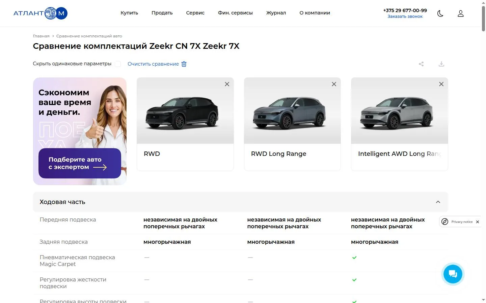
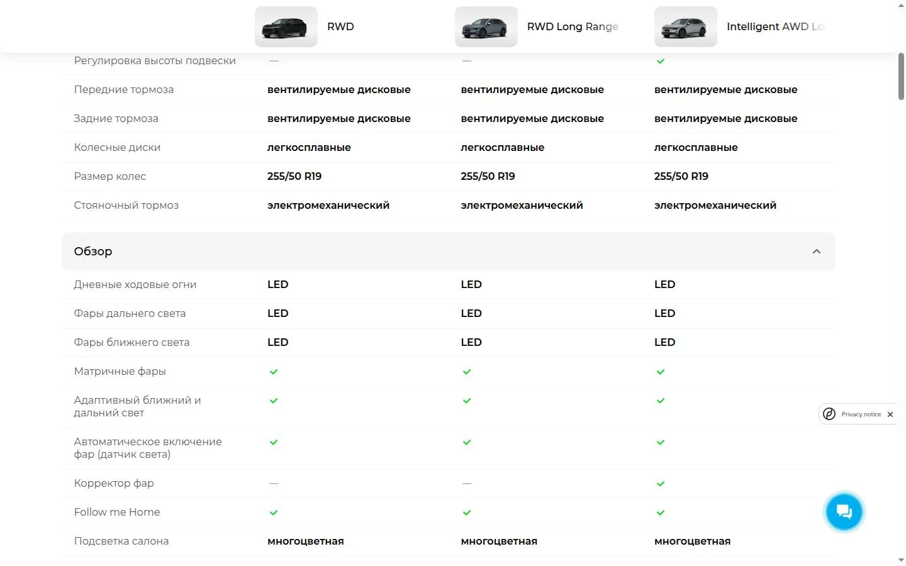
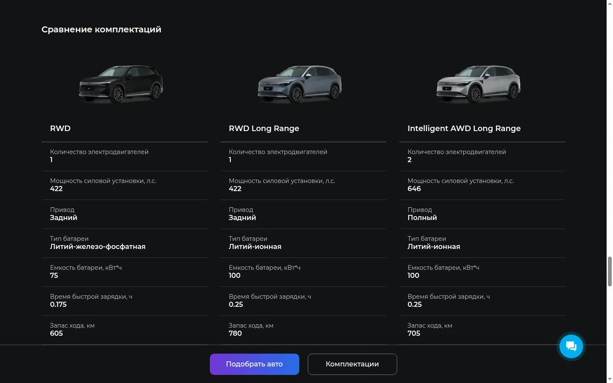
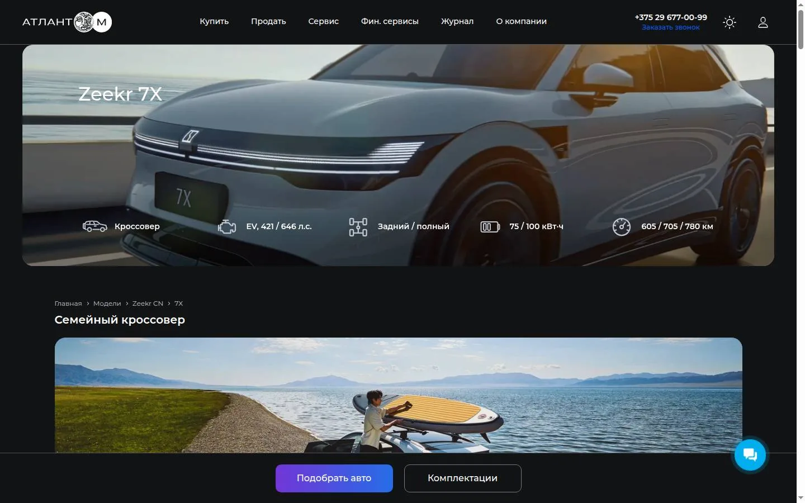
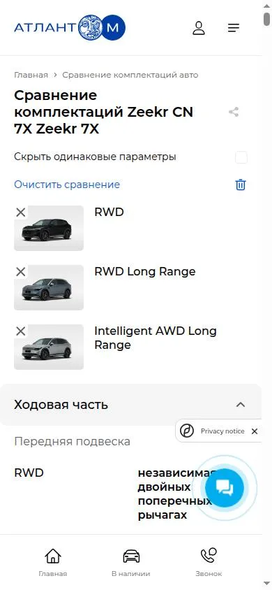

# Атлант-М против Evolution Car: карточки авто

**Вывод: Атлант-М силён охватом и наличием, но карточки у него технически дырявые, а Li Auto, Voyah, Deepal, Avatr, Xiaomi, Denza и Aito у них нет вообще. Обгоняем так: в первую очередь марки, которых у них нет, затем Zeekr 7X как пилот новой карточки. На ней их сравнение комплектаций плюс то, чего у них нет: цена каждой комплектации под ключ, конфигуратор и ответы на вопросы.**

Снято 15.11.2026: atlantm.by (sitemap, исходный HTML, живой браузер на 1440 и 390 px), наш evolutioncar.by, спрос и выдача Минска из съёма 10–11.11.2026 (Wordstat и выдача через XMLRiver, Минск – регион 157). Новых платных запросов не было.

## 1. Где Атлант-М сильнее нас

- **Объём.** В sitemap 4 576 адресов: 2 151 страница сервиса, 812 карточек новых машин в наличии, 614 карточек машин с пробегом, 509 статей журнала, 14 марок и 76 моделей в каталоге, у каждой модели отдельная страница комплектаций (ещё 76).
- **Выдача по нашим моделям** (съём 11.11): Zeekr 7X – 2-е место и в Яндексе, и в Google; Zeekr 001 – 3-е в Яндексе; BYD Song L – 3-е в Яндексе, в Google 2-е обзором из журнала; Leapmotor C11 – 2-е и там и там; «электромобиль купить минск» – 1-е в Google страницей /cars/electro.
- **Журнал работает на модели.** Обзоры стоят в Google по модельным запросам: «lixiang l6» – 2-е место обзором, хотя Li Auto они не продают.
- **Реальный склад.** Карточки авто в наличии с VIN, цветом и ценой, в title: «Купить BELGEE S50 Flagship plus Седан 2026 г., 1.5 л., синий в Минске – VIN».

Наш сайт сегодня: 129 карточек моделей, 13 конфигураторов, в title цена («Zeekr 7X 2026 из Китая под ключ – ориентир от 49 000 $»), в разметке Car и Offer с ценой, страница отдаётся готовым HTML. Слабое место – текст: около 700 слов по одному шаблону на всех, без комплектаций и без вопросов.

## 2. Где у них дыры, в которые мы заходим

| Дыра Атлант-М | Факт | Что делаем мы |
|---|---|---|
| Карточка машины в наличии пустая для робота | /cars/new/14152802: в исходном HTML нет H1, из текста только подвал, всё дорисовывает скрипт (Next.js). Адрес – номер, без марки и модели | Карточку отдаём готовым HTML: H1, характеристики и цена в коде. Адрес со словами: /catalog/zeekr/7x/…  |
| Разметка товара не работает | Product ставится скриптом, в Offer нет цены, а это обязательное поле для расширенного сниппета | У нас Car и Offer с ценой уже стоят, добавляем цену каждой комплектации |
| Чужой рейтинг на каждой модели | Рейтинг 4,4 по 19 843 оценкам – отзывы о компании, приклеены к каждой модели. Google за такое снимает звёзды и может наказать вручную | Рейтинг модели не ставим, только честные отзывы клиентов о сделке |
| «В наличии» при пустом складе | У Zeekr 7X в разметке «InStock», а в данных страницы список машин пустой | Пишем честно: «под заказ, срок N недель» |
| Мусор в шаблоне | Title и H1 комплектаций: «Zeekr CN 7X Zeekr 7X», бренд «Zeekr CN», которого никто не ищет; смайлы в description | Чистые названия, как ищут люди: «Zeekr 7X», «Зикр 7Х» в тексте |
| Нет цен у комплектаций | Ни на модели, ни на сравнении нет цены ни у одной версии | Цена под ключ в Минске у каждой комплектации – главный козырь |
| Неряшливые данные | «Время быстрой зарядки 0.175 ч», «Размер AR-HUD 36.21» без единиц, «миллимитрового» с ошибкой | Пишем по-человечески: «10–80 % за 10,5 мин» |
| Нет китайского премиума | В каталоге нет Li Auto, Voyah, Deepal, Avatr, Xiaomi, Denza, Aito | У нас эти марки уже есть, плюс конфигураторы |

**Спрос там, где Атланта нет** (Wordstat, Минск, месяц, головные фразы): deepal 3 141, voyah 2 373, лисян 1 475, lixiang 841, avatr 651, li auto 342, denza 215, aito 195, xiaomi su7 177, xiaomi yu7 160. Всего около 9,5 тыс. запросов в месяц по Минску. По 29 запросам этих марок Атлант-М в первой десятке только дважды, и оба раза обзором из журнала, а не карточкой: «lixiang l6» – 2-е место в Google, «xiaomi su7» – 7-е в Google.

**Спрос в прямом бою с ними:** zeekr 2 244 + «зикр» 1 565, byd 11 956, leapmotor 1 045, byd song plus 1 514, zeekr 001 492, zeekr 7x 274, byd song l 179.

## 3. Что забираем из дизайна комплектаций

Берём приём, а не их код и картинки: рендеры машин у нас свои, с сайтов производителей, как в конфигураторах.

1. **Колонка на комплектацию**, сверху рендер машины в цвете этой версии, крестик убрать колонку. До 4 колонок.
2. **Липкая шапка при прокрутке**: миниатюра машины и название версии едут вместе с таблицей, не теряешься на 150-й строке.
3. **Группы-гармошки**: Ходовая, Обзор (свет, стёкла, камеры), Безопасность, Комфорт, Мультимедиа. У Zeekr 7X около 150 строк.
4. **«Скрыть одинаковые параметры»** – одна галочка, и остаются только различия.
5. **Галочка и прочерк** вместо «да / нет»: глаз ловит различия сразу.
6. **Первая плитка – призыв**: «Подберите авто с экспертом». У нас – «Рассчитать под ключ».
7. **Поделиться и скачать** – ссылку на сравнение кидают жене и в чат.

**На странице модели** короткий блок из 7 главных строк по всем версиям и кнопка «Комплектации» в нижней панели:

**Первый экран** – полоса из 5 иконок: кузов, мощность, привод, батарея, запас хода. Тоже берём.

**Телефон**: параметр заголовком, под ним версии строками. Читается, но длинно, поэтому у нас по умолчанию включено «только различия».

**Сверху их решения добавляем то, чего у них нет:**
- цена под ключ в Минске под названием каждой версии;
- строка «за доплату X $ получаете: +224 л.с., пневма, полный привод» между соседними версиями;
- кнопка «Собрать в конфигураторе» у каждой версии, ведёт в наш конфигуратор с этой сборкой;
- 5–7 вопросов под таблицей: зарядка в Беларуси, гарантия, сроки, растаможка электромобиля.

## 4. План: как обогнать

1. **Сначала марки, которых у них нет:** Li Auto, Voyah, Deepal, Avatr, Xiaomi, Denza, Aito. Карточки моделей по новому образцу: комплектации с ценой, конфигуратор, вопросы. Там соперники – импортёры (westmotors.by, voltauto.by, ev-motors.by), не дилер с журналом на 509 статей.
2. **Пилот прямого боя – Zeekr 7X:** у нас уже есть конфигуратор, у них 2-е место без цен и без конфигуратора. На нём доводим образец и смотрим позиции через 3–4 недели.
3. **Страница комплектаций отдельным адресом** /catalog/<марка>/<модель>/trims/ – только у моделей со спросом на «комплектации» (geely boyue l – 45 в месяц, belgee x50 – 42, byd song plus – 12). Остальным хватит блока на карточке.
4. **Карточки машин в наличии** – только если у клиента есть реальные машины с VIN. Готовый HTML и адрес со словами, это то, что у Атланта пустое.
5. **Вычистить текст карточек**: 700 слов шаблона заменить на сведения о модели: версии, отличия, зарядка, сроки пригона. Без воды и без «лучший выбор».

## Смежное, найдено по пути (не чинил)

- Конфигураторы Zeekr 7X и 9X живые (код 200), но их нет в sitemap – роботы их не видят.
- Опечатка в адресе: /catalog/byd/yuan-plus-chapmion-edition/ (chapmion вместо champion).
- Запас хода Zeekr 7X: у нас «до 715 км», у Атланта 605 / 780 / 705 по версиям – сверить с производителем.
- Проект лежит двумя копиями: ~/Documents/evolution-car-by и ~/Sites/evolution-car-by (удалённый Deford2027), последние коммиты совпадают – решить, какая рабочая.
- В Google на 11.11 ещё стоят старые адреса (/zeekr9x, /avatr12, /denzad9); 301 на новые работают, проверено 15.11.

## Нужно от тебя

1. **Цены по комплектациям под ключ** – кто их даёт (менеджер Evolution или считаем сами от цены в Китае)? Без них главный козырь против Атланта пропадает.
2. **Порядок:** начинаем с марок, которых у Атланта нет (рекомендую), и параллельно Zeekr 7X как пилот образца?
3. **Есть ли у клиента машины в наличии с VIN** – тогда делаем карточки наличия.

## Что раскрыть

- Полный список строк сравнения Zeekr 7X (150 параметров по группам) – как шаблон данных для всех моделей.
- Прототип новой карточки Zeekr 7X с блоком комплектаций.
- Позиции по всем 129 нашим моделям против Атланта и импортёров (XMLRiver, смета до 150 ₽).
