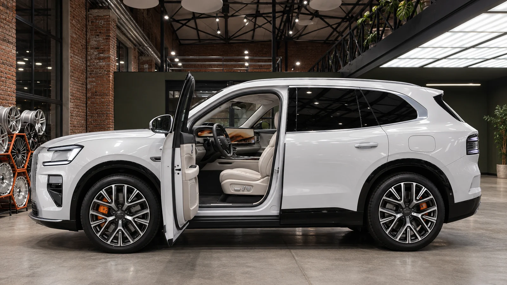
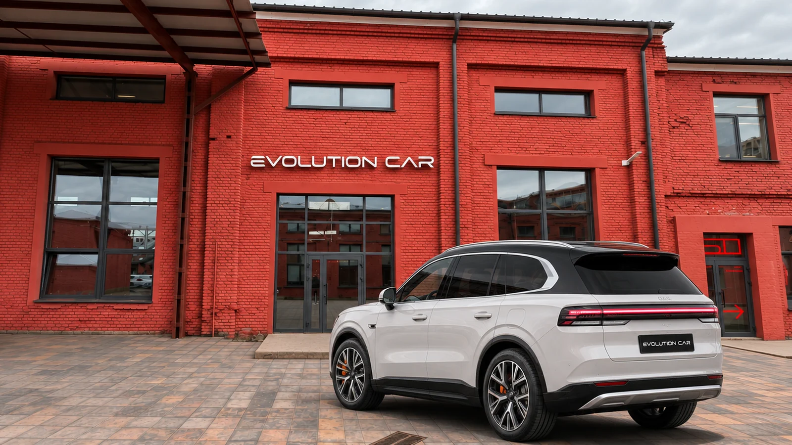

# Evolution Car: 6 кадров с новым логотипом на выбор

**Вывод:** на любимом кадре у фасада стоит новая вывеска «EVOLUTION CAR», на номере – чёрная табличка с тем же логотипом. Рядом 5 новых ракурсов для отдельных страниц: салон машины, открытая дверь в зале, профиль, вид сзади, вид спереди в зале. Выбери, какой кадр на какую страницу.

Логотип взят из файла сайта, тот же шрифт, что в шапке evolutioncar.by. Машина – Zeekr 8X по официальным рендерам. Фон – настоящий фасад на Машерова, 15/4 и настоящий зал по вашим фото. Кадры 1600×900, WebP, 160–270 КБ.

## 0. У фасада, ¾ спереди – твой кадр с новым логотипом

- **Что поменяли:** вывеска «EVolution electric car» заменена на «EVOLUTION CAR» в шрифте логотипа. Номер теперь чёрный, с белым логотипом. Чужой Mercedes с края обрезан.
- **Где уместен:** первый экран карточки, каталог, блок «Где посмотреть». Этот же кадр теперь стоит в отчёте недели для клиента.

## 1. Салон машины: место водителя, через стекло – ваш зал

- **Где уместен:** блок «Салон и экраны» в карточке, статьи про комплектации.
- **Получилось:** салон как на официальном фото Zeekr: руль, двойной экран, светлая кожа. За стеклом кирпич, фермы, ряд машин.
- **Учти:** на экранах карта без надписей, китайского текста нет. Стойка с дисками за стеклом – как на фото зала.

## 2. В зале, открыта водительская дверь

- **Где уместен:** «Посмотреть вживую», «Тест-драйв», страница «О салоне».
- **Получилось:** видны сиденье, руль и экран. Зал узнаётся: фермы, акустические диски, оливковая стена.

## 3. Профиль у фасада

- **Где уместен:** галерея карточки (размер и силуэт), блок характеристик, сравнение версий.
- **Получилось:** вся машина целиком, колёса точные, вывеска над ней.

## 4. Сзади ¾ у фасада

- **Где уместен:** второй кадр галереи после кадра 0, блок «Заказ и доставка».
- **Получилось:** сквозная полоса фонарей, чёрный номер с логотипом, вывеска.
- **Учти:** на двери багажника генератор нарисовал мелкий значок, читаемых букв нет. Если кадр берём, значок уберу.

## 5. Спереди в зале, низкая точка

- **Где уместен:** баннер главной, первый экран премиальной карточки, обложка статьи.
- **Получилось:** решётка и световые полосы на весь кадр, чёрный номер с логотипом читается.

## Нужно от тебя

1. Какой кадр на какую страницу. Например: 0 – первый экран карточки, 3 – галерея, 1 – блок «Салон».
2. Делать ли такую серию на другие модели: фасад + салон + профиль на каждую карточку.

## Что раскрыть

- Те же ракурсы в другом цвете машины.
- Вечер у фасада с подсвеченной новой вывеской.
