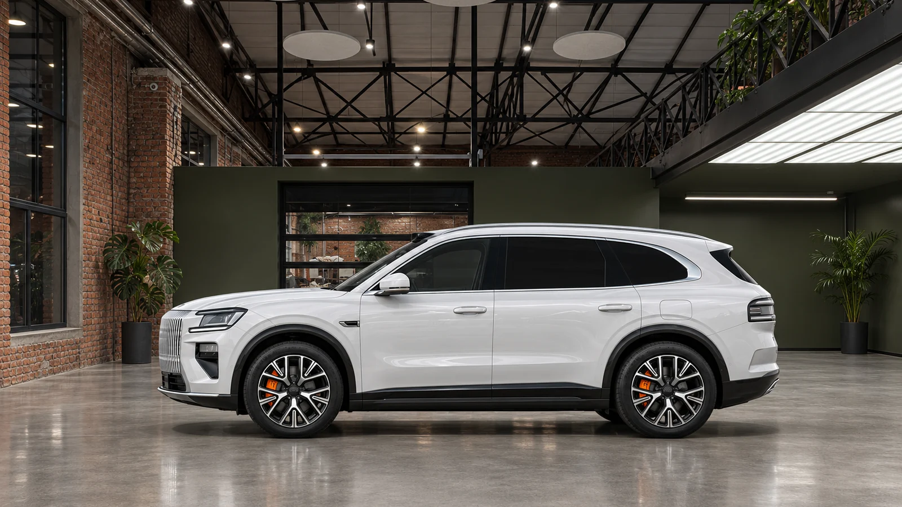

# Evolution Car: кадры с новым логотипом – выбор сделан

**Решение Артёма 15.11:** кадр 0 у фасада – лучший, стоит в блоке «Тест-драйв» карточки Zeekr 8X и дальше так на все карточки авто. Кадры 1 и 5 – на статьи («кайф»). Кадры 2 и 3 – чуть слабее, тоже на статьи. Кадр 4 (сзади у фасада) убран.

Логотип взят из файла сайта, тот же шрифт, что в шапке evolutioncar.by. Машина – Zeekr 8X. Фон – настоящий фасад на Машерова, 15/4 и настоящий зал по вашим фото. Кадры 1600×900, WebP, 100–270 КБ.

| Кадр | Куда |
|---|---|
| 0. У фасада, ¾ спереди | блок «Тест-драйв» в карточке, шаблон для всех карточек |
| 1. Салон, место водителя | статьи |
| 5. Спереди в зале | статьи |
| 2. В зале сбоку | статьи, запасной |
| 3. Профиль у фасада | статьи, запасной |

Карточка с кадром: [прототип Zeekr 8X, блок «Тест-драйв»](https://tema-mail.github.io/razbory/evolutioncar-zeekr-8x-d2effe31/prototip/#test-drive)

## 0. У фасада, ¾ спереди – твой кадр с новым логотипом

- **Что поменяли:** вывеска «EVolution electric car» заменена на «EVOLUTION CAR» в шрифте логотипа. Номер теперь чёрный, с белым логотипом. Чужой Mercedes с края обрезан.
- **Где уместен:** первый экран карточки, каталог, блок «Где посмотреть». Этот же кадр теперь стоит в отчёте недели для клиента.

## 1. Салон машины: место водителя, через стекло – ваш зал

- **Переделано 15.11:** салон больше не рисует генератор. Это официальный рендер Zeekr 8X без изменений: приборка, двойной экран, руль, тоннель. Заменено только то, что видно за стеклом: настоящее фото вашего зала (стойка дисков, оливковая стена, ворота). Капот за стеклом перекрашен из бордового в белый, как у машины на остальных кадрах.
- **Где уместен:** блок «Салон и экраны» в карточке, статьи про комплектации.
- **Учти:** мелкие китайские подписи в виджетах экрана слегка размыты, иероглифов не видно.

## 2. В зале сбоку, двери закрыты

- **Переделано 15.11:** кадр с открытой дверью убран. Машина стоит боком, все двери закрыты, силуэт тот же, что на кадре 3 у фасада.
- **Где уместен:** «Посмотреть вживую», страница «О салоне», галерея карточки.

## 3. Профиль у фасада

- **Где уместен:** галерея карточки (размер и силуэт), блок характеристик, сравнение версий.
- **Получилось:** вся машина целиком, колёса точные, вывеска над ней.

## 5. Спереди в зале, низкая точка

- **Где уместен:** баннер главной, первый экран премиальной карточки, обложка статьи.
- **Получилось:** решётка и световые полосы на весь кадр, чёрный номер с логотипом читается.

## Нужно от тебя

1. Делать ли такой же кадр у фасада на остальные модели каталога сейчас или после боя карточки 8X.

## Что раскрыть

- Те же ракурсы в другом цвете машины.
- Вечер у фасада с подсвеченной новой вывеской.
