# Советую вариант 3: машина у фасада Evolution днём

Это настоящее здание на Машерова, 15/4, с вывеской «EVolution electric car». Машина передана точно, свет дневной и ровный. Фон один и тот же, поэтому его можно повторять на всех карточках, и каталог будет выглядеть одной серией. Зал (вариант 1) хорош как запасной, если нужен кадр внутри салона.

## Как делали

- Фон – реальные фото салона: 28 снимков из зала, 11 фото с Яндекс Карт (фасад, ресепшн, стена с воротами), фото выдачи с сайта.
- Машина – официальные рендеры Zeekr 8X: ¾ спереди, сбоку, сзади, крупно решётка.
- Генерация – Codex imagegen. Каждый кадр проверен глазами целиком: решётка из вертикальных хромированных планок, световая полоса, 4 колеса, пропорции.
- Номера пустые белые, без знаков. Иероглифов и зеркального текста нет. Логотип – только настоящая вывеска на фасаде.
- Цвет везде один, белый перламутр. Так проще сравнивать подходы.
- Все кадры – WebP 1600x900, 108–353 КБ.

## 10 вариантов

### 1. В зале, ¾ спереди

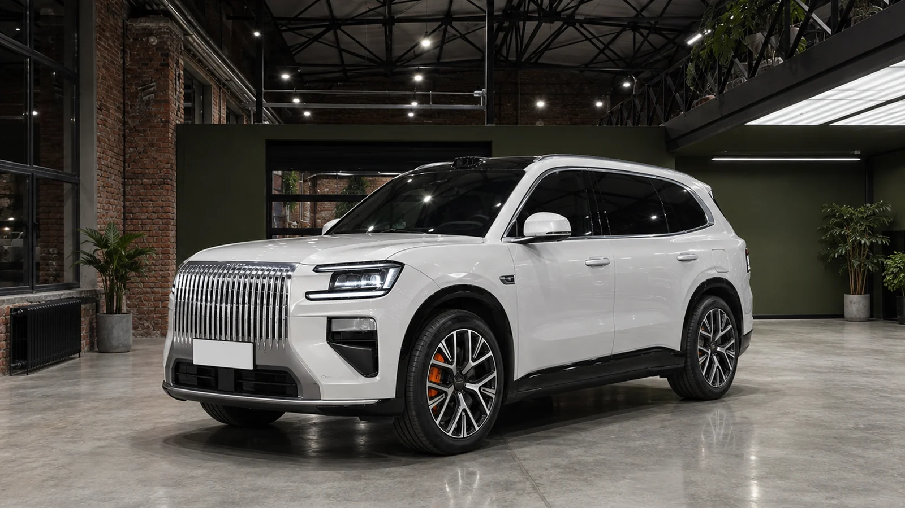

- **Подход:** машина одна посреди зала: кирпич, фермы, круглые акустические диски, оливковая стена со стеклянными воротами.
- **Где уместен:** первый экран карточки, каталог.
- **Получилось:** машина точная, зал узнаётся, свет как на настоящих фото.
- **Не получилось:** дисков на потолке меньше, чем в жизни.

### 2. В профиль на фоне ресепшна

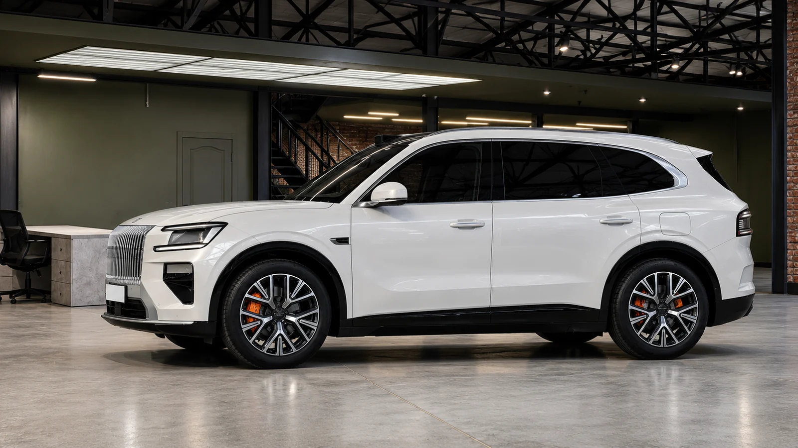

- **Подход:** чистый вид сбоку, сзади настоящий ресепшн: серый стол, оливковая стена, лестница, кирпичная колонна.
- **Где уместен:** галерея карточки (размер и силуэт), блок характеристик.
- **Получилось:** пропорции и колёса точные, ресепшн как на фото с Яндекс Карт.
- **Не получилось:** логотипа на стене нет. Его там нет и в жизни, поэтому не выдумывали.

### 3. У фасада днём, ¾ спереди

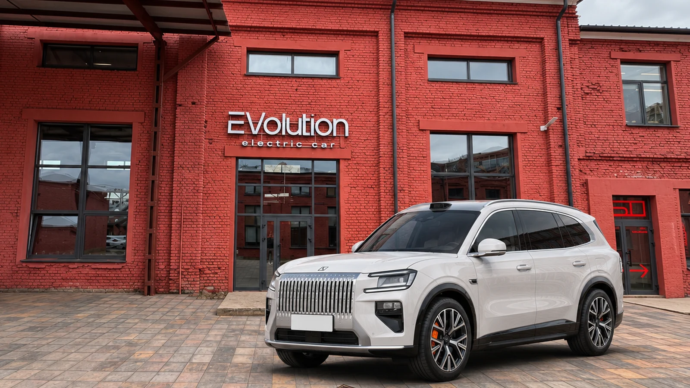

- **Подход:** правка настоящего фото фасада, машина на брусчатке у входа.
- **Где уместен:** первый экран карточки, каталог, блок «Где посмотреть».
- **Получилось:** фасад, окна, вывеска и навес остались как в жизни, машина точная.
- **Не получилось:** чужой Mercedes с края пришлось обрезать. Справа видна соседская дверь с красной вывеской, она настоящая.

### 4. У фасада вечером

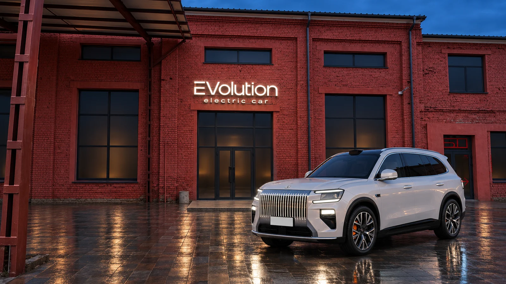

- **Подход:** тот же фасад в синий час: горит вывеска, мокрая брусчатка, у машины включены дневные огни.
- **Где уместен:** баннер главной, первый экран раздела, реклама.
- **Получилось:** эффектно, вывеска цела. Окна тёмные, без выдуманной мебели.
- **Не получилось:** первая попытка нарисовала в окнах чужой интерьер, переделали. На капоте отражалась вывеска зеркально, это отретушировано. Свет в окнах условный.

### 5. Зима у салона

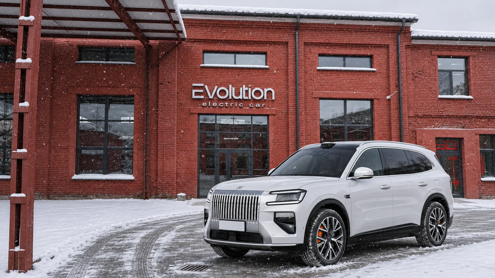

- **Подход:** фасад зимой: свежий снег, колея, снегопад, машина чистая.
- **Где уместен:** сезонный баннер с декабря по февраль, блок «Приезжайте смотреть».
- **Получилось:** выглядит как минская зима, вывеска и здание целы.
- **Не получилось:** только на зиму. Летом такая картинка будет выглядеть старой.

### 6. В зале среди других машин

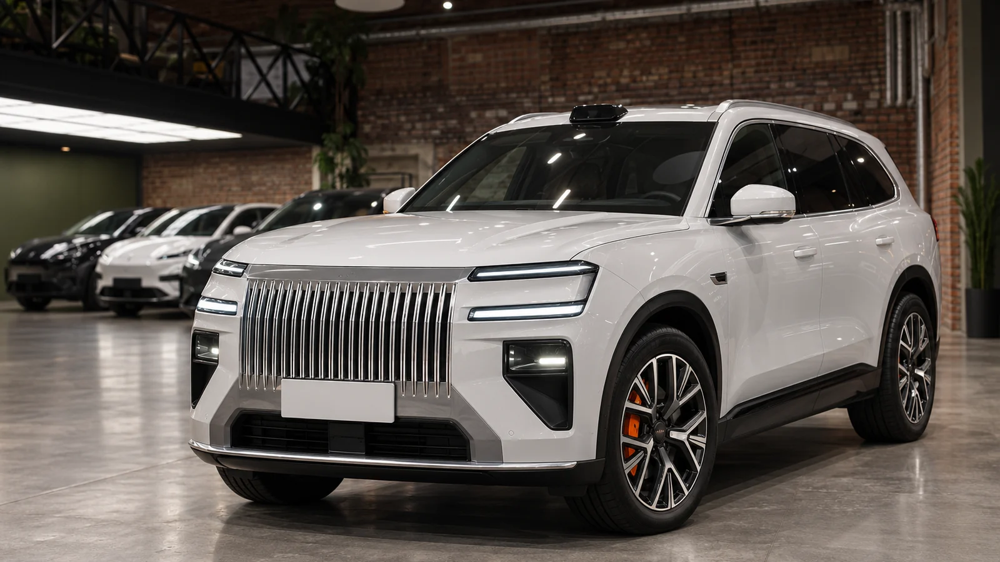

- **Подход:** наша машина резкая на первом плане, сзади размытый ряд других машин без значков.
- **Где уместен:** каталог «В наличии», блок «Машины в салоне».
- **Получилось:** понятно, что это салон с наличием. Решётка чистая.
- **Не получилось:** первая попытка дала «закорючки» на верхней кромке решётки, переделали. Стена в глубине больше кирпичная, чем в жизни.

### 7. Выдача клиенту

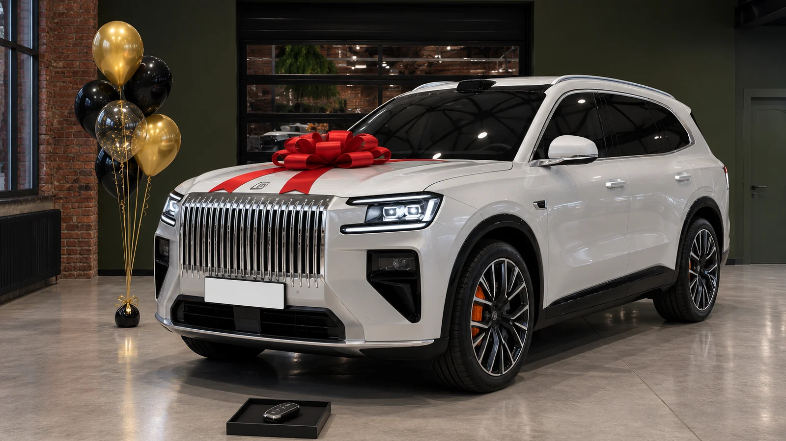

- **Подход:** у стеклянных ворот зала: красный бант на капоте, чёрно-золотые шары, как на настоящей выдаче, ключ на подносе. Людей нет.
- **Где уместен:** блок «Как проходит выдача», отзывы, соцсети.
- **Получилось:** с третьей попытки. Кадр горизонтальный, лента банта на капоте, решётку не задевает.
- **Не получилось:** низ решётки чуть «тянется». Первые две попытки были хуже: вертикальный кадр, лента на решётке.

### 8. Крупно перед машиной

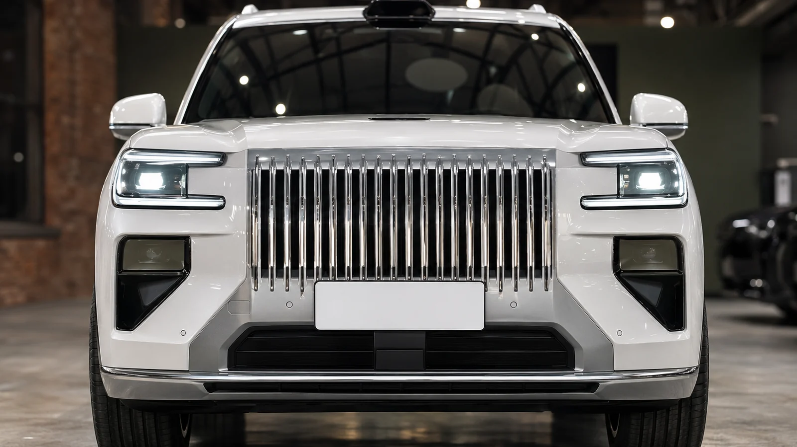

- **Подход:** низкая точка, решётка и световая полоса на весь кадр, сзади размытый зал.
- **Где уместен:** галерея карточки, блок «Дизайн», обложка статьи.
- **Получилось:** самая точная решётка из всех, салон узнаётся по кирпичу и дискам.
- **Не получилось:** сам салон почти не виден. Для «машина в нашем салоне» кадр слабее.

### 9. Сзади ¾ у входа

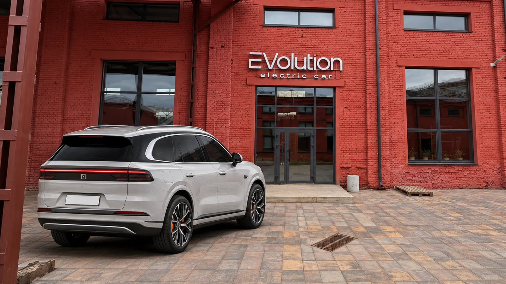

- **Подход:** фасад днём, машина задом к камере: сквозная полоса фонарей, чёрная крыша.
- **Где уместен:** галерея карточки, второй кадр после варианта 3.
- **Получилось:** корма узнаётся, вывеска цела.
- **Не получилось:** машина в кадре мельче, чем в варианте 3. Кадр пришлось доставать вручную, потому что генератор сначала подложил чужую картинку.

### 10. Студия внутри салона: подиум и свет

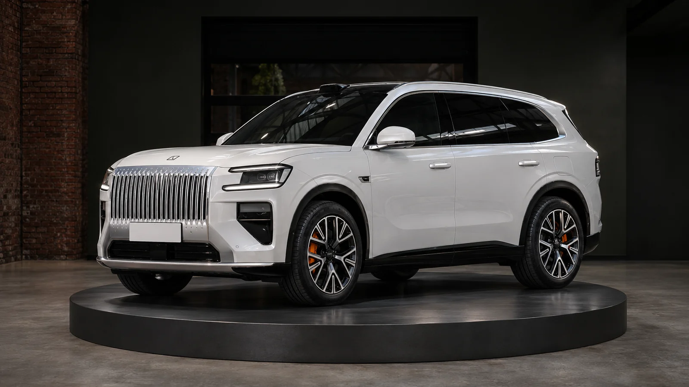

- **Подход:** зал затемнён, машина на круглом подиуме, мягкий верхний свет. Сзади видны кирпич и ворота.
- **Где уместен:** первый экран премиальной карточки, презентация модели.
- **Получилось:** дорогой вид, машина точная.
- **Не получилось:** подиума в салоне нет, это постановка. Салон узнаётся слабо.

## Исходные фото салона, от которых строили

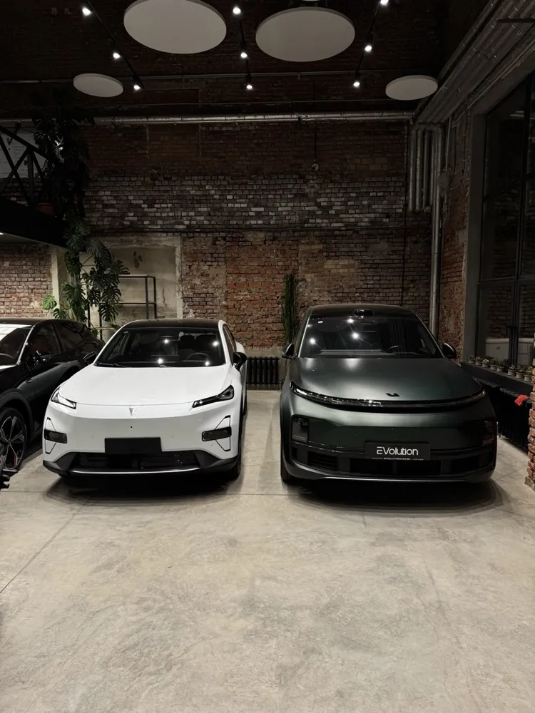

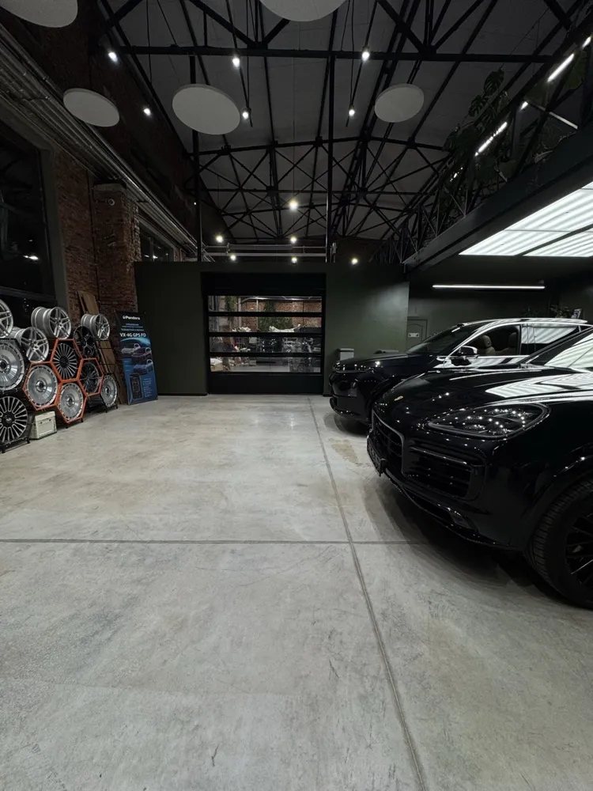

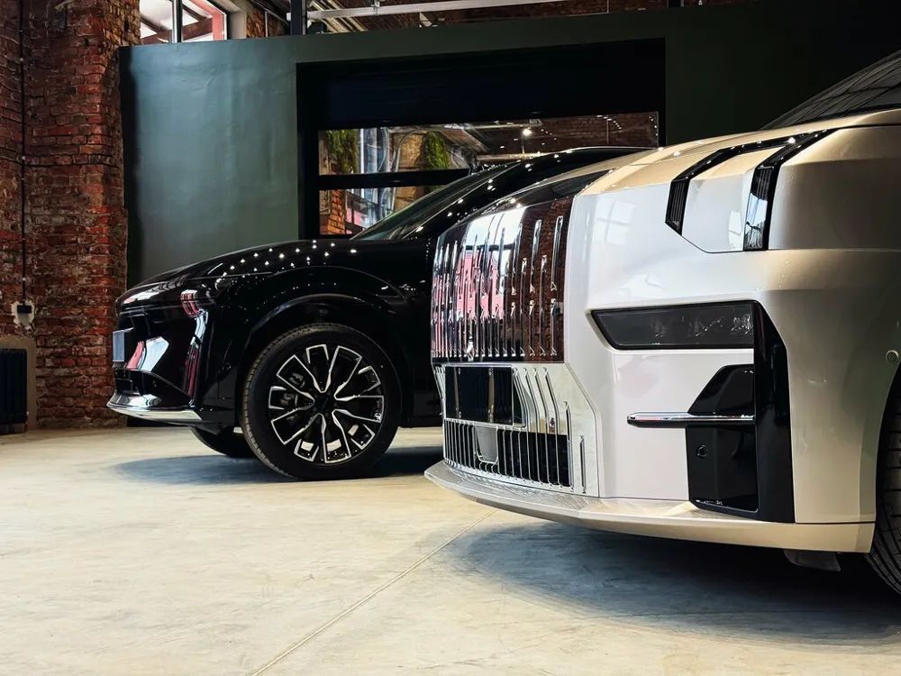

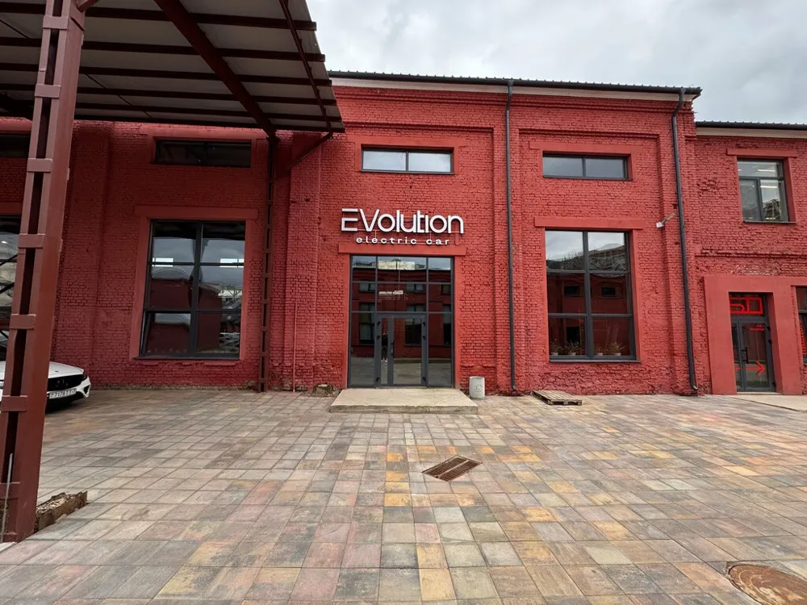

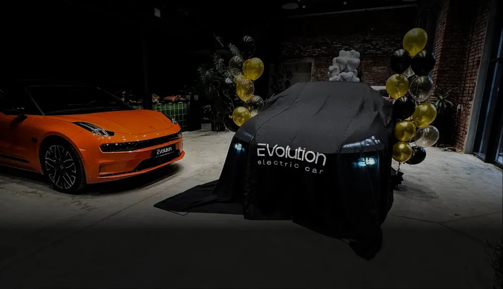

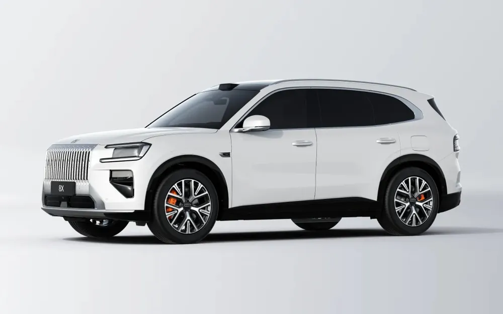

## Что важно для серии на все карточки

- Подход 3 повторяется проще всего: один кадр фасада, меняется только машина. На каждую модель – 1–3 попытки.
- Каждый кадр надо смотреть глазами: решётку, колёса, текст на вывеске, номер.
- Генерации запускать по одной или сверять результаты по md5. При параллельном запуске генератор однажды подложил чужую картинку.

## Нужно от Артёма

Какой номер берём (1–10) для всех карточек авто.

## Что раскрыть

- Как делать серию на весь каталог: сроки и проверки.
- Вариант 3 в другом цвете машины, чтобы проверить на чёрной.
