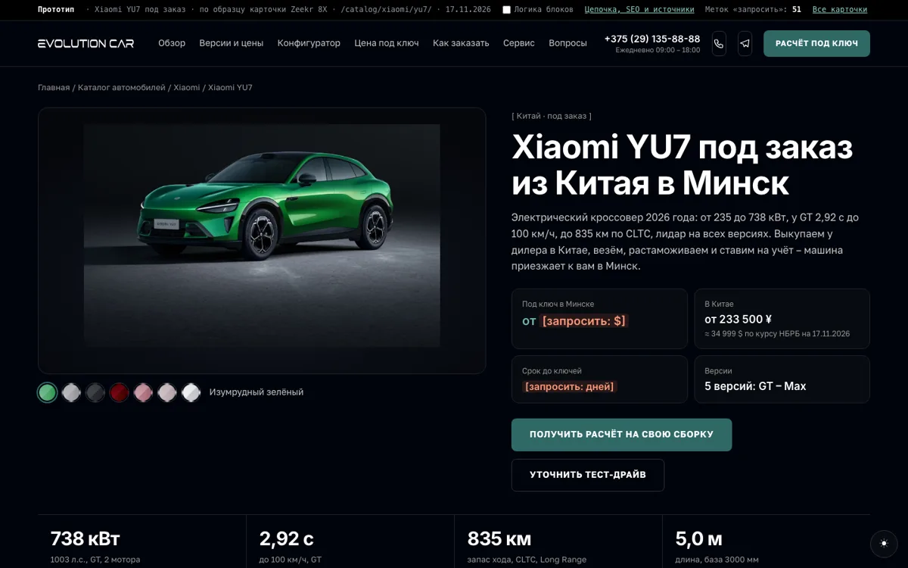
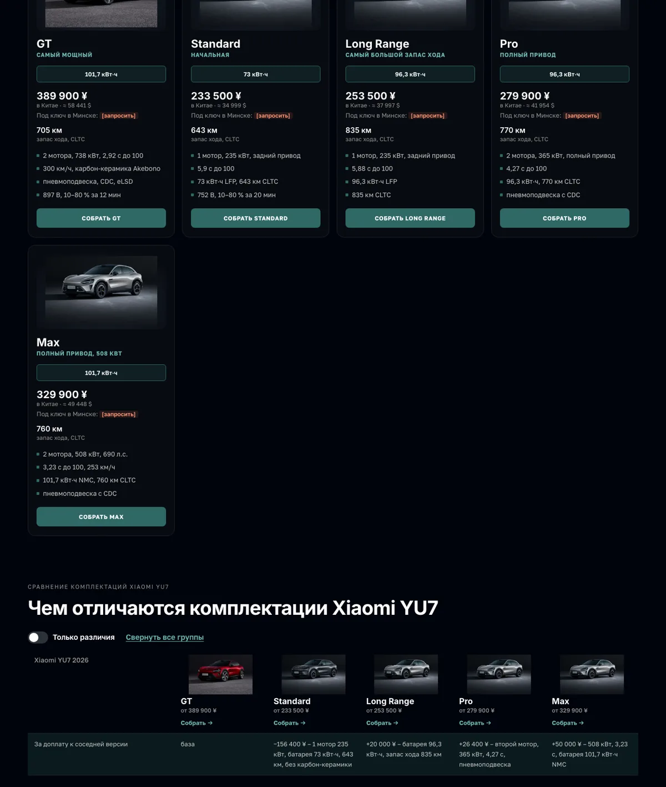
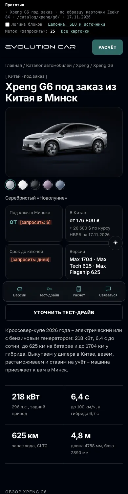

# Карточки моделей Evolution Car по образцу Zeekr 8X

**Вывод: на каждую из 46 моделей, где у нас есть конфигуратор, теперь есть карточка-прототип в дизайне EV Car – 45 новых плюс готовая 8X. Ссылки стоят рядом с конфигураторами на [общей странице](https://tema-mail.github.io/razbory/konfiguratory-2f6c81a4/). На сайт пока не ставили. Для боя от Evolution нужны те же цифры, что и для 8X: цена под ключ, доставка, срок, условия лизинга.**

Собрано 17.11.2026. Страницы закрыты от поиска (noindex).

**Сверка 17.11:** спорные цифры Li Auto проверены по таблицам параметров – L9, L8 и MEGA подтвердились, у i6 появились разгон и цена полного привода. Подробно – в разделе 4.

## 1. Что в каждой карточке

Те же 16 блоков и та же цепочка вопросов, что в карточке 8X: первый экран с выбором цвета, обзор, тест-драйв, версии с ценой, сравнение комплектаций, конфигуратор внутри, чек «из чего цена», лизинг, шаги заказа, риски, выдачи, свой сервис, сравнение с соседями, вопросы, форма, похожие модели.

- **Цены в Китае** – официальные цены производителя по каждой версии и батарее, курс НБРБ подтягивается на день открытия.
- **Растаможка** считается по типу машины формулой нашего калькулятора: электро – 15 % и НДС 0 %, последовательный гибрид – 15 % и НДС 20 %, подключаемый гибрид – единая ставка ГТК плюс второй вариант «15 % + НДС».
- **Картинки** – официальные рендеры из наших конфигураторов: цвета кузова, версии, ракурсы, салон.
- **Сборка из конфигуратора** уходит в чек и в форму, как в 8X.
- **Телефон**: ленты вбок, сравнение двух версий, конфигуратор на весь экран.

## 2. Откуда данные и что проверено

Цены и характеристики собирали три исследователя: официальные сайты и открытые API марок (Xpeng, Geely), autohome, CarNewsChina, CnEVPost. Источники с датой – в каждой карточке, кнопка «Цепочка, SEO и источники» в верхней полосе.

- **Каждый файл данных** прошёл проверку кодом: версии совпадают с конфигуратором, цены в разумных пределах, нет длинного тире и иероглифов.
- **Все 45 страниц** открыты в браузере на ширине компьютера и телефона: ошибок скрипта 0, битых картинок 0, горизонтальной прокрутки на телефоне нет.
- **Глазами** смотрел Xiaomi YU7, Lynk & Co 08, Xpeng G6 и тест на данных 8X.
- **Пустых цифр** в сумме 193 – там, где источник не дал проверенного значения. На странице вместо них стоит «[уточнить]», выдумок нет.

## 3. Все карточки

Цена – официальная в Китае, юани.

| Модель | Цена в Китае, ¥ | Версий | Карточка |
|---|---|---|---|
| Zeekr 9X | 465 900–599 900 | 7 | [карточка](zeekr-9x/) · пустых цифр: 0 |
| Zeekr 8X | 356 800–500 800 | 4 | [карточка](https://tema-mail.github.io/razbory/evolutioncar-zeekr-8x-d2effe31/prototip/) – ручная, образец |
| Zeekr 7X | 229 800–269 800 | 3 | [карточка](zeekr-7x/) · пустых цифр: 10 |
| Zeekr X | 155 800–175 800 | 3 | [карточка](zeekr-x/) · пустых цифр: 5 |
| Zeekr 001 | 269 800–365 000 | 4 | [карточка](zeekr-001/) · пустых цифр: 5 |
| Zeekr 001 FR | 769 000–769 000 | 1 | [карточка](zeekr-001-fr/) · пустых цифр: 1 |
| Zeekr 007 | 203 900–243 900 | 3 | [карточка](zeekr-007/) · пустых цифр: 3 |
| Zeekr 007 GT | 203 900–243 900 | 3 | [карточка](zeekr-007-gt/) · пустых цифр: 3 |
| Zeekr 009 | 439 800–469 800 | 3 | [карточка](zeekr-009/) · пустых цифр: 5 |
| Zeekr 009 Grand | 789 000–899 000 | 2 | [карточка](zeekr-009-grand/) · пустых цифр: 2 |
| Zeekr MIX | 279 900–299 900 | 2 | [карточка](zeekr-mix/) · пустых цифр: 2 |
| Li Auto L9 | 459 800–509 800 | 2 | [карточка](lixiang-l9/) · пустых цифр: 0 |
| Li Auto L8 | 369 800–429 800 | 2 | [карточка](lixiang-l8/) · пустых цифр: 0 |
| Li Auto L6 | 249 800–249 800 | 1 | [карточка](lixiang-l6/) · пустых цифр: 0 |
| Li Auto i6 | 249 800–249 800 | 1 | [карточка](lixiang-i6/) · пустых цифр: 0 |
| Li Auto i8 | 309 800–339 800 | 2 | [карточка](lixiang-i8/) · пустых цифр: 2 |
| Li Auto i9 | 369 800–369 800 | 1 | [карточка](lixiang-i9/) · пустых цифр: 1 |
| Li Auto MEGA | 509 800–509 800 | 1 | [карточка](lixiang-mega/) · пустых цифр: 1 |
| Xiaomi SU7 | 219 900–303 900 | 3 | [карточка](xiaomi-su7/) · пустых цифр: 9 |
| Xiaomi SU7 Ultra | 529 900–814 900 | 3 | [карточка](xiaomi-su7-ultra/) · пустых цифр: 3 |
| Xiaomi YU7 | 233 500–389 900 | 5 | [карточка](xiaomi-yu7/) · пустых цифр: 29 |
| Avatr 07L | 229 900–279 900 | 4 | [карточка](avatr-07l/) · пустых цифр: 4 |
| Avatr 07 | 229 900–229 900 | 1 | [карточка](avatr-07/) · пустых цифр: 1 |
| Avatr 06 | 219 900–229 900 | 2 | [карточка](avatr-06/) · пустых цифр: 1 |
| Avatr 06T | 219 900–279 900 | 6 | [карточка](avatr-06t/) · пустых цифр: 6 |
| Avatr 12 | 293 900–433 900 | 7 | [карточка](avatr-12/) · пустых цифр: 5 |
| Lynk & Co 900 | 299 800–416 900 | 7 | [карточка](lynkco-900/) · пустых цифр: 0 |
| Lynk & Co 09 | 275 800–275 800 | 1 | [карточка](lynkco-09/) · пустых цифр: 0 |
| Lynk & Co 08 | 171 800–198 800 | 3 | [карточка](lynkco-08/) · пустых цифр: 5 |
| Lynk & Co 07 | 155 800–175 800 | 3 | [карточка](lynkco-07/) · пустых цифр: 5 |
| Lynk & Co Z20 | 123 800–163 800 | 5 | [карточка](lynkco-z20/) · пустых цифр: 22 |
| Geely Galaxy E5 | 107 800–147 800 | 6 | [карточка](geely-e5/) · пустых цифр: 6 |
| Geely Xingyuan | 64 800–94 800 | 8 | [карточка](geely-xingyuan/) · пустых цифр: 8 |
| Geely Galaxy Starship 7 | 109 800–129 800 | 4 | [карточка](geely-starship-7/) · пустых цифр: 4 |
| Geely Galaxy Starshine 6 | 86 800–106 800 | 3 | [карточка](geely-starshine-6/) · пустых цифр: 3 |
| Xpeng GX | 279 800–359 800 | 8 | [карточка](xpeng-gx/) · пустых цифр: 4 |
| Xpeng X9 | 309 800–369 800 | 8 | [карточка](xpeng-x9/) · пустых цифр: 5 |
| Xpeng G9L | 241 800–319 800 | 6 | [карточка](xpeng-g9l/) · пустых цифр: 4 |
| Xpeng G9 | 248 800–278 800 | 3 | [карточка](xpeng-g9/) · пустых цифр: 3 |
| Xpeng G7 | 195 800–205 800 | 4 | [карточка](xpeng-g7/) · пустых цифр: 2 |
| Xpeng G6 | 176 800–186 800 | 3 | [карточка](xpeng-g6/) · пустых цифр: 2 |
| Xpeng P7 | 203 800–301 800 | 4 | [карточка](xpeng-p7/) · пустых цифр: 4 |
| Xpeng P7+ | 186 800–198 800 | 4 | [карточка](xpeng-p7-plus/) · пустых цифр: 2 |
| Xpeng M03 | 119 800–151 800 | 6 | [карточка](xpeng-m03/) · пустых цифр: 6 |
| Xpeng L03 | 123 800–156 800 | 9 | [карточка](xpeng-l03/) · пустых цифр: 6 |
| Xpeng L05 | 144 800–176 800 | 6 | [карточка](xpeng-l05/) · пустых цифр: 4 |

## 4. Сверка спорных цифр 17.11

Сверял по таблицам параметров китайского справочника xchuxing (версии 2026 года), ссылки добавлены в источники карточек.

| Что было под вопросом | Итог | Что сделано |
|---|---|---|
| Li Auto L9: 420 кВт или 330 кВт | 420 кВт, 710 Н·м, моторы 145 + 275 кВт, 4,9 с. 330 кВт – прошлое поколение | подтверждено, в [карточку](lixiang-l9/) добавлены моторы и 200 км/ч |
| Li Auto L8: 4,8 с или 5,3 с | 420 кВт, 4,8 с, 200 км/ч | подтверждено, [карточка](lixiang-l8/) без правок цифр |
| Разгон Li MEGA | 4,9 с (5,5 с – первое поколение) | подтверждено, в [карточку](lixiang-mega/) добавлены 200 км/ч и масса 2925 кг |
| Разгон Li i6 2026 | 6,8 с задний привод, 4,8 с полный; полный привод стоит 269 800 ¥ | внесено в [карточку](lixiang-i6/) и в сравнения у [Zeekr 7X](zeekr-7x/) и [Xiaomi YU7](xiaomi-yu7/), где стояли 4,5 с от 2025 года |
| Объём ДВС L9 и L8 | точного числа в см³ нет нигде, везде «1.5 л» | оставлено 1496 см³: на растаможку не влияет, порог 1500 см³ |
| Zeekr 7X 2027: цена Max+ | запуска ещё нет, идёт предзаказ с 05.11, цены по версиям не объявлены | оставлено «[уточнить]», вернуться после запуска |

**Осталось как есть:**

- **Geely Starship 7** в конфигураторе электрический, **Starshine 6** – метанольный гибрид: это не ошибка данных, так устроены сами конфигураторы.
- **Скидки** (минус 5–26 тыс. ¥ у Geely, Xpeng и Zeekr 009) не брали, везде официальная цена.
- **Пневмоподвеска i6 2026:** таблица показывает, что её нет, но источник один и разметка сбита – в карточку не ставил.

## Нужно от тебя

1. **Смотрим ли карточки.** Если подход ок – следующий шаг: пресс-фото и видео марок в обзор (сейчас там только рендеры) и Wordstat по каждой модели.
2. **Цифры Evolution на все карточки сразу:** цена под ключ или наценка, доставка, срок до ключей, предоплата, условия лизинга. Это закрывает метки «запросить» на всех 46 страницах.

## Что раскрыть

- **Карточки:** какую модель разобрать подробно.
- **Источники:** почему у модели такая цена.
- **Сравнение с 8X:** чем новые отличаются от ручной (видео, отдельные фото).
