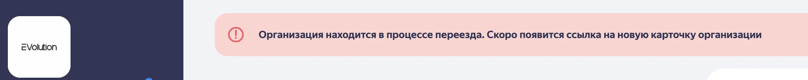
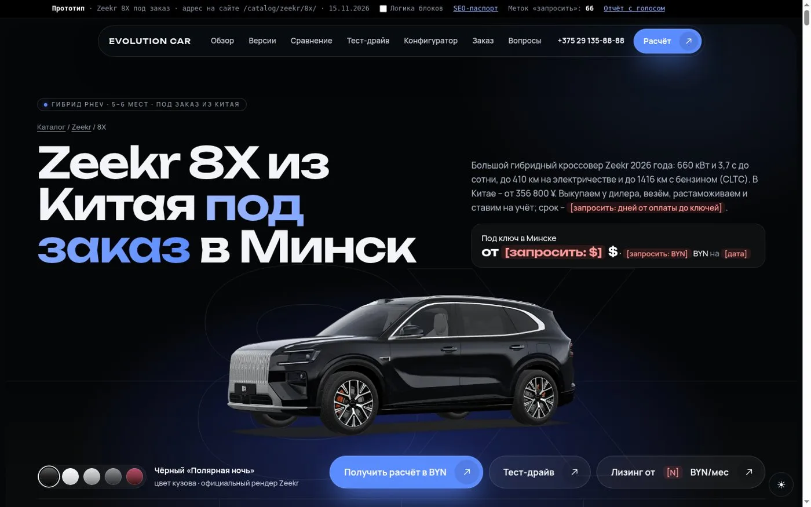
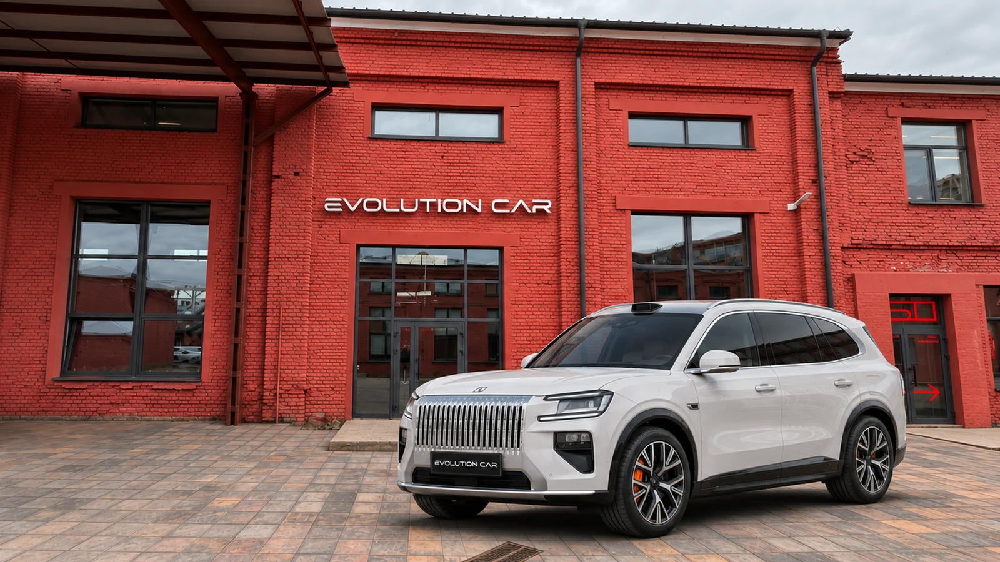

# Evolution Car: итоги недели 9–15 ноября

**Вывод:** на сайт пришло в 3,7 раза больше людей, чем неделей раньше: 1 415 визитов против 378. Блог стал вторым входом с поиска после главной. Мы подготовили новую карточку Zeekr 8X и свой калькулятор растаможки, а карточку сервиса в Яндекс Картах отправили на переезд.

Отчёт подготовил Артём Галимов, основатель студии Deford. Цифры взяты из Яндекс Метрики evolutioncar.by и сняты 15.11 в полдень по Минску, поэтому воскресенье посчитано не целиком.

## Неделя за 5 секунд

| Показатель | 2–8.11 | 9–15.11 |
|---|---|---|
| Визиты на сайт | 378 | **1 415** |
| Из рекламы Google Ads | 1 | **900** |
| Из поиска (Google + Яндекс) | 245 | **316** |
| Из поиска на статьи блога | 19 | **110** |
| Нажали на телефон | 16 | **33** |
| Нажали на мессенджер | 14 | **24** |
| Звонки через коллтрекинг (уникальные целевые) | учёта ещё не было | **14 (9)** |
| Отправили заявку с формы | см. примечание | **8** |
| Доля Минска в трафике | 42 % | **65 %** |

Примечание: заявки прошлой недели с этой не сравниваем. 5–6 ноября после починки форм шли проверочные отправки, и они смешались с настоящими. Метрика считает только тех, кто согласился на cookie, поэтому полный список заявок – у вас в Telegram, Битрикс24 и кабинете сайта.

## 1. Людей стало больше, и это нужные люди

- **Основной рост дала реклама Google Ads**, 900 визитов за неделю.
- **Поиск вырос на 29 %**, с 245 до 316 визитов. В Беларуси главный поисковик Google: на него приходится 9 из 10 визитов с поиска.
- **Трафик стал местным.** Беларусь – 90 % визитов против 74 % неделей раньше, Минск – 65 % против 42 %.
- **Обращений стало больше:** нажатий на телефон – 33 против 16, на мессенджеры – 24 против 14. С этой недели коллтрекинг считает звонки в Метрике: 14 звонков, из них 9 уникальных и дольше 30 секунд.

## 2. Что вышло на сайт за неделю

- **25 новых статей в блоге** под то, что ищут в Беларуси: растаможка, утильсбор, как пригнать из Кореи, сколько ждать машину из Китая, где заряжать электромобиль, обзоры Geely Monjaro, BYD, Voyah, Zeekr 7X и других. Все 25 открываются на сайте. С поиска на статьи пришли 110 человек против 19 неделей раньше. Лидер – обзор Geely Monjaro, 27 визитов.
- **Сравнение и избранное теперь на всех карточках каталога.** Раньше они были только у Li Auto L6, L7 и L9.
- **Заставка показывается один раз на устройство**, при повторных заходах больше не мешает.
- **Метрика точнее считает интерес.** Отказом больше не считается визит, в котором человек прокрутил страницу или нажал кнопку. Из-за этого показатель отказов до 13.11 и после него сравнивать нельзя.
- **Позиции в поиске теперь снимаются по Минску.**
- **Карточку сервиса в Яндекс Картах отправили на переезд.** Яндекс принял заявку: на карточке висит отметка «Организация находится в процессе переезда», скоро появится ссылка на новую карточку.

## 3. Что подготовили к запуску

- **Новая карточка модели на примере Zeekr 8X.** 16 блоков в том порядке, в каком покупатель задаёт вопросы: какая машина, какую версию выбрать, сколько стоит, почему вам можно доверять, какие риски, как заказать. В карточке – 7 версий с ценой в Китае, сравнение комплектаций, тест-драйв, лизинг и расчёт в BYN. Страницы Zeekr 8X на сайте ещё нет, а в Минске эту модель ищут 229 раз в месяц, по Беларуси – 519. [Открыть прототип](https://tema-mail.github.io/razbory/evolutioncar-zeekr-8x-d2effe31/prototip/)
- **Свой калькулятор растаможки.** Бензин и дизель считает по формуле ГТК, результат сверен до цента. Электромобили и последовательные гибриды – по Указу № 428. Для параллельных гибридов, таких как Zeekr 8X, показывает два расчёта: таможня пока не разъяснила, по какой схеме их считать физлицам в 2026 году. [Открыть калькулятор](https://tema-mail.github.io/razbory/evolutioncar-kalkulyator-rastamozhki-8f50e724/kalkulyator/)
- **46 конфигураторов новых машин из Китая:** Zeekr – 11 моделей, Xpeng – 11, Li Auto – 7, Avatr – 5, Lynk & Co – 5, Geely – 4, Xiaomi – 3. Картинки официальные, для каждой сборки, в конце – кнопка «Отправить сборку менеджеру». На сайте сейчас 16 конфигураторов, новые встроим в карточки моделей. [Все конфигураторы](https://tema-mail.github.io/razbory/konfiguratory-2f6c81a4/)
- **3D-шоурум Zeekr в зале Evolution Car** с вашим логотипом. [Открыть](https://tema-mail.github.io/zeekr-configurator/salon/)
- **Единый кадр для карточек:** машина у вашего фасада на Машерова, 15/4. Фон везде один, поэтому каталог будет выглядеть одной серией.

## 4. Что узнали о рынке

- **У Атлант-М нет Li Auto, Voyah, Deepal, Avatr, Xiaomi, Denza и Aito.** По этим маркам в Минске около 9,5 тыс. запросов в месяц. С них предлагаем начать: здесь проще всего забрать покупателя у крупного игрока. Карточки Атланта при этом технически слабые: поисковик не видит в них цен. [Разбор Атлант-М](https://tema-mail.github.io/razbory/evolutioncar-atlantm-kartochki-bf4e7773/)
- **Рынок Минска:** спрос, конкуренты и цены по направлениям Китай, Корея, Европа и США. Покупатели пишут в запросах «в Беларусь», а не «в Минск». Европу ищут в основном через растаможку. [Рынок Минска](https://tema-mail.github.io/razbory/evolutioncar-rynok-minsk-7d8b28ef/)
- **Кто впереди в поиске и почему:** у westmotors.by и lemon-cars.by сотни тысяч страниц лотов. [Разбор конкурентов](https://tema-mail.github.io/razbory/evolutioncar-konkurenty-43eded2f/)

## 5. Что не получилось

- **С 14.11 новые статьи не выходили.** С понедельника снова выпускаем по 5 статей в день.
- **Нет данных Яндекс Вебмастера о показах в поиске:** они не обновляются с 9 октября. Метрика при этом видит визиты из Яндекса, значит сайт в поиске есть. Разбираемся с доступом.
- **Мелочи, найденные по ходу.** Конфигураторов Zeekr 7X и 9X нет в карте сайта. В адресе одной карточки BYD опечатка. Запас хода Zeekr 7X у нас расходится с Атлант-М. Исправим на этой неделе.

## План на 16–22 ноября

Главное:

1. Выпустить на сайт карточку Zeekr 8X по прототипу.
2. Поставить на сайт калькулятор растаможки с курсом НБРБ.

Второстепенное:

3. Встроить новые конфигураторы в карточки моделей.
4. Начать карточки марок, которых нет у Атлант-М: Li Auto, Voyah, Deepal, Avatr, Xiaomi.
5. Выпускать по 5 статей в день.
6. Исправить мелочи из раздела 5.
