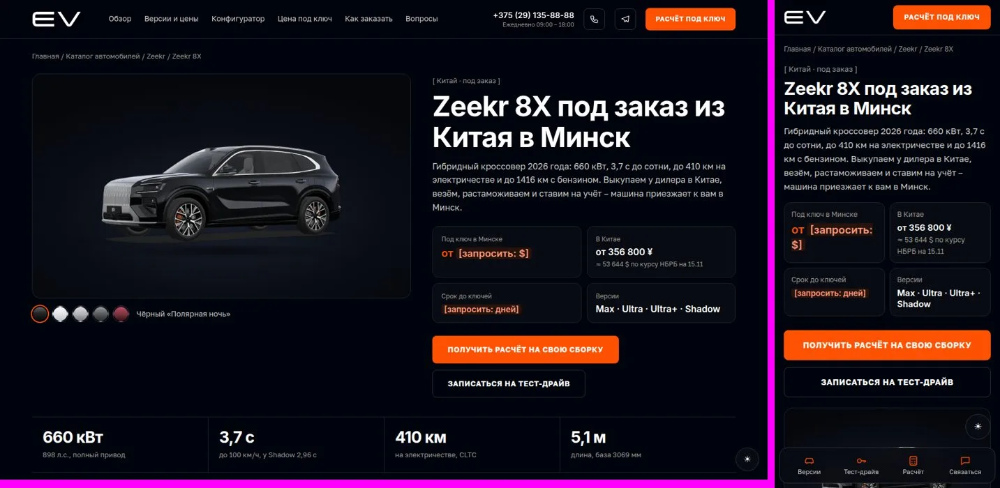

# Карточка Zeekr 8X: зачем каждый блок и почему такой порядок

**Вывод: ты прав, в первой версии порядок был набором секций, а не логикой покупателя. Я не применил твоё же правило от 06.11: каждый блок отвечает на вопрос, а вопрос, который он вызывает, – это вопрос следующего блока. Новая версия собрана по этой цепочке, в дизайне EV Car, и проходит автоматическую проверку цепочки без разрывов.**

**[Открыть прототип v2 в дизайне EV Car](../evolutioncar-zeekr-8x-d2effe31/prototip/)** · [первая версия для сравнения](../evolutioncar-zeekr-8x-d2effe31/prototip/v1/)

В прототипе галочка «Логика блоков» показывает у каждого блока то же, что в таблице ниже: вопрос, что нам, что клиенту, на что опираемся и к какому вопросу ведёт.

## 1. Логика порядка в одну строку

Человек, который ищет «zeekr 8x», проходит путь: **можно ли и сколько → хочу ли я её → можно ли потрогать → какую версию → за что доплата → какой будет моя → сколько стоит моя → как заплатить → как идёт заказ → а если что-то пойдёт не так → кто уже получил → как с ней жить → может, другую → мелкие вопросы → заявка → что ещё посмотреть.**

Сначала **желание** (блоки 1–3), потом **выбор** (4–6), потом **деньги** (7–8), потом **доверие к заказу** (9–12), в конце **сомнения и заявка** (13–16). Кнопка расчёта – на первом экране, в середине и в конце, плюс липкая панель на телефоне: кто решил раньше, не листает до формы.

## 2. Каждый блок

| № | Блок | Вопрос клиента | Что клиенту | Что нам | Почему здесь – к какому вопросу ведёт |
|---|---|---|---|---|---|
| 1 | Первый экран: фото в цвете, H1, ответ, цена в Китае и под ключ, срок, 2 кнопки | Можно ли купить Zeekr 8X в Минске и сколько он будет стоить? | За 5 секунд: машину везут, примерная цена, срок; сразу расчёт или тест-драйв | Ловим «zeekr 8x» (229 в месяц по Минску), ответ в первом абзаце для Яндекса, Алисы и нейросетей; две двери в заявку | Цена названа – дальше «а стоит ли она этих денег?» |
| 2 | Обзор с фото: экстерьер, салон, экраны, силовая установка, безопасность | Что это за машина и стоит ли она этих денег? | Видит машину целиком, как в салоне, понимает, за что деньги | Желание и время на странице; текст в HTML закрывает «характеристики», «салон», «фото» | На пике желания – «а можно потрогать?» |
| 3 | Тест-драйв 8X и 9X | Можно ли прокатиться, прежде чем решать? | Снимает главный страх «под заказ»: платит не вслепую | Самая горячая заявка: кто сел за руль, покупает чаще | Решил, что хочет, – «какую версию брать?» |
| 4 | Версии и цены: 4 версии, батарея 55/70, цена в ¥ и $ | Какую версию выбрать и сколько стоит каждая? | Делит себя по бюджету сам, видит запас хода | Цены по версиям – козырь против Атланта; менеджер получает уже выбранную версию | Видит разницу в цене – «за что доплата?» |
| 5 | Сравнение комплектаций: колонки, «только различия», «за доплату» | Чем именно отличаются версии – за что я доплачиваю? | Разница без чтения 150 строк | Меньше вопросов менеджеру, чаще берут версию выше; таблица в HTML для поиска | Выбрал версию – «как будет выглядеть моя?» |
| 6 | Конфигуратор без 3D | Как будет выглядеть моя машина с моим цветом и опциями? | Видит свою машину на официальных рендерах | Заявка с полной сборкой вместо «хочу 8X»; такого нет у конкурентов | Собрал – «сколько стоит именно эта?» |
| 7 | Чек «из чего цена»: Китай, доставка, таможня, сборы, работа | Сколько будет стоить моя сборка в Минске со всеми платежами? | Видит, что скрытых платежей нет; таможня считается честно по ГТК | Доверие через прозрачность; итог под ключ закрывает главный козырь voltauto | Увидел сумму – «можно не всю сразу?» |
| 8 | Лизинг: аванс, срок, платёж | Можно ли не платить всю сумму сразу? | «По карману» вместо «дорого» | Не теряем тех, кто не готов отдать 80 тысяч; отдельная цель в Метрике | Понял, как платить, – «а как это работает с машиной, которой ещё нет?» |
| 9 | Как заказать: 6 шагов со сроком и оплатой | Как я плачу за машину, которой ещё нет, и когда её получу? | Знает, когда платит и когда ключи | Меньше одинаковых звонков, меньше отказов на договоре | Понял процесс – «а если что-то пойдёт не так?» |
| 10 | Четыре риска заказа + образец договора | Что будет, если что-то пойдёт не так? | Честные ответы на 4 страха: курс, повреждение, срок, не та комплектация | Возражения закрыты до менеджера; у конкурентов блока нет | Услышал обещания – «кто уже получил?» |
| 11 | Выдачи и отзывы | Кто уже получил машину через вас? | Живые машины и люди, а не слова | Доказательство; без чужого рейтинга на модели – ошибка Атланта | Поверил – «как с ней жить в Беларуси?» |
| 12 | Жизнь в Беларуси: язык, зима, зарядка, сервис | Как с ней жить в Беларуси: язык, зима, зарядка, сервис? | Машина приедет готовой | Продаём допуслуги: русификация, антикор, станция | Последнее сомнение – «а может, другую?» |
| 13 | 8X, 9X или Lixiang L9 | Может, мне больше подойдёт Zeekr 9X или Lixiang L9? | Короткое сравнение класса и «кому что» | Сомневающийся идёт на нашу карточку, а не к конкуренту; перелинковка | Остались мелочи – «где ответы?» |
| 14 | Вопросы | Остались вопросы по деталям – где ответы? | Ответ в первой фразе без звонка | Хвосты Wordstat и разметка FAQ для быстрых ответов | Всё ясно – «как получить расчёт?» |
| 15 | Форма: цель, версия, телефон | Как получить точный расчёт на мою сборку? | Один телефон – расчёт в BYN на свою машину | Заявка с версией, цветом, сборкой и целью: расчёт, тест-драйв, лизинг | Не подошла – «что ещё посмотреть?» |
| 16 | Похожие автомобили | Что ещё посмотреть, если 8X не подошёл? | Соседние модели в один клик | Не отпускаем с сайта | Конец страницы |

## 3. Что было не так в первой версии

1. **Полоса доверия сразу под первым экраном.** Договор и оплату частями показывали человеку, который ещё не решил, хочет ли машину. Ответ на вопрос, которого ещё нет. Теперь это шаги заказа (блок 9).
2. **Характеристики в трёх местах**: шоурум с проездом, обзор и сравнение повторяли одно и то же. Шоурум убран, цифры – полосой под первым экраном.
3. **Тест-драйв и лизинг одним блоком посередине**, до цены. Лизинг до цены бессмыслен: человек ещё не знает сумму. Теперь тест-драйв – сразу после обзора, на пике желания, а лизинг – сразу после чека цены.
4. **Конфигуратор отдельно от цены**: собрал – и цена не связана. Теперь «Собрал → Посчитать эту сборку» ведёт в чек, и чек пересчитывается под версию.
5. **Выдачи и отзывы почти в конце**, после жизни в Беларуси. Теперь доказательства идут сразу за рисками: «обещаете → покажите».
6. **У блоков был вопрос, но не было «к чему ведёт».** Отсюда ощущение набора секций. Теперь у каждого блока есть вопрос и следующий вопрос, а проверка `proverka.mjs` ловит разрыв цепочки – v2 её проходит.

## 4. Что в дизайне EV Car

Взято с evolutioncar.by: фон #00040c, оранжевый #ff5102, заголовки Inter, текст Golos Text, кнопки капсом со скруглением 8, карточки с тонкой рамкой. Первый экран как у ваших карточек моделей: фото слева, плитки цен справа. Шаги «01–06» с оранжевой линией, похожие машины, как в вашем каталоге, логотип и подвал с большой надписью EVOLUTION CAR.

Новое в расчёте: **таможня в чеке считается по правилам ГТК** и пересчитывается под выбранную версию. Пример: Ultra 70 – около 25 486 €, или около 84 900 BYN по курсу НБРБ на 15.11.

## 5. Проверено

- `proverka.mjs` из набора маркетолога, на сервере, 390 и 1440 px: **PASS**. В цепочке 16 блоков, разрывов нет, у каждого блока есть вопрос и опора. Форма: галочка пустая, кнопка неактивна без неё, есть текст до и после отправки. На телефоне есть липкая панель, горизонтальной прокрутки нет.
- На телефоне обзор сделан вкладками, версии – лентой со свайпом, группы сравнения свёрнуты: блоки больше не растягиваются на 6 экранов.
- Красных меток «запросить» – 43. Это данные Evolution, без них в бой нельзя.

## Нужно от тебя

1. **Порядок блоков** – так логично? Особенно тест-драйв сразу после обзора и лизинг сразу после цены.
2. Цены под ключ, срок, предоплата, условия тест-драйва и лизинга – без них блоки 1, 7, 8, 9 стоят с метками.
3. Что дальше: дорабатываем этот прототип или сразу переносим в шаблон карточки на сайте?

## Что раскрыть

- Тексты каждого блока: усилить через Хормози (оффер, гарантия заказа).
- Блок «Риски заказа» – какие обещания Evolution реально может дать в договоре.
- Перенос в шаблон для всех моделей под заказ.
