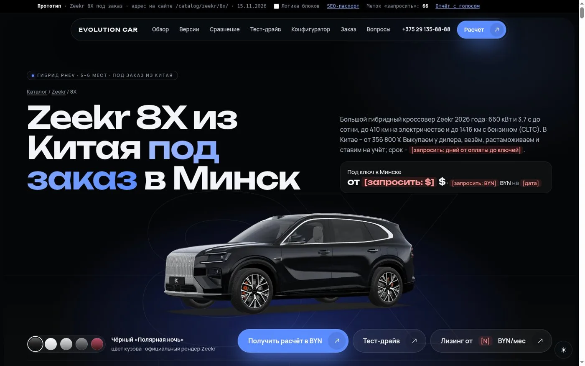
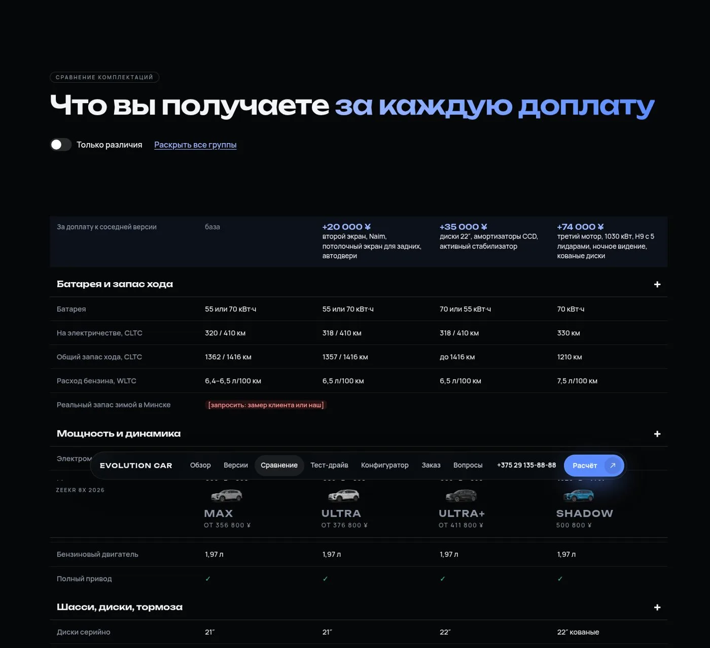
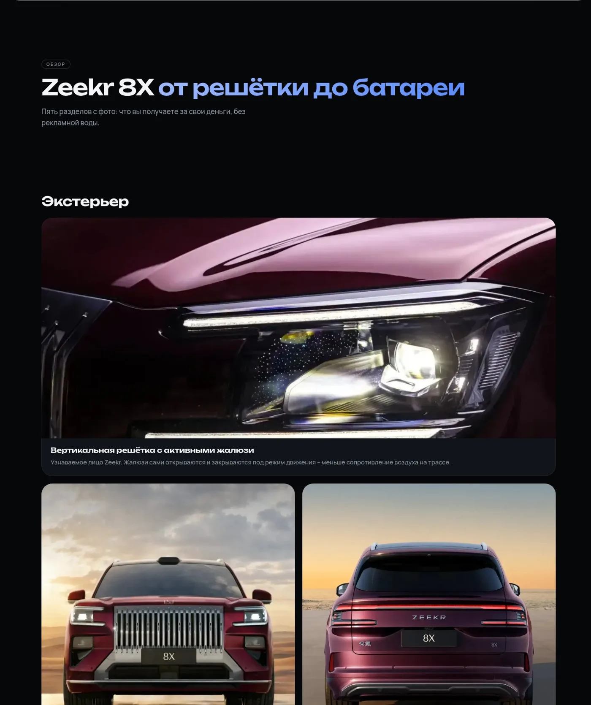
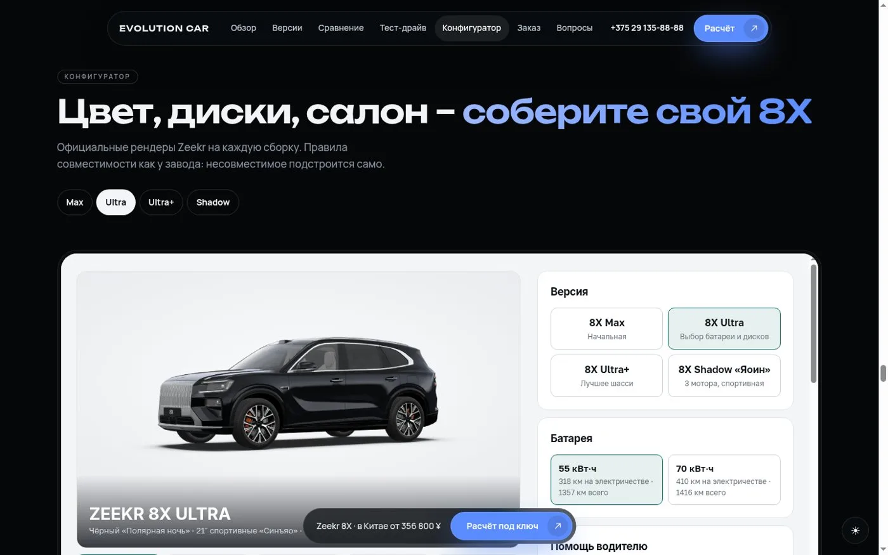
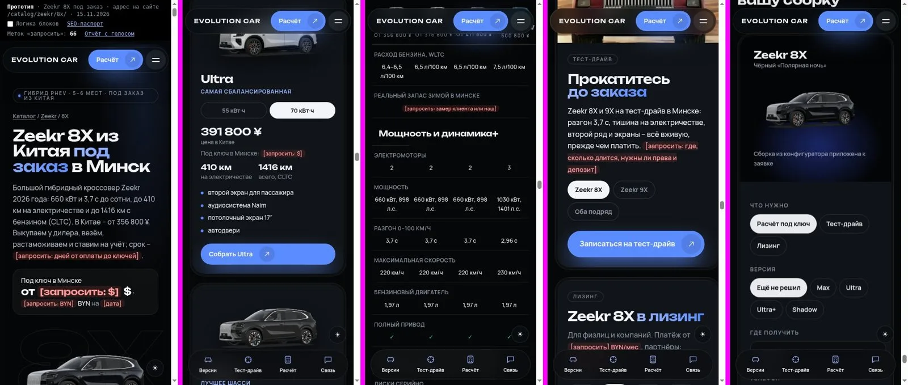
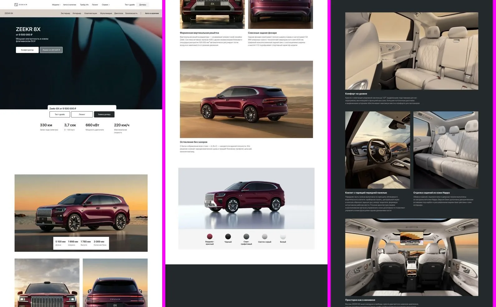

# Zeekr 8X под заказ: карточка для Evolution Car

**Вывод: карточка Zeekr 8X под заказ готова прототипом – [открыть прототип](prototip/). В неё собрано лучшее у пяти соседей плюс наш конфигуратор без 3D, тест-драйв и лизинг. По SEO и продажам она сильнее всех карточек 8X в Минске, кроме одного места: нет цены под ключ. Эту цифру даёт только Evolution, и без неё voltauto.by остаётся впереди по главному.**

Снято 15.11.2026: страницы atlantm.by, voltauto.by, westmotors.by, kitmotor.by, edriver.by, zeekr.com.ru, zeekr-avto.ru, zeekr-cars.com, li-auto.com. Метрика zeekr.com.ru – по API, Wordstat – съём 11.11, выдача – съём 11.11 и XMLRiver 15.11 (6 запросов, около 2 ₽).

## 1. Что на странице и откуда это взято

Порядок блоков – путь покупателя: увидел → понял, какая версия → собрал → узнал цену → прокатился → оставил заявку.

| Блок | Откуда приём | Зачем |
|---|---|---|
| Первый экран: ответ в первом абзаце, выбор из 5 цветов, кнопки «Расчёт», «Тест-драйв», «Лизинг» | zeekr-avto.ru (три кнопки), наш v3 | ответ для поиска, Алисы и нейросетей; три входа в заявку |
| Полоса доверия: договор с ООО, фиксация цены, оплата частями, отчёты | свой | под заказ платят за машину, которую не видели |
| Обзор с фото: экстерьер, салон, экраны, силовая установка, безопасность – липкие вкладки | zeekr-avto.ru, zeekr-cars.com | полное описание с картинками, которого не хватало; текст в HTML для поиска |
| 4 версии × батарея 55/70: цена в Китае меняется переключателем | li-auto.com (цена с датой), voltauto | 7 сборок с ценой – у Атланта и kitmotor цен нет |
| Сравнение комплектаций: колонка с рендером, липкая шапка, гармошки, «только различия», ✓/– | Атлант-М | плюс наше: строка «за доплату» и кнопка «Собрать» у каждой версии |
| Тест-драйв 8X и 9X + лизинг (аванс, срок) | zeekr-avto.ru | снимает страх «покупаю, не трогая» |
| Конфигуратор без 3D: 158 сборок кузова на официальных рендерах | наш zeekr-8x-konfigurator | сборка сама уходит в форму и в чек цены |
| Чек «из чего цена», 6 шагов заказа, 4 риска заказа | v3 + свой | у конкурентов блока рисков нет |
| Вопросы (из Wordstat), сравнение с 9X и Li L9, форма | свой | цели: расчёт, тест-драйв, лизинг – раздельно |

## 2. Соседи: что брать, а что нет

- **zeekr.com.ru** – тёмная витрина, мало блоков, фото в атмосфере: не перегружено, как ты и сказал. Берём настроение и «4 цифры под первым экраном». Не берём: вместо описания – пустые прокрутки с кадрами, таблица из 4 строк.
- **zeekr-avto.ru** – лучший разбор: каждый раздел машины с фото и подписью, видео, кнопки «Тест-драйв» и «Лизинг от 201 007 ₽» прямо у цены. Это взяли почти целиком. Слабое место: разметки нет совсем, сайт на Тильде.
- **zeekr-cars.com** – текст, таблица характеристик, галерея «Фото Зикр 8 икс», вопросы. Берём заголовок под запрос «фото» и подробную таблицу.

## 3. Метрика zeekr.com.ru: что видно изнутри

Счётчик 101020928, 17.08–14.11.2026, Метрика API:

- /models/8x – 3 056 входов за 90 дней, отказы 16 %, почти 2 минуты на странице. Карточка 8X – вторая точка входа после главной.
- Органика сайта падает каждый месяц: август 10 300 → октябрь 4 092 визита. За последние 30 дней реклама Директа дала больше, чем поиск.
- Запросы на 8X: «zeekr 8x» 438, «зикр 8х» 86, «zeekr 8x 2026» 52 – то же, что в Минске.
- **Квиз «подбор под бюджет» начинают 380 раз, а заявок с формы с этих визитов – 7.** Квиз цепляет, но не доводит. Вывод: у нас форма из одного телефона, без длинного квиза.
- Целей на тест-драйв, лизинг и кредит нет. Цель «Заявка через сайт» с середины октября не срабатывает. У нас цели раздельные с первого дня.

## 4. Почему li-auto.com в выдаче

«zeekr 8x цена в китае»: Google – 5-е место, Яндекс Минск – 5-е; «zeekr 8x цена»: Google – 6-е (XMLRiver, 15.11).

1. **Заголовок точно под запрос** с датой: «Цена на Zeekr 8x под заказ (цена на 26-е Октября 2026)». Свежая дата в заголовке – сигнал актуальности, человек кликает.
2. **Цифры, которых нет у других**: 7 таблиц расчёта, три пути растаможки. Поиску есть что показать по слову «цена».
3. **Сайт целиком про китайские машины** (сервис Lixiang в Москве), домен с 2024 года, новости ссылаются друг на друга.
4. **Белорусских страниц с ценой в Китае почти нет** – отвечать некому, и в Минск пролезает московская статья.

Что берём: таблицу цен в Китае по 7 версиям с датой и обновление раз в месяц. Это уже стоит в блоке «Версии».

## 5. Спрос по Zeekr 8X

Wordstat, 11.11.2026, в месяц: «zeekr 8x» – 229 по Минску и 519 по Беларуси; «зикр 8х» – 100 и 266; с «купить» – около 50 по Минску. Хвосты закрыты в вопросах и заголовках: цена, цена в Китае, комплектации, Ultra, Shadow/Dawn, гибрид, разгон, 1400 км, цвета, конфигуратор.

## 6. Проверено

- Прототип открыт на 1440 и 390 px: горизонтальной прокрутки нет, ошибок в консоли и битых ресурсов нет.
- Кнопка «Собрать Ultra+» открывает конфигуратор на Ultra+. Сборка из конфигуратора попадает в форму и в чек цены.
- Тестовая заявка «Тест-драйв» собрала: цель, цвет, полную сборку, телефон, страницу. В прототипе никуда не уходит.
- Все кадры на странице я смотрел глазами: рендеры Zeekr чистые, номеров нет, иероглифов в тексте нет, длинных тире нет.
- Красных меток «запросить» – 66. Их заполняет Evolution, без них в бой нельзя.

## 7. Разбор Атлант-М и чат EV Car

Разбор Атлант-М (карточки и комплектации): [открыть](../evolutioncar-atlantm-kartochki-bf4e7773/). Живого чата «Ev Car BY» сейчас нет. Выводы записаны в память проекта и в план проекта `docs/plan-evolution-car-by.md` – при следующем запуске чат их увидит.

## Нужно от тебя

1. **Цены под ключ** по 7 сборкам – это главное. Менеджер Evolution даёт, или считаем сами от цены в Китае?
2. **Тест-драйв**: где, сколько длится, нужен ли депозит. **Лизинг**: партнёр, минимальный аванс, ставка.
3. **Условия заказа**: предоплата %, что фиксируем в договоре, срок от оплаты до ключей.
4. **Фото для обзора**: пресс-кит Zeekr или свои. В прототипе для показа стоят пресс-фото с zeekr-avto.ru – на бою так нельзя.
5. **В бой** делаем как /catalog/zeekr/8x/ на evolutioncar.by после ответов 1–3? Конфигуратор там встраиваем блоком, а не фреймом.

## Что раскрыть

- Перенос карточки на evolutioncar.by (Astro): шаблон для всех моделей «под заказ».
- Цифры zeekr.com.ru по 9X и стоку – по ним видно, что продаётся.
- Таблица цен в Китае по всем нашим Zeekr с ежемесячным обновлением.
