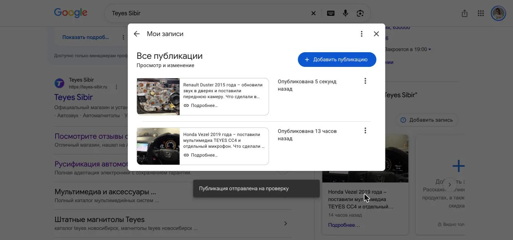
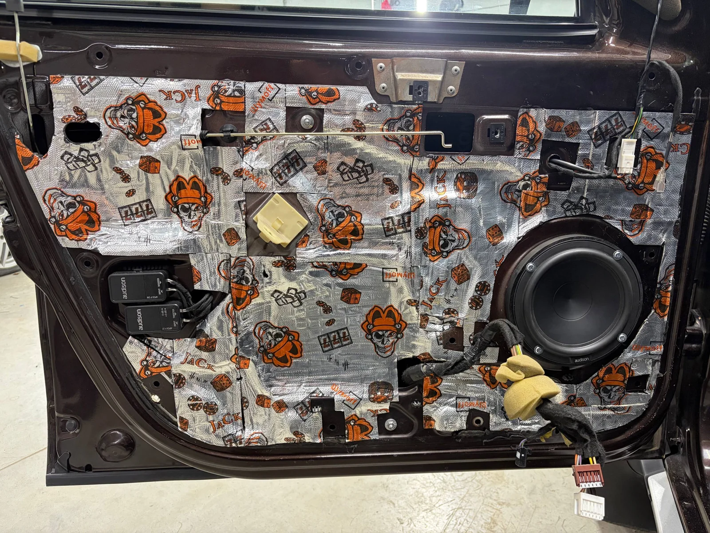
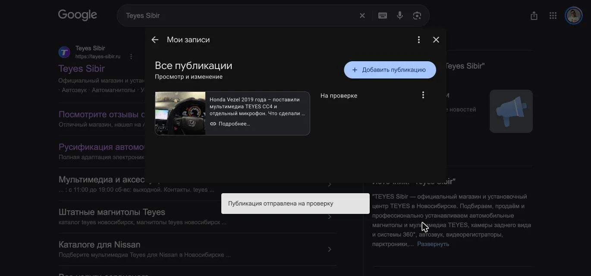
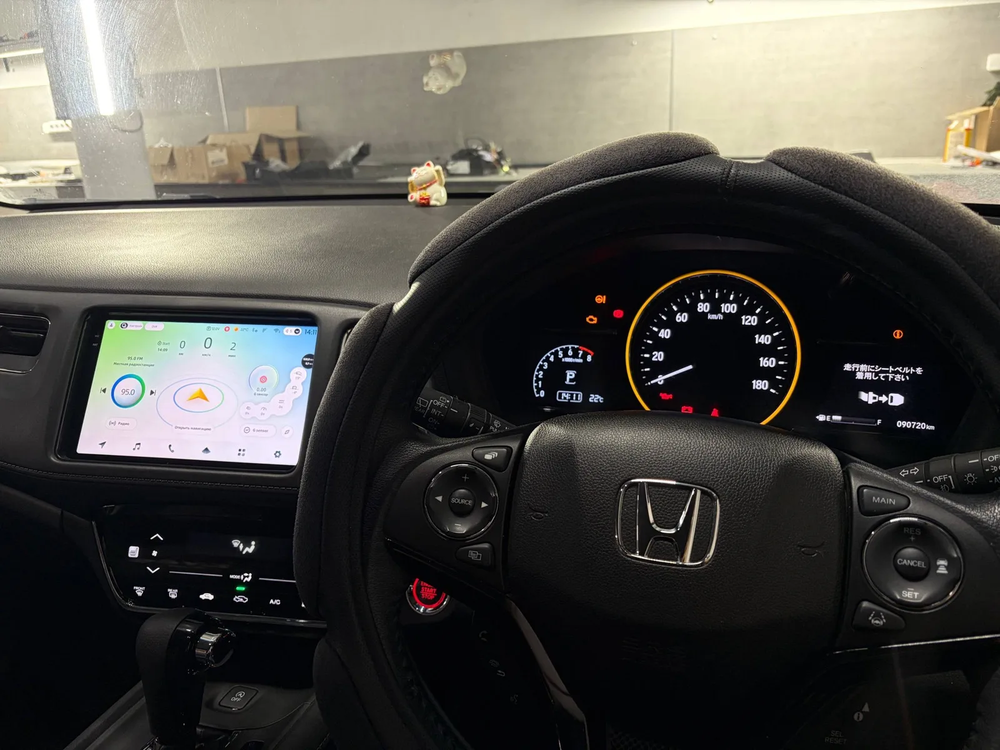
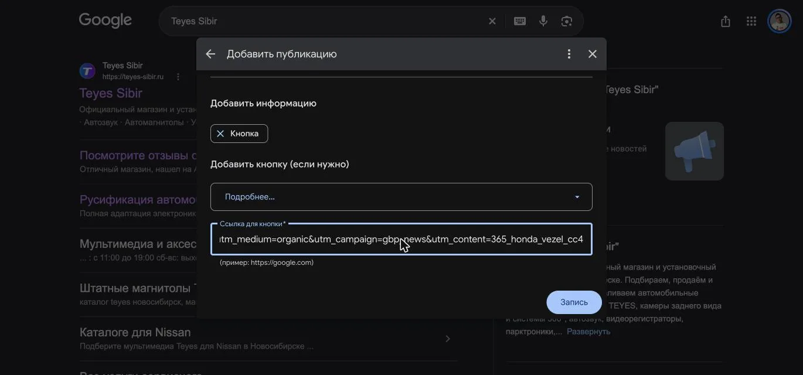

# Вторая новость TEYES в Google Картах вышла: Renault Duster – автозвук и передняя камера

16.11.2026, ~16:10 НСК. Новость опубликована в карточке Teyes Sibir и сразу получила статус «Опубликована». В заводе стоит в календаре TEYES 16.11 как «вышла».

## Что вышло

- Работа №367 из чата мастеров, 15.11.2026: Renault Duster 2015 – установка динамиков, шумоизоляция дверей, передняя камера.
- Кнопка «Подробнее» ведёт на страницу автозвука teyes-sibir.ru/services/installing_car_audio с меткой utm_content=367_renault_duster_zvuk. Адрес отвечает 200.
- Автозвук – одна из трёх главных услуг TEYES, поэтому взял эту работу, а не очередную магнитолу.

## Почему этот кадр

- В работе 4 фото. На двух виден госномер – их не брал.
- Взял дверь: видны динамик Audison, кроссоверы внутри двери и шумоизоляция. Номера и людей в кадре нет.
- Prado №366 (тоже 15.11) пропустил: на единственном кадре экран выключен.

## Текст (611 знаков, проверка кодом – 0 ошибок)

> Renault Duster 2015 года – обновили звук в дверях и поставили переднюю камеру.
>
> Что сделали в установочном центре TEYES Sibir:
> – шумоизоляция дверей материалом Шумофф;
> – установили динамики Audison, кроссоверы спрятали внутри двери;
> – поставили переднюю камеру в решётку бампера, под номером.
>
> Шумоизоляция нужна, чтобы дверь не дребезжала на басу и меньше пропускала шум дороги. Передняя камера показывает, что прямо перед бампером, – удобно подъезжать к бордюру и сугробу.
>
> Подбираем акустику и шумоизоляцию под конкретную машину. Приезжайте на Сухарную, 35 к13 в Новосибирске или смотрите автозвук по кнопке.

- Марки Audison и Шумофф – с фото, остальное – из записи мастера. Цены и сроков нет: их нет в записи.

## Скилл после второй выкладки

- Прошло с первого раза: окно, фото скриптом, текст, кнопка – без ручной помощи.
- Нашёл и поправил: завод ждёт тип кнопки строкой, а скилл описывал объект – первая отметка получила отказ 422, вторая прошла. Правило записано в скилл и журнал.
- Выкладок по скиллу: 2 из 3–5, после которых он считается готовым.

## Нужно от тебя

Ничего нового. Висит прежнее: вход в Google-аккаунт карточки Баланса, выдавать ли вход клиенту TEYES, 10 предложений «Редактора» по страницам TEYES.

## Что дальше

1. Третья новость: BMW X5 №360 или Subaru Forester №361 (мультимедиа), Prado №358 – с закрытым номером.

Голос итога – временно голос мака: сервис golos сегодня зависает (так же у соседних чатов).

## Что раскрыть

- Как выбираю работу для новости.
- Когда переходить с браузера на API.

---

Ниже – первая новость и всё, что было до неё.

## Google Карты упакованы в скилл и в завод: TEYES Sibir заведён с 12 вкладками каналов, Баланс ждёт входа в Google

16.11.2026. Первая новость TEYES (Honda Vezel с TEYES CC4) вышла и прошла модерацию. Теперь это порядок, а не разовая работа.

## Скилл google-karty-novosti

- Порядок: свежая работа мастеров с фото → текст → проверка кодом → окно в твоём Chrome → фото скриптом → «Запись» → статус Google → отметка в заводе.
- Твои решения внутри: только браузер, без «да», картинки ставлю сам; проверка текста и фото без номеров – всегда.
- Проверен на 1 реальной выкладке. По твоему правилу «готов» – после 3–5.

## Завод AI сфера

- **TEYES Sibir** – третий клиент (кабинет /teyes-sibir, вход клиенту не выдавал). Работают: Сайт, Дзен, ВКонтакте, Яндекс Карты, Google Карты. «В разработке»: Instagram, YouTube, Rutube, Одноклассники, auto.ru, drive2, Телетайп – пунктирные вкладки без действий.
- **Google Карты в заводе** – способ «браузер»: завод отдаёт готовые новости, скилл выкладывает и отмечает выход. Новость Honda Vezel стоит в календаре TEYES 16.11 со статусом «вышло».
- Проверил сам на живом заводе: TEYES в клиентах, 12 вкладок, новость в ноябре, маршруты без входа – 401. Тесты: 527 прошли.

## Баланс и API

- Заявку на API Google пока не одобрил: квота 0. По твоему слову API не трогаем, после первой кампании решаем.
- Карточки Баланса нет ни в одном из 5 Google-аккаунтов в твоём Chrome. В заводе у Баланса так и написано: «Выкладываем через браузер – ждём вход в Google-аккаунт, где карточка Баланса».
- Нашёл лишнее: в аккаунте №3 ещё 3 неподтверждённые карточки «Teyes Sibir», одна – дубль. Не трогал.

## Нужно от тебя

1. Баланс: войди в Chrome в Google-аккаунт, где карточка Баланса, или добавь свой рабочий аккаунт менеджером карточки.
2. Выдавать ли вход в кабинет TEYES клиенту.
3. После заведения TEYES станция «Редактор» предложила 10 обновлений страниц TEYES. Сайт на Тильде, завод туда не выкладывает – их можно отклонить.

## Что раскрыть

- Как устроены вкладки каналов в кабинете.
- Что делать с лишними карточками TEYES в аккаунте №3.

---

## Первая новость (16.11)

## Фото теперь ставлю сам

- Окно новости Google – встроенная страница того же сайта google.com. Скрипт со страницы поиска достаёт до её поля файла, берёт фото по ссылке, перекодирует в JPEG и кладёт в поле. Без рабочего стола и перетаскивания.
- Скрипт записан в проект: `karty-brauzer/chrome/foto_v_okno.js`, проверен на этой новости.
- Твои слова записаны в ход работ: новости Google Карт выкладываю без твоего «да», картинки решаю сам. Проверка текста кодом и фото без номеров остаются обязательными.

## Что дальше

1. Тем же путём делаю следующие новости по свежим работам с фото: Prado №358 (номер в кадре закрою), BMW X5 №360, Subaru Forester №361.

## Что за работа

- Работа №365 из чата мастеров, 10.11.2026: Honda Vezel 2019, поставили TEYES CC4 и отдельный микрофон. В работе 4 фото: до, после, микрофон, машина снаружи.
- Для новости взял кадр «после»: CC4 включена в рамке, номера машины в кадре нет. На кадре с машиной снаружи виден номер, его не беру.
- На приборке в кадре японская надпись (машина из Японии). В тексте новости иероглифов нет, проверка кодом прошла.

## Текст новости (628 знаков)

> Honda Vezel 2019 года – поставили мультимедиа TEYES CC4 и отдельный микрофон.
>
> Что сделали в установочном центре TEYES Sibir:
> – установили CC4 в рамку под Vezel вместо прежней магнитолы;
> – вывели выносной микрофон на потолок у стойки лобового стекла, рядом с козырьком. Так при разговоре по громкой связи микрофон ближе к голосу водителя.
>
> Теперь на экране навигация, музыка и приложения на Android, а звонки идут через микрофон под потолком.
>
> Подбираем мультимедиа Teyes под конкретную машину: рамку, проводку и что сохранить из штатного. Приезжайте на Сухарную, 35 к13 в Новосибирске или смотрите варианты для Honda по кнопке.

- Кнопка «Подробнее» ведёт в каталог Teyes для Honda: teyes-sibir.ru/store/catalog/honda с меткой utm_source=google_maps, utm_content=365_honda_vezel_cc4. Метку видно только в Метрике, в новости её нет. Адрес отвечает 200.
- Проверка `proverit()` из karty_google.py: 628 знаков, ошибок 0 (телефон, ссылки, капс, «!!!», длинное тире, иероглифы).
- В тексте только то, что есть в записи мастера и на фото. Размер экрана, сроки и цену не пишу: их в записи нет.

## Что было в окне перед публикацией

- Описание: 628/1500, текст выше.
- Кнопка: «Подробнее…» + ссылка.
- Фото: в первой попытке не встало (расширение не видит поле файла), во второй поставил скриптом.

## Что раскрыть

- Почему именно эта работа, а не Prado №358 и №366.
- Как выкладывать новости по расписанию без открытого Chrome (скрипт на сервере или API после одобрения заявки).

---

Ниже – что было до этого.

### Скрипт через браузер (16.11, пока API нет)

- Репо tema-mail/karty-brauzer (закрытое), на сервере claude-vps – ~/tools/karty-brauzer.
- Как работает: обычный Chrome на сервере со своим профилем, скрипт подключается к нему и заполняет «Добавить новость»: текст, фото, кнопка «Подробнее» со ссылкой. Без флага «опубликовать» кнопку «Опубликовать» не жмёт, только снимок экрана.
- Перед выкладкой проверка текста: 100–1500 знаков, без телефона, ссылок, капса, длинного тире, иероглифов. 6 тестов прошли.
- Проверено: Chrome на сервере поднимается и закрывается, сирот не остаётся.
- 16.11 ночью выяснилось: окно новости открывается и заполняется прямо в твоём Chrome. Вход на сервере больше не нужен.

### Сделано 15.11 вечером (по твоему «да»)

- Включены My Business Account Management API и Business Information API в проекте teyes-seo-admin. API для новостей (Google My Business v4) Google открывает только после одобрения заявки.
- Заявка на доступ отправлена с твоего аккаунта: карточка Teyes Sibir, проект 630219646968, сайт teyes-sibir.ru. Обращение 3-7899000042278, Google пишет «7–10 рабочих дней». Ответ придёт на почту аккаунта.
- Экран согласия OAuth «Zavod TEYES Sibir» создан (External, режим Testing), ты в тестовых пользователях. OAuth-клиент zavod-google-karty (Desktop) создан, ключ лежит на маке в ~/.config/google-karty (права 600).
- Дубль «Teyes Сибирь» не трогали.

### Что дальше

1. Придёт одобрение: перевожу приложение из Testing в рабочий режим (в Testing ключ живёт 7 дней), ты один раз жмёшь «Разрешить», вечный ключ уходит на сервер завода.
2. Тем временем делаю в заводе выкладку новостей в Google Карты и статусы модерации.
3. На баннер Google «Verification required» для твоего аккаунта: подтверждение личности делаешь сам, без него правки в карточке могут не показываться.

---

Ниже – разбор, с которого начали.

15.11.2026. Карточка есть, подтверждена и висит на твоём Google-аккаунте. Через API Google позволяет выкладывать новости, а у Яндекса такого API нет совсем. Остановка одна: Google сначала одобряет доступ к API, и заявку подаёт владелец карточки.

### 1. Как было с Яндекс Картами и почему слетело

- В старом заводе (бэкап 12.11, `factory/src/ymaps.py`) пост в Яндекс Бизнес готовился сам: текст из статьи, до 4 фото, проверка лимитов. Отправлял его скрипт, который в браузере заполнял форму кабинета `yandex.ru/sprav/<id>/p/edit/posts/` и нажимал «Создать».
- Публичного API для публикаций у Яндекса нет: проверено руками 11.09 и нашим токеном 21.10 (запрос перекидывает на вход).
- Старый завод снят 12.11, вместе с ним пропала и эта выкладка. Других рабочих выкладок в Яндекс Карты в чатах и Штабе я не нашёл.
- Новый завод (zavod.сеоконтентзавод.рф) уже знает правила Яндекс Бизнеса и Google Карт: лимиты, запреты модерации, календарь. Кнопки «выложить» в нём пока нет, по плану выкладывает человек.

### 2. Что есть у Google и что я проверил сам

| Что | Факт | Источник |
|---|---|---|
| Карточка | «Teyes Sibir», Сухарная 35 к13, «Подтверждено», в твоём аккаунте | business.google.com, 15.11 |
| Дубль | «Teyes Сибирь», тот же адрес, «Требуется подтверждение» | там же |
| Правки Google | 1 правка ждёт в кабинете | там же |
| Карты снаружи | категория «Автомастерская», сайт и телефон верные, отзывов 0 | Google Карты с VPS, 15.11 |
| Проект Google Cloud | teyes-seo-admin, номер 630219646968, в твоём аккаунте | console.cloud.google.com |
| API Business Profile | в проекте не включены | там же |
| Метод для новостей | `localPosts.create` (v4): текст, фото, кнопка «Подробнее» / «Позвонить», события, акции | developers.google.com/my-business |
| Доступ | квота 0, пока Google не одобрит заявку; условия: карточка подтверждена и активна 60+ дней, есть сайт, заявка с почты владельца | developers.google.com/my-business/content/prereqs |

### 3. План подключения

1. **Ты (5 минут):** форма support.google.com/business/contact/api_default → «Application for Basic API Access», с почты владельца карточки, номер проекта 630219646968, сайт teyes-sibir.ru. Ответы на поля подготовлю.
2. **Я, после твоего «да»:** включаю в teyes-seo-admin три API (Account Management, Business Information, Google My Business для новостей), создаю OAuth-ключ. Ты один раз нажимаешь «Разрешить», вечный ключ уходит на сервер завода.
3. **Я, пока Google рассматривает:** в заводе клиент TEYES, разъём Google Карт на API, статусы «на проверке / вышла / отклонена» из ответа Google. Выкладка только после «Согласовать» в календаре и твоего слова на боевой режим.
4. **Пока ответа нет:** новости выкладываю по одной через кабинет в твоём Chrome, каждую после твоего «да».

Сколько Google рассматривает заявку, он не пишет. Квота после одобрения 300 запросов в минуту, нам хватит с запасом.

### Вопросы 15.11 (1 и 2 закрыты: API включены, заявка подана)

1. «Да» на включение API и OAuth-ключа в проекте teyes-seo-admin.
2. Подать заявку на доступ: 5 минут, текст ответов дам.
3. Дубль «Teyes Сибирь»: удаляем? Две карточки на один адрес делят показы.
4. Яндекс Карты возвращаем так же: завод готовит пост, скрипт выкладывает через кабинет в браузере. Делаем?

### Что можно было раскрыть 15.11

- Как в старом заводе работала выкладка в Яндекс Бизнес.
- Какие посты пойдут в Google и какие правила модерации.
- Правка Google, которая ждёт в кабинете.
