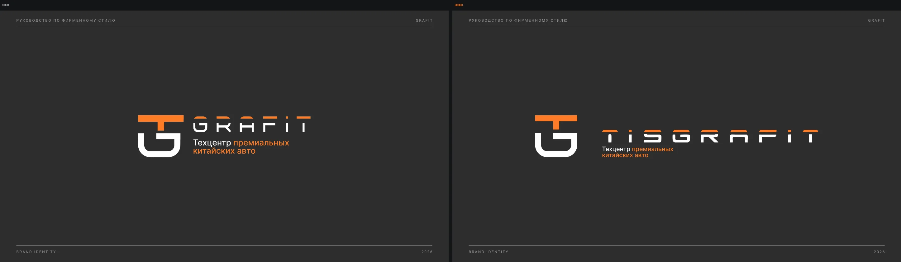
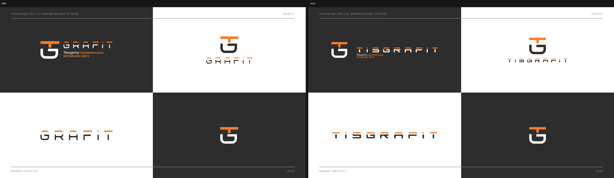
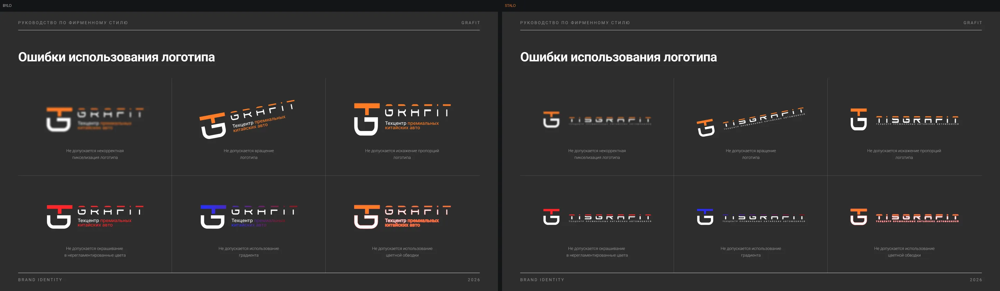
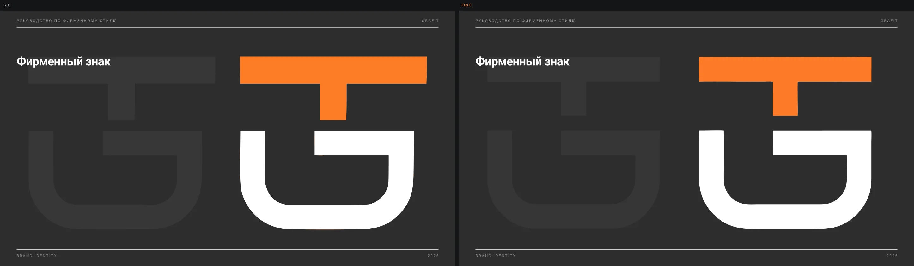
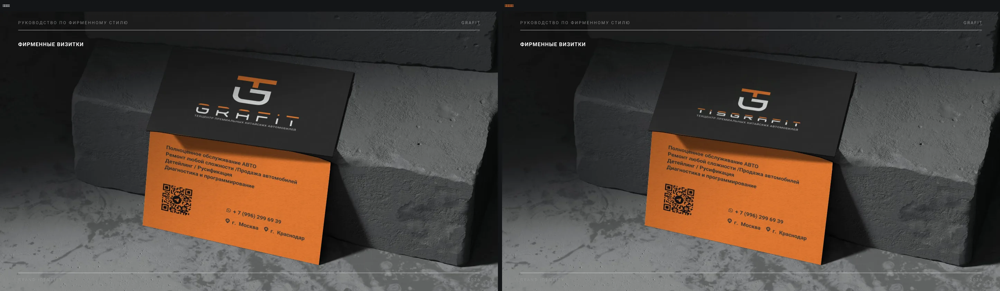
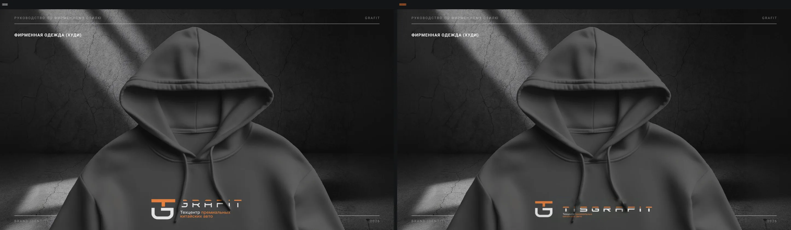
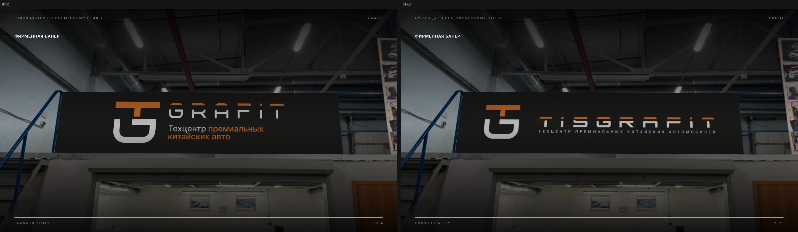
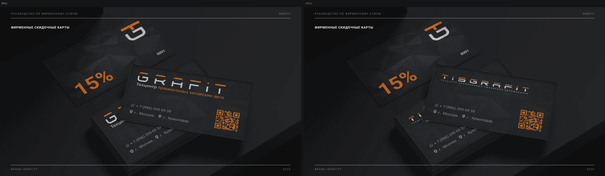
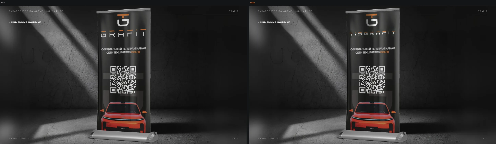

# Брендбук GRAFIT: старое лого заменено на TISGRAFIT на всех 27 страницах

Цвета, фото, тексты и вёрстка – как были. Меняли только лого: и надпись, и знак «TG» – в новом файле он тоже перерисован.

**[Скачать готовый PDF (70 МБ)](https://github.com/tema-mail/razbory/releases/download/grafit-brendbuk-8f5f2357/GRAFIT-brendbuk-TISGRAFIT.pdf)** · копия на маке: «Загрузки» → «Брендбук GRAFIT – лого TISGRAFIT.pdf»

## Что заменено

- **6 векторных страниц**: обложка, охранное поле (сетку перестроил под новое лого), варианты лого, 6 «ошибок использования», фирменный знак, униформа.
- **12 мокапов, 15 мест**: визитки, папка, худи (перед, капюшон, спина), футболка, жилетка, стакан, пакет, баннер, скидочные карты (3 карты в стопке), ролл-ап, листовка.
- Знак тоже новый: в файле «Тигра» полоса T по ширине G, ножка тоньше, G круглее. Поэтому знак меняли везде, включая страницы, где стоит только он.

## Как сделано, чтобы было аккуратно

- **Пропорции знак/надпись** – как в файле клиента. Знак той же высоты, что старый. Где длинное «TISGRAFIT» не влезает в место старого лого, весь блок уменьшен целиком, без растягивания.
- **Цвета** – брендбуковые с каждой страницы: оранжевый #FD7B27, белый, #2E2D2D. В файле клиента оранжевый чуть другой (#EE700E) – его не брал, палитру брендбука не трогал.
- **Мокапы**: старое лого стёрто, новое положено в той же перспективе, со светом, складками ткани и фактурой бумаги. Слоган «Техцентр премиальных китайских авто» сохранён.
- На униформе лого нарисовано как печать на ткани (два слоя с прозрачностью и осветлением) – новое положено в те же слои, эффект тот же.

## Что проверено

- Все 27 страниц собранного PDF открываются без ошибок рендера.
- Все 15 мест на мокапах просмотрены крупно. Найдены и исправлены два дефекта: пятно на нижней визитке в стопке и проступавший тёмный «Техцентр» на лицевой визитке.
- Нашёл подвох при сохранении: слияние одинаковых объектов в PDF ломало страницу «Основные цвета». Сохраняю без него – страница в порядке.

## Нужно от тебя

1. **Название в тексте осталось GRAFIT** – колонтитул «GRAFIT» на каждой странице, «Сети техцентров GRAFIT» на ролл-апе и листовке, подписи «Клиентская зона техцентра Grafit». Ты просил менять только лого, поэтому не трогал. Менять на TISGRAFIT?
2. **Большой полупрозрачный знак за QR-кодом** на ролл-апе и листовке остался старым – он еле виден, но форма прежняя. Переделать?
3. **Вертикальное лого** (знак над надписью) я собрал сам: в файле клиента есть только горизонтальное. Если у дизайнера есть своя вертикальная версия – пришли, поставлю её.

## Что раскрыть

- Как устроена подгонка на мокапах и где она могла ошибиться.
- Исходники и скрипты: `~/Sites/grafit-brendbuk` (пересборка одной командой).
