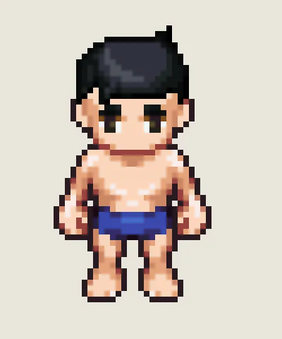

# Гром: день по твоим часам и герой с твоей внешностью

**Вывод:** день теперь считается по твоим понятиям и подводится только вечером. Гром засчитывает день после 22:00, если в Тренере 3 приёма пищи и у Евы нет просроченных задач. Сегодняшнее закрытие в 14:44 я отменил. Герой перерисован по твоему фото.

## 1. Понятия – для всех

| Понятие | Время (НСК) | Что это значит для ботов |
|---|---|---|
| День | 07:00–01:00 | итог дня до 01:00; с 01:00 до 07:00 ничего не считаем, боты молчат |
| Рабочий день (мой день) | 10:00–22:00 | утреннее сообщение с 10:00, итог – в 22:00 |

Записал правилом для всех чатов в общие инструкции и в память. Ева уже перешла: планёрка 10:00–22:00, утренняя рассылка в 10:00 (выложено и перезапущено, её 125 тестов проходят).

## 2. Как Гром теперь подводит день

- **10:00** – «рабочий день пошёл, ключевая задача первой».
- **Днём** день не закрывается, сколько бы ты ни поел.
- **22:00** – проверка:
  1. в Тренере 3 приёма пищи и больше;
  2. у Евы нет твоих открытых задач со сроком по сегодня. «На завтра» у Евы снимает просрочку, «снята» тоже.
- Всё есть – день засчитан, +1 к серии, сообщение.
- Чего-то нет – голосовое Винсента и список, чего не хватает. До 01:00 можно добить: скинуть еду Тренеру, закрыть или перенести задачу у Евы. Гром проверяет раз в 5 минут и засчитает сам.
- **01:00** – не засчитан: −10 здоровья, серия с нуля. Суббота – выходной, как было.

## 3. Что проверено вживую

- Сегодняшнее раннее закрытие отменено в боевой базе: серия 0, закрытых дней нет.
- «Сегодня» на живых данных показывает: еда 2 приёма из 3; задачи у Евы со сроком сегодня или раньше – **11 штук**, самая старая «GRAFIT – доработать структуру страниц» со сроком 12.11. В сообщении – первые 6 и «ещё N».
- Тесты бота: 47 из 47. Бот перезапущен на сервере, ошибок в журнале нет.

## 4. Герой теперь похож на тебя

По твоему фото: чёрные волосы, коротко по бокам и с объёмом сверху (из 13 причёсок LPC ближе всего «cowlick»), густые тёмные брови, карие глаза, светлая кожа, без бороды. Пока дрыщ – тело растёт от тренировок. Родинку не ставил: лицо в спрайте около 10 точек, одна тёмная точка выглядит как грязь. Само фото в открытый репозиторий не попало, там только эти параметры. Новый герой уже ходит у тебя по рабочему столу, на странице и в окне «Гром».

## 5. Нужно от тебя

- До 22:00 скинь Тренеру ещё один приём пищи.
- 11 задач у Евы: на разборе в 18:00 закрой сделанные, остальные перенеси. Сегодня урона не будет – он включается с понедельника 16.11, но день без этого не засчитается.

## Что раскрыть

1 – список всех 11 задач с просрочкой, 2 – почему 3 приёма пищи, 3 – как Ева переносит задачи.
