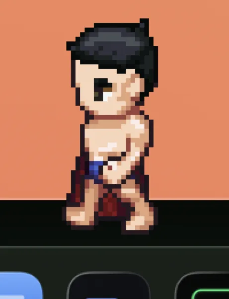

# Гром: плащ на герое, купленное теперь надевается само

Выложено 19.11 в 23:12 НСК, коммит 83ecc38, тесты 56 из 56.

## Почему плаща не было

- Покупка клала вещь в инвентарь, а надевать надо было отдельной кнопкой «Надеть». Слот «спина» был пустой, поэтому герой на столе ходил без плаща.

## Что сделал

- Плащ надет: на сервере в наряде «спина – Красный плащ», герой на маке подхватил его за 30 секунд.
- Теперь любая купленная вещь сразу надевается. Если в том же слоте что-то было, старая вещь остаётся в инвентаре, её можно надеть обратно.

## Нужно от тебя

- Ничего.

## Что раскрыть

- Как снять или поменять вещь.
