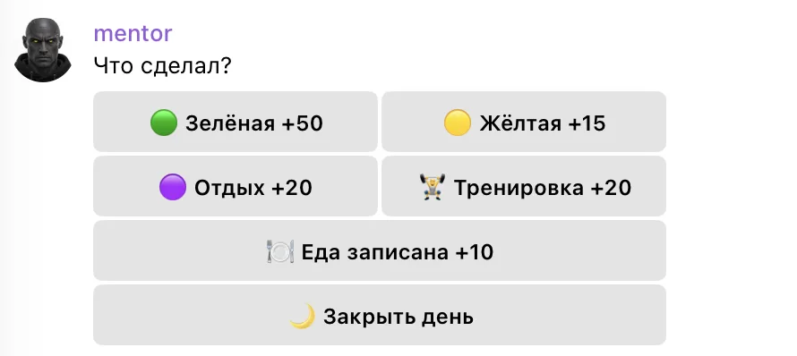
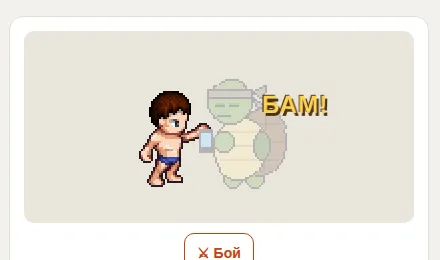
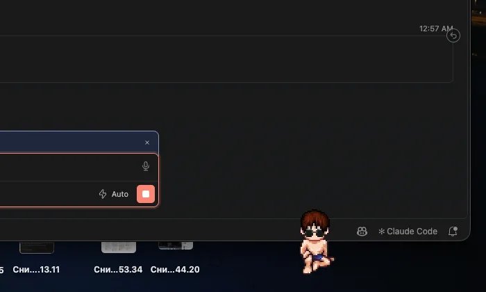

# Гром берёт всё сам: еда, тренировки, задачи

**Вывод:** руками больше ничего не отмечаешь. Гром сам смотрит в Тренера (еда, тренировки, шаги, вес) и в контроль Евы (закрытые задачи с доказательством) и сам начисляет монеты. Кнопки «Зелёная», «Тренировка», «Закрыть день» убраны. Руками остались только магазин и разговор.

## 1. Откуда Гром берёт данные

| Что | Откуда | Что даёт |
|---|---|---|
| Еда | Тренер (@trener_artem_bot): ты кидаешь туда фото | день с едой +10, челлендж «Еда 5 из 5» |
| День закрыт | Тренер: 2 и больше приёмов пищи за день | серия дней, без урона ночью |
| Тренировки | Тренер, таблица тренировок | +20, челлендж «Зал 3 из 3», форма тела растёт |
| Шаги, сон | Тренер, с трекера через «Здоровье» | видно в «Сегодня» |
| Вес | Тренер | удары по боссу «Жир» |
| Задачи | Ева: закрыта кнопкой «Сделано» или /gotovo с доказательством | ключевая +50, обычная +15, отдых +20 и лечит |

Проверка встроена в источник: Тренер видит фото еды, Ева закрывает задачу только с твоим подтверждением. «Снята» монет не даёт, задачи, закрытые до 15.11, тоже.

Кнопка внизу теперь **«📋 Сегодня»** – Гром показывает, что увидел сам за день и чего не хватает, чтобы день закрылся.

## 2. Что такое «зелёная»

Это из курса Колмакова (АСБ), план недели:
- **Ключевая задача недели** («зелёная») – их 2, ведут к результату. +50 монет.
- **Обычная** («жёлтая») – до 5 в неделю. +15.
- **Отдых** («фиолетовая») – 1 в неделю: хобби, отдых, подарок близким. +20 и лечит героя.

В боте теперь написано словами, без цветов. Цвет задаче ставишь ты на разборе с Евой в воскресенье, она пишет его в контроль. Задачи без цвета считаются обычными. Ева подтвердила: с сегодняшнего разбора в 18:00 ставит цвет каждой новой задаче. Задачи, которые ты ставишь ей прямо в боте, Гром тоже видит.

## 3. Что проверено вживую

- Сегодня в 14:44 Гром сам увидел в Тренере 2 приёма пищи (~970 ккал) и сам закрыл день: серия 1, сообщение пришло тебе.
- «Сегодня» на живых данных: еда 2 приёма, тренировок 0, шаги 16 (это проба Быстрой команды), задач у Евы с 15.11 пока ни одной.
- Тесты бота: 46 из 46.
- Нашёл и починил: бой с Черепахой страница запускала по словам «Зелёная задача», а бот теперь пишет «Ключевая задача недели». Поправил на странице и в приложении на маке. На скрине бой запущен именно новым текстом.

## 4. Чего пока нет и что нужно от тебя

- **Тренировки с трекера в Тренера не приходят.** Быстрая команда шлёт шаги, калории и сон, а тренировки нет – таблица тренировок пустая. Пока не придут, «Зал 3 из 3» и форма тела стоят. Это работа чата «Тренер»: он сейчас закрыт, задача – научить Быструю команду отдавать тренировки из «Здоровья».
- **Вес в Тренере пустой** – босс «Жир» стартует с первого взвешивания в Тренере.
- **Сегодня в 18:00 – разбор с Евой:** назови 2 ключевые задачи недели и 1 отдых, Ева поставит цвет.
- **Фото для внешности** героя: лицо анфас, если есть – в полный рост.

## Что раскрыть

1 – как Гром решает, что день закрыт, 2 – что делать чату «Тренер» с тренировками, 3 – цены и награды в магазине.
