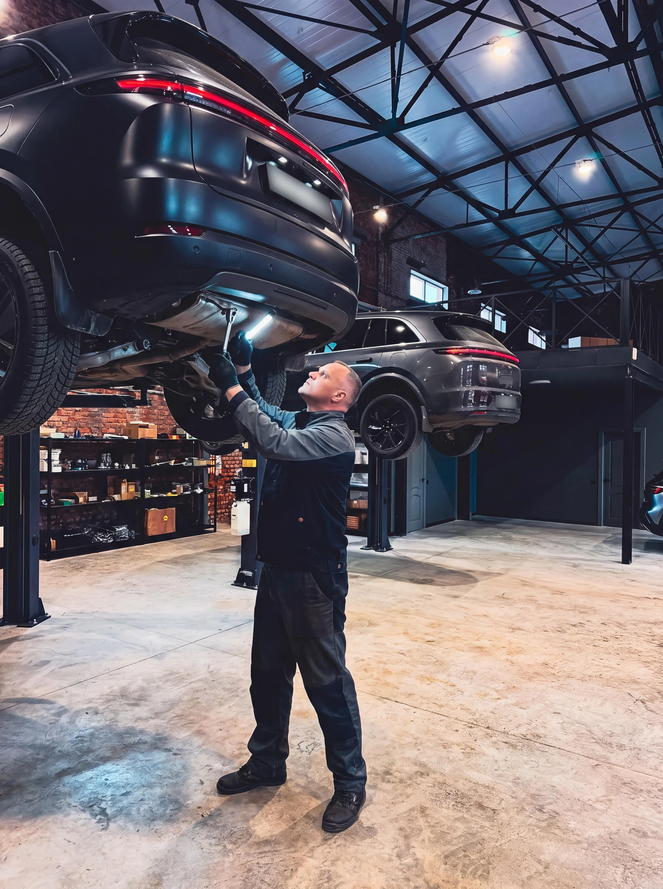
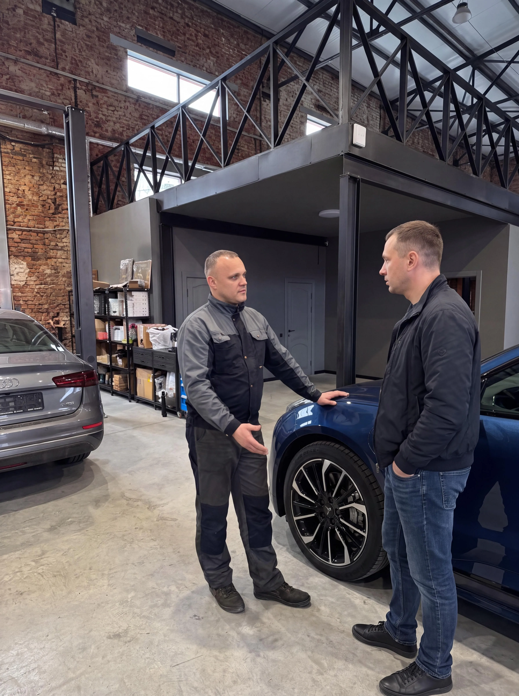
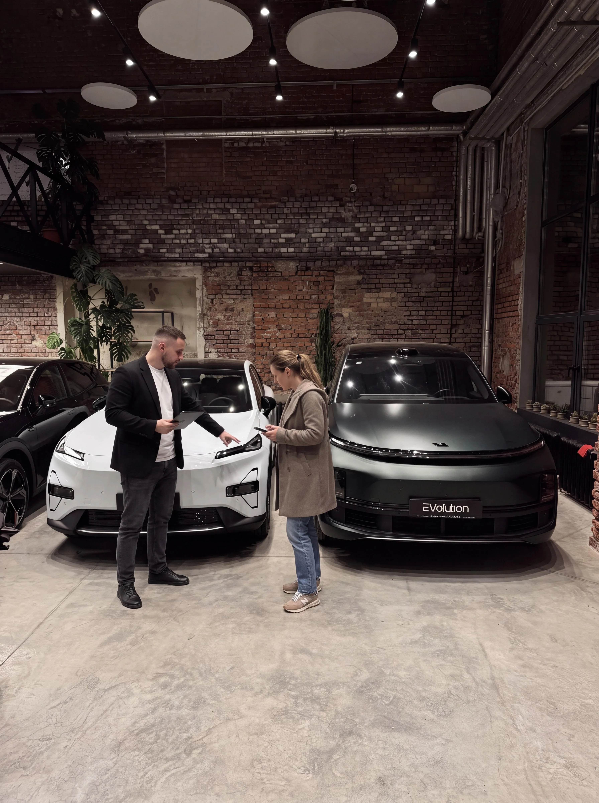
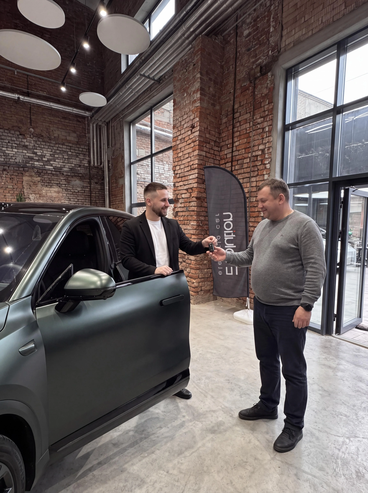
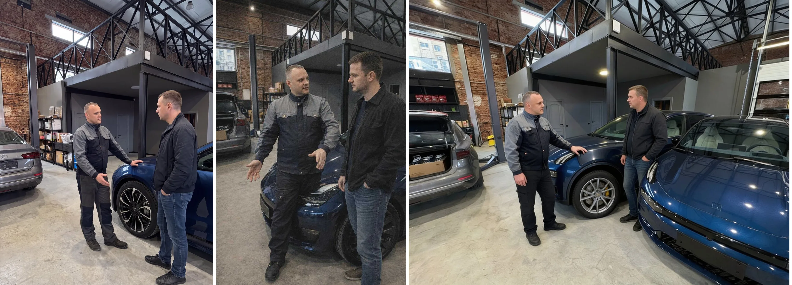
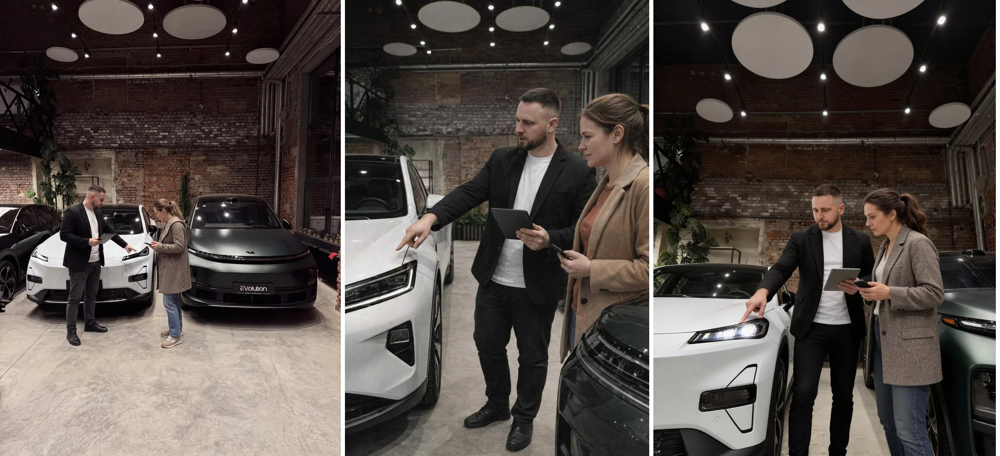
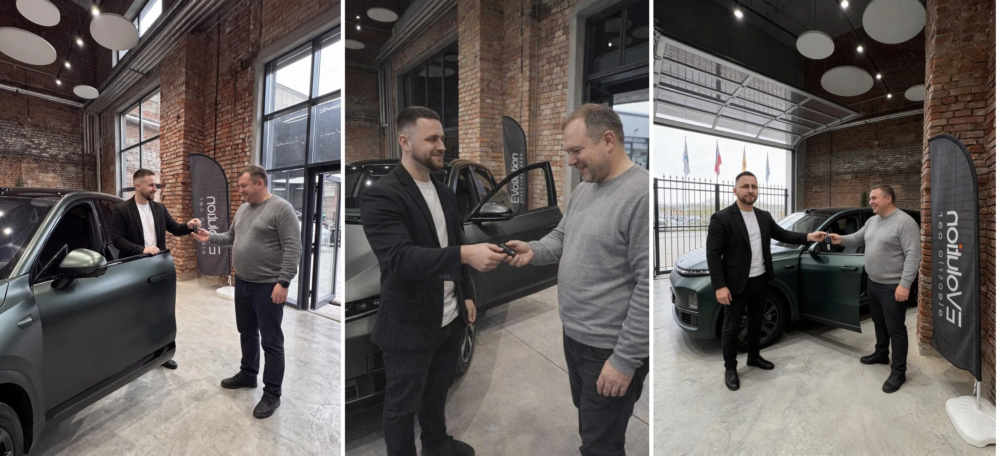
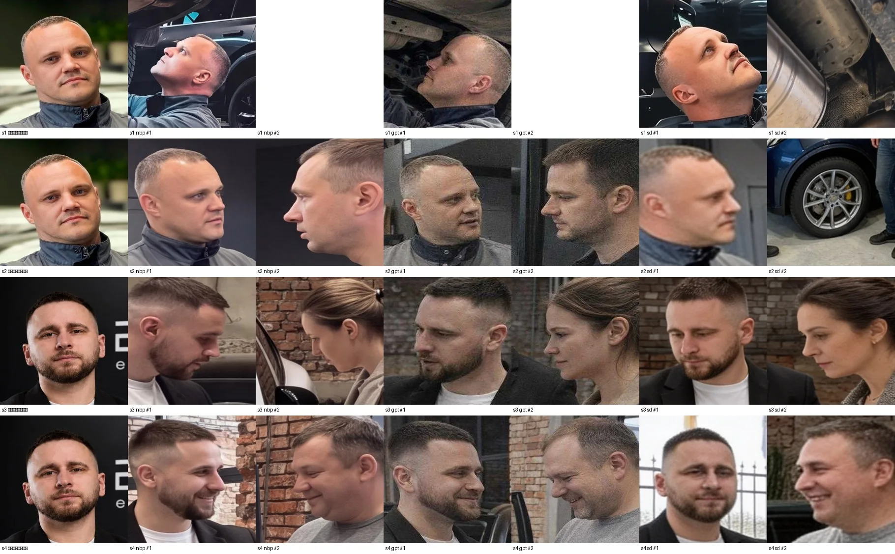
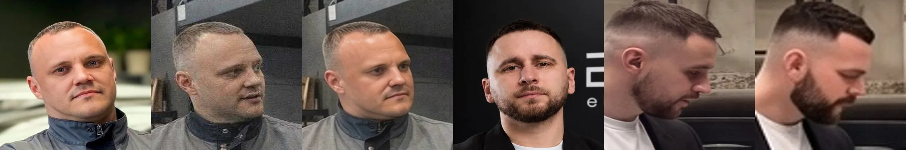

# ИИ-фотограф: агент собран, проба на Evolution готова к разбору косяков

**Вывод:** живые фото с настоящими сотрудниками в настоящем помещении делаем правкой реального кадра моделью Nano Banana Pro с фото лица сотрудника. GPT для лиц сотрудников не основной инструмент. Готового сервиса под такую задачу на рынке нет, конвейер свой.

## 1. Рынок: готовые сервисы делают только портреты
- Aragon, HeadshotPro, BetterPic, Secta, Telegram-боты нейрофотосессий – «лицо на фоне». Своё помещение – максимум как задник за портретом, сцены с действием нет.
- Лицо по 1–5 фото без обучения сейчас держат модели правки: Nano Banana, Seedream, Flux. GPT Image даёт «тот же типаж, а не того же человека» (тест getimg, 20.10.2026).
- Право: нужно письменное согласие сотрудника на ИИ-изображения (ст. 152.1 ГК РФ). Обязательной маркировки ИИ в РФ пока нет, законопроект – с 01.03.2027. В ЕС пометка обязательна с 02.08.2026.

## 2. Проба: 4 сцены из фотобанка Evolution, 3 модели
Фото – из фотобанка: сервис с подъёмниками и зал на Машерова 15/4. Сотрудники – с сайта evolutioncar.by/about: механик Дмитрий (слесарь), менеджер Вадим.

Лучший результат – Nano Banana Pro:

Сравнение моделей (слева направо: Nano Banana Pro, GPT Image 1.5, Seedream 4.5):

| Модель | Помещение и машины | Лицо | Вывод |
|---|---|---|---|
| Nano Banana Pro | сохранены в 4 из 4 | узнаётся | основная |
| GPT Image 1.5 | приближает кадр, меняет фары и модели машин, рисует выхлоп | «типаж»: полнее, старше | для обложек и схем |
| Seedream 4.5 | лишняя синяя машина (сцена 2), выдуманная улица с флагами (сцена 4) | узнаётся | только черновики |

## 3. Отдельная модель лица нужна только для исправления
- Лица крупно рядом с исходником (первый столбец – фото с сайта):

- Замена лица (faceswap-v5) вернула Дмитрию лицо на кадре GPT. На мелком опущенном лице Вадима она пережала: борода и волосы стали темнее.

- Правило: замену лица делаем, только когда лицо уплыло, и сверяем глазами.

## Косяки, которые я уже нашёл
- Сцена 1: под электромобилем нарисованы глушитель и выхлоп. В правилах теперь – днище по типу привода или не брать его в кадр.
- Сцена 1: номера модель нарисовала читаемыми – закрыл по рамке.
- Сцена 2: на пустой рамке номера серого седана надпись-каша.
- Сцена 3: люди мелкие, сходство трудно проверить. Правило: человек не меньше 1/3 высоты кадра.
- Сцена 4: модель приблизила кадр и заменила ворота стеклом.

## Что сделано
- Агент `ii-fotograf` – живые кадры с сотрудниками, а ещё обложки и схемы этапов от реальных кадров для сайтов, контента и завода. Текст и цифры на обложках накладываем кодом, не генерируем.
- База знаний: 34 правила живого кадра из исследования + 8 уроков пробы, чек-лист приёмки, конвейер и цены.
- Скрипты: вызов Segmind, партия сцен, лист сравнения, лица рядом с исходником, номер по рамке.
- Потрачено на Segmind: **$2,63** на 15 удачных вызовов (по каталогу вышло бы около $1,4). Остаток $6,84.

## Нужно от тебя
1. Разбери косяки по 4 кадрам: что видишь ты, кроме моих.
2. «Да» на основную модель Nano Banana Pro (около $0,3 за кадр по факту).
3. Если кадры пойдут на сайт – согласие Дмитрия и Вадима.

## Что раскрыть
- Обложку и схему этапов «приёмка → диагностика → ремонт → выдача» на этих же кадрах.
- Пробу на Balance: тренер и клиент в их зале.
- Telegram-бот: фото сотрудника и помещения → кадры в ответ.
