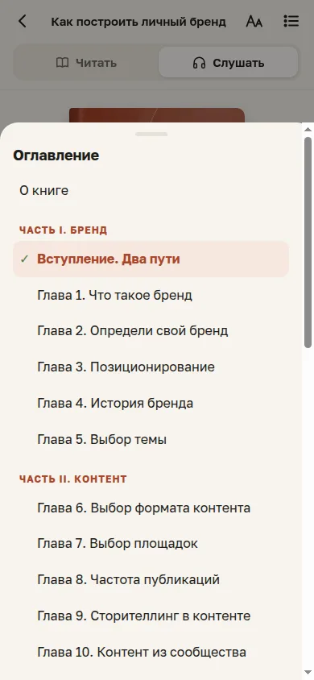

# Книги: полка на телефоне, читать и слушать

**Вывод: библиотека работает по ссылке https://knigi.deford.ru – открыл на телефоне, добавил на экран «Домой», и это приложение с полкой. Сейчас на полке «Как построить личный бренд»: 29 глав текстом и 6 ч 9 мин звука.**

## 1. Что внутри – полка, читалка, плеер

 

- **Полка** – обложки стоят на полке, рядом пустые места «Скоро новая книга». Сверху карточка «Продолжить» – с того места, где остановился, одним нажатием.
- **Читать** – одна глава на экран, крупный шрифт, кнопка «Слушать главу» прямо под заголовком, внизу «Дальше: Глава 2». Шрифт крупнее/мельче, светлая/тёмная тема (вечером тёмная сама).
- **Слушать** – большой плеер: ±15 секунд, скорость 1–2×, таймер сна (15/30/60 мин или до конца главы), список глав с галочками прослушанного. Глава кончилась – включается следующая.
- **Читаешь и слушаешь одновременно** – мини-плеер внизу экрана, пока листаешь текст.
- Управление с экрана блокировки и наушников – обложка, название главы, пауза, перемотка.
- Место чтения и прослушивания запоминается на телефоне.

 

## 2. Как поставить на телефон

- **iPhone (Safari):** открыть ссылку → «Поделиться» ⬆︎ → «На экран „Домой“». Появится иконка «Книги» (полка с книгами), открывается без адресной строки.
- **Android (Chrome):** ⋮ → «Добавить на главный экран» (или кнопка «Установить» на полке).
- Подсказка с этими шагами показывается прямо на полке, пока не установил.

## 3. Где живёт и почему не найдётся в поиске

- Адрес **knigi.deford.ru** – сервер FirstVDS Москва, рядом со «Встречами» (meet.deford.ru): из России открывается быстро.
- Закрыто от поисковиков тремя способами: robots.txt запрещает всё, на каждой странице noindex, сервер отдаёт заголовок X-Robots-Tag. Ссылку знает только тот, кому ты её дал.
- Новая книга: делаем книгу текстом и звуком как эту → одна команда импорта → выкладка. На полке появится сама.
- Код – приватный репо tema-mail/knigi, папка ~/Sites/knigi.

## Что проверено

- Живой адрес: https 200, http → https 301, noindex заголовком и в странице, robots закрыт.
- Звук: все 29 глав на месте, перемотка работает (сервер отдаёт куски файла – 206), в браузере на 390 px глава заиграла, позиция сохранилась.
- Глазами на ширине телефона: полка (светлая и тёмная), чтение, плеер, оглавление; горизонтальной прокрутки нет.
- Соседние сайты на сервере после правки Caddy – 200 (meet.deford.ru, deford.ru, avtoball.ru).
- **Не проверено:** настоящий iPhone в режиме «на экране Домой» – фоновое воспроизведение при заблокированном экране. Это проверишь только ты на своём телефоне.

## По пути

- Найдено и исправлено: выкладка не включала сайт, потому что общий конфиг Caddy правился через подмену файла. Правило внесено в стандарт сайтов, сделана проверка proverka-caddyfile.sh. Та же ошибка в выкладке **tehnics-preza** – не трогал, это чужой проект.
- Авария записана и отправлена тебе: **admin.teyes-sibir.ru не открывается** – домен смотрит на старый Beget, сервер не отвечает.

## Нужно от тебя

1. Открыть https://knigi.deford.ru на телефоне, добавить на экран «Домой», включить главу и заблокировать экран – играет ли дальше.
2. Сказать, если нужно закрыть вход кодом (как во «Встречах») – сейчас вход по ссылке без пароля.

## Что раскрыть

- Скачать книгу целиком для офлайна (самолёт, метро)?
- Выделил текст → заметка в бот «Заметки»?
- Какую книгу ставим на полку следующей?
