# Мобильная вёрстка: как мы раскладываем блоки на телефоне

**Вывод: портянка была потому, что у нас не было правила, куда девать каждый блок на телефоне – только техника (поля, кегль, нет прокрутки вбок). Теперь у каждого блока свой режим: вниз, лента вбок, закреплённая прокрутка, гармошка, вкладки или на весь экран. Режим выбирается по таблице из исследований NN/g и Baymard и пяти разобранных сайтов, проверка сама ловит длинный блок без режима, а твои решения по блокам копятся в журнале и правят таблицу. Карточка 8X уже переделана: 26 экранов → 17,8. Ниже – все 16 её блоков на 390 px, по каждому нужно твоё слово.**

15.11.2026 · Evolution Car BY, карточка Zeekr 8X · [открыть карточку на телефоне](https://tema-mail.github.io/razbory/evolutioncar-zeekr-8x-d2effe31/prototip/)

## 1. Почему было криво

- **Правила были только технические**: 16 px в полях, вырезы экрана, 100svh, нет прокрутки всей страницы вбок (скилл `adaptive-web-layout`). Какой блок вниз, какой вбок – не решалось вообще, поэтому всё шло вниз.
- **Карточка 8X до правки:** 26 экранов, текст 12 px, кнопка тест-драйва вылезала за край, сравнение в 4 колонки по 85 px, конфигуратор во фрейме на 5 экранов, нижняя панель закрывала вторую кнопку первого экрана.
- **Проверка этого не ловила** – она смотрела только прокрутку вбок.

## 2. Что говорят исследования и рынок

| Блок | На телефоне | Почему |
|---|---|---|
| Первый экран | Вниз, не больше ~1 экрана: модель, цена, кнопка | 57 % времени – выше сгиба, 74 % – в первых двух экранах (NN/g, 2018) |
| Ключевые цифры | Сетка 2×2, до 0,4 экрана | zeekr.com.ru – 4 цифры на 0,4 экрана |
| Галерея, пары фото | Лента: край следующей карточки + «3 / 12» | Одни точки люди пропускают (NN/g Mobile carousels, Baymard) |
| Преимущества | До 5 – вниз; 6–12 – лента; больше 12 – гармошка группами | zeekr-avto: ~25 карточек вниз, 19 экранов |
| Этапы, шаги | Лента вбок, до конца 3–4 свайпа | NN/g; лента «Путь» на 87.242.100.185 – 12 шагов в 0,67 экрана |
| Характеристики | Гармошка по группам, 4–6 главных строк открыты | Горизонтальные вкладки на телефоне пропускают (Baymard) |
| Сравнение комплектаций | Не больше 2 колонок, первый столбец и шапка закреплены | NN/g Mobile tables; voltauto – 6 колонок, 949 px |
| Сравнение моделей | Карточки лентой, в каждой 4–5 отличий | – |
| «Что входит» картинкой с выносками | Картинка целиком с метками 1–5, под ней лента карточек 1–5 | Выноски, сложенные в столбик, теряют связь с картинкой |
| Похожие, в наличии | Лента: видно 1,5 карточки + «Смотреть все» | NN/g |
| Вопросы | Гармошка, первый открыт | NN/g Accordions on mobile |
| Форма | Вниз, до 1 экрана, поля 16 px | Digital.gov |
| SEO-текст | 3–4 строки + «Читать дальше» | Baymard |
| Закреплённая прокрутка | Только 3–5 шагов «вау», без длинного текста, ниже первого экрана | Перехват прокрутки на телефоне путает сильнее всего (NN/g, 2023) |

**Пять сайтов на 390 px:**
- **zeekr-avto.ru** – 25,2 экрана, однотипные карточки «фото + абзац» вниз, серый текст с контрастом 2,4:1.
- **voltauto.by** – 20,8 экрана, сравнение в 6 колонок без закреплённого столбца.
- **zeekr.com.ru** – закреплённая галерея: 6 фото листаются 5,4 экрана.
- **Atlant-M** – 13,2 экрана, ленты и вкладки (лучший из пяти), но половина кнопок ниже 32 px.
- **87.242.100.185** – 20,6 экрана, в нём уже есть хорошая лента «Путь» – разбор ниже.

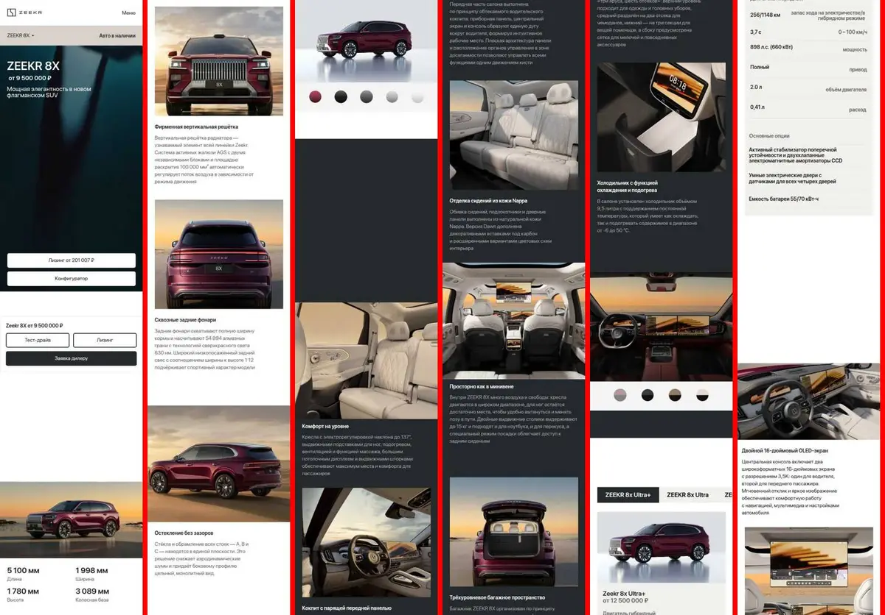
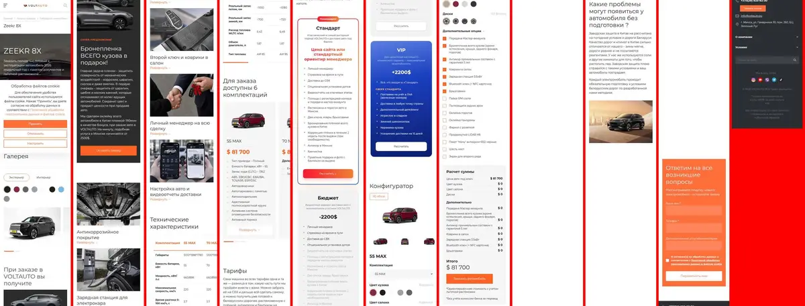
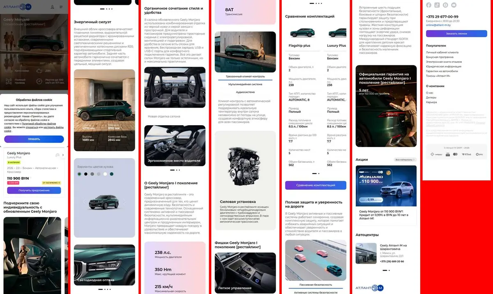

## 3. Как система работает дальше

1. **Режим каждого блока** пишется в разметку (`data-mob`) с причиной – по таблице режимов в `site-lead/references/mobilka.md`.
2. **Проверка** `proverka.mjs` на 390 px валит прототип, если блок выше 1,5 экрана без режима, если текст мельче 13 px или если вся страница едет вбок. Старая карточка 8X падала на двух правилах, новая проходит.
3. **Твой просмотр.** Я показываю снимки по блокам, как ниже. Ты говоришь по каждому: «ок», «вниз», «вбок», «закрепить», «гармошка», «урезать», «криво».
4. **Журнал** `mobilka-zhurnal.md`: каждое твоё слово – строка с датой, проектом и блоком. Если решение общее – правлю таблицу режимов, и на следующем сайте делаю уже так.
5. Правило подключено в стандарты `site-lead`, скилл маркетолога, агента прототипов и скилл адаптива – ими собирается любой новый прототип.

## 4. Карточка Zeekr 8X по блокам – нужно твоё слово

Ответь одной строкой, например: «1 урезать, 2 гармошка, 12 вниз, остальное ок».

### 1. Первый экран – вниз, 1,4 экрана
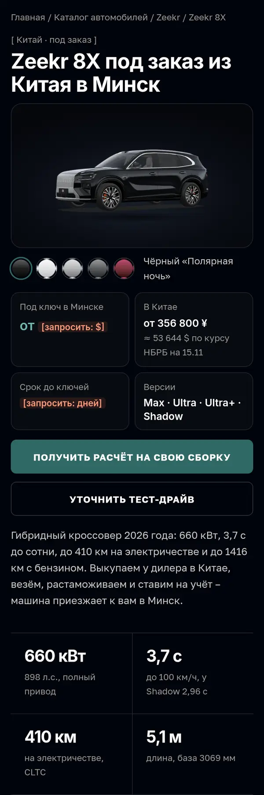
Порядок: заголовок → машина → цвета → цены → кнопки → описание → цифры. По исследованию первый экран – около одного экрана. **Предлагаю:** описание под кнопками убрать в «Обзор», останется ~1 экран.

### 2. Обзор – вкладки, 1,9 экрана
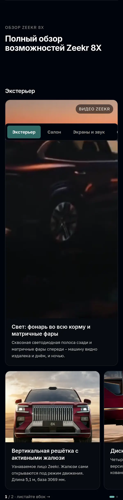
Вкладки «Экстерьер / Салон / Экраны и звук», внутри высокое видео и пары фото лентой. Baymard: горизонтальные вкладки на телефоне часто не замечают. **Вопрос:** оставить вкладки или сделать гармошку разделов; видео сделать ниже (16:9 вместо высокого).

### 3. Тест-драйв – вниз, 1 экран
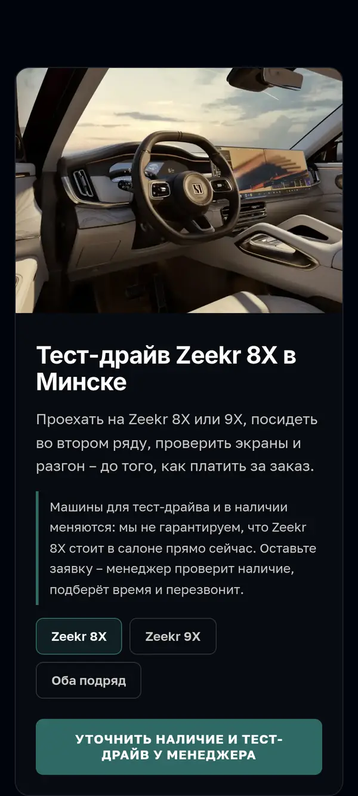

### 4. Цены по комплектациям – лента, 1 экран
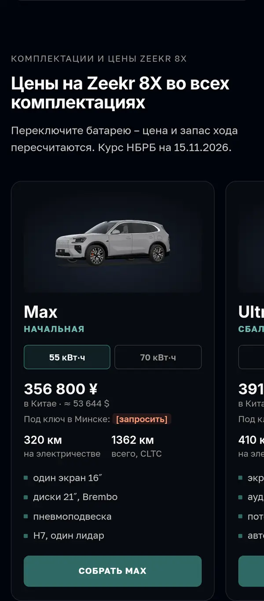
Комплектации лентой, следующая выглядывает.

### 5. Чем отличаются комплектации – две версии + гармошка, 1,5 экрана
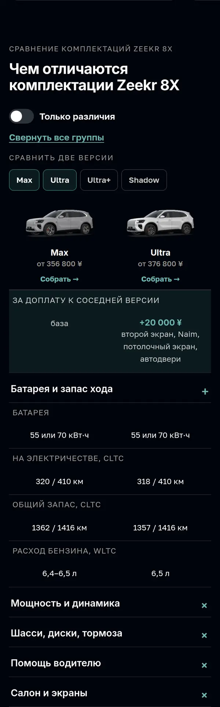
Сравниваются две версии на выбор, группы свёрнуты, первая открыта.

### 6. Конфигуратор – на весь экран, 0,8 экрана

В потоке – карточка с кнопкой. Конфигуратор грузится только по нажатию, открывается на весь экран, закрывается крестиком.

### 7. Из чего складывается цена – вниз, 1,3 экрана
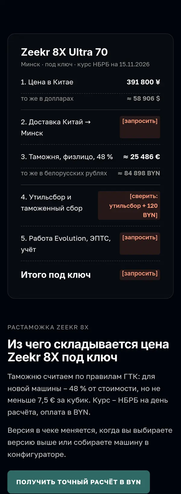
Чек читают целиком, поэтому вниз.

### 8. Лизинг – вниз, 0,9 экрана
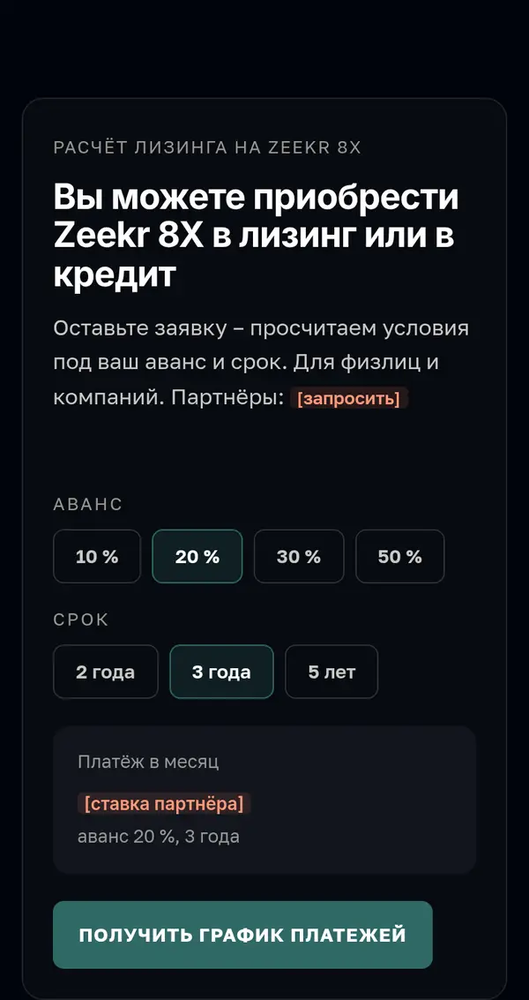

### 9. Как заказать – лента, 0,5 экрана
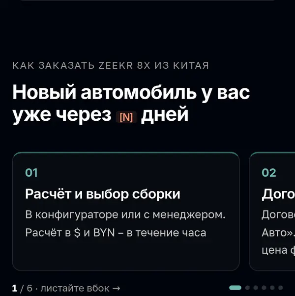
6 шагов вбок, как ты сказал про «четыре этапа». **Вопрос:** лента или закреплённая прокрутка – шаги обязательные.

### 10. Если что-то пойдёт не так – лента, 0,6 экрана
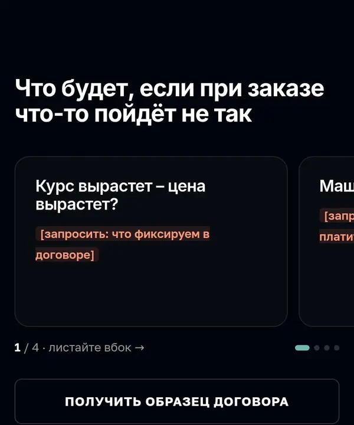

### 11. Выдачи клиентам – лента, 0,6 экрана
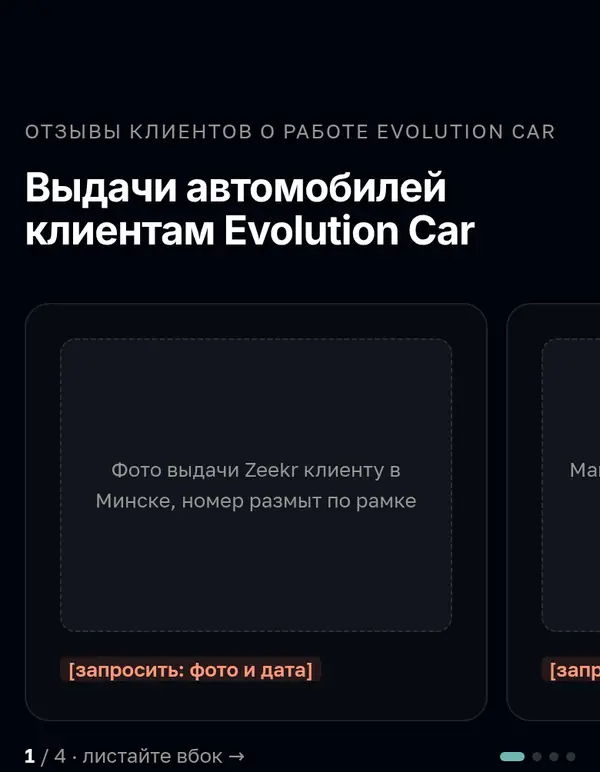
Пока места под фото – ждём реальные выдачи с размытыми номерами.

### 12. Свой сервис – лента, 1,3 экрана
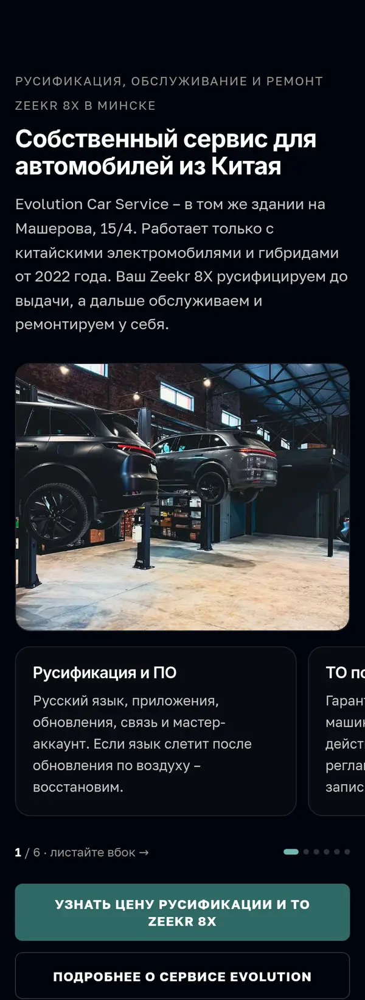
Ты назвал этот блок главным преимуществом. По твоему же правилу важное идёт вниз. **Вопрос:** 6 карточек сервиса оставить лентой или развернуть вниз.

### 13. 8X, 9X или L9 – лента карточек моделей, 1,3 экрана
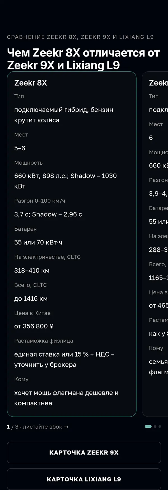
В каждой карточке 13 строк. По исследованию хватает 4–5 отличий. **Предлагаю:** оставить 5 (мощность, запас хода, мест, цена в Китае, кому подходит), остальное – ссылкой на карточку модели.

### 14. Вопросы – гармошка, 1 экран
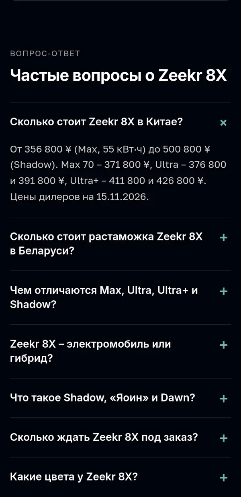

### 15. Расчёт – форма вниз, 1,3 экрана
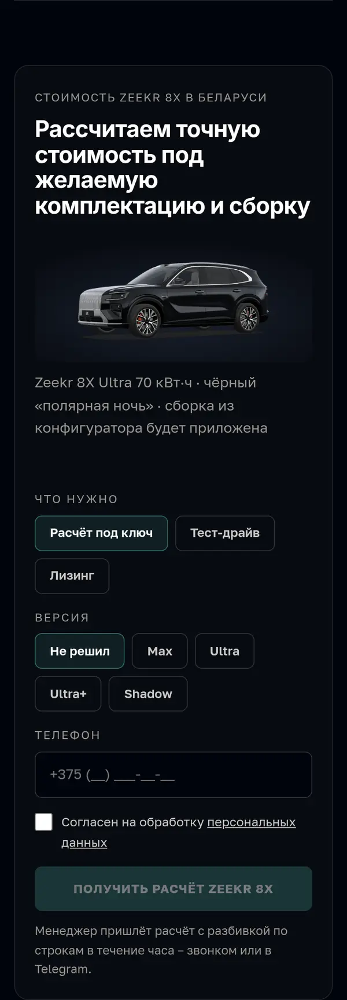
**Предлагаю:** на телефоне убрать картинку машины над формой, останется ~1 экран.

### 16. Похожие автомобили – лента, 0,7 экрана
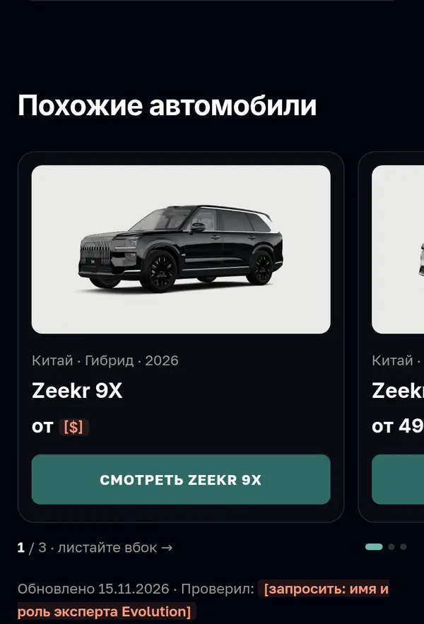

## 5. Образец 87.242.100.185: два блока, которые ты назвал

**«Четыре этапа».** Блока с таким названием на странице нет. Ближе всего – «Четыре способа проверить нас до договора» (шаги 01–04): 4 карточки вниз по ~400 px, всего 2,1 экрана. **Решение:** тот же компонент, что у ленты «Путь» на этом же сайте – карточка ~280 px, край следующей, полоса прогресса. Будет ~0,7 экрана и 3 свайпа.

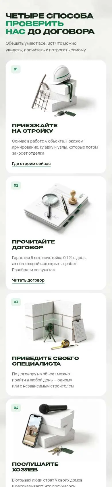
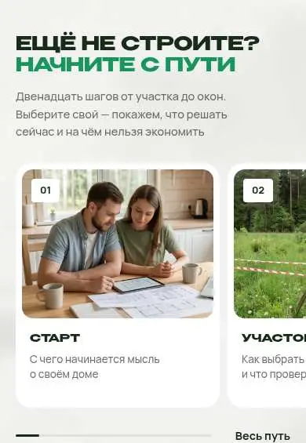

**«Что вы получаете»**, 1,84 экрана. Что криво:
1. Картинка дома шириной 647 px стоит в рамке 342 px – крыша обрезана.
2. Пять точек-выносок с десктопа сложены списком под картинкой: точку и её описание нельзя увидеть вместе.
3. Первым идёт «Считается отдельно» – то, что не входит в цену, раньше того, что входит.
4. Карточки проявляются с задержкой, при быстрой прокрутке видны пустоты.
5. Шапка, нижняя панель и окно cookie вместе занимают около 30 % экрана.

**Решение:** картинка целиком по ширине с метками 1–5, под ней лента карточек 1–5, нажал метку – лента едет к нужной карточке. «Не входит» – одной строкой в конце.

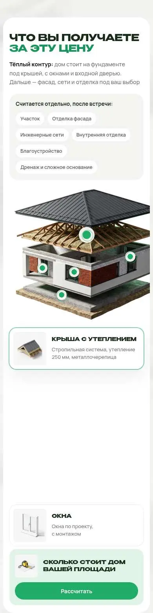
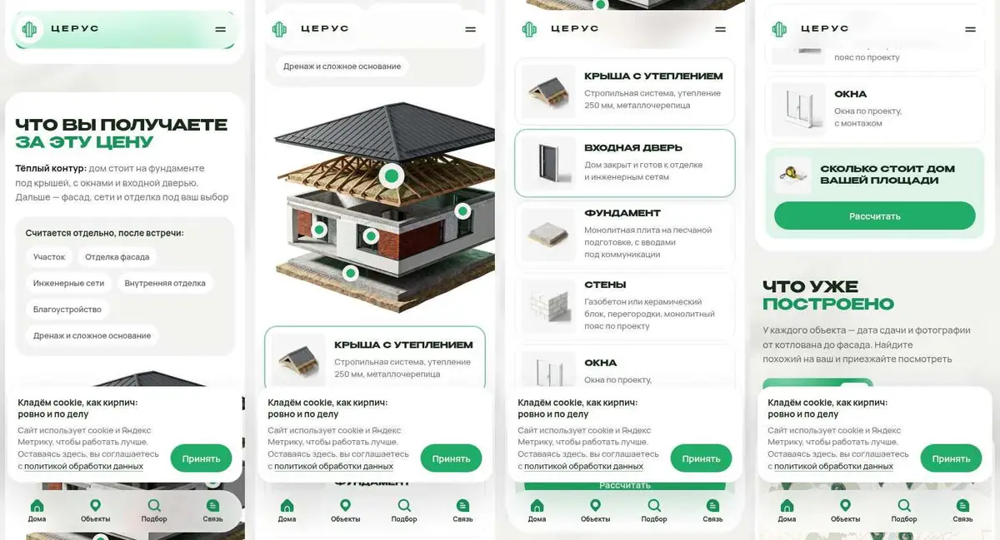

Сайт Анжелы мы не трогали: правка – по твоему слову.

## Нужно от тебя

1. Слово по блокам карточки 8X одной строкой – раздел 4.
2. «Четыре этапа» на 87.242.100.185 – это «Четыре способа проверить нас до договора»?
3. Править ли сам сайт 87.242.100.185 по этим двум блокам.

## Что раскрыть

- Разбор одного сайта-образца блок за блоком.
- «Что вы получаете» – прототипом, как будет на телефоне.
- Полный список источников: NN/g, Baymard, web.dev, Lighthouse, Digital.gov.
