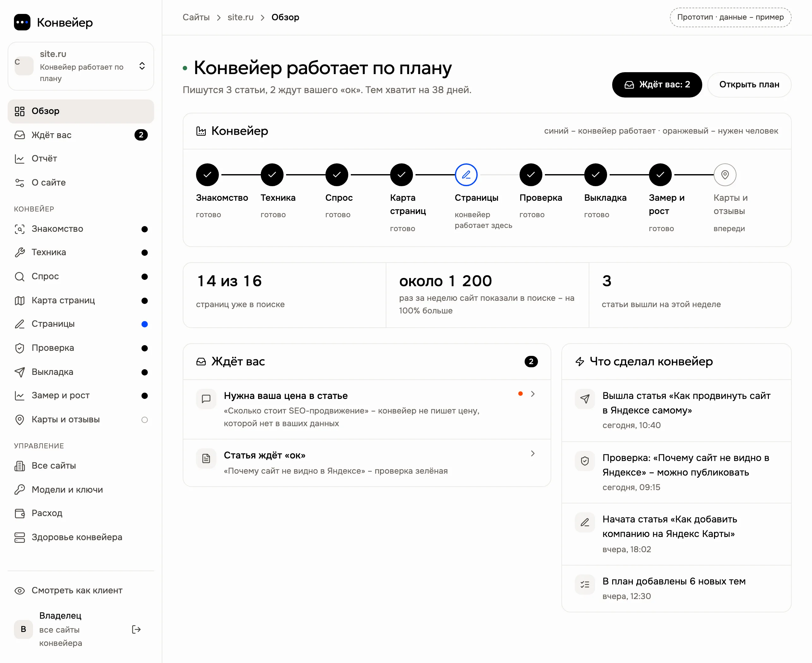
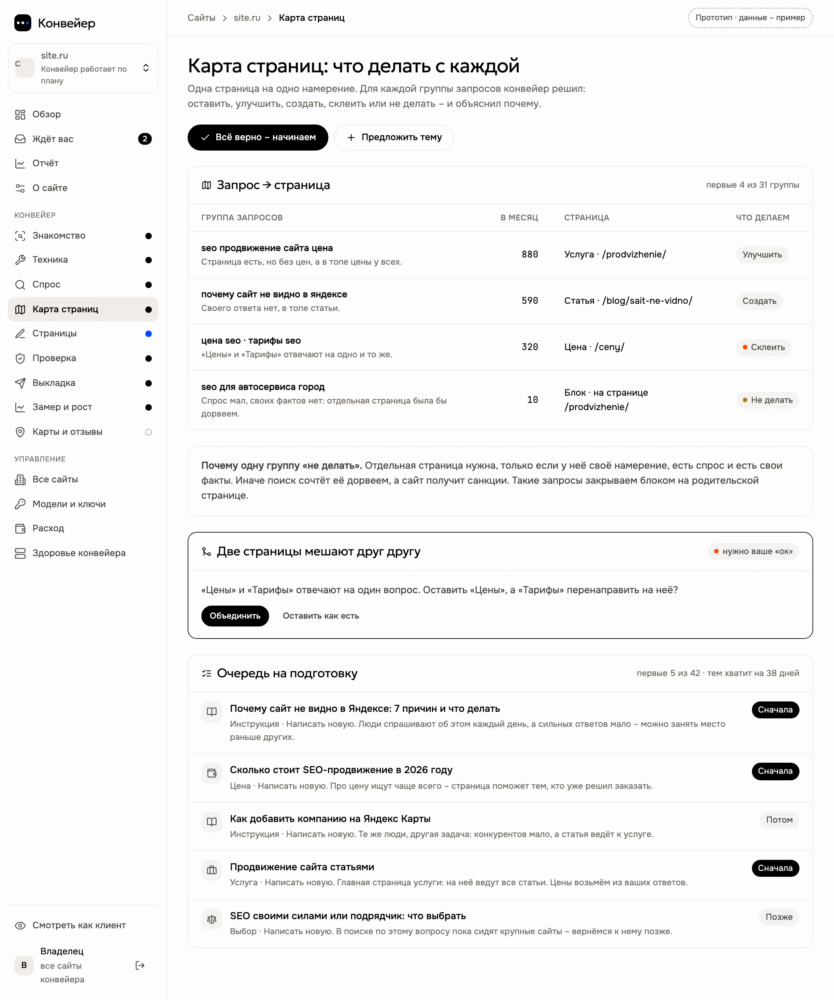

# Глава 42. Контент-конвейер на нейросетях: как он устроен изнутри

**Вывод.** Наш конвейер – это девять станций по порядку: знакомство с бизнесом, техника, спрос, карта страниц, написание, проверка, выкладка, замер и рост, карты и площадки. У каждой станции один вход, один выход и один ответственный, и страница не идёт дальше, пока выход предыдущей станции не принят. Нейросеть работает почти на каждой станции, но решает на трёх из них человек: что считать фактом, какие страницы делать и что выкладывать. «Напиши сто статей» проигрывает такому порядку не скоростью, а тем, что пропускает первые четыре станции, на которых решается, что вообще стоит писать.

> **Ситуация.** Типичная история: владелец сервиса по ремонту техники посмотрел ролик «контент на автопилоте», подключил нейросеть к сайту и поставил задачу: три статьи в день по списку тем, который она сама и придумала.
> **Что пошло не так.** Через два месяца на сайте полторы сотни статей. Треть отвечает на один и тот же вопрос разными заголовками. В двадцати названы цены, которых в прайсе нет. Половина не попала в индекс, потому что на сайте не было карты сайта, а старые страницы услуг так и остались без цен. Заявок не прибавилось. Писать нейросеть умела; не было ничего до и ничего после.
> **Вопрос главы.** Из каких станций состоит контент-конвейер, что у каждой на входе и на выходе, что делает нейросеть, что программа, что человек и почему порядок станций нельзя сокращать.

В [главе 29](../glava-29/) мы показали принципы работы с нейросетями и короткую таблицу станций. Здесь разбираем то же изнутри: как идёт работа у нас в студии, на что похожи документы каждой станции и где конвейер останавливается и ждёт человека.

### Схема: девять станций и возврат слабых страниц

```
 1 Знакомство -> 2 Техника -> 3 Спрос -> 4 Карта страниц
   досье и        сайт          запросы     запрос -> страница:
   база фактов    исправен      и выдача    оставить, улучшить,
        |                                   создать, склеить, не делать
        | факты                                   |
        v                                         v
 5 Написание -> 6 Проверка -> 7 Выкладка -> 8 Замер и рост
   по брифу,      отдельно       по "да"       индекс, показы,
   только из      от автора      человека      места, заявки
   базы фактов                                      |
        ^                                           |
        +------ слабые страницы возвращаются -------+
                в карту страниц (станция 4)

 9 Карты и площадки: те же факты уходят за пределы сайта
   (карточки, отзывы, материалы для площадок)

 [ч] человек решает на станциях 1, 4 и 7; на 6 - если проверка красная
```



На снимке видно главное свойство конвейера: в любой момент понятно, на какой станции сайт, что уже сделано и что ждёт человека. Синяя станция – там сейчас идёт работа. Справа – журнал того, что сделано за последние дни, слева – очередь вопросов к владельцу.

## 1. Конвейер – это девять станций, у каждой свой вход, выход и ответственный

### Зачем делить на станции

Причин три, и все они практические.

**Брак виден там, где он возник.** Если страница вышла с выдуманной ценой, виновата не «нейросеть вообще», а конкретная станция: либо в базе фактов не было цены, либо автор её не использовал, либо проверка пропустила. Чинится одна станция, а не весь процесс.

**Работу можно остановить и продолжить.** Владелец неделю не отвечает на вопросы о ценах – стоит одна станция и только те страницы, которым нужны эти цены. Остальное движется.

**Каждой станции – свой исполнитель.** Короткая задача с понятным выходом нейросети по силам; длинная «сделай всё» – нет ([глава 29](../glava-29/)). Где результат можно проверить формально, работает программа. Где нужно решение, стоит человек.

### Вход и выход каждой станции

| № | Станция | На входе | Что происходит | На выходе | Кто делает | Кто принимает |
|---|---|---|---|---|---|---|
| 1 | Знакомство | Адрес сайта, прайс, ответы владельца | Чтение сайта и карточек, сбор фактов, вопросы о том, чего нет | Досье: паспорт бизнеса, база фактов, список «чего не говорим» | Нейросеть | Владелец |
| 2 | Техника | Сайт | Проверка индекса, зеркал, карты сайта, скорости, доступа для роботов | Список неисправностей и исправленный сайт | Программа, специалист | Специалист |
| 3 | Спрос | Досье, регион | Сбор и чистка запросов, группировка, просмотр выдачи | Группы запросов с частотой, намерением и типом страниц в топе | Нейросеть, программа | Специалист |
| 4 | Карта страниц | Группы запросов, список страниц сайта | Сопоставление «запрос → страница», поиск дублей | Таблица решений по каждой группе и очередь на подготовку | Нейросеть, программа | Человек |
| 5 | Написание | Строка карты, досье, выдача | Бриф, структура, текст по блокам, мета-теги, ссылки | Черновик страницы | Нейросеть | – |
| 6 | Проверка | Черновик, база фактов, соседние страницы | Набор проверок, каждая с результатом «прошла» или «нет» | Зелёный черновик или список замечаний | Программа, отдельная нейросеть | Человек, если есть красное |
| 7 | Выкладка | Проверенная страница, «да» человека | Публикация, контроль живого адреса, сообщение поисковикам | Страница на сайте, запись в журнале | Программа | Человек даёт «да» |
| 8 | Замер и рост | Данные кабинетов по страницам | Индекс, показы, места, заявки; решение по каждой странице | Список «держим, дожать, ждём, склеить» | Программа, нейросеть | Специалист |
| 9 | Карты и площадки | Досье, вышедшие страницы, случаи из практики | Сверка карточек, ответы на отзывы, материалы для площадок | Пакеты к публикации, реестр размещений | Нейросеть готовит, человек публикует | Человек |

Правило движения одно: станция не начинает работу, пока не принят выход предыдущей. Нет досье – не пишем. Нет карты страниц – не пишем. Проверка красная – не выкладываем.

## 2. Первые четыре станции решают, что писать

На эти станции уходит заметная часть времени первого месяца, и именно их пропускает «автопилот». Здесь почти нет готовых текстов, зато появляется то, без чего тексты бесполезны.

### Станция 1. Знакомство: досье и база фактов

Нейросеть читает сайт компании целиком, её карточки на картах и отзывы и собирает три документа.

**Паспорт бизнеса.** Что за компания, для кого, как устроена работа: принимает клиентов по адресу, выезжает или работает через интернет. От типа зависит всё дальнейшее: местной компании нужны карты и страницы «услуга в городе», сервису по всей стране – нет.

**База фактов.** Таблица, из которой автор потом берёт цифры. Кроме неё – ниоткуда.

| Факт | Значение | Источник | Состояние |
|---|---|---|---|
| Диагностика | бесплатно при ремонте, иначе 500 ₽ | прайс на сайте | подтверждён |
| Гарантия на работы | 6 месяцев | ответ владельца | подтверждён |
| Срок ремонта | 1–3 дня | страница услуги | проверить до 1 июня |
| Выезд мастера | по городу, от 700 ₽ | анкета | подтверждён |
| Число выполненных ремонтов | нет данных | – | вопрос владельцу |

У каждого факта есть источник и состояние. «Проверить до…» – для того, что устаревает: цены, сроки, акции. Когда дата подходит, факт возвращается владельцу с вопросом «всё ещё так?».

**Список «чего не говорим».** Обещания, которых компания не даёт («починим за час», «самые низкие цены»), темы, которых не касаемся, слова, запрещённые законом о рекламе для этой ниши.

Чего на сайте не нашлось, конвейер спрашивает у владельца. Вопросы устроены так, чтобы на них можно было ответить за минуту:

| Плохой вопрос | Вопрос, как он задаётся у нас |
|---|---|
| «Расскажите о ваших ценах» | «Сколько стоит замена экрана у телефона? Зачем спрашиваем: люди ищут цену, страница без неё проигрывает тем, где она есть. На сайте цены нет. Предлагаем написать „от 2 500 ₽“ – это так?» и кнопки «да», «поправить», «не знаю» |

Вопросов немного: только о том, чего нет в открытых источниках и без чего страницы не написать. Последний шаг станции – честная оценка «стоит ли продвигать и с чего начинать»: если за главные запросы ниши бьются крупные сети, начинаем с соседних тем и редких вопросов, где выйти на первую страницу реально за недели, а не за год.

Досье принимает владелец. Это первое из трёх человеческих решений.

### Станция 2. Техника: сначала исправный сайт

Вторая станция идёт до спроса и текстов по простой причине: новые страницы на неисправном сайте не помогут. Программа проверяет то, что описано в главах о технике ([глава 11](../glava-11/), [глава 13](../glava-13/), [глава 14](../glava-14/)):

- открывается ли сайт и по одному ли адресу;
- не закрыты ли разделы от роботов, включая роботов нейросетей;
- есть ли карта сайта и верна ли она;
- сколько страниц в индексе против числа страниц на сайте;
- нет ли битых страниц, дублей, цепочек перенаправлений;
- как быстро сайт грузится на телефоне.

Выход станции – короткий список в три столбца: что не так, чем грозит, кто чинит. Часть конвейер чинит сам (карта сайта, уведомление поисковиков), часть уходит разработчику. Пока в списке есть пункты «мешает индексации», станции 5–7 ждут.

### Станция 3. Спрос: запросы и выдача по каждому

Запросы собираются из нескольких мест: Вордстат по региону компании, подсказки поиска, запросы из Вебмастера и Search Console, по которым сайт уже показывается, вопросы клиентов из досье ([глава 6](../glava-6/)). Нейросеть чистит список от чужих городов, чужих товаров и мусора и раскладывает по слоям:

| Слой | Что в нём | Какая страница обычно нужна |
|---|---|---|
| Главные запросы | Человек готов заказать: «цена», «заказать», «рядом» | Страница услуги с ценой |
| Вопросы об услуге | Человек выбирает, кому доверить | Статья с ответом в первом абзаце, ведёт к услуге |
| Соседние темы | Те же люди, другая задача | Статья; берём только те, что ведут к услуге |
| Редкие вопросы | Точные, узкие, конкурентов мало | Короткая инструкция |

Отдельный шаг, который нельзя доверить воображению нейросети: по каждой группе программа открывает живую выдачу и записывает, что в топе – страницы услуг, статьи, каталоги или агрегаторы ([глава 7](../glava-7/)). Тип будущей страницы берётся из выдачи, а не из головы модели.

### Станция 4. Карта страниц: одна страница на одно намерение

Здесь каждая группа запросов получает страницу и решение. Решений пять:

| Решение | Когда | Пример |
|---|---|---|
| Оставить | Страница есть, стоит хорошо | Не трогаем, наблюдаем |
| Улучшить | Страница есть, но слабее топа | «Страница услуги без цен, а в топе цены у всех» |
| Создать | Спрос есть, страницы нет | «Своего ответа нет, в топе статьи» |
| Склеить | Две страницы отвечают на одно и то же | «Цены» и «Тарифы»: оставить одну, со второй поставить перенаправление |
| Не делать | Спрос мал или своих фактов нет | Закрыть блоком на родительской странице |



На снимке видны три вещи, ради которых существует эта станция. Первая: у каждого решения написано «почему» – одной строкой, понятной владельцу. Вторая: решение «не делать» стоит в таблице наравне с остальными. Отдельная страница под запрос с десятью показами в месяц и без своих фактов была бы дорвеем ([глава 10](../glava-10/)), и конвейер должен уметь отказаться от неё сам. Третья: когда две страницы мешают друг другу, конвейер не склеивает их молча, а спрашивает.

Карту программа проверяет на дубли: нет ли двух строк с одним намерением, не занят ли адрес, не пересекается ли новая тема с уже вышедшей. После этого карту утверждает человек – это второе человеческое решение и самое дорогое по последствиям. Ошибка здесь размножается: неправильная карта даёт сотню правильных по форме и ненужных по сути страниц.

Из утверждённой карты получается очередь на подготовку с порядком «сначала, потом, позже». Вперёд идут страницы, которые ближе к деньгам и где проще выйти в топ.

## 3. Следующие три станции делают страницу: написание по шагам, отдельная проверка, выкладка с контролем

### Станция 5. Написание

Одна страница – это не один запрос к нейросети, а цепочка коротких шагов. У каждого своя инструкция и свой результат.

1. **Бриф.** По выдаче: что есть на страницах топ-5 – блоки, вопросы, таблицы, цены, объём ([глава 15](../glava-15/)). Плюс строка карты и нужные факты из базы.
2. **Структура.** Заголовки и порядок блоков. Ответ на главный вопрос – в первом абзаце.
3. **Текст по блокам.** Каждый блок пишется отдельно, с фактами под него. Автор берёт цифры только из базы фактов.
4. **Мета-теги и разметка.** Заголовок страницы, описание, структурированные данные по видимому содержимому.
5. **Ссылки.** С какой страницы на эту и с этой на какие: на услугу, к которой ведёт статья, и на соседние вопросы.

Что происходит, когда факта нет. Автор не придумывает и не пропускает молча, а ставит пометку прямо в текст: «стоит от [цена – ждёт ответа владельца]». Страница с пометкой дальше не идёт, а владельцу уходит вопрос. Так выглядит главное правило конвейера в действии: нет факта – пометка и вопрос, а не выдумка.

Чего автор не делает: не выбирает тему (её дала карта), не решает, выкладывать ли страницу, и не проверяет сам себя.

### Станция 6. Проверка

Проверка отделена от написания: её делают программы и другая нейросеть с инструкцией «найди ошибки». Проверок больше десятка – от фактов и похожести на соседние страницы до вида на телефоне. Каждая даёт «прошла» или «не прошла» с объяснением. Устройству этой станции, тому, что ломалось без неё, и роли человека посвящена вся [глава 43](../glava-43/).

### Станция 7. Выкладка: страница должна доехать

Выкладка – не нажатие кнопки, а пять шагов с контролем.

| Шаг | Что делается | Что проверяется |
|---|---|---|
| 1. Разрешение | Человек говорит «да» этой странице или партии | Без «да» выкладка не начинается |
| 2. Публикация | Страница появляется на сайте | Адрес свободен, совпадает с картой страниц |
| 3. Контроль живого адреса | Программа открывает страницу как посторонний посетитель | Код ответа 200, текст на месте, заголовок и описание те же, что в черновике, страница не закрыта от индексации |
| 4. Карта сайта и дата | Страница добавлена в карту сайта с честной датой изменения | Дата меняется только при настоящей правке |
| 5. Сообщение поисковикам | Адрес отправлен через IndexNow, карта сайта обновлена в кабинетах | Запрос принят; через несколько дней – зашёл ли робот ([глава 14](../glava-14/)) |

Третий шаг появился из опыта. «Опубликовано» в системе управления сайтом и «открывается у посетителя» – разные события: страница может остаться черновиком, отдать ошибку или оказаться закрытой служебным тегом. Пока программа не увидела живую страницу, в журнале она не считается вышедшей.

Темп выкладки задаётся заранее и остаётся ровным: например, три страницы в неделю. Сотня страниц в один день для молодого сайта – подозрительный сигнал, а для нас ещё и потеря контроля: если в партии системный брак, он уже на сайте.

## 4. Последние две станции замыкают круг: замер возвращает слабые страницы в карту, а площадки разносят факты за пределы сайта

### Станция 8. Замер и рост

У каждой вышедшей страницы есть строка с цифрами: в индексе ли она в Яндексе и Google, места по своим запросам, показы и переходы за неделю, заявки. Данные приходят из Вебмастера, Search Console и Метрики ([глава 23](../glava-23/)). По ним каждой странице ставится одно из четырёх решений:

| Решение | Признак | Что дальше |
|---|---|---|
| Держим | Страница в первой десятке, есть переходы и заявки | Наблюдаем, обновляем факты |
| Дожать | Места 6–20, показы есть, переходов мало | Возврат в карту с задачей: чего не хватает против топа ([глава 25](../glava-25/)) |
| Ждём | Страница вышла недавно | Не трогаем две-четыре недели |
| Склеить или убрать | Не в индексе, или поиск считает дублем, или две страницы меняются местами по одному запросу | Возврат в карту с вопросом человеку |

Слова «возврат в карту» – ключевые. Конвейер – не прямая линия от темы до публикации, а круг: слабая страница снова становится строкой карты с решением «улучшить» и конкретной причиной. Улучшение проходит те же станции, что и новая страница. И дату на странице мы меняем только вместе с новыми фактами: смена даты без правки по существу – обман, который поисковики замечают.

Эта же станция наблюдает за уже вышедшим: если на странице пропал заголовок, изменилась цена или исчез блок, человек получает вопрос «так и должно быть?».

### Станция 9. Карты и площадки

Те же факты из досье должны совпадать за пределами сайта. Станция делает три вещи:

- сверяет карточки на картах и в справочниках с эталоном: название, адрес, телефон, часы ([глава 21](../glava-21/));
- готовит черновики ответов на отзывы;
- из вышедших страниц и случаев практики собирает материалы под площадки – для каждой свой, по правилам этой площадки ([глава 40](../glava-40/)).

Автоматической публикации здесь почти нет, и это не недоработка. У большинства площадок нет открытого способа публиковать программой, а некоторые прямо запрещают тексты нейросетей. Поэтому выход станции – пакет: текст, фото, ссылка с меткой, подсказка, куда нажать. Публикует человек, а размещение попадает в реестр с проверкой через 7, 30 и 90 дней.

### Кто что делает

| | Нейросеть | Программа | Человек |
|---|---|---|---|
| Что умеет лучше всех | Читать, сводить, писать черновики, формулировать вопросы | Считать, сравнивать, проверять по правилу, делать одно и то же без усталости | Знать правду о бизнесе и отвечать за решение |
| Что делает на конвейере | Досье, чистка и группировка запросов, брифы, тексты, черновики ответов, пояснения «почему» | Сбор данных из кабинетов, проверка дублей и похожести, контроль живого адреса, замеры | Подтверждает факты, утверждает карту страниц, даёт «да» на выкладку, публикует на площадках |
| Чего ей не поручаем | Решать, что является фактом; проверять собственный текст; выкладывать | Оценивать смысл и пользу | Рутину, которую можно проверить правилом |

### Почему конвейер, а не «напиши сто статей»

| | «Напиши сто статей» | Конвейер |
|---|---|---|
| Откуда темы | Нейросеть придумывает | Из спроса и выдачи, через карту страниц |
| Откуда факты | Из «среднего по интернету» | Из базы фактов с источником |
| Что с существующими страницами | Ничего | Улучшить, склеить, оставить – решено по каждой |
| Дубли | Появляются сами | Отсекаются на карте и на проверке |
| Что после публикации | Ничего | Контроль адреса, замер, возврат слабых |
| Что видно владельцу | Число статей | Станция, очередь, вопросы к нему, цифры по страницам |
| Чем кончается | Сотни страниц, часть вне индекса, заявок нет | Меньше страниц, каждая со своим запросом и цифрами |

Скорость письма у обоих подходов одинаковая. Разница в том, что конвейер тратит первые недели на вопрос «что писать», а потом каждую неделю отвечает на вопрос «сработало ли».

### С чего начать у себя

Для малого бизнеса конвейер не обязан быть программой. Его первую версию можно собрать в таблицах:

1. Лист «База фактов»: факт, значение, источник, дата проверки.
2. Лист «Карта страниц»: группа запросов, частота, страница, решение, почему.
3. Лист «Журнал»: страница, дата выкладки, проверен ли живой адрес, индекс, места, показы, заявки через месяц.
4. Правило: нейросети даём одну строку карты и нужные факты, а не «напиши про наш бизнес».
5. Правило: проверяет не тот, кто писал, и выкладывает человек.

Десять-двадцать страниц, прошедших такой путь, покажут, на какой станции у вас брак. После этого есть смысл что-то автоматизировать.

### Как правильно: чек-лист

- [ ] До первого текста собраны досье и база фактов с источником у каждого факта.
- [ ] Вопросы владельцу – только о том, чего нет в открытых источниках, с объяснением «зачем» и предложенным ответом.
- [ ] Техника проверена и исправлена до написания страниц.
- [ ] Запросы сгруппированы, по каждой группе просмотрена живая выдача.
- [ ] У каждой группы в карте страниц – решение из пяти и причина одной строкой.
- [ ] Карту утвердил человек; программа проверила её на дубли.
- [ ] Страница пишется шагами; цифры – только из базы фактов; нет факта – пометка и вопрос.
- [ ] Проверку делает не автор.
- [ ] Выкладка – по «да» человека, с контролем живого адреса и ровным темпом.
- [ ] У каждой вышедшей страницы есть строка с индексом, местами, показами и заявками.
- [ ] Слабые страницы возвращаются в карту с причиной.
- [ ] Материалы для площадок публикует человек, размещения ведутся в реестре.

### Частые ошибки

- Начинают со станции 5 – тексты есть, а кому и зачем, никто не решал.
- База фактов «в голове у владельца» – нейросеть заполняет пустоты выдумкой.
- Вопросы владельцу анкетой на сорок пунктов – ответа не будет никогда.
- Тип страницы выбирает нейросеть, а не выдача – статья там, где в топе страницы услуг.
- В карте нет решения «не делать» – под каждый запрос появляется страница, сайт обрастает дорвеями.
- Старые страницы не трогают, пишут только новые – улучшение существующей часто даёт больше.
- «Опубликовано» принимают за «открывается» – страницы висят черновиками и отдают ошибки.
- Сто страниц в день – брак размножен раньше, чем замечен.
- После выкладки страницу никто не смотрит – слабые копятся, сильные устаревают.
- Дату обновляют без правки по существу – поисковик перестаёт верить датам сайта.

### Где мнения расходятся

- **Сколько станций нужно.** На рынке есть конвейеры из одиннадцати этапов и из шести, с восемнадцатью проверками и с пятью. Число – вопрос удобства. Важно, чтобы были четыре вещи: факты из источников, карта «запрос → страница», проверка отдельно от автора и замер после выкладки.
- **Статьи или страницы услуг.** Многие конвейеры выпускают только информационные статьи: их проще генерировать. По нашему опыту и по наблюдениям практиков, улучшение страниц услуг и категорий обычно ближе к заявкам. Мы начинаем с них, а статьями закрываем вопросы вокруг.
- **Нужен ли человек на карте страниц.** Сторонники полной автоматики считают, что программа сама найдёт дубли. Она действительно находит похожие формулировки, но не знает, какая из двух страниц важнее для бизнеса. Поэтому решение о склейке у нас за человеком.

### Что раскрыть дальше

- [Глава 29. SEO с нейросетями и агентами](../glava-29/) – принципы, на которых построен конвейер.
- [Глава 9. Карта сайта под спрос: когда запросу нужна своя страница](../glava-9/) – логика станции 4.
- [Глава 10. Не дорвеи и не каннибализация](../glava-10/) – почему «не делать» и «склеить» – полноценные решения.
- [Глава 14. Обход и обновление: как сообщать поисковику о новом](../glava-14/) – что происходит на выкладке.
- [Глава 25. Рост действующего сайта: позиции 6–10 дороже новых статей](../glava-25/) – решение «дожать».
- [Глава 40. Как делается площадка: от профиля до материала](../glava-40/) – станция 9 подробно.
- [Глава 43. Контент-конвейер: проверки, человек и результат](../glava-43/) – станция 6, стоп-кран и честный разговор о результатах.
