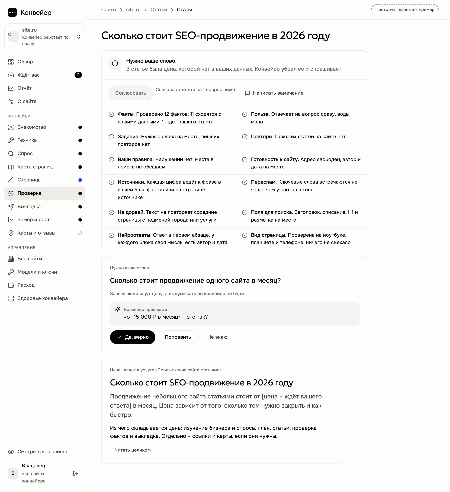

# Глава 43. Контент-конвейер: проверки, человек и результат

**Вывод.** Конвейер на нейросетях даёт пользу ровно настолько, насколько строги его ворота: факты только из источников, сравнение каждой страницы с соседними, список запрещённых слов, проверка по закону о рекламе, человек на выкладке и стоп-кран, который останавливает выпуск при первом признаке системного брака. Каждая из этих проверок появилась не из теории, а после поломки: сотен одинаковых статей, трёхдневного простоя после ночного сбоя, отбора запросов «по совпадению букв». После выкладки работа не заканчивается: через две-четыре недели замер отвечает на вопрос «помогла ли правка». Честный итог такой: конвейер даёт ровный выпуск, страницы в индексе и рост показов и обращений там, где страница закрывает настоящий спрос, но не заменяет ни спрос, ни технику, ни репутацию.

> **Ситуация.** Типичная история: компания построила выпуск страниц на нейросетях по всем правилам из предыдущей главы – досье, карта, шаги. Проверку сделали «лёгкой»: тот же помощник, что писал текст, в конце отвечал на вопрос «всё ли в порядке?». Выкладка шла автоматически каждую ночь.
> **Что пошло не так.** За месяц ни одна страница не была отклонена: автор ни разу не нашёл у себя ошибок. На сайт ушли страницы с ценой, которой нет в прайсе, с фразой «лучший сервис города» и три пары страниц, совпадающих на девять десятых. Когда ночью оборвался один из шагов, выпуск молча встал, и заметили это только через несколько дней. Конвейер был, ворот не было.
> **Вопрос главы.** Какие проверки стоят между черновиком и сайтом, что из них делает программа, что нейросеть и что человек, как устроен стоп-кран, как после выкладки понять, сработало ли, и кому такой конвейер вообще нужен.

### Схема: ворота между черновиком и сайтом

```
 черновик
    |
    v
 [1] проверки программой: факты против базы, похожесть с соседями,
    |                     запрещённые слова, переспам, поля, адрес
    v
 [2] проверки отдельной нейросетью: польза, смысл, правила владельца,
    |                               закон о рекламе
    v
 всё зелёное? -- нет --> возврат автору с причиной;
    | да                 не исправил - человеку
    v
 [3] человек: "да" на страницу или партию
    |
    v
 [4] два замка открыты? -- нет --> пробный режим: показать "было - стало"
    | да
    v
 выкладка -> контроль живого адреса -> замер через 2-4 недели
    ^
    |
 СТОП-КРАН: сбой шага, две страницы подряд с фактом вне базы,
 падение индекса, показов или заявок -> выпуск стоит, человеку сообщение
```

## 1. Ворота качества стоят перед выкладкой, и ни одна проверка не доверена автору

### Как выглядит проверенная страница



На снимке – статья, которая почти готова. Одиннадцать фактов сошлись с базой, двенадцатый – цена – в базе не нашёлся. Конвейер убрал цену из текста, поставил пометку «ждёт вашего ответа» и задал владельцу вопрос с предложенным вариантом. Кнопка «Согласовать» неактивна, пока вопрос открыт. Это и есть ворота: страница может быть написана хорошо, но дальше не пройдёт, пока хотя бы одна проверка не закрыта.

### Двенадцать проверок

| Проверка | Что именно проверяется | Кто проверяет | Что при провале |
|---|---|---|---|
| Факты | Каждая цена, срок, гарантия, число в тексте есть в базе фактов | Программа | Цифра убирается, вопрос владельцу |
| Источники | У каждой цифры есть строка базы или страница-источник | Программа | Возврат автору |
| Задание | Нужные слова из брифа на месте, структура соответствует | Программа | Возврат автору |
| Переспам | Ключевые слова встречаются не чаще, чем у страниц в топе ([глава 16](../glava-16/)) | Программа | Возврат автору |
| Повторы | На сайте нет страницы с тем же намерением | Программа по карте страниц | Вопрос человеку: склеить или отменить |
| Не дорвей | Текст не повторяет соседние страницы с подменой города, модели или услуги | Программа, сравнение с соседями | Отказ или доработка фактами |
| Польза | Ответ на вопрос – в начале, воды нет, каждый блок несёт своё | Отдельная нейросеть | Возврат автору с замечаниями |
| Правила владельца | Нет обещаний и тем из списка «чего не говорим» | Программа по словам, нейросеть по смыслу | Возврат автору |
| Запрещённые слова и закон о рекламе | Штампы, превосходные степени без подтверждения, запрещённые обещания | Программа по списку, нейросеть по смыслу | Возврат автору |
| Поля для поиска | Заголовок страницы, описание, главный заголовок, разметка | Программа | Возврат автору |
| Нейроответы | Прямой ответ в первом абзаце, у блока одна мысль, есть автор и дата ([глава 30](../glava-30/)) | Программа, нейросеть | Возврат автору |
| Готовность к сайту и вид | Адрес свободен, автор и дата на месте, страница не разъезжается на телефоне | Программа | Возврат на сборку |

Разберём четыре проверки, на которых держится остальное.

### Факты только из источников

Правило из [главы 29](../glava-29/) превращается в механику так. Программа вынимает из текста всё, что похоже на факт: суммы, сроки, проценты, годы, размеры, слова «гарантия», «бесплатно», «за один день». Каждую находку она ищет в базе фактов. Нашла – зелёное. Не нашла – красное, даже если цифра правдоподобна и даже если она верна: правда, которой нет в базе, для конвейера неотличима от выдумки.

Дальше два пути. Если факт нужен странице, владельцу уходит вопрос: «в статье была цена, которой нет в ваших данных; предлагаем „от …“ – это так?». Ответ попадает в базу, и следующая страница уже не споткнётся. Если не нужен – цифра убирается.

Есть и обратная сторона, о которой честно надо сказать: эта проверка ловит цифры и формальные обещания, но не ловит неверное утверждение без цифр («этот материал не боится влаги»). Такие вещи проверяет нейросеть с инструкцией «найди утверждения, которые нельзя подтвердить досье» и, для важных страниц, человек, знающий предмет.

### Похожесть соседних страниц

Каждый черновик сравнивается с ближайшими страницами сайта: с теми же услугами в других городах, с соседними моделями, со статьями на близкие темы. Способ простой: тексты режутся на цепочки из нескольких слов подряд и считается, какая доля цепочек совпала ([глава 17](../glava-17/)).

| Доля совпадения с соседом | Что это значит | Решение |
|---|---|---|
| До трети – двух пятых | Нормально для страниц одного типа: общий каркас, свои факты | Пропустить |
| От двух пятых до четырёх пятых | Каркаса слишком много, своего мало | Доработать: добавить факты, которых нет у соседа |
| Больше четырёх пятых | Почти копия | Отказ: такую страницу не выкладываем |

Вторая мерка – доля своего: не меньше четверти страницы должно быть тем, чего нет ни на одной соседней. Важно, откуда берётся отличие. Не из перестановки слов и синонимов, а из фактов: свои цены, свои сроки, своя особенность модели или района, свой случай из практики. Если отличить страницу нечем, это сигнал не автору, а карте страниц: возможно, этой странице не нужно существовать.

### Список запрещённых слов

Слова, которых в текстах быть не должно, ловит программа – это самая дешёвая и самая надёжная проверка. Список у нас трёхслойный, каждый слой строже предыдущего:

1. **Общий** – для всех текстов студии.
2. **Площадки** – правила конкретного места публикации ([глава 40](../glava-40/)).
3. **Сайта** – то, что запретил владелец этого бизнеса.

| Что ловим | Примеры | Почему |
|---|---|---|
| Штампы машинного текста | «в современном мире», «давайте разберёмся», «не секрет, что», «в этой статье мы рассмотрим» | Читатель узнаёт их с первой строки и перестаёт верить остальному |
| Канцелярит | «осуществлять», «данный», «является» | Текст тяжелеет, смысл прячется |
| Неснятые пометки | «проверить», «уточнить», знаки вопроса в скобках | Черновик не должен попасть на сайт |
| Оценки без подтверждения | «лучший», «номер один», «самые низкие цены» | Закон о рекламе, см. ниже |
| Обещания, которых компания не даёт | «починим за час», «гарантируем результат» | Список «чего не говорим» из досье |
| Технический мусор | Неверные знаки, обрывки разметки, чужой язык | Вид страницы |

Список пополняется по одному правилу: нашли на сайте новую ошибку, которую можно поймать словами, – она в тот же день становится строкой списка. Так одна ошибка случается один раз, а не на каждом следующем проекте.

### Закон о рекламе

Это не юридическая консультация, а перечень того, что мы проверяем до юриста. Страница собственного сайта не всегда считается рекламой в смысле закона, но мы проверяем тексты так, как если бы считалась: это дешевле, чем разбираться потом, и те же требования к достоверности есть в законе о защите прав потребителей.

- **Превосходные степени и сравнения.** «Лучший», «первый», «единственный» допустимы только с указанием, по какому критерию и кем это установлено. Без этого слова убираются.
- **Гарантии результата.** Особенно в медицине, финансах, юридических услугах: обещать исход лечения, доход или выигранное дело нельзя.
- **Особые ниши.** Медицинские услуги, лекарства, финансовые продукты, алкоголь и ряд других имеют свои требования к текстам, вплоть до обязательных предупреждений. Для таких ниш у сайта свой слой списка, а страницы перед выкладкой читает человек.
- **Сравнение с конкурентами.** Называть и ругать других по имени не нужно ни по закону, ни по здравому смыслу.
- **Платные размещения на площадках.** Пометка и идентификатор рекламы – вопрос [главы 20](../glava-20/).

### Проверка должна проверять смысл, а не букву

Самая коварная ошибка проверок – когда они формально работают. У нас был поучительный случай с ранней версией отбора запросов. Программа решала, относится ли поисковая фраза к бизнесу, так: если в фразе несколько букв подряд совпадают с каким-нибудь словом с сайта – фраза «своя». Группу для фразы она выбирала по первому совпавшему куску слова. На выдачу никто не смотрел.

Отчёты выглядели прекрасно: тысячи «принятых» фраз, аккуратные группы. На деле среди принятых были запросы о чужих товарах с похожими названиями, а группы собирались по случайным корням. Всё, что строилось дальше – карта, страницы, – наследовало этот мусор.

Отсюда три правила для любой проверки на конвейере:

1. **У проверки есть свои ворота качества.** Для чистки запросов мы берём случайную сотню принятых фраз и сотню отклонённых. Ориентир: мусора среди принятых – не больше двух, нужных среди отклонённых – не больше пяти.
2. **У каждого отказа и каждого принятия есть причина словами.** «Отклонено: чужой город», «принято: услуга из досье». Причину можно прочитать и оспорить; совпадение букв – нельзя.
3. **Гладкий результат – повод проверить.** Сто процентов пройденных проверок за месяц значат не то, что брака нет, а то, что проверка ничего не ловит.

## 2. Человек стоит на выкладке: согласование, два замка и стоп-кран

### Согласование страницы

Человек видит не «текст на вычитку», а итог проверок: что зелёное, что красное, какой вопрос к нему. Его задача – не искать опечатки, а принять решение, которое программа принять не может: это правда о нашем бизнесе? это можно обещать? такая страница нам нужна?

Новому сайту мы согласуем каждую страницу. Когда база фактов наполнилась, а первые два-три десятка страниц прошли без возвратов, можно перейти к согласованию партиями: человек видит список, читает выборочно и даёт «да» на всё зелёное. Красное всегда разбирается по одному.

### Два замка

Боевая выкладка – действие с последствиями: страница на живом сайте клиента, сообщение поисковикам, запись на площадке. Поэтому у нас она закрыта двумя независимыми замками.

| Замок | Где стоит | Кто открывает |
|---|---|---|
| Первый | В настройках конкретного сайта: «боевая выкладка разрешена» | Только по прямому слову руководителя, с предупреждением заранее |
| Второй | В настройках самого конвейера: общий рубильник боевого режима | Так же, отдельным действием в другом месте |

Пока закрыт хотя бы один, станция выкладки работает в пробном режиме: собирает страницу в копии сайта и показывает разницу «было – стало». На живой сайт не уходит ничего. Чтение – замеры, проверки, сбор спроса – замками не ограничено.

Зачем два, а не один. Один замок открывают по ошибке: перепутали сайт, скопировали настройки с соседнего проекта, запустили не тот режим. Чтобы ошибиться с двумя, нужно ошибиться дважды в разных местах. А «да» человека на конкретную страницу – это уже третье условие поверх замков.

### Стоп-кран

Стоп-кран – набор условий, при которых выпуск останавливается сам, не дожидаясь человека.

| Что случилось | Почему останавливаемся | Что стоит |
|---|---|---|
| Две страницы подряд с фактом, которого нет в базе | Это не случайность, а дыра в базе или сбой автора | Написание и выкладка по этому сайту |
| Шаг конвейера завершился ошибкой | Следующий шаг получит неполный результат | Всё, что зависит от этого шага |
| Контроль живого адреса не прошёл | Страница не открылась или открылась не та | Выкладка |
| Доля страниц в индексе заметно упала после партии | Поисковик что-то исключает | Выкладка до разбора ([глава 24](../glava-24/)) |
| Показы или заявки с поиска резко упали | Причина неизвестна, продолжать опасно | Выкладка до разбора |
| Поисковик сообщил о нарушении в кабинете | Нужен человек | Всё |
| Проверки отклонили несколько страниц подряд по одной причине | Системный брак на станции выше | Написание |

При остановке происходят три вещи одновременно: выпуск встаёт, человеку уходит сообщение, в журнале появляется запись – что случилось, на какой станции и какие страницы затронуты. Вернуть выпуск может только человек, и только после того, как причина названа.

### Сбой должен кричать

Второй случай из практики – о том, что бывает, когда стоп-кран есть, а голоса у него нет. На одном из сайтов статьи выходили каждое утро. Однажды ночью оборвался вспомогательный шаг – подготовка картинок. Незаконченная работа осталась лежать в рабочей папке, а утренний запуск, увидев её, отказался стартовать: так он и был задуман, чтобы не выложить половину страницы. Защита сработала правильно. Но сообщения никому не ушло, а сотрудник, который мог заметить, был занят другим. Три дня сайт стоял без новых страниц, и узнали об этом случайно.

Потери были невелики, урок – большой:

- **На каждой точке отказа – сообщение человеку в ту же минуту.** Сценарий, который умеет остановиться, но не умеет сказать об этом, недоделан.
- **Тишина – тоже сигнал.** Если к десяти утра нет записи «выпуск прошёл», это тревога, даже когда ошибок не было.
- **Сообщение о починке так же обязательно, как о поломке.** Иначе через неделю никто не помнит, чинили или нет.

### Третий случай: сотни почти одинаковых статей

Он уже упоминался в [главе 29](../glava-29/), здесь важна механика. Конвейер каждый день получал «новую тему» и писал статью. Ни одна станция не сверяла тему с уже вышедшими, а готовый текст – с соседями. Каждая статья по отдельности была грамотной и проходила проверку «на качество». Когда статьи наконец сравнили между собой, больше двух третей оказались ответом на один и тот же вопрос под разными заголовками.

Ни одна проверка отдельной страницы этого не поймала бы. Поймать могли только две, которых не было: строка в карте страниц «такое намерение уже есть» до написания и сравнение с соседями после. С тех пор обе обязательны, а разбор той партии кончился склейкой: из каждой группы одинаковых оставили одну страницу, остальные перенаправили на неё.

## 3. После выкладки замер отвечает на один вопрос: помогла ли правка

### Почему без замера конвейер слепой

Выпуск страниц легко принять за результат: «вышло сорок страниц» звучит как работа. Но страница – это гипотеза: «если ответить на этот вопрос вот так, нас будут находить и обращаться». Гипотезу проверяют.


### Как устроен замер одной правки

1. **Снимок «до».** В день правки записываются: места по запросам страницы, показы и переходы за последние 28 дней, заявки, сам текст страницы.
2. **Одна правка – одна запись.** Что изменили и зачем: «добавили таблицу цен и случай из практики, потому что у страниц в топе они есть».
3. **Пауза.** Раньше двух недель не смотрим: поисковику нужно время переобойти страницу и пересчитать её ([глава 3](../glava-3/)).
4. **Снимок «после».** Через 14–28 дней – те же цифры за такой же по длине отрезок.
5. **Контрольная группа.** Рядом – несколько похожих страниц, которые не трогали. Если выросли все, это сезон или изменение в поиске, а не наша правка.
6. **Вывод из трёх.** «Помогла», «не помогла», «неясно». Третий вариант честный и частый: данных мало, сезон сменился, поисковик штормило.

| Что видим через месяц | Что это, скорее всего, значит | Что делаем |
|---|---|---|
| Места и переходы выросли, у контрольных – нет | Правка помогла | Переносим приём на похожие страницы |
| Выросли и у контрольных | Общий рост, не заслуга правки | Приём не считаем доказанным |
| Показы выросли, переходов нет | Страницу показывают, но не выбирают | Работаем над заголовком и описанием в выдаче |
| Переходы выросли, заявок нет | Приходят не те или страница не продаёт | Смотрим запросы и путь до заявки ([глава 26](../glava-26/)) |
| Ничего не изменилось | Причина была не в этом | Возврат в карту с новой гипотезой |
| Стало хуже | Сломали то, что работало | Возвращаем прежнюю версию: для этого и хранили текст «до» |

Замер дисциплинирует сильнее любой проверки текста. Через полгода у студии есть не мнение «таблицы цен полезны», а список: в скольких случаях помогло, в скольких нет и на каких страницах.

## 4. Конвейер даёт ровный выпуск и рост там, где есть спрос, но не заменяет спрос, технику и репутацию

Цифр и названий здесь не будет намеренно: чужие проценты ничего не говорят о вашем сайте, а обещать их – именно то, от чего предостерегает вся книга. Вместо них – что мы наблюдаем устойчиво.

### Что конвейер даёт

- **Ровный выпуск.** Страницы выходят каждую неделю в одном темпе, а не «когда у автора есть время». Для поисковика сайт выглядит живым, для владельца работа предсказуема.
- **Страницы в индексе.** Когда техника проверена до текста, а у каждой страницы свой запрос и свои факты, в индекс попадает подавляющая часть выпущенного. Это не само собой разумеется: у выпуска без карты заметная доля страниц в индекс не входит вовсе.
- **Рост показов и обращений с поиска там, где страница закрывает спрос.** Оговорка в конце – главная. Растут страницы, под которые есть запросы, на которые в выдаче можно ответить лучше соседей и для которых у компании нашлись свои факты.
- **Меньше выдумок.** Цена с потолка на сайте – частая причина конфликта с клиентом. С базой фактов такие случаи становятся редкостью, а пойманные видны в журнале.
- **Порядок.** В любой день понятно, что с каждой страницей: на какой станции, в индексе ли, какие у неё цифры, какое решение. Это свойство ценят даже те, кто равнодушен к SEO.
- **Быстрая реакция на изменения.** Сменилась цена – по базе фактов находятся все страницы, где она названа.

### Чего конвейер не даёт

| Чего не заменяет | Почему |
|---|---|
| Спрос | Если услугу в городе ищут двадцать человек в месяц, сто страниц не сделают из них двух тысяч ([глава 6](../glava-6/)) |
| Технику | Страницы на сайте, который отдаёт ошибки или закрыт от роботов, не работают, сколько бы их ни было ([глава 11](../glava-11/)) |
| Репутацию | Ссылки, отзывы, упоминания, карты строятся отдельно и медленно ([глава 20](../glava-20/), [глава 21](../glava-21/)) |
| Возраст сайта | Молодому домену нужны месяцы, и выпуском их не сократить ([глава 4](../glava-4/)) |
| Владельца | Если на вопросы о ценах и гарантиях никто не отвечает, конвейер честно стоит |
| Хороший продукт | Трафик на слабое предложение даёт слабые заявки |
| Защиту от внешних бурь | Сбой на стороне поисковика или смена его правил бьёт по всем; конвейер только помогает быстрее это заметить |

И ещё одна честная строка: часть страниц не срабатывает и после всех проверок. Проверки отсекают брак, а не гарантируют успех. Поэтому станция замера и возврат слабых страниц в карту – не дополнение, а половина конвейера.

### Кому такой конвейер нужен, а кому нет

| Нужен | Не нужен или рано |
|---|---|
| У бизнеса десятки и сотни групп запросов: много услуг, моделей, категорий, вопросов | Одна услуга и десяток запросов: хватит пяти сильных страниц, сделанных руками |
| Есть свои факты: прайс, сроки, выполненные работы, фото | Фактов нет или владелец не готов ими делиться: писать будет не из чего |
| Есть человек, который полчаса в неделю отвечает на вопросы и даёт «да» | Никто не готов утверждать: автоматический выпуск без человека мы не запускаем |
| Сайт технически исправен или его готовы чинить | Сайт не индексируется: сначала техника |
| Клиенты ищут услугу в поиске | Клиенты приходят по рекомендациям и с карт: деньги полезнее вложить в карточки и отзывы |
| Горизонт – от полугода | Нужны заявки на следующей неделе: это задача рекламы |

Малому бизнесу из правой колонки не нужна «система». Ему нужны те же принципы в малом размере: таблица фактов, десяток страниц под главные запросы, проверка не автором и взгляд на цифры через месяц ([глава 42](../glava-42/)).

### Как правильно: чек-лист

- [ ] Проверку делает не автор: программа для формального, отдельная нейросеть для смысла.
- [ ] Каждая цифра в тексте сверяется с базой фактов; чего нет в базе – вопрос владельцу.
- [ ] Каждая страница сравнивается с соседними; выше четырёх пятых совпадения – отказ.
- [ ] Есть список запрещённых слов в три слоя; новая ошибка добавляется в него в тот же день.
- [ ] Превосходные степени, гарантии результата и особые ниши проверяются по закону о рекламе.
- [ ] У самих проверок есть ворота: выборка принятых и отклонённых, причина словами.
- [ ] Боевая выкладка закрыта двумя замками и «да» человека; по умолчанию – пробный режим.
- [ ] Записаны условия стоп-крана; остановка шлёт сообщение человеку в ту же минуту.
- [ ] Отсутствие утреннего выпуска – тревога, даже без ошибок.
- [ ] У каждой правки есть снимок «до», пауза 14–28 дней, снимок «после» и контрольные страницы.
- [ ] В отчёте – не число страниц, а что с ними стало: индекс, места, показы, заявки.

### Частые ошибки

- Автор проверяет сам себя – за месяц ноль отклонений и брак на сайте.
- Проверяют каждую страницу отдельно, но не сравнивают между собой – сотни одинаковых статей.
- Проверка по форме: совпали буквы, есть ключ, объём набран – смысл никто не смотрел.
- Сто процентов «зелёных» принимают за качество, а не за слепую проверку.
- Один замок на выкладке – его открывают по ошибке.
- Стоп-кран останавливает, но не сообщает – простой замечают через несколько дней.
- Замер через три дня после правки – выводы из шума.
- Нет контрольных страниц – сезонный рост записан в заслуги правке.
- В отчёте «вышло сорок страниц» – работа подменена выпуском.
- Конвейер запускают на сайте с неисправной техникой или в нише без спроса – и винят нейросеть.

### Где мнения расходятся

- **Нужен ли человек на каждой странице.** Одни считают, что при хороших проверках человек только тормозит выпуск. Другие читают каждую страницу до конца. Мы посередине: человек обязателен на фактах, на карте и на «да», а читать каждую страницу целиком нужно на старте и в особых нишах.
- **Нужны ли проверки «на машинность».** Часть рынка прогоняет тексты через определители машинного текста. Мы этого не делаем: поисковики говорят, что оценивают пользу, а не происхождение, а такие определители ошибаются в обе стороны. Время уходит на факты и похожесть.
- **Какой порог похожести считать отказом.** Для страниц с большим общим каркасом – карточек, страниц «услуга в городе» – некоторые допускают заметно больше совпадений. Мы держим строгий порог и добираем отличие фактами; если добрать нечем, страницу не делаем.

### Что раскрыть дальше

- [Глава 17. Уникальность шаблонных страниц](../glava-17/) – как считать похожесть и чем отличать страницы.
- [Глава 18. Тексты и нейросети без мусора](../glava-18/) – правила текста, из которых вырос список запрещённых слов.
- [Глава 23. Замеры: откуда цифры и почему им не верить вслепую](../glava-23/) – источники данных для замера.
- [Глава 24. Тревоги: как поймать падение в тот же день](../glava-24/) – пороги для стоп-крана.
- [Глава 27. Чего не делать: серые методы и чем они кончаются](../glava-27/) – чем кончается массовый выпуск без проверок.
- [Глава 29. SEO с нейросетями и агентами](../glava-29/) – принципы, на которых стоят проверки.
- [Глава 42. Контент-конвейер на нейросетях: как он устроен изнутри](../glava-42/) – все девять станций по порядку.
