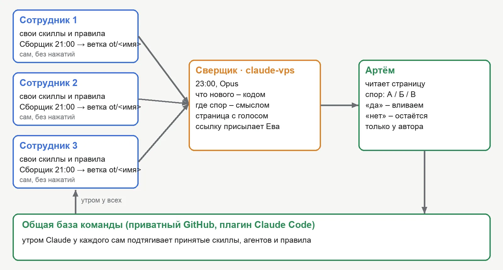

# Общая база знаний команды: как синхронизировать Claude у всех

**Вывод:** один закрытый репозиторий команды, из которого Claude Code у каждого сам подтягивает общие скиллы, агентов и правила. Каждый вечер агент «Сверщик» собирает, что каждый добавил у себя, показывает страницей с голосом, что нового и где правила спорят, и ждёт твоего «да». После «да» утром у всех обновится само.

Предложение. Ничего ещё не строил и никому доступ не давал – жду ответов внизу.

---

## 1. Почему нужен общий репозиторий, а не копии

Сейчас скиллы живут копиями по машинам, и копии расходятся.

- Наш набор `claude-codex-kit` последний раз обновлён 15.10: в нём 69 скиллов. У меня сейчас 94 скилла и 63 агента. За месяц ручная синхронизация отстала на треть.
- У сотрудников свои подписки Claude и свои GitHub – общее место может быть только одно: приватный репозиторий, куда их пригласили.
- В Claude Code для этого есть штатная вещь – **маркетплейс плагинов**. Репозиторий подключается один раз, дальше Claude сам обновляет плагин при запуске. Вручную копировать ничего не нужно.

Что проверил по документации Claude Code (19.11):

- Плагин раздаёт **скиллы, агентов, хуки и MCP**. **Правила (CLAUDE.md) плагин не раздаёт.** Поэтому правила едут отдельно: общий файл правил кладётся в папку `~/.claude/rules/` у каждого – Claude читает её во всех проектах.
- Автообновление чужого маркетплейса **по умолчанию выключено** – включаем одной строкой в настройках при установке (`autoUpdate: true`). Обновление подтягивается в течение 10 минут после начала работы, новое начинает действовать со следующего запуска Claude.
- Для закрытого репозитория у сотрудника должен быть вход в GitHub на компьютере (`gh auth login` один раз) – это делает установщик.
- Общие скиллы зовутся с приставкой: `/deford:site-lead`. Если у человека есть свой скилл с тем же именем, грузятся оба – поэтому при переносе в общий слой свою копию удаляем, иначе Claude будет путаться.

## 2. Два слоя: общее командное и личное у каждого

Просто раздать всё моё нельзя – половина скиллов завязана на тебя.

| Что проверил в моих скиллах и агентах | Сколько |
|---|---|
| Ссылаются на папки моего мака (`/Users/artemgalimov`, `~/Sites/...`) | 42 |
| Ссылаются на наши серверы (claude-vps, Бегет, FirstVDS) | 14 |
| Упоминают тебя по имени | 65 |
| Ключи сервисов внутри файлов | 0 |

Поэтому два слоя:

- **Общий слой (плагин команды):** правила по сайтам, SEO, дизайну, текстам, картинкам; скиллы и агенты, которые работают на любом компьютере. Это и раздаём.
- **Личный слой (остаётся у каждого):** твой голос, Ева, твои серверы и ключи, твой Штаб. У сотрудника – его личные настройки.

У каждого скилла и правила появляется пометка «команда» или «личное». Сверщик не пустит в общий слой скилл с чужими путями или ключом – вернёт с причиной.

## 3. Автоматика в три такта

1. **Сборщик – у каждого сотрудника, 21:00, сам.** Маленький скрипт по расписанию берёт его новые и изменённые скиллы, агентов и правила, прогоняет проверку на ключи и отправляет в его личную ветку общего репозитория (`ot/<имя>`). Сотрудник ничего не нажимает.
2. **Сверщик – на claude-vps, 23:00, Opus.** Забирает все ветки и сравнивает с общей базой:
   - **кодом** – что добавилось, изменилось, удалено; совпадение имён; пересечение слов-триггеров у разных скиллов (Claude будет путать, какой звать); чужие пути и ключи;
   - **смыслом (Opus)** – правила раскладывает по темам и ищет, где одно противоречит другому, где правило уже есть другими словами, где новое сильнее старого.
   - Итог – страница с голосом «что нового за день и где спор» и предложение влить в общую базу. Ссылку присылает Ева.
3. **Раздача – после твоего «да».** Принятое вливается в общую базу. Скиллы и агентов Claude у всех подтягивает сам через плагин, правила кладёт в `~/.claude/rules/` тот же вечерний скрипт сотрудника. Отклонённое остаётся только у автора.

## 4. Споры решает один человек – ты

Если правила спорят, Сверщик не выбирает сам.

- По каждому спору – карточка: правило А (кто, когда, цитата) против правила Б, и варианты «оставить А / оставить Б / объединить так». Ты выбираешь букву.
- Решение записывается в само правило («заменяет такое-то, решено 19.11»), чтобы спор не всплывал каждый вечер.
- Пример, какой спор он поймает: у одного «картинки всегда WebP», у другого «для печати PNG» – это не спор, а два правила с разной областью, Сверщик предложит их уточнить, а не выбирать.

---

## Варианты и цена

Час работы – 1000 ₽ по нашей внутренней ставке. Opus на claude-vps идёт по подписке, отдельных денег за прогоны нет.

| Вариант | Что входит | Сроки | Цена |
|---|---|---|---|
| **А. Полный (советую)** | Репозиторий-плагин, разрез на общее и личное, сборщик у сотрудников, Сверщик со смысловыми спорами, страница с голосом, вливание по «да» | 1,5 дня работы | ~12 000 ₽ |
| Б. Лёгкий | Общий репозиторий + вечерняя страница «что нового и где спор», раздача вручную командой обновления | полдня | ~4 000 ₽ |
| В. Плюс план Claude Team | Поверх А: плагин и общие правила раздаются из настроек организации на claude.ai – сотрудникам не нужен вход в GitHub, отключить общее они не смогут. Сам по себе «что нового и где спор» не покажет – Сверщик нужен всё равно | +полдня | подписка Team за каждое место вместо личных |

## Что может пойти не так и как закрыто

- **Плохое правило одного уйдёт всем** – ничего не вливается без твоего «да».
- **Ключ попадёт в репозиторий** – gitleaks до отправки у сотрудника и ещё раз у Сверщика; ключи раздаются отдельно, через выдачу доступа со сроком.
- **Сотрудник поправит общий скилл у себя, а не в базе** – Сверщик видит расхождение с общей версией и предлагает внести правку в базу.
- **Скилл завязан на мой мак** – перед выносом в общий слой пути меняю на общие, это входит в вариант А.

## Нужно от тебя

1. Список сотрудников: имя, логин GitHub, мак или Windows, работают ли в Codex.
2. Где живёт база: советую GitHub-организацию студии, а не личный `tema-mail` – доступ людям выдаётся и отзывается в один клик.
3. «Газ» на вариант А – начну с разреза моих скиллов на «общее / личное» и пришлю список на проверку.

## Что раскрыть

- Список: какие мои скиллы и агенты уйдут в общий слой, какие останутся личными.
- Как выглядит вечерняя страница Сверщика – макет на примере моих правил.
- Как сотрудник подключается: одна команда и что он увидит.
