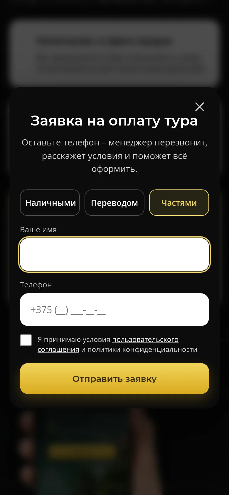
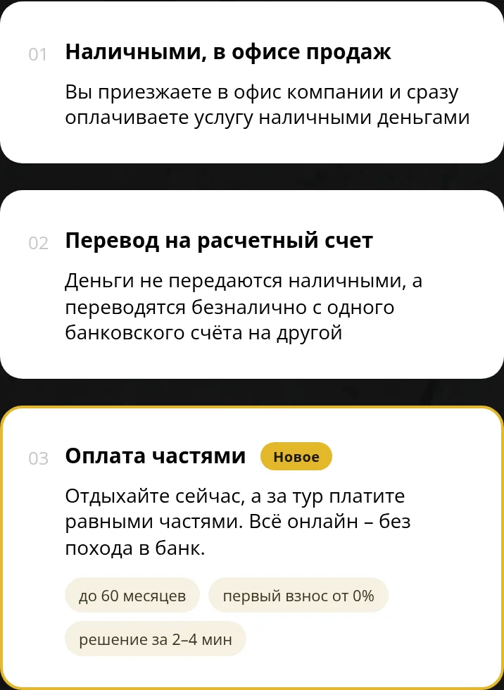
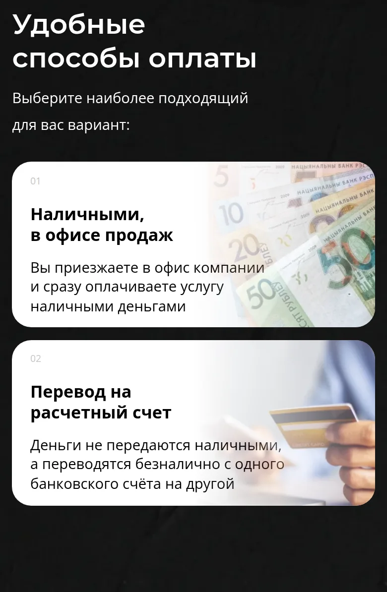
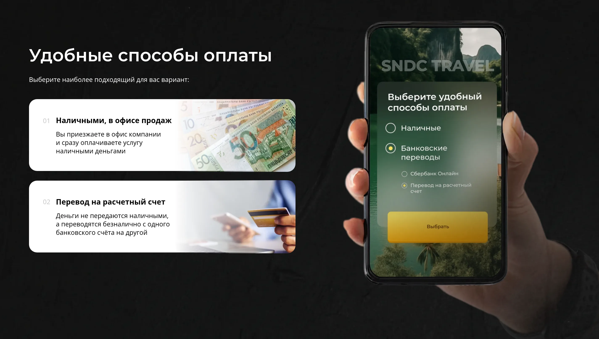
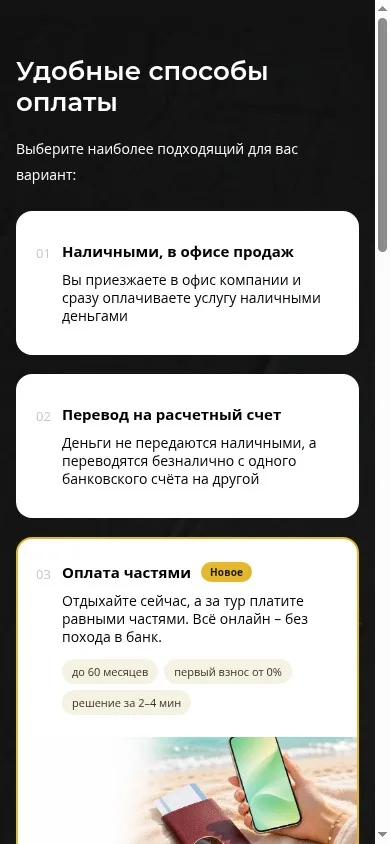

# SNDC Travel: блок оплаты на сайте, кнопки открывают своё окно «Заявка на оплату», мобилка поправлена

**Живой сайт:** [sndc-travel.by/#Payment](https://sndc-travel.by/#Payment) – раздел «Способы оплаты», 19.11.

## 1. Блок на сайте

- Старый Zero-блок оплаты **скрыт, не удалён** – вернуть можно одним кликом в редакторе Тильды. Его копия лежит в проекте.
- На его месте – новый блок Тильды (Vibe-блок) с тем же дизайном, что ты видел: три карточки, рука с телефоном, белый блок «Как оформить оплату частями».
- Шрифты – сайта (Montserrat и Open Sans), картинки – на CDN Тильды, фон – общий фон страницы.
- Пункт меню «Способы оплаты» ведёт сюда же: якорь не трогали.

## 2. Кнопки – своё окно «Заявка на оплату» (20.11)

- Было: «Выбрать» и «Оформить онлайн» открывали общее окно сайта – анкету на подбор тура со «Страной путешествия» и российским +7. К оплате оно не подходило.
- Стало: своё окно внутри блока. Способ оплаты подставляется сам (что выбрано на телефоне в руке, у «Оформить онлайн» – «Частями»), имя, телефон с маской **+375**, пустая галочка согласия со ссылкой на соглашение.
- Заявка уходит туда же, куда со всех форм сайта: Tilda CRM «Заявки travel», два Telegram, почта sndc.clients. В заявке видно поле «Способ оплаты» и «Источник: Блок «Способы оплаты»».
- После отправки в том же окне – «Заявка отправлена».
- У «Выбрать» на телефоне зона нажатия увеличена: сама кнопка в макете мелкая.

## 2а. Мобилка: карточка 03 (20.11)

Фото на «Оплате частями» убрано, как у 01 и 02. Все три карточки одной ширины и радиуса, жёлтая рамка ровная.

## 3. Больше ничего не трогал

Изменены только два блока главной: старый скрыт, новый добавлен сразу за ним. Общее окно сайта «Оставьте заявку» не трогали. Остальные страницы и блоки – без изменений.

## Как блок выглядел до наших правок

Снято 20.11 с копии главной, сохранённой перед выкладкой. Старый блок в Тильде скрыт, не удалён.

## Что проверено

- Живой сайт в браузере на 1440 и 390 px: старого блока нет, новый на месте, горизонтальной прокрутки нет, карточки на телефоне с полями 16 px, все 4 картинки загружены, шрифты сайта.
- 20.11, телефон 390 px (эмуляция iPhone, нажатие пальцем): «Выбрать» и «Оформить онлайн» открывают «Заявку на оплату», способ подставляется, маска +375 работает, пустая форма не уходит – ошибки по-русски, крестик закрывает. Поверх кнопки ничего не лежит на ширинах 360–430.
- **Настоящую заявку не отправлял** – она ушла бы клиенту в CRM и Telegram.
- Код блока в Тильде перед правкой сверен с моим – совпадает.

## Нужно от тебя

1. Глянуть сайт и сказать, если что поправить.
2. Цифры (до 20 000 BYN, 6–60 мес., банки) – из прототипа, подтвердить у клиента.
3. Отправить с телефона одну тестовую заявку из блока и проверить, что она пришла в Telegram и CRM.
4. Заметил, не трогал: в общем окне сайта «Оставьте заявку» (шапка) телефон по умолчанию +7. Поправить на +375 – скажи.

## Что раскрыть

- Как откатить: в Тильде включить старый блок оплаты, скрыть новый, опубликовать.

---

## Как делали дизайн блока (19.11, до выкладки)

**Макет блока:** [открыть отдельно](blok/) – версия до выкладки, на ней Артём смотрел дизайн.

### Что было на сайте – не тронуто

Заголовок, подзаголовок, карточки «Наличными» и «Перевод на расчётный счёт» – те же тексты, шрифты (Montserrat + Open Sans), размеры 533×144, радиус 16, серые номера, оригинальные фото с Тильды и фактура фона страницы.

### Что добавлено по прототипу

- **Карточка 03 «Оплата частями»** – жёлтая рамка, плашка «Новое», три метки: до 60 месяцев, первый взнос от 0%, решение за 2–4 мин. Фото к ней новое, в той же манере, что у 01 и 02: светлый край слева, пляж, паспорт, телефон.
- **Блок «Как оформить оплату частями»** – белая панель: 4 шага, кнопка «Оформить онлайн», телефон +375 29 124-22-11, плитки условий (до 20 000 BYN, 6–60 мес., от 0%, паспорт, всё онлайн через МСИ, 2–4 минуты, без комиссий), банки-партнёры и 3 вопроса раскрывашкой.

### Картинка с телефоном – новая

Старая: мыльная, на экране «Сбербанк Онлайн» – для Беларуси мимо. Новая рука с телефоном сгенерирована через GPT в Codex – бесплатно, по подписке. Интерфейс на экране не нарисован, а свёрстан кодом поверх фото: текст чёткий, варианты «Наличные / Банковские переводы / Оплата частями» нажимаются. На сайте кнопка «Выбрать» открывает окно заявки.

### Что проверено тогда

- Открыто на Pages через браузер на 1440 и 390 px: горизонтальной прокрутки нет, поля 16 px, все 4 картинки грузятся.
- Клик по варианту на экране меняет выбранную карточку и ссылку кнопки – проверено скриптом.
- Картинки в WebP: рука 172 КБ, фото карточки 48 КБ.

- Исходники: ~/Sites/sndc-oplata (оригиналы с сайта, сгенерированные PNG, блок).
