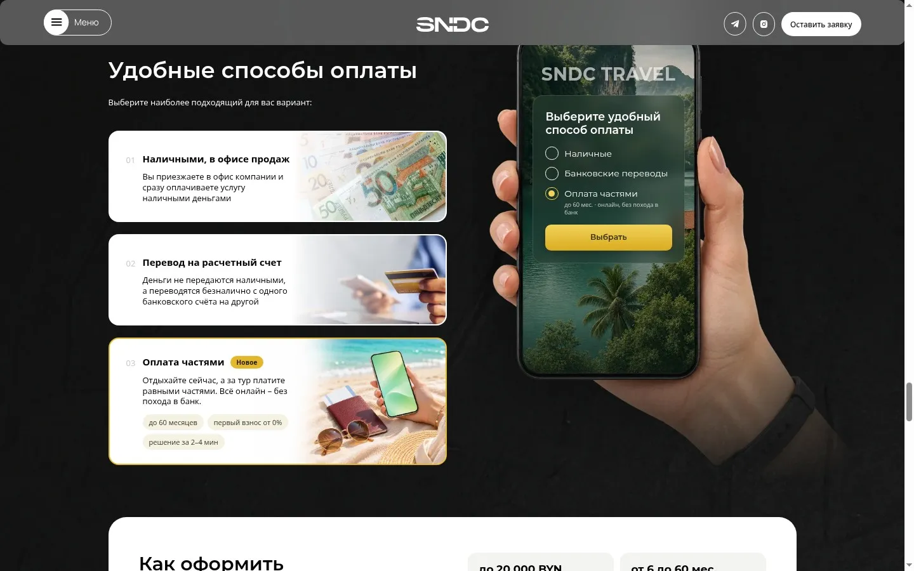
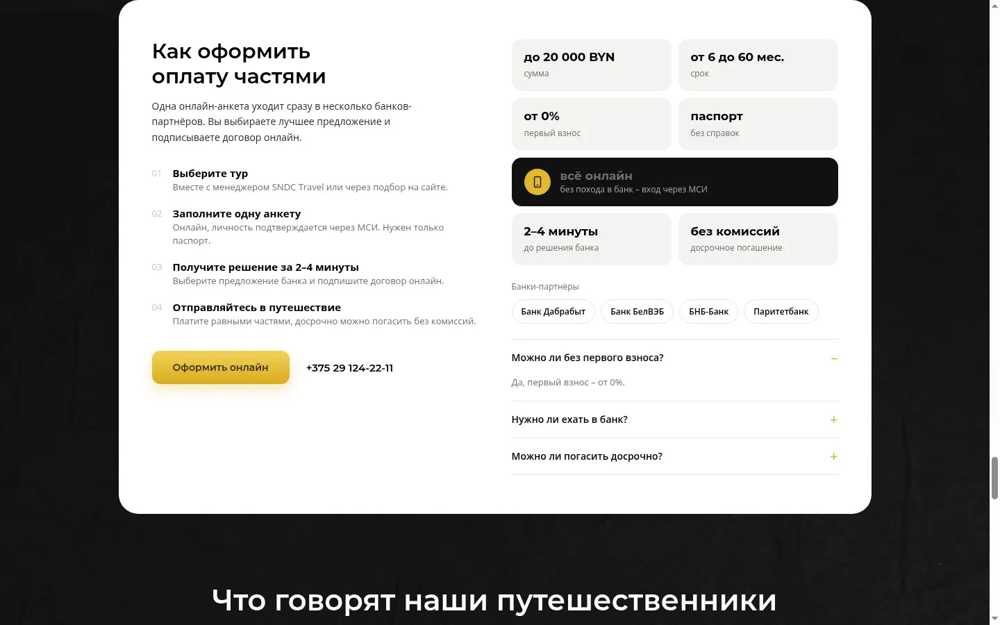
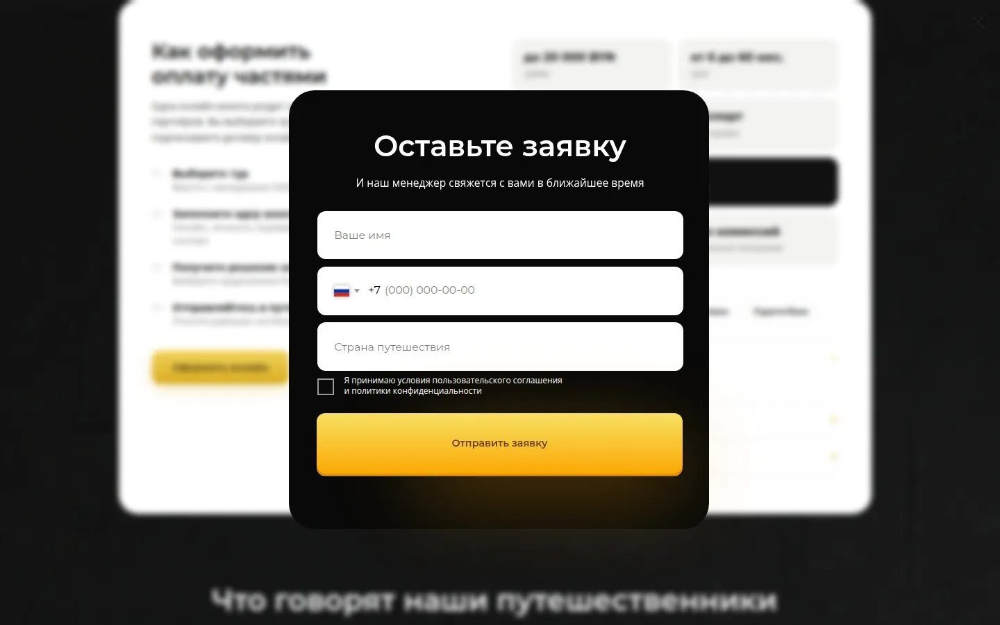
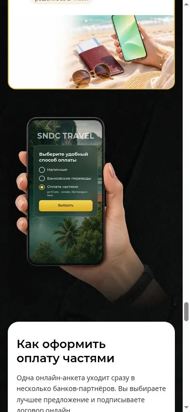
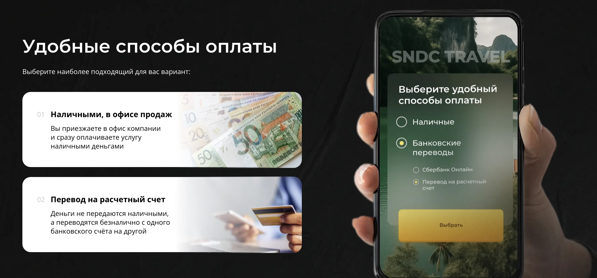

# SNDC Travel: новый блок оплаты стоит на сайте, все кнопки открывают окно заявки

**Живой сайт:** [sndc-travel.by/#Payment](https://sndc-travel.by/#Payment) – раздел «Способы оплаты», 19.11.

## 1. Блок на сайте

- Старый Zero-блок оплаты **скрыт, не удалён** – вернуть можно одним кликом в редакторе Тильды. Его копия лежит в проекте.
- На его месте – новый блок Тильды (Vibe-блок) с тем же дизайном, что ты видел: три карточки, рука с телефоном, белый блок «Как оформить оплату частями».
- Шрифты – сайта (Montserrat и Open Sans), картинки – на CDN Тильды, фон – общий фон страницы.
- Пункт меню «Способы оплаты» ведёт сюда же: якорь не трогали.

## 2. Кнопки – в окно заявки

- «Выбрать» на экране телефона и «Оформить онлайн» открывают **уже существующее на сайте окно «Оставьте заявку»** – то же, что у кнопки «Оставить заявку» в шапке.
- Отдельное окно не делал: готовое уже настроено, заявки из него уходят в Tilda CRM «Заявки travel», два Telegram и почту sndc.clients.
- Телефон в блоке – звонок по номеру +375 29 124-22-11.

## 3. Больше ничего не трогал

Изменены только два блока главной: старый скрыт, новый добавлен сразу за ним. Остальные страницы и блоки – без изменений. Главная опубликована два раза (вторая – правка цвета одной плитки).

## Что проверено

- Живой сайт в браузере на 1440 и 390 px: старого блока нет, новый на месте, горизонтальной прокрутки нет, карточки на телефоне с полями 16 px, все 4 картинки загружены, шрифты сайта.
- Клик по «Оформить онлайн» (1440 px) и по «Выбрать» (390 px) – окно заявки открывается.
- Код блока в Тильде перед правкой сверен с моим – совпадает.

## Нужно от тебя

1. Глянуть сайт и сказать, если что поправить.
2. Цифры (до 20 000 BYN, 6–60 мес., банки) – из прототипа, подтвердить у клиента.
3. Заметил, не трогал: в окне заявки телефон по умолчанию с флагом России и +7, а сайт белорусский. Поправить на +375 – скажи.

## Что раскрыть

- Как откатить: в Тильде включить старый блок оплаты, скрыть новый, опубликовать.
- Отдельное окно заявки «на рассрочку» с пометкой способа оплаты – если менеджерам нужно видеть, откуда заявка.

---

## Как делали дизайн блока (19.11, до выкладки)

**Макет блока:** [открыть отдельно](blok/) – версия до выкладки, на ней Артём смотрел дизайн.

### Что было на сайте – не тронуто

Заголовок, подзаголовок, карточки «Наличными» и «Перевод на расчётный счёт» – те же тексты, шрифты (Montserrat + Open Sans), размеры 533×144, радиус 16, серые номера, оригинальные фото с Тильды и фактура фона страницы.

### Что добавлено по прототипу

- **Карточка 03 «Оплата частями»** – жёлтая рамка, плашка «Новое», три метки: до 60 месяцев, первый взнос от 0%, решение за 2–4 мин. Фото к ней новое, в той же манере, что у 01 и 02: светлый край слева, пляж, паспорт, телефон.
- **Блок «Как оформить оплату частями»** – белая панель: 4 шага, кнопка «Оформить онлайн», телефон +375 29 124-22-11, плитки условий (до 20 000 BYN, 6–60 мес., от 0%, паспорт, всё онлайн через МСИ, 2–4 минуты, без комиссий), банки-партнёры и 3 вопроса раскрывашкой.

### Картинка с телефоном – новая

Старая: мыльная, на экране «Сбербанк Онлайн» – для Беларуси мимо. Новая рука с телефоном сгенерирована через GPT в Codex – бесплатно, по подписке. Интерфейс на экране не нарисован, а свёрстан кодом поверх фото: текст чёткий, варианты «Наличные / Банковские переводы / Оплата частями» нажимаются. На сайте кнопка «Выбрать» открывает окно заявки.

### Что проверено тогда

- Открыто на Pages через браузер на 1440 и 390 px: горизонтальной прокрутки нет, поля 16 px, все 4 картинки грузятся.
- Клик по варианту на экране меняет выбранную карточку и ссылку кнопки – проверено скриптом.
- Картинки в WebP: рука 172 КБ, фото карточки 48 КБ.

- Исходники: ~/Sites/sndc-oplata (оригиналы с сайта, сгенерированные PNG, блок).
