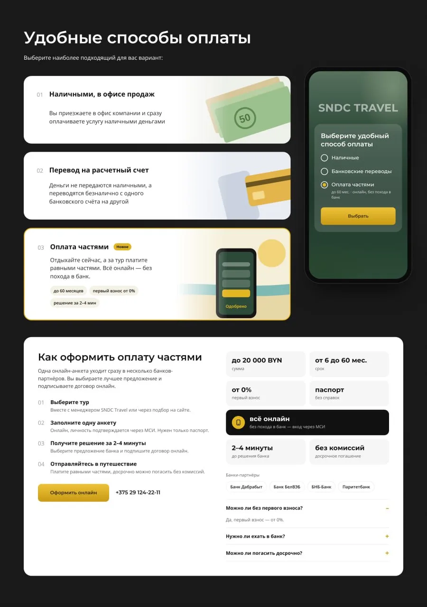
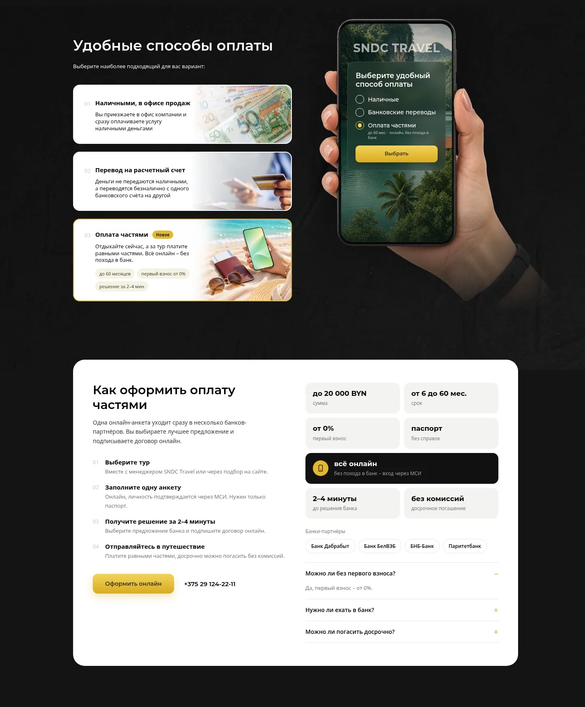

# SNDC Travel: блок оплаты дорисован – две новые части встали в дизайн сайта, картинка с телефоном заменена

**Живой блок:** [открыть отдельно](blok/) – кликается, переключает способы оплаты, адаптив под телефон. На сайте ничего не меняли.

## 1. Что было на сайте – не тронуто

Заголовок, подзаголовок, карточки «Наличными» и «Перевод на расчётный счёт» – те же тексты, шрифты (Montserrat + Open Sans), размеры 533×144, радиус 16, серые номера, оригинальные фото с Тильды и фактура фона страницы.

## 2. Что добавлено по прототипу

- **Карточка 03 «Оплата частями»** – жёлтая рамка, плашка «Новое», три метки: до 60 месяцев, первый взнос от 0%, решение за 2–4 мин. Фото к ней новое, в той же манере, что у 01 и 02: светлый край слева, пляж, паспорт, телефон.
- **Блок «Как оформить оплату частями»** – белая панель: 4 шага, кнопка «Оформить онлайн», телефон +375 29 124-22-11, плитки условий (до 20 000 BYN, 6–60 мес., от 0%, паспорт, всё онлайн через МСИ, 2–4 минуты, без комиссий), банки-партнёры и 3 вопроса раскрывашкой.

## 3. Картинка с телефоном – новая

Старая: мыльная, на экране «Сбербанк Онлайн» – для Беларуси мимо. Новая рука с телефоном сгенерирована через GPT в Codex – бесплатно, по подписке. Интерфейс на экране не нарисован, а свёрстан кодом поверх фото: текст чёткий, варианты «Наличные / Банковские переводы / Оплата частями» нажимаются, кнопка «Выбрать» при «частями» ведёт к блоку оформления.

## Что проверено

- Открыто на Pages через браузер на 1440 и 390 px: горизонтальной прокрутки нет, поля 16 px, все 4 картинки грузятся.
- Клик по варианту на экране меняет выбранную карточку и ссылку кнопки – проверено скриптом.
- Картинки в WebP: рука 172 КБ, фото карточки 48 КБ.

## Нужно от тебя

1. Глянуть и сказать «да» или что поправить.
2. Ссылка кнопки «Оформить онлайн» – сейчас заглушка. Куда ведёт: форма, квиз, страница банка?
3. Цифры (20 000 BYN, 60 мес., банки) взяты из прототипа – подтвердить у клиента до выкладки.

## Что раскрыть

- Перенос в Тильду (Zero-блок) после «да».
- Исходники: ~/Sites/sndc-oplata (оригиналы с сайта, сгенерированные PNG, блок).
