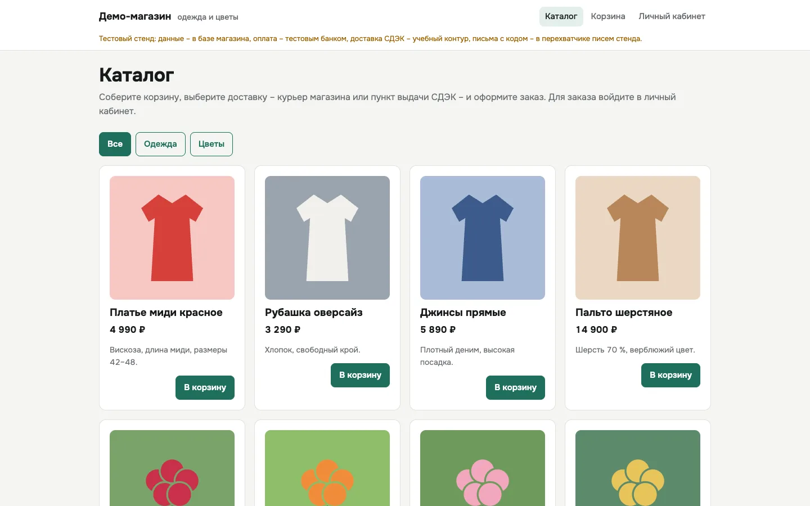
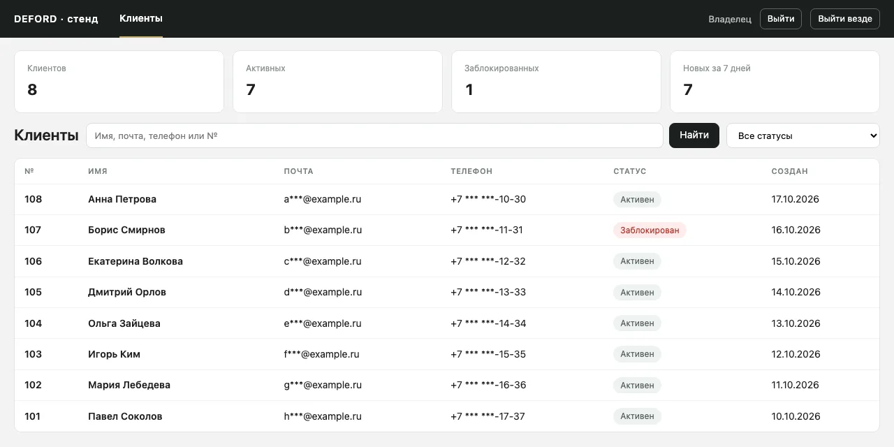
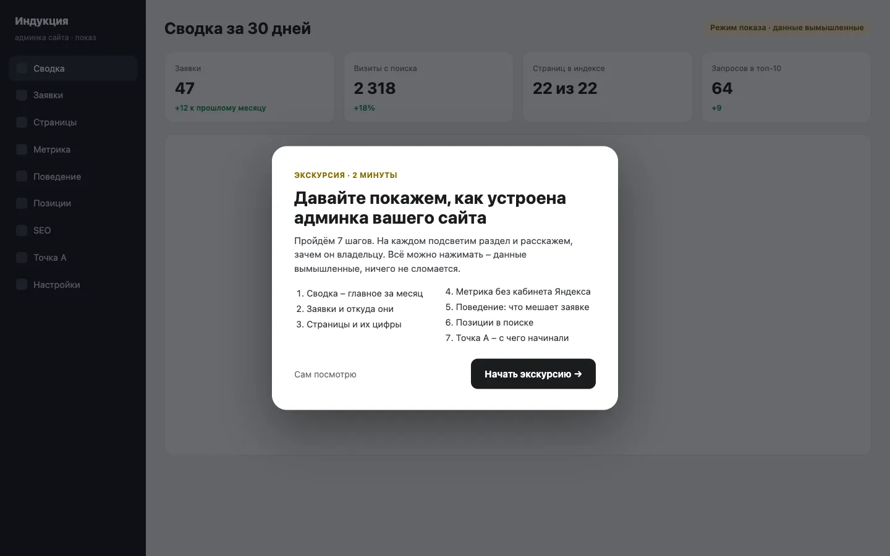
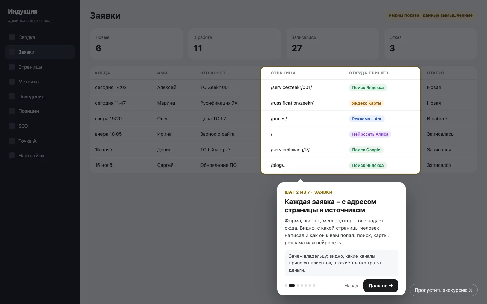
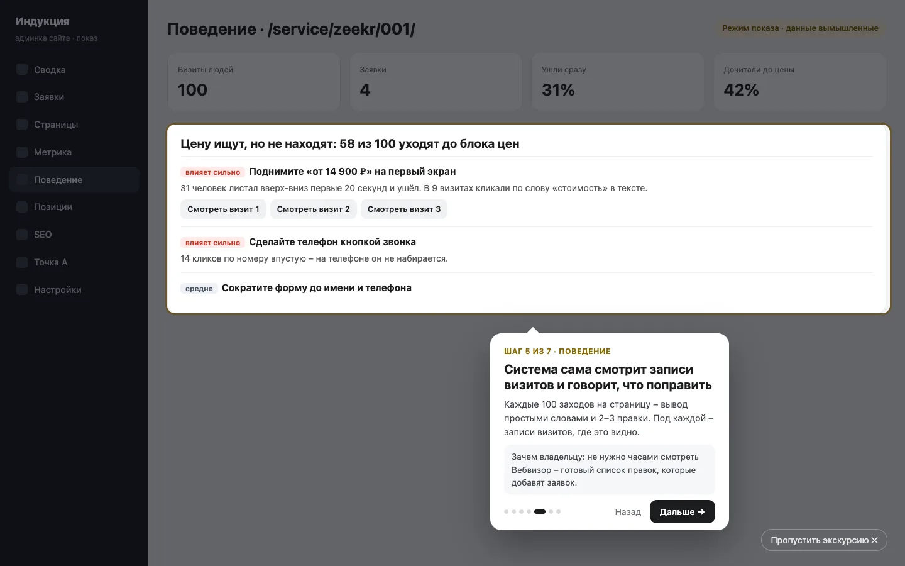
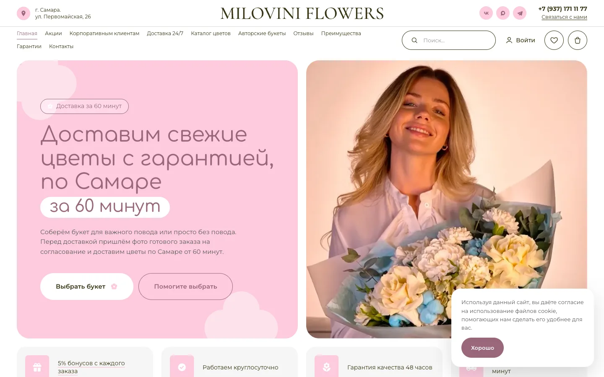
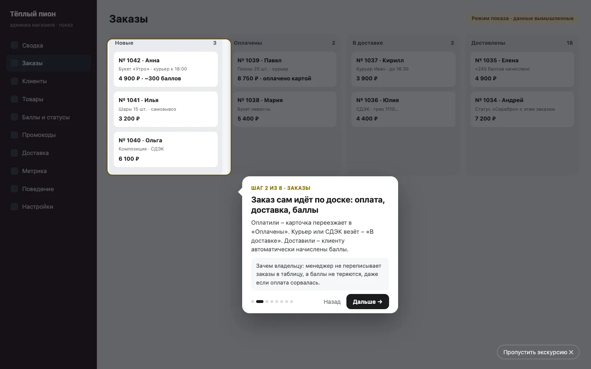
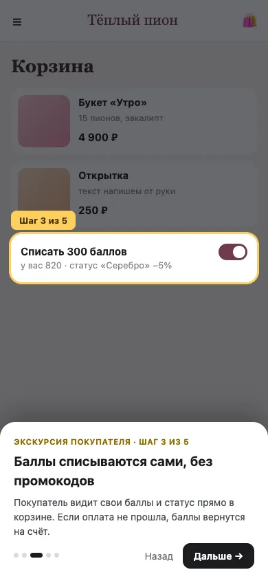

# Стенды: два живых сайта и админки с экскурсией

**Вывод.** Нормальных стендов для показа сейчас нет. Предлагаю сделать заново на stend.deford.ru два живых сайта: техцентр «Индукция» под поиск и магазин цветов «Тёплый пион». В каждой админке будет экскурсия: подсветка раздела и всплывашка «что это и зачем владельцу». Ниже картинки, как это будет выглядеть. Ответь «да» или поправь по номерам, и я начну с общей страницы.

## 1. Что есть сейчас (проверил 17.11): показать клиенту нечего

- **stend.deford.ru и поддомены не заведены**, кода стендов нет. Карту от 15.11 так и не начали верстать.
- **Магазин store.deford.ru работает** (корзина, баллы, СДЭК, вход по коду). Но витрина собрана как черновик: рисованные футболки, одежда вперемешку с цветами.
- **В админке магазина только «Клиенты» и «Заказы»**, а на входе стоит 2FA. Клиент туда сам не зайдёт.
- **Полная админка есть только у EV** (Заявки, Метрика, Поведение, Позиции, SEO, Точка А). Но в ней живые заявки клиентов EV, а их показывать нельзя.

## 2. Что делаю: общая страница, два сайта, экскурсия

### Общая страница stend.deford.ru

С неё начинается показ: три карточки, у каждого сайта две кнопки – «Админка с экскурсией» и «Сайт». Лендинг с рекламой пока висит как «в разработке».

### Сайт техцентра «Индукция»: 22 страницы и админка как у EV

- Сайт строю по карте от 15.11: две марки, ТО и русификация, цены, блог, юридические страницы.
- Админка – та же, что у EV, на вымышленных данных: заявки с источниками, Метрика, позиции, поведение с выводами Лупы, Точка А.
- При первом входе открывается приветствие и экскурсия на 7 шагов. Кнопка «?» запускает её заново.

### Магазин «Тёплый пион»: дизайн Milovini, движок store.deford.ru

- **Внешний вид** беру по нашему шаблону Milovini: живые фото, мягкие цвета, удобно на телефоне. Букеты свои, товары Milovini не берём.
- **Внутри работает по-настоящему:** корзина, баллы и статусы, промокоды, доставка (СДЭК в учебном режиме), кабинет покупателя.
- **В админку добавляю разделы:** сводка, товары, баллы и статусы, промокоды, доставка, Метрика, поведение. Экскурсия по админке – 8 шагов.
- **Для покупателя на телефоне** отдельная короткая экскурсия на 5 шагов: каталог → корзина → баллы → оплата → кабинет.

## 3. Как устроена экскурсия и режим показа

- **Экскурсию пишу сам на Preact** (наш стек островов), без чужой библиотеки. Тексты всех шагов лежат в одном файле, поправить их можно без программиста.
- **Каждый шаг отвечает «зачем владельцу»**, а не «куда нажать». Это рассказ про систему, а не инструкция.
- **Режим показа:** данные вымышленные, нажимать можно всё. Ночью стенд возвращается в исходное состояние, а визиты в «Поведении» обновляются, как в демо Лупы.
- Ту же экскурсию потом можно включить в боевые админки клиентов: она покажет новому владельцу его кабинет.

| Шаг | Что | Время |
|---|---|---|
| 1 | Домен в reg.ru, общая страница stend.deford.ru, общий пароль | 2–3 ч |
| 2 | Экскурсия (Preact) + приветствие, проверка на 1440 и 390 | 4–5 ч |
| 3 | Сайт «Индукция»: 22 страницы, админка-копия EV на вымышленных данных, 7 шагов | 12–16 ч |
| 4 | Фото букетов (≈30, генерация), витрина «Тёплый пион», второй экземпляр движка | 10–14 ч |
| 5 | Новые разделы админки магазина, 8 + 5 шагов экскурсии, приёмка | 8–10 ч |

Итого 36–48 часов, при часе 1000 ₽ это 36–48 тыс. ₽ себестоимости, 4–5 рабочих дней. Каждый шаг – с коммитом и ссылкой.

## Нужно от тебя: «да по рекомендациям» или правка по номеру

1. **Вход для показа.** Рекомендую: общий пароль на весь стенд (одна строка, ты отдаёшь её клиенту), а в админке кнопка «Войти как гость» без 2FA. Второй вариант – вообще без пароля, только закрыть от поисковиков: проще, но открыть сможет любой.
2. **Магазин – отдельный экземпляр** shop.stend.deford.ru на том же движке. store.deford.ru рекомендую оставить программистам для разработки: там проверяют СДЭК и оплату, и показ будет им мешать.
3. **Фото букетов генерирую сам** через Codex на подписке, это 0 ₽. Своих фото у вымышленного бренда нет, поэтому рисуем с нуля. Вариант через Segmind дороже и по качеству для букетов не нужен.
4. **Названия** «Индукция» и «Тёплый пион». Запасные: «Обская тяга» и «Лист и лента».
5. **Ещё по Метрике (вопрос с 15.11).** У Ю-Клуба и Анжелы в Краснодаре та же дыра, что была у EV: защита сайта блокирует часть адресов Метрики, и визиты теряются. Сказать их чатам?

**Что раскрыть:** список шагов экскурсии с текстами, как будут ночью обновляться данные, что из админки EV переносится как есть, а что упрощаю.
