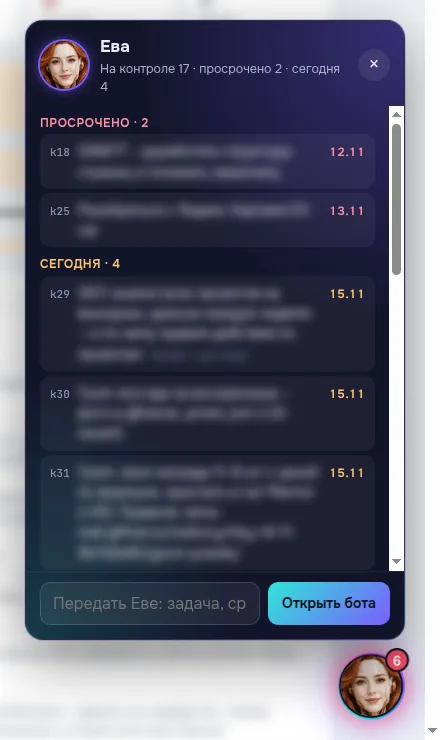

# Светокнопка Евы в Штабе: работает

В Штабе в правом нижнем углу светится кнопка с лицом Евы. Красная цифра на ней – сколько задач горит: просрочено плюс на сегодня, сейчас 6. Нажал – открывается окно Евы в стиле виджетов наставника. В окне видно, что у неё на контроле, а через поле внизу можно передать ей задачу. Открыть: [Штаб](https://tema-mail.github.io/shtab-view/), пароль прежний.

**Нужно от тебя:**
- открыть Штаб и нажать на Еву;
- сказать, что добавить в окно;
- если сменишь аватар Евы в чате Фёдора – заменю лицо на кнопке, это одна картинка.

> Проверено 15.11.2026 в браузере на claude-vps: кнопка, окно, поле «Передать Еве» на ширине 1440 и 390, прокрутки вбок нет. Живой Штаб отдаёт новую версию. Названия задач на скриншотах размыты: эта страница открыта всем, а Штаб закрыт паролем.

## 1. Что видно

- **Кнопка.** Лицо Евы в переливающемся кольце: фиолетовый, бирюзовый, розовый. Кольцо медленно крутится и дышит светом. Когда есть просроченные задачи или задачи на сегодня, свечение уходит в красный, а на кнопке появляется цифра.
- **Окно.** Тёмное, с подсветкой, как виджеты наставника. Сверху Ева и сводка: на контроле 17, просрочено 2, на сегодня 4. Ниже задачи четырьмя группами: «Просрочено» красным, «Сегодня» жёлтым, потом «Дальше» и «Без срока». У каждой задачи номер, как в боте (k25, k31), и срок.

## 2. Как передать задачу Еве

- Пишешь в поле внизу, например: «Позвонить Кириллу про drive2 до вторника».
- Жмёшь «Передать» – открывается бот Евы в Telegram, текст уже стоит в поле ввода. Остаётся нажать «Отправить».
- Текст ещё и копируется. Если Telegram на каком-то устройстве не подставит его сам, просто вставь.
- Пустое поле – кнопка называется «Открыть бота» и просто открывает чат с Евой.

## 3. Откуда задачи и насколько им верить

- **Список** берётся из контроля Евы (`data/kontrol.json` в Штабе).
- **Закрытые задачи** при каждой сборке Штаба сверяются с ботом на сервере. Что ты закрыл кнопкой в Telegram, из окна пропадает. Сегодня так отсеялось 17 закрытых из 34, на контроле осталось 17.
- **Если сервер не ответит**, окно честно напишет «не сверено», а не покажет старьё как правду.
- **Обновление.** Фёдор пересобирает Штаб каждое утро в 09:00. Окно показывает состояние на момент сборки, время сверки написано внизу окна.

## 4. Что ещё сделано по ходу

- **Правило «артефакт – страница с голосом»** записано во все чаты: задача без страницы с голосом не считается сделанной. Секретарь вечером ставит «сделано» задаче Claude только по ссылке, прошедшей проверку.
- **Сборщик страниц с голосом для всех чатов** – `~/.claude/shablony/artefakt.py`: он собрал эту страницу. **Проверка** – `proverka-artefakta.sh <ссылка>`: проверяет, что страница открывается, голос на ней есть и mp3 живой. На странице без голоса она падает: прогнал на странице аватаров Евы – красная, голоса там нет.

**Что раскрыть:** 1 – добавить в окно Евы «что сделано сегодня», 2 – общий редизайн Штаба в том же стиле, 3 – какие страницы-разборы остались без голоса.
