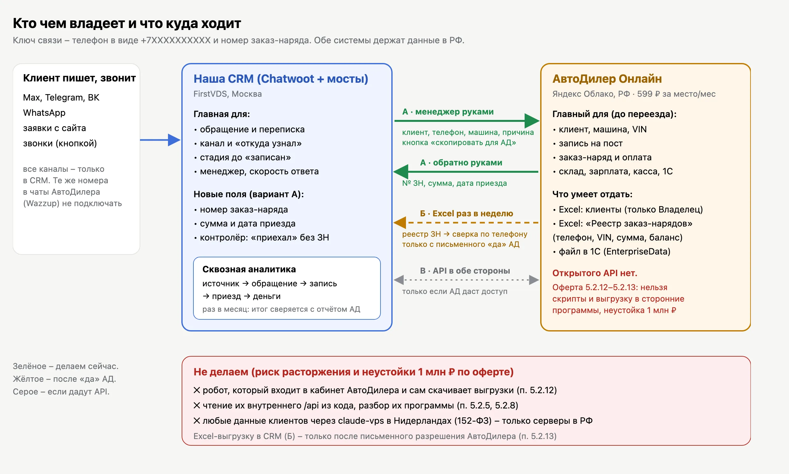

# АвтоДилер: открытого API нет, а оферта запрещает выгружать данные скриптами – начинаем с «моста руками» за ≈ 12 000 ₽, переезд решаем через 2–3 месяца

**Вывод.** У «АвтоДилер Онлайн» нет открытого API, и его оферта прямо запрещает автоматический сбор данных и выгрузку в сторонние программы – с неустойкой 1 млн ₽ и отключением. Поэтому интеграцию начинаем без выгрузки. CRM ведёт клиента до записи. Менеджер переносит в АвтоДилер клиента и машину, а обратно – номер заказ-наряда и сумму. Стоит ≈ 12 000 ₽, 2 дня (оценка). Параллельно ты пишешь в АвтоДилер и просишь API или письменное разрешение на выгрузку: с «да» добавляем сверку по Excel или API. Переписывать АвтоДилер ради экономии на подписке невыгодно: свой учёт ≈ 176–232 тыс. ₽ против ≈ 22 тыс. ₽ подписки в год. Переезд оправдан другим: одна система вместо двух и свои данные вместо чужой оферты. Решаем через 2–3 месяца работы CRM.

Проверено по открытым источникам 18.11.2026: сайт autodealer.ru, справка online/help (180 страниц), оферта autodealer.ru/rules, страница входа online.autodealer.ru. В кабинет не входил, демо не заказывал, никому не писал. Цены и сроки – оценка, час = 1000 ₽, день = 8 часов.

**Нужно от тебя**

- Буквы по 6 вопросам внизу. Совет: 1 – скажи, 2 – скажи, 3А, 4А, 5 – скажи, 6А.
- Отправить в АвтоДилер письмо из раздела 3 от ИП. Сам я им не пишу.
- Кто в АвтоДилере с ролью «Владелец». Выгружать клиентов может только он.

[Открыть схему](shema.html)

## 1. Что это за программа: облако на 599 ₽ за место, все модули в подписке, своя CRM с чатами и телефонией

**Линейка (autodealer.ru, 18.11.2026):**

| Продукт | Что это | Где данные |
|---|---|---|
| **АвтоДилер Онлайн** | облачная программа для СТО, вход online.autodealer.ru, на рынке с ≈ 2020 («5 лет АвтоДилер Онлайн» в истории за 2025) | Яндекс Облако, ЦОД Владимир, Сасово, Калуга – РФ ([справка «Инфраструктура»](https://autodealer.ru/online/help/infrastruktura/informatciia-dlia-podachi-uvedomleniia-v-roskomnadzor.html)) |
| Настольная «Система АвтоДилер» | старая Windows-программа, по базе знаний ещё поддерживается | своя база **Firebird 3.0** на компьютере сервиса ([база знаний](https://autodealer.ru/support/knowledge-base): в загрузках Firebird 3.0, PDF «Соединение с базой данных», «Резервирование») |
| Приложения | «АвтоДилер Онлайн» для сотрудников (iOS, Android, RuStore), «Звонки» (только Android: телефон как АТС), «АвтоМоби» для клиентов | то же облако |

У TEYES, по ТЗ CRM от 21.10, – «АвтоДилер Онлайн», ≈ 598 клиентов. Это нужно подтвердить: вопрос 1.

**Модули** ([autodealer.ru](https://autodealer.ru/), [справка](https://autodealer.ru/online/help/)): заказ-наряд с работами, товарами, платежами и печатью; запись на ремонт по постам и сетке плюс виджет онлайн-записи на сайт; CRM – канбан сделок, воронка, причины отказа; клиенты и машины с VIN и госномером; склад с приходом, остатками, инвентаризацией и проценкой; зарплата по схемам, табель; деньги и банковские выписки; касса (Атол, Штрих-М, Эвотор, СБП); отчёты; права и роли. Есть и то, что вам вряд ли нужно: каталоги запчастей, нормы времени, маркировка, ТехноВектор, ЭДО.

**Цена** ([autodealer.ru/online](https://autodealer.ru/online#rates), 18.11.2026): 599 ₽/мес за одно место, где место = один одновременно работающий пользователь. В таблице 2 995 ₽/мес за 5 мест и 5 990 ₽/мес за 10. Скидка до 30% при оплате за срок. CRM, интеграции, мобильные приложения и выгрузка в 1С входят в подписку. Отдельно платные: каталоги запчастей, нормы времени, автозаполнение по VIN или госномеру. Мессенджеры подключаются через сторонний **Wazzup**, у которого своя оплата за канал: ≈ 1 000–6 000 ₽/мес по обзорам toolfox и startpack, на официальном сайте цены в долларах – не проверено.

**Что важно для нас:** у АвтоДилера уже есть своя «первая линия». Это канбан сделок, чаты WhatsApp, Telegram, ВК и Авито через Wazzup, телефония (Mango, Новофон, МегаФон, Билайн, Телфин, UIS, Zadarma, приложение «Звонки») и справочник «Рекламные кампании» – их «откуда узнал». С нашей CRM это пересекается. Правило: одно окно – Chatwoot. Те же номера в чаты АвтоДилера не подключаем, иначе один клиент окажется в двух окнах.

## 2. Как с ним можно обмениваться: API нет, есть только ручные Excel и файлы, а оферта запрещает выгружать данные в сторонние программы

**Каждый способ – что даёт и откуда известно:**

| Способ | Что можно | Направление | Платно | Статус |
|---|---|---|---|---|
| **Открытый API** | – | – | – | **Нет.** Ни в справке, ни на сайте, ни в обновлениях 2026 года API и вебхуков нет. Каталог crmindex отмечает «API для интеграции», но документации нет – не проверено |
| Внутренний `/api` программы | то, что видит сам интерфейс | – | – | Есть: online.autodealer.ru/api отвечает 401 и требует входа. Это служебный API их веб-интерфейса, без документации. **Не используем:** оферта, п. 5.2.5 и 5.2.8 |
| **Excel: клиенты** | ФИО, контакты (телефон, почта, Telegram), машины, свой идентификатор | из АД и в АД | входит | Проверено по [справке](https://autodealer.ru/online/help/klienty/import-i-eksport-klientskoi-bazy.html): .xlsx до 15 МБ, экспорт **только у роли «Владелец»**, массовое обновление через экспорт и импорт по идентификатору |
| **Excel: отчёт «Реестр заказ-нарядов»** | дата начала и закрытия, номер, клиент, **телефон**, ответственный, состояние (в работе, выполнен, закрыт), марка, модель, год, госномер, **VIN**, сумма ЗН, работ и товаров, скидки, **баланс** (долг или переплата), прибыль | из АД | входит | Проверено по [справке «Отчёты. Сервис»](https://autodealer.ru/online/help/otchety-monitor-i-grafiki/otchety/otchety.-servis.html): любой отчёт выгружается в Excel кнопкой. Только руками, расписания нет |
| Excel: отчёт «Рекламные кампании» | по каждому источнику: клиенты, число документов, сумма, прибыль | из АД | входит | Проверено ([«Отчёты. Другое»](https://autodealer.ru/online/help/otchety-monitor-i-grafiki/otchety/otchety.-drugoe.html)). Поле «Рекламная кампания» в заказ-наряде **обязательное** |
| Excel: импорт работ, номенклатуры, прихода (xlsx, csv, xml) | справочники и приход товара | в АД | входит | Проверено (справка: «Импорт и экспорт работ», «Прихода товаров из CSV/XML») |
| Файл в 1С:Бухгалтерию 3.0 | документы с НДС, формат EnterpriseData 1.20 (1.6 – до 01.01.2027) | из АД в 1С | входит | Проверено ([обновления](https://autodealer.ru/online/updates) 05.02, 29.09, 09.11.2026). Файл, а не онлайн-обмен |
| **Виджет онлайн-записи на сайт** | клиент выбирает дату; заявка падает в их CRM в «Неразобранное» и/или на почту | сайт → АД | входит | Проверено ([справка](https://autodealer.ru/online/help/zapis-na-remont/onlain-zapis-na-remont.html)). Адрес приёма заявок не описан, вклиниваться в него не будем |
| Телефония через оператора | журнал звонков, всплывающая карточка, запись разговора | оператор → АД | у оператора | Проверено: например, Mango шлёт события на `online.autodealer.ru/calls/mango/online`. **Догадка:** если оператор умеет слать события двум получателям, звонки попадут и в нашу CRM без участия АД. Проверить у оператора |
| Wazzup (чаты) | переписка в окне АД | мессенджер → АД | Wazzup отдельно | Проверено ([справка «Чаты»](https://autodealer.ru/online/help/integratcii/chaty/index.html)). Нам не нужен: чаты у нас в Chatwoot |
| Прямой доступ к базе | всё | из базы | – | Только у настольной версии (Firebird, файл на компьютере): технически читается SQL-ом. В облаке доступа к базе нет. Оферта, п. 5.2.13, касается и этого |
| Робот, который входит в кабинет и скачивает | всё, что видно | из АД | – | Технически возможен. **Запрещено** офертой, п. 5.2.12: «автоматизированный сбор информации… скриптами, ботами» |

**Оферта – главное ограничение** ([autodealer.ru/rules](https://autodealer.ru/rules), действующая редакция, прочитана 18.11.2026):

- **5.2.13** – Лицензиат не вправе «экспортировать данные Программы, в том числе загруженные самим Лицензиатом, в сторонние ПО».
- **5.2.12** – не вправе «осуществлять автоматизированный сбор информации и её систематизацию с использованием скриптов, ботов и иных способов».
- **5.2.8** – не вправе «объединять или интегрировать с другим программным… обеспечением, если иное не предусмотрено договором».
- **3.2.7** – Лицензиар вправе «ограничить возможность экспорта информации, в том числе данных Лицензиата».
- **12.6** – нарушение п. 5.2–5.4 – основание для прекращения договора и/или ограничения доступа «с предъявлением… штрафной неустойки в размере 1 000 000 рублей».
- **13.13** – договор меняется в одностороннем порядке без уведомления.
- В редакции от 07.12.2023 ([веб-архив](http://web.archive.org/web/20231207173303/https://autodealer.ru/rules)) пунктов про экспорт, скрипты и 1 млн не было, был только п. 5.2.8. Запреты добавили позже.

Это не юридическое заключение. TEYES – оператор персональных данных своих клиентов по 152-ФЗ, АвтоДилер их только хранит. Как это сочетается с запретом выгружать собственные данные – вопрос юристу. До ответа юриста или письменного «да» АвтоДилера считаем выгрузку в CRM запрещённой.

**Ответ на старый вопрос из ТЗ 21.10 «есть ли телефон в выгрузке»:** да – и в выгрузке клиентов, и в «Реестре заказ-нарядов». Препятствие не техническое, а договорное.

## 3. План интеграции: сейчас мост руками, после «да» АвтоДилера – Excel или API

**Кто главный по каким данным (до переезда):**

| Данные | Главный источник | Почему |
|---|---|---|
| Обращение, переписка, канал, «откуда узнал», стадия до «записан», менеджер | **CRM** | здесь клиент появляется, здесь его ведут |
| Клиент, машина, VIN, запись на пост, заказ-наряд, оплата, склад, зарплата, касса, 1С | **АвтоДилер** | здесь мастера и деньги, ломать работу сервиса не будем |
| Связь между ними | телефон в виде +7XXXXXXXXXX + номер заказ-наряда | телефон есть в обеих системах, номер ЗН однозначен |

**Варианты:**

| | А – мост руками (совет сейчас) | Б – Excel раз в неделю | В – официальный API |
|---|---|---|---|
| Как | При «Записан» CRM даёт кнопку «Скопировать для АвтоДилера» (ФИО, телефон, машина, VIN, причина, рекламная кампания). Менеджер вставляет это в запись АД. При «Приехал/Оплатил» менеджер вносит в CRM номер ЗН и сумму из АД | Владелец раз в неделю выгружает «Реестр заказ-нарядов» в Excel и загружает его на страницу CRM. Мост сопоставляет по телефону, ставит «Приехал/Оплатил» и сумму, показывает расхождения. Файл удаляется сразу после разбора | Если АвтоДилер даст доступ: при «Записан» CRM создаёт клиента и запись в АД, из АД возвращаются статус ЗН и оплата |
| Что ходит | CRM → АД: клиент, машина, причина. АД → CRM: № ЗН, сумма, дата приезда | АД → CRM: телефон, VIN, № ЗН, сумма, баланс, состояние | в обе стороны |
| Частота | каждый клиент, 30–60 секунд работы менеджера | раз в неделю, 5 минут у Владельца | сразу |
| Деньги по источникам | справочник «Рекламные кампании» в АД = наш список «откуда узнал». Их отчёт за месяц сверяем с нашей аналитикой по итогам, без выгрузки людей | автоматически по телефону | автоматически |
| Защита от ошибок | контролёр: «Приехал» без номера ЗН, сумма 0, ЗН повторяется у двух клиентов | расхождения показываются списком | – |
| Условие | никаких | **письменное разрешение АД** (п. 5.2.13). Выгрузка только руками, без робота (п. 5.2.12) | документация и цена API от АД |
| Срок и цена (оценка) | ≈ 12 ч ≈ **12 000 ₽, 2 дня**: поля и кнопка 5 ч, контролёр 3 ч, месячная сверка 3 ч, тесты 1 ч | **+16–20 000 ₽, 2–3 дня** поверх А | **40–60 000 ₽, 1–1,5 недели** после документации; цена доступа у АД неизвестна |

**Риски и как закрываем:**

- **Дубли клиентов.** В АД есть «Объединение дубликатов» (необратимо). В CRM контакт ищется по телефону. Менеджер в АД сначала ищет по телефону, потом создаёт клиента – правило в регламенте.
- **Разные телефоны** (8 и +7, пробелы, второй номер). Мост приводит всё к +7XXXXXXXXXX. Второй номер клиента в АД – «Ассоциировать с клиентом».
- **Ошибка менеджера в сумме.** Раз в месяц сравниваем итог «Оплатил» в CRM с отчётом АД «Рекламные кампании». Расхождение больше 5% – разбор по номерам ЗН.
- **152-ФЗ.** АД – Яндекс Облако в РФ, CRM – FirstVDS в Москве. Excel с клиентами (вариант Б) хранится только на сервере CRM в РФ и удаляется после разбора. Через claude-vps (Нидерланды) и через мак данные клиентов не идут.
- **Оферта.** В варианте А из АД не выгружается ничего, кроме того, что менеджер видит глазами. Б и В – только с письменным «да».

**Письмо в АвтоДилер (отправляешь ты от ИП, через [поддержку](https://autodealer.ru/support)):**

> Здравствуйте. Мы пользуемся АвтоДилер Онлайн (аккаунт <…>). Хотим связать программу с нашей CRM обращений, чтобы видеть, какие обращения дошли до заказ-наряда и оплаты. Подскажите, пожалуйста: 1) есть ли у вас API для партнёров или клиентов и сколько стоит доступ; 2) можно ли с вашего письменного согласия раз в неделю выгружать в Excel отчёт «Реестр заказ-нарядов» и загружать его в нашу CRM – с учётом п. 5.2.12–5.2.13 оферты; 3) в каком порядке мы можем выгрузить всю свою базу клиентов и историю заказ-нарядов, если когда-нибудь перестанем пользоваться программой. Спасибо.

## 4. Переезд: переписать стоит 5 частей, кассу и 1С лучше не трогать; ≈ 176–232 тыс. ₽ и 2,5 месяца с параллельной работой

**Зачем переезжать, если подписка ≈ 22 тыс. ₽ в год.** Оценка: 3 места × 599 ₽ × 12. Окупить свой учёт за 176–232 тыс. ₽ экономией на подписке не получится – это 8–10 лет. Переезд оправдывают три вещи. Одна система вместо двух. Деньги в аналитике без ручного переноса. Свои данные вместо оферты, по которой их нельзя выгрузить и которую меняют без уведомления. Если АД даст API, переезд, возможно, не нужен вообще.

**Что переписывать, по порядку** – для сервиса типа TEYES: установка магнитол и сигнализаций, русификация, без кузовного и запчастей:

| # | Часть | Что внутри | Часы (оценка) |
|---|---|---|---|
| 1 | Клиенты и машины | карточка с телефонами, машины (марка, модель, год, VIN, госномер), история | 24 |
| 2 | Запись на посты | сетка постов и мастеров, запись из CRM в один клик, напоминание клиенту | 32 |
| 3 | Заказ-наряд | работы и товары из прайса, статусы, мастер, печать ЗН и акта, гарантия | 56 |
| 4 | Оплаты и деньги | оплата наличными, картой, по СБП, долг и переплата, отчёт денег | 24 |
| 5 | Склад (если ведёте) | приход магнитол, рамок и проводки, списание в ЗН, остатки, инвентаризация | 40 |
| 6 | Зарплата мастеров (если считаете в АД) | процент от работ, отчёт за месяц | 16 |
| 7 | Перенос данных | клиенты, машины, история ЗН из Excel-выгрузок | 16 |
| 8 | Роли, тесты, обучение, сопровождение параллельной работы | | 24 |
| | **Итого** | без склада и зарплаты – 176 ч ≈ **176 000 ₽**; всё – 232 ч ≈ **232 000 ₽** | ≈ 22–29 рабочих дней |

**Что не переписываем:**

- **Касса и чеки (54-ФЗ).** Если сейчас чек пробивает АД через свой кассовый модуль, после переезда касса работает сама по себе или через облачную кассу с API. Отдельная задача ≈ 16–24 ч (оценка) – риск выше всего, поэтому последней.
- **1С.** Бухгалтеру – реестр документов в Excel. Свой файл EnterpriseData – только если бухгалтер без него не может, ≈ 24 ч.
- Каталоги запчастей, нормы времени, проценка, маркировка, ЭДО, ТехноВектор – не нужны.

**Перенос данных.** Клиенты и машины – встроенный экспорт клиентов (xlsx, роль «Владелец»). История – «Реестр заказ-нарядов» и отчёт «Выполненные работы» (номер ЗН, госномер, марка, работа, сумма) за всё время. Условие до старта – письменный порядок выгрузки от АД (вопрос 3 в письме) и слово юриста: п. 5.2.13 буквально запрещает и это.

**Параллельная работа и когда выключать АвтоДилер:**

1. Пилот 2 недели: один мастер или пост в новой системе, остальные в АД.
2. Все новые заказ-наряды – в новой системе. АД остаётся для истории и кассы, оплаты 2 недели вносятся в обе системы для сверки.
3. Выключаем АД, когда выполнено всё:
   - 4 недели подряд все ЗН ведутся только в новой системе;
   - сумма оплат за неделю сходится с кассой (ОФД) до рубля;
   - остатки склада сходятся после инвентаризации;
   - зарплата мастеров за месяц посчитана новой системой, мастера согласны;
   - полная выгрузка АД (клиенты, ЗН, работы) лежит в архиве на сервере в РФ;
   - бухгалтер получил всё нужное для 1С.

**Сроки (оценка):** разработка ≈ 5–6 недель, пилот и параллельная работа ≈ 4 недели, всего ≈ 2,5 месяца. Старт – после 2–3 месяцев живой CRM и ответа АвтоДилера.

## 5. Вопросы: версия, роли, письмо, модули, что делаем сейчас

1. **Какая у вас версия?** А – АвтоДилер Онлайн: вход через браузер на online.autodealer.ru. Б – настольная: программа на Windows, база на компьютере. В – не знаю: пришли скрин экрана входа. Всё – 0 ₽. От этого зависит, возможен ли доступ к базе.
2. **Сколько мест и кто «Владелец»?** Назови число одновременно работающих (1, 3, 5) и того, у кого роль «Владелец»: А – ты, Б – управляющий или администратор (кто), В – не знаю. 0 ₽.
3. **Пишем в АвтоДилер?** А – да, ты отправляешь письмо из раздела 3 (0 ₽, текст готов). Б – нет, остаёмся на мосте руками. В – не пишем и сразу готовим переезд. Совет – А: ответ решит и интеграцию, и выгрузку при уходе.
4. **Интеграция сейчас.** А – мост руками (≈ 12 000 ₽, 2 дня). Б – мост плюс Excel-сверка, только после «да» АД (≈ 28–32 000 ₽, 4–5 дней). В – ждём ответа АД и ничего не делаем (0 ₽, деньги в аналитике менеджер вводит при «Оплатил», как решено 17.11). Совет – А.
5. **Какие модули АД у вас живые?** А – клиенты, запись, заказ-наряды с оплатой (переезд ≈ 176 000 ₽). Б – плюс склад и зарплата (≈ 232 000 ₽). В – плюс касса с чеками через АД, их CRM и чаты Wazzup, телефония (≈ 232 000 ₽ + касса 16–24 000 ₽). Скажи, что из этого реально пользуют.
6. **Переезд.** А – решаем через 2–3 месяца работы CRM и после ответа АД (0 ₽ сейчас). Б – проектируем сейчас: карта экранов и данных ≈ 16 000 ₽, 2 дня. В – не переезжаем: АД остаётся для ЗН, склада и кассы, CRM – для обращений. Совет – А.

**Что раскрыть:** 1 – оферта и что юристу спросить; 2 – как выглядит кнопка «Скопировать для АвтоДилера» и контролёр; 3 – переезд по экранам (заказ-наряд, сетка постов); 4 – звонки в обе системы через оператора.

Источники (все открыты 18.11.2026): [autodealer.ru](https://autodealer.ru/) · [тарифы](https://autodealer.ru/online#rates) · [CRM](https://autodealer.ru/online/crm) · [справка](https://autodealer.ru/online/help/) · [обновления](https://autodealer.ru/online/updates) · [оферта](https://autodealer.ru/rules) · [оферта в 2023](http://web.archive.org/web/20231207173303/https://autodealer.ru/rules) · [база знаний настольной версии](https://autodealer.ru/support/knowledge-base) · [crmindex](https://crmindex.ru/products/autodealer) · Wazzup: [toolfox](https://toolfox.ru/services/s/wazzup), [startpack](https://startpack.ru/application/wazzup).
